# Hướng dẫn sử dụng hệ thống quản trị Trạm Dừng Cảm Xúc

> **Dành cho Hana Lương** · Phiên bản 2 (18/10/2026 – trước buổi thử CMS CM-07; đối chiếu từng bước trên bản chạy thử có dữ liệu MẪU)
> Tài liệu hướng dẫn thao tác toàn diện trên hệ thống quản trị website: tạo và quản lý sản phẩm, thu thập lead, chăm sóc khách hàng, quản trị trang pháp lý, cài đặt thanh toán ngân hàng và tự tay dựng trang bằng công cụ kéo thả trực quan mà không cần biết lập trình.

---

## Mục lục

1. [Đăng nhập và Bảo mật tài khoản](#1-đăng-nhập-và-bảo-mật-tài-khoản)
   - [1.3b. Trang chủ admin – Dashboard "Hôm nay"](#13b-trang-chủ-admin--dashboard-hôm-nay)
   - [1.4. Cấu trúc menu bên trái theo công việc của Hana](#14-cấu-trúc-menu-bên-trái-theo-công-việc-của-hana)
   - [1.4b. Tên các nút trên form và nút Xem trước (con mắt)](#14b-tên-các-nút-trên-form-và-nút-xem-trước-con-mắt)
   - [1.5. Khách hàng đăng nhập thế nào](#15-khách-hàng-đăng-nhập-thế-nào)
   - [1.5b. Quyền tự quản lý nhận email nhắc của khách hàng (Nghị định 13/2023)](#15b-quyền-tự-quản-lý-nhận-email-nhắc-của-khách-hàng-nghị-định-132023)
   - [1.6. Khách hàng tự xem đơn hàng và link thanh toán tại /tai-khoan](#16-khách-hàng-tự-xem-đơn-hàng-và-link-thanh-toán-tại-tai-khoan)
   - [1.7. Khách hàng yêu cầu xóa tài khoản & Hana xóa dữ liệu khách](#17-khách-hàng-yêu-cầu-xóa-tài-khoản--hana-xóa-dữ-liệu-khách)
2. [Nhận biết và Làm việc với dữ liệu mẫu](#2-nhận-biết-và-làm-việc-với-dữ-liệu-mẫu)
3. [Quản lý Sản phẩm, Giá bán và Tài nguyên](#3-quản-lý-sản-phẩm-giá-bán-và-tài-nguyên)
   - [3.1. Tạo và chỉnh sửa sản phẩm: Giao diện 6 tab theo loại](#31-tạo-và-chỉnh-sửa-sản-phẩm-giao-diện-6-tab-theo-loại)
   - [3.1b. Tạo sản phẩm bằng trình hướng dẫn (5 bước)](#31b-tạo-sản-phẩm-bằng-trình-hướng-dẫn-5-bước)
   - [3.1c. Đổi tên gói, tagline và tên sản phẩm số](#31c-đổi-tên-gói-tagline-và-tên-sản-phẩm-số-clear--build--shine-habit-hack-eq-buddy)
   - [3.7. Xem trước trước khi xuất bản (Live Preview)](#37-xem-trước-trước-khi-xuất-bản-live-preview)
   - [3.8. Quản lý Lịch workshop và quyền tham gia (Workshops)](#38-quản-lý-lịch-workshop-và-quyền-tham-gia-workshops)
     - [3.8b. Lên lịch workshop bằng Trình hướng dẫn (3 bước)](#38b-lên-lịch-workshop-bằng-trình-hướng-dẫn-3-bước)
   - [3.9. Chương trình dùng thử 21 ngày cho công cụ số](#39-chương-trình-dùng-thử-21-ngày-cho-công-cụ-số)
   - [3.10. Quản lý Bài học và Video khóa học (Habit Hack)](#310-quản-lý-bài-học-và-video-khóa-học-habit-hack)
     - [3.10.1. Cách nhập video Bunny Stream cho bài học](#3101-cách-nhập-video-bunny-stream-cho-bài-học)
     - [3.10.2. Thêm bài học bằng Trình hướng dẫn (4 bước)](#3102-thêm-bài-học-bằng-trình-hướng-dẫn-4-bước)
   - [3.11. Habit Hack – Hành trình 28 ngày: 6 bước thiết kế & Tracker đồng hành](#311-habit-hack--hành-trình-28-ngày-6-bước-thiết-kế--tracker-đồng-hành)
     - [3.11.1. Sáu bước thiết kế vòng lặp thói quen (/habit/5-phut)](#3111-sáu-bước-thiết-kế-vòng-lặp-thói-quen-habit5-phut)
     - [3.11.2. Màn hình Tracker theo dõi 28 ngày (/habit/tracker)](#3112-màn-hình-tracker-theo-dõi-28-ngày-habittracker)
     - [3.11.3. Theo dõi Kế hoạch trong trang quản trị (habitPlans)](#3113-theo-dõi-kế-hoạch-trong-trang-quản-trị-habitplans)
     - [3.11.4. Quản trị câu chữ giao diện Habit Journey & Script nạp DP-01d](#3114-quản-trị-câu-chữ-giao-diện-habit-journey--script-nạp-dp-01d)
   - [3.12. Quản lý và Thu hồi Chứng nhận (Certificates)](#312-quản-lý-và-thu-hồi-chứng-nhận-certificates)
   - [3.13. Quản lý 26 thẻ EQ Buddy](#313-quản-lý-26-thẻ-eq-buddy)
     - [3.13b. Sửa câu chuyện của một thẻ và xem trước](#313b-sửa-câu-chuyện-của-một-thẻ-và-xem-trước)
   - [3.14. In QR cho bộ thẻ EQ Buddy (EqCards)](#314-in-qr-cho-bộ-thẻ-eq-buddy-eqcards)
   - [3.15. Ảnh chia sẻ thẻ EQ Buddy và Liên kết Shopee bộ thẻ vật lý](#315-ảnh-chia-sẻ-thẻ-eq-buddy-và-liên-kết-shopee-bộ-thẻ-vật-lý)
   - [3.16. Trang giới thiệu bộ thẻ và Kích hoạt dùng thử EQ Buddy số](#316-trang-giới-thiệu-bộ-thẻ-và-kích-hoạt-dùng-thử-eq-buddy-số)
   - [3.17. Quản lý Thẻ đã lưu và Bảo mật suy ngẫm của khách hàng (SavedCards)](#317-quản-lý-thẻ-đã-lưu-và-bảo-mật-suy-ngẫm-của-khách-hàng-savedcards)
4. [Quản lý Lời chia sẻ của khách hàng (Testimonials)](#4-quản-lý-lời-chia-sẻ-của-khách-hàng-testimonials)
   - [4.1. Thêm một lời chia sẻ mới](#41-thêm-một-lời-chia-sẻ-mới)
   - [4.2. Quy tắc bắt buộc: Đồng ý hiển thị (Consent)](#42-quy-tắc-bắt-buộc-đồng-ý-hiển-thị-consent)
   - [4.3. Câu chuyện "Trước / Sau" của khách hàng](#43-câu-chuyện-trước--sau-của-khách-hàng)
   - [4.4. Câu hỏi thường gặp (FAQ) dùng chung](#44-câu-hỏi-thường-gặp-faq-dùng-chung)
   - [4.5. Đội ngũ chuyên gia](#45-đội-ngũ-chuyên-gia)
5. [Dựng trang trực quan bằng công cụ kéo thả (Puck Editor)](#5-dựng-trang-trực-quan-bằng-công-cụ-kéo-thả-puck-editor)
   - [5.9. Các khối mới (Sitemap v2)](#59-các-khối-mới-sitemap-v2)
   - [5.10. Các khối mới – đợt B (Sitemap v2: Về Trạm + Coach 1:1)](#510-các-khối-mới--đợt-b-sitemap-v2-về-trạm--coach-11)
   - [5.11. Trang Tài nguyên (Sitemap v2)](#511-trang-tài-nguyên-sitemap-v2)
   - [5.12. Trang Liên hệ & Câu hỏi thường gặp (Sitemap v2)](#512-trang-liên-hệ--câu-hỏi-thường-gặp-sitemap-v2)
   - [5.13. Mẫu trang Sitemap v2 & bản nháp](#513-mẫu-trang-sitemap-v2--bản-nháp)
   - [5.14. Trang Cộng đồng & Doanh nghiệp (Sitemap v2)](#514-trang-cộng-đồng--doanh-nghiệp-sitemap-v2)
   - [5.15. Quản lý Thẻ con trong Lưới Thẻ Biểu Tượng / Đánh Số (IconCardGrid)](#515-quản-lý-thẻ-con-trong-lưới-thẻ-biểu-tượng--đánh-số-iconcardgrid)
   - [5.16. Quản lý Ô số liệu trong Thanh Số Liệu (StatsBar)](#516-quản-lý-ô-số-liệu-trong-thanh-số-liệu-statsbar)
   - [5.17. Quản lý Bước hành trình trong Hành Trình Các Bước (JourneySteps)](#517-quản-lý-bước-hành-trình-trong-hành-trình-các-bước-journeysteps)
   - [5.18. Quản lý Thẻ dịch vụ trong Các Thẻ Dịch Vụ Coaching (ServiceCards)](#518-quản-lý-thẻ-dịch-vụ-trong-các-thẻ-dịch-vụ-coaching-servicecards)
   - [5.19. Quản lý Thẻ gói trong Khối Các Gói Growth Mirror (PackageCards)](#519-quản-lý-thẻ-gói-trong-khối-các-gói-growth-mirror-packagecards)
   - [5.20. Quản lý Câu hỏi thường gặp trong Khối FAQ (FaqItem)](#520-quản-lý-câu-hỏi-thường-gặp-trong-khối-faq-faqitem)
   - [5.21. Khối Cột (Columns) hỗ trợ đa dạng khối con](#521-khối-cột-columns-hỗ-trợ-đa-dạng-khối-con)
   - [5.22. Cơ chế tự động sửa màu lệch nền (Child Color Fallback)](#522-cơ-chế-tự-động-sửa-màu-lệch-nền-child-color-fallback)
   - [5.23. Section tự do: kéo thả từng phần tử](#523-section-tự-do-kéo-thả-từng-phần-tử)
   - [5.24. Chỉnh kiểu từng khối: tab Nội dung / Kiểu / Nâng cao (EB-04)](#524-chỉnh-kiểu-từng-khối-tab-nội-dung--kiểu--nâng-cao-eb-04)
   - [5.25. Khung chứa linh hoạt (Container): hộp flexbox lồng nhau kiểu Elementor (EB-05)](#525-khung-chứa-linh-hoạt-container-hộp-flexbox-lồng-nhau-kiểu-elementor-eb-05)
   - [5.26. Widget cơ bản & tương tác: Tiêu đề, Văn bản, Ảnh, Nút, Icon, Tabs, Accordion, Bộ đếm (EB-06)](#526-widget-cơ-bản--tương-tác-tiêu-đề-văn-bản-ảnh-nút-icon-tabs-accordion-bộ-đếm-eb-06)
   - [5.27. Cấu trúc và menu chuột phải (EB-07)](#527-cấu-trúc-và-menu-chuột-phải-eb-07)
   - [5.28. Mẫu đã lưu và Lịch sử phiên bản (EB-08)](#528-mẫu-đã-lưu-và-lịch-sử-phiên-bản-eb-08)
   - [5.29. Tự chỉnh khoảng cách tiêu đề và giãn dòng Anton (PK-13)](#529-tự-chỉnh-khoảng-cách-tiêu-đề-và-giãn-dòng-anton-pk-13)
   - [5.30. Nâng cao: CSS / HTML tuỳ chỉnh và hiệu ứng (EB-09)](#530-nâng-cao-css--html-tuỳ-chỉnh-và-hiệu-ứng-eb-09)
   - [5.31. Thêm thẻ vào khối (gói, dịch vụ, số liệu, bước, câu hỏi…) bằng một nút bấm (PK-14)](#531-thêm-thẻ-vào-khối-gói-dịch-vụ-số-liệu-bước-câu-hỏi-bằng-một-nút-bấm-pk-14)
   - [5.32. Đầu trang và chân trang dựng bằng trình soạn thảo (EB-10)](#532-đầu-trang-và-chân-trang-dựng-bằng-trình-soạn-thảo-eb-10)
   - [5.33. Thanh thao tác nhanh và phím tắt (EB-13a)](#533-thanh-thao-tác-nhanh-và-phím-tắt-eb-13a)
   - [5.34. Bấm để chèn khối (EB-13b)](#534-bấm-để-chèn-khối-eb-13b)
   - [5.35. Hero ảnh nền (EB-14a)](#535-hero-ảnh-nền-eb-14a)
   - [5.36. Khối bị khoá và cách mở khoá (EB-14b)](#536-khối-bị-khoá-và-cách-mở-khoá)
   - [5.37. Đổi màu, cỡ chữ từng dòng chữ (EB-15a)](#537-đổi-màu-cỡ-chữ-từng-dòng-chữ)
   - [5.38. Căn lề thẻ và icon (EB-15b)](#538-căn-lề-thẻ-và-icon)
6. [Quản lý Trang pháp lý và Thông tin người bán](#6-quản-lý-trang-pháp-lý-và-thông-tin-người-bán)
7. [Cài đặt Website, Kênh liên hệ và Thanh toán](#7-cài-đặt-website-kênh-liên-hệ-và-thanh-toán)
   - [7.5. Xác nhận chuyển khoản đơn hàng](#75-xác-nhận-chuyển-khoản-đơn-hàng)
8. [Quản lý Khách tiềm năng (Leads) và Xuất file CSV](#8-quản-lý-khách-tiềm-năng-leads-và-xuất-file-csv)
9. [Quản lý Câu hỏi Quiz chẩn đoán thói quen](#9-quản-lý-câu-hỏi-quiz-chẩn-đoán-thói-quen)
10. [Xử lý sự cố và Nhận biết thông báo lỗi thường gặp](#10-xử-lý-sự-cố-và-nhận-biết-thông-báo-lỗi-thường-gặp)
11. [Bài kiểm tra cổng Giai đoạn 1 (Checklist dành cho Hana)](#11-bài-kiểm-tra-cổng-giai-đoạn-1-checklist-dành-cho-hana)
    - [11b. Checklist cổng Sitemap v2 (dành cho Hana)](#11b-checklist-cổng-sitemap-v2-dành-cho-hana)
12. [Danh sách việc cần Hana cung cấp (Nội dung & Tài sản)](#12-danh-sách-việc-cần-hana-cung-cấp-nội-dung--tài-sản)
13. [Danh sách ảnh chụp màn hình hướng dẫn](#13-danh-sách-ảnh-chụp-màn-hình-hướng-dẫn)

---

## 1. Đăng nhập và Bảo mật tài khoản

### 1.1. Đăng nhập vào trang quản trị

**Mục đích**: Truy cập vào hệ thống làm việc trung tâm để quản lý toàn bộ nội dung, khách hàng và sản phẩm của Trạm Dừng Cảm Xúc.

**Các bước thực hiện**:

1. Mở trình duyệt web (Google Chrome, Safari hoặc Microsoft Edge) trên máy tính.
2. Nhập địa chỉ: `<ĐỊA CHỈ DEMO>/admin` (ví dụ trên môi trường thật: `https://tramdungcamxuc.com/admin`).
3. Nhập **Email** và **Mật khẩu** của tài khoản quản trị.
4. Bấm nút **Đăng nhập**.

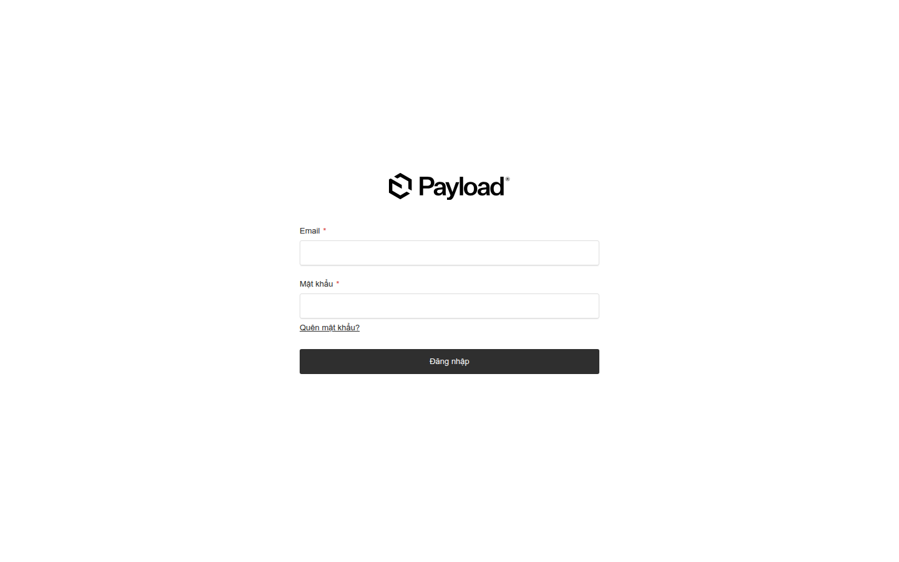
<!-- ẢNH 01: trang <ĐỊA CHỈ DEMO>/admin/login, giao diện đăng nhập với ô Email, Mật khẩu và nút Đăng nhập -->

> **Nếu gặp lỗi**: Kiểm tra xem bàn phím có đang bật phím viết hoa (`Caps Lock`) hoặc bộ gõ tiếng Việt làm sai mật khẩu không. Nếu báo sai thông tin đăng nhập quá nhiều lần, hãy đợi 1 phút rồi thử lại.

---

### 1.2. Đổi mật khẩu cá nhân

**Mục đích**: Thiết lập mật khẩu riêng an toàn sau khi nhận tài khoản hoặc cập nhật mật khẩu định kỳ.

**Các bước thực hiện**:

1. Ở cột menu bên trái, tìm nhóm **Hệ thống**, bấm vào mục **Quản trị viên**.
2. Bấm vào dòng chứa tài khoản email của Hana trong danh sách để mở trang hồ sơ.
3. Cuộn xuống khu vực thông tin mật khẩu, bấm vào nút **Đổi mật khẩu**.
4. Lúc này màn hình sẽ mở ra 2 ô mới:
   - Ô **Mật khẩu mới**: Nhập mật khẩu bí mật bạn muốn đặt (nên gồm ít nhất 8 ký tự, có chữ và số).
   - Ô **Xác nhận mật khẩu**: Gõ lại chính xác mật khẩu mới vừa nhập ở ô trên.
5. Bấm nút **Lưu** ở góc trên bên phải hoặc thanh công cụ phía dưới để hệ thống cập nhật.

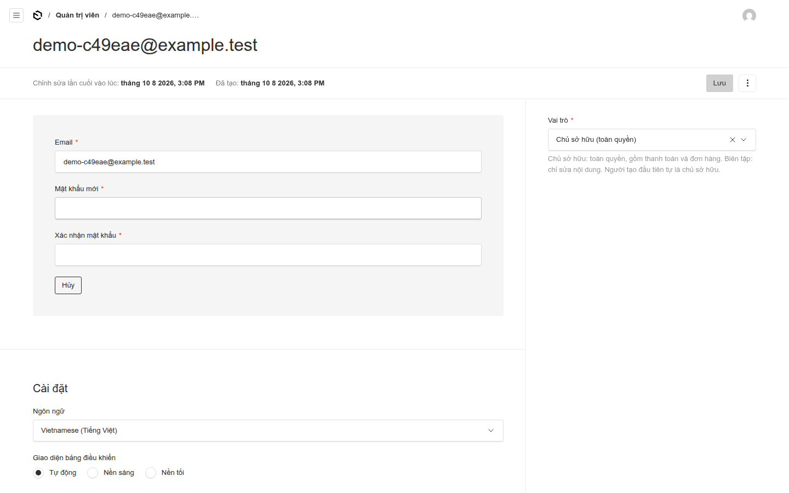
<!-- ẢNH 02: trang <ĐỊA CHỈ DEMO>/admin/collections/users/[id], giao diện hồ sơ quản trị viên sau khi bấm Đổi mật khẩu, khoanh ô Mật khẩu mới, Xác nhận mật khẩu và nút Lưu -->

> **Nếu gặp lỗi**: Nếu hai ô mật khẩu không khớp nhau, hệ thống sẽ hiện thông báo nhắc nhở màu đỏ. Bạn chỉ cần gõ lại cẩn thận hai ô giống hệt nhau rồi bấm **Lưu**.

---

### 1.3. Hai vai trò trong hệ thống

Hệ thống phân chia tài khoản quản trị thành hai vai trò rõ ràng để đảm bảo an toàn tuyệt đối cho doanh nghiệp của bạn:

- **Chủ sở hữu (`owner`) – Toàn quyền**: Đây là vai trò của riêng Hana. Bạn có quyền hạn tối cao: tạo và sửa mọi nội dung, quản lý giá bán, cài đặt tài khoản ngân hàng nhận tiền chuyển khoản VietQR, quản lý đơn hàng, xem toàn bộ thông tin khách hàng và phân quyền cho người khác.
- **Biên tập (`editor`) – Soạn thảo nội dung**: Dành cho các bạn trợ lý hoặc cộng sự hỗ trợ viết bài, chỉnh ảnh, soạn thảo lời chia sẻ. Người ở vai trò này **không thể xem hoặc thay đổi** tài khoản ngân hàng, không thể sửa cài đặt thanh toán, và không thể xóa bỏ đơn hàng của khách.

---

### 1.3b. Trang chủ admin – Dashboard "Hôm nay"

**Mục đích**: Ngay sau khi đăng nhập, Hana nhìn thấy ngay các công việc cần xử lý trong ngày, các phím tắt tạo nhanh và tài liệu hướng dẫn mà không cần phải tự đi tìm trong từng bảng dữ liệu.

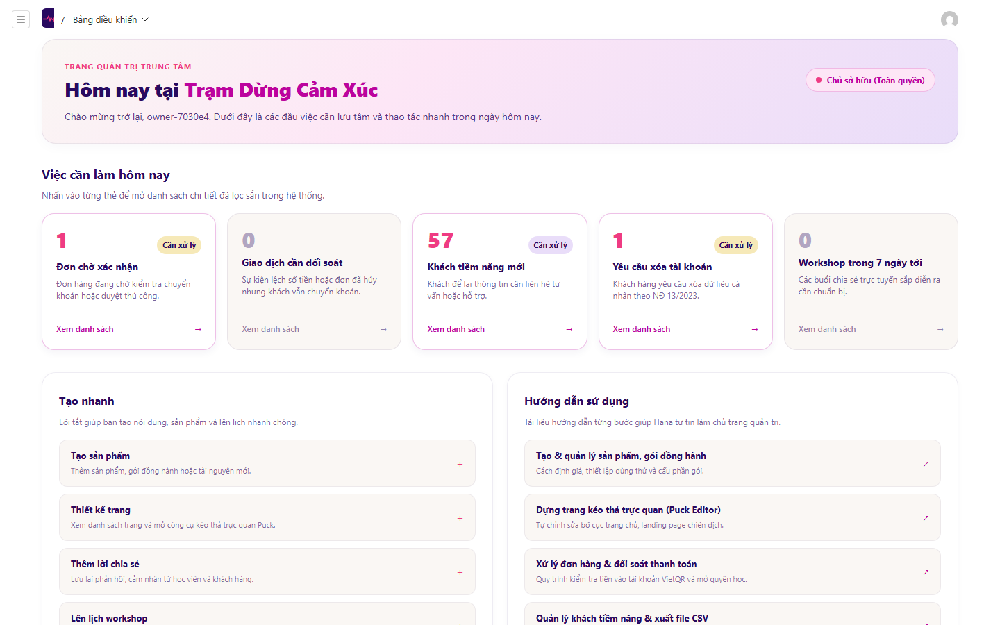
<!-- ẢNH 02b: trang <ĐỊA CHỈ DEMO>/admin, giao diện Dashboard Hôm nay với khu vực Việc cần làm, Tạo nhanh và Hướng dẫn sử dụng -->

#### 1. Khu vực "Việc cần làm hôm nay"

- **Ý nghĩa**: Tập hợp các đầu việc đang chờ bạn xử lý, hiển thị dạng các thẻ số to rõ ràng. Tuyệt đối không hiển thị thông tin cá nhân (như email, họ tên, số tiền) trên màn hình này để đảm bảo an toàn và bảo mật thông tin.
- **5 nhóm việc cần lưu tâm**:
  1. **Đơn chờ xác nhận**: Các đơn hàng khách đã đặt và đang chờ chuyển khoản hoặc chờ bạn duyệt thủ công. Bấm vào thẻ để mở danh sách các đơn đang ở trạng thái `pending`.
  2. **Giao dịch cần đối soát** _(chỉ tài khoản `owner` của Hana mới nhìn thấy)_: Cảnh báo khi có khách chuyển khoản sai số tiền hoặc chuyển tiền cho đơn đã bị hủy. Bấm vào thẻ để đối soát ngay nhật ký giao dịch SePay.
  3. **Khách tiềm năng mới**: Khách hàng để lại thông tin liên hệ từ trang chủ, form tư vấn hoặc đăng ký nhận tài nguyên. Bấm vào thẻ để mở danh sách lead mới cần chăm sóc.
  4. **Yêu cầu xóa tài khoản**: Khách hàng gửi yêu cầu xóa dữ liệu cá nhân theo quy định NĐ 13/2023. Bấm vào để vào hồ sơ khách và xử lý quy trình xóa an toàn.
  5. **Workshop trong 7 ngày tới**: Các buổi chia sẻ trực tuyến sắp diễn ra trong tuần, giúp bạn chuẩn bị tài liệu và phòng họp kịp thời.
- **Trạng thái "Không có việc nào – tuyệt!"**: Khi mọi đầu việc đã được giải quyết xong, hệ thống sẽ hiện thông báo chúc mừng nhẹ nhàng màu xanh mint dịu mát, giúp Hana yên tâm dành thời gian sáng tạo hoặc nghỉ ngơi.

#### 2. Khu vực "Tạo nhanh"

Các lối tắt màu hồng ấm áp giúp bạn thao tác ngay chỉ với 1 cú click:

- **Tạo sản phẩm**: Mở form tạo công cụ số, gói đồng hành hoặc tài nguyên mới.
- **Thiết kế trang**: Mở danh sách trang web và khởi chạy công cụ kéo thả trực quan Puck.
- **Thêm lời chia sẻ**: Lưu cảm nhận mới của học viên gửi về.
- **Lên lịch workshop**: Tạo buổi chia sẻ trực tuyến Zoom mới cho học viên.
- **Thêm bài học**: Bổ sung nội dung hoặc video bài học vào khóa học Habit Hack.

#### 3. Khu vực "Hướng dẫn sử dụng"

Các liên kết mở nhanh tới đúng tài liệu hướng dẫn chi tiết mà bạn đang xem:

- Hướng dẫn tạo và quản lý sản phẩm, gói đồng hành (Mục 3).
- Hướng dẫn dựng trang kéo thả trực quan Puck (Mục 5).
- Xử lý đơn hàng và đối soát thanh toán VietQR (Mục 1.6 & 7).
- Quản lý khách tiềm năng và xuất file CSV (Mục 8).
- Quy trình xóa tài khoản an toàn cho khách (Mục 1.7).

---

### 1.4. Cấu trúc menu bên trái theo công việc của Hana

**Mục đích**: Menu quản trị được thiết kế theo đúng luồng công việc tự nhiên hàng ngày của Hana, chia thành 6 nhóm mạch lạc, giúp Hana và cộng sự tìm kiếm thông tin nhanh chóng mà không bị rối mắt bởi các bảng dữ liệu kỹ thuật.

#### Bảng 6 nhóm menu chính

| Tên nhóm                | Mục đích công việc                                                                                             | Các mục hiển thị trong nhóm                                                                                                                                                                                                                                                                                                                                                                                                                                                                                                                                                                | Ai nhìn thấy?      |
| :---------------------- | :------------------------------------------------------------------------------------------------------------- | :----------------------------------------------------------------------------------------------------------------------------------------------------------------------------------------------------------------------------------------------------------------------------------------------------------------------------------------------------------------------------------------------------------------------------------------------------------------------------------------------------------------------------------------------------------------------------------------- | :----------------- |
| **Trang web**           | Quản lý các trang nội dung công khai, bài viết chia sẻ, cảm nhận của khách hàng, chân trang và cấu hình chung. | • **Trang nội dung** (`pages`): Dựng trang bằng Puck editor.<br>• **Bài viết và video** (`posts`): Blog và bài chia sẻ.<br>• **Lời chia sẻ** (`testimonials`): Đánh giá của học viên.<br>• **Câu hỏi thường gặp** (`faqs`): FAQ dùng chung (mục 4.4).<br>• **Đội ngũ** (`teamMembers`): Chuyên gia của Trạm (mục 4.5).<br>• **Trang pháp lý** (`legalPages`): Điều khoản, bảo mật.<br>• **Thư viện ảnh và tài liệu** (`media`): Ảnh bìa, ảnh minh họa.<br>• **Menu điều hướng** (`navigation`): Menu đầu và chân trang.<br>• **Cài đặt website** (`siteSettings`): Ngân hàng VietQR, logo. | `owner` + `editor` |
| **Sản phẩm & bán hàng** | Quản lý danh mục gói đồng hành, sách điện tử, dịch vụ coaching, đơn hàng và ưu đãi.                            | • **Sản phẩm** (`products`): Công cụ số, gói đồng hành, ebook.<br>• **Dịch vụ đồng hành** (`services`): Coaching 1:1, tư vấn.<br>• **Chương trình doanh nghiệp** (`programs`): Đào tạo B2B.<br>• **Đơn hàng** (`orders`): Theo dõi và xác nhận đơn chuyển khoản.<br>• **Mã giảm giá** (`discountCodes`): Ưu đãi cho chiến dịch.<br>• **Tài liệu riêng tư** (`privateFiles`): PDF chỉ giao sau khi đăng ký/mua.                                                                                                                                                                             | `owner` + `editor` |
| **Khóa Habit**          | Quản lý toàn bộ nội dung khóa học Habit Hack 1% Better và hoạt động tương tác.                                 | • **Nhóm bài học** (`courseModules`): 7 chặng học tập.<br>• **Bài học** (`lessons`): 20 bài học kèm video Bunny Stream.<br>• **Kỹ thuật thực hành** (`techniques`): 11 kỹ thuật can thiệp hành vi.<br>• **Câu hỏi chẩn đoán** (`diagnosticQuestions`): 16 tình huống trì hoãn.<br>• **Lịch workshop** (`workshops`): Lịch học Zoom và đường dẫn.                                                                                                                                                                                                                                           | `owner` + `editor` |
| **EQ Buddy**            | Quản lý bộ 26 thẻ nhận diện và điều hòa cảm xúc.                                                               | • **Thẻ EQ Buddy** (`eqCards`): 26 thẻ bài, thông điệp, câu chuyện, câu hỏi đào sâu và xuất mã QR in ấn.                                                                                                                                                                                                                                                                                                                                                                                                                                                                                   | `owner` + `editor` |
| **Học viên & khách**    | Chăm sóc học viên, theo dõi quá trình rèn luyện và cấp chứng nhận hoàn thành.                                  | • **Khách hàng** (`customers`): Danh sách học viên và tài khoản.<br>• **Khách tiềm năng** (`leads`): Thu thập email từ form, xuất CSV.<br>• **Chứng nhận 21 ngày** (`certificates`): Chứng nhận 21 ngày hoàn thành.<br>• **Kế hoạch thói quen** (`habitPlans`): Kế hoạch Habit Loop 5 phút.                                                                                                                                                                                                                                                                                                | `owner` + `editor` |
| **Hệ thống**            | Khu vực kỹ thuật dành riêng cho Chủ dự án và IT: phân quyền, kiểm tra lỗi, đối soát thanh toán.                | • Quản trị viên, Quyền truy cập, Check-in 21 ngày, Tiến độ bài học, Kết quả chẩn đoán, Thẻ đã lưu, Sự kiện thanh toán, Nhật ký thao tác, Nhắc hạn dùng thử, Nhắc lịch workshop, Nhắc lỡ nhịp tracker, Mã OTP, Lượt gửi form, Dấu vết dùng thử (14 mục).                                                                                                                                                                                                                                                                                                                                    | **Chỉ `owner`**    |

#### Bảo vệ an toàn: Ẩn mục kỹ thuật với vai trò Biên tập (`editor`)

- Khi cộng sự hoặc trợ lý đăng nhập bằng tài khoản `editor`, nhóm **Hệ thống** sẽ **tự động ẩn hoàn toàn khỏi thanh menu bên trái**.
- **Lợi ích**:
  - Giao diện của cộng sự cực kỳ gọn gàng, chỉ tập trung vào việc viết bài, cập nhật bài học và chăm sóc học viên.
  - Ngăn ngừa tuyệt đối nguy cơ bấm nhầm làm thay đổi tài khoản ngân hàng, xóa dữ liệu nhật ký bảo mật hoặc can thiệp vào các tiến trình thanh toán tự động của hệ thống.
  - Hana (vai trò `owner`) vẫn xem được đầy đủ 6 nhóm để đối soát khi cần.

---

### 1.4b. Tên các nút trên form và nút Xem trước (con mắt)

Trên **form chuẩn** của mọi bảng (sản phẩm, thẻ EQ, lời chia sẻ, bài học…), thanh nút ngay dưới tiêu đề gồm:

| Nút trên màn hình      | Trong tài liệu này gọi tắt là | Làm gì                                                                                     |
| :--------------------- | :---------------------------- | :----------------------------------------------------------------------------------------- |
| 👁 (biểu tượng con mắt) | **Xem trước**                 | Mở / đóng khung xem trước bên phải form. Bản ghi mới phải **Lưu bản nháp** một lần mới có. |
| **Lưu bản nháp**       | **Lưu nháp**                  | Lưu lại, khách **chưa** thấy.                                                              |
| **Xuất bản tài liệu**  | **Xuất bản**                  | Đưa nội dung ra website. Hệ thống kiểm tra các ô bắt buộc trước khi cho xuất bản.          |

- Dòng **Trạng thái** bên trái thanh nút cho biết bản ghi đang là **Bản nháp** hay **Đã xuất bản** – xem dòng này để chắc nội dung đã lên web.
- Các **trình hướng dẫn từng bước** (tạo sản phẩm, thêm bài học, lên lịch workshop) có nút riêng ở cuối trang: **Lưu nháp**, **Tiếp tục**, **Quay lại** và ở bước cuối **🚀 Xuất bản**.

---

### 1.5. Khách hàng đăng nhập thế nào

**Mục đích**: Giúp Hana nắm rõ trải nghiệm của học viên và khách hàng khi truy cập vào hệ thống học tập hoặc tài khoản cá nhân (Hana không cần thao tác gì, hệ thống xử lý tự động 100%).

- **Đăng nhập không cần mật khẩu (Passwordless OTP)**: Khách hàng không cần nhớ mật khẩu. Khách chỉ cần vào trang `/tai-khoan/dang-nhap`, nhập địa chỉ email và đồng ý với Chính sách bảo mật.
- **Mã xác thực 6 chữ số qua Email**: Hệ thống tự động gửi một mã OTP gồm 6 chữ số tới hộp thư của khách, có hiệu lực trong 10 phút. Khách nhập mã này để vào tài khoản ngay lập tức.
- **Bảo mật và Tự động**: Mỗi mã chỉ dùng được 1 lần, nếu nhập sai quá 5 lần mã sẽ tự khóa để chống dò mã. Phiên đăng nhập được lưu an toàn trên trình duyệt của khách trong 30 ngày.
- **Thu hồi phiên khi đăng xuất hoặc đổi email**: Khi khách hàng bấm "Đăng xuất" tại `/tai-khoan`, hệ thống sẽ lập tức thu hồi phiên trên máy chủ và đăng xuất khách khỏi tất cả các thiết bị. Tương tự, nếu Hana chỉnh sửa lại địa chỉ email của khách hàng trong mục **Khách hàng** (`customers`), toàn bộ phiên đăng nhập gắn với email cũ trước đó sẽ tự động hết hạn ngay lập tức; khách hàng cần đăng nhập lại bằng địa chỉ email mới.
- **Không bị đè quyền giữa Quản trị và Khách hàng**: Hana và cộng sự có thể kiểm tra thử cả phiên tài khoản khách hàng (`/tai-khoan`) và đăng nhập trang quản trị (`/admin`) trên cùng một trình duyệt mà không bị đè quyền hay báo lỗi thiếu quyền khi vào `/admin`. Hệ thống luôn tự động ưu tiên nhận diện phiên quản trị viên khi truy cập trang admin.
- **Hồ sơ khách hàng trong CMS**: Hệ thống tự động tạo hồ sơ khách hàng mới trong mục **Khách hàng** (`customers`) ngay lần đăng nhập đầu tiên và tự động gắn đúng các đơn hàng, quyền học của họ. Khách hàng hoàn toàn không thể truy cập vào trang quản trị `/admin` của Hana.

---

### 1.5b. Quyền tự quản lý nhận email nhắc của khách hàng (Nghị định 13/2023)

**Mục đích**: Tôn trọng quyền rút lại sự đồng ý nhận thông báo nhắc nhở của khách hàng theo quy định bảo vệ dữ liệu cá nhân (Nghị định 13/2023/NĐ-CP).

- **Khách hàng tự bật / tắt**:
  - **Qua link trong email**: Dưới chân các email nhắc lịch workshop 24 giờ và email nhắc lỡ nhịp thực hành 2 ngày đều có dòng chữ nhỏ _"Không nhận email nhắc nữa"_. Khách bấm vào sẽ mở trang xác nhận `/nhac-lich/huy?t=...` và bấm nút ngừng nhận mà không cần phải đăng nhập.
  - **Trong trang Tài khoản (`/tai-khoan`)**: Tại mục **Tùy chọn email thông báo**, khách có công tắc _"Nhận email nhắc lịch workshop và nhắc tập"_. Khách có thể chủ động bật hoặc tắt bất cứ lúc nào.
- **Trường "Không nhận email nhắc lịch / nhắc tập" (`reminderEmailsOptOut`) trong CMS**:
  - Khi xem chi tiết khách hàng trong mục **Khách hàng** (`customers`), Hana sẽ thấy ô kiểm này.
  - Nếu ô này được tích: hệ thống sẽ tự động bỏ qua, không gửi email nhắc workshop 24 giờ và email nhắc lỡ 2 ngày cho khách hàng này.
  - **Quy tắc quan trọng cho Hana**: **Hana tuyệt đối không tự ý bỏ tích để bật lại thay cho khách khi khách đã chủ động tắt**. Quyền nhận thông báo thuộc về sự đồng ý của khách hàng. Nếu khách muốn nhận lại, hãy hướng dẫn khách tự đăng nhập vào `/tai-khoan` để gạt công tắc bật lại.
  - **Email giao dịch không bị ảnh hưởng**: Khách tắt nhận email nhắc thì hệ thống vẫn gửi đầy đủ các email giao dịch bắt buộc như mã OTP đăng nhập, thư xác nhận thanh toán đơn hàng, link đặt lịch Coaching và tài liệu đã mua.

---

### 1.6. Khách hàng tự xem đơn hàng và link thanh toán tại `/tai-khoan`

**Mục đích**: Giúp khách hàng chủ động kiểm tra trạng thái đơn, tiếp tục thanh toán đơn chưa trả hoặc tải lại tài liệu mà Hana không cần phải tìm và gửi lại link thanh toán thủ công.

- **Khu vực "Đơn hàng của tôi" trên `/tai-khoan`**: Sau khi đăng nhập bằng email OTP, khách hàng chỉ cần vào trang cá nhân `/tai-khoan` để thấy ngay danh sách đơn hàng của mình (tối đa 20 đơn gần nhất).
- **Tự lấy link thanh toán**:
  - Với các đơn **Chờ thanh toán** (`pending`) hoặc **Quá hạn** (`failed`), hệ thống hiển thị nút **"Xem cách thanh toán"**.
  - Khách bấm vào sẽ được dẫn thẳng tới trang thanh toán `/thanh-toan/don/[payToken]` để quét mã VietQR.
  - **Hana không cần gửi lại link**: Khi khách nhắn hỏi lại link thanh toán, Hana chỉ cần hướng dẫn khách đăng nhập vào `/tai-khoan` là khách sẽ tự thấy link của mình.
- **Tải lại tài liệu đã mua**: Với đơn **Đã thanh toán** (`paid`) của sản phẩm có đính kèm file, khách có nút **"Tải lại"**.
  - Mỗi lần bấm, hệ thống tạo một link tải riêng cho đúng khách đó, **hết hạn sau 10 phút**. Hết hạn thì khách bấm "Tải lại" lần nữa để lấy link mới.
  - Link chỉ dùng được khi khách **đang đăng nhập đúng tài khoản đã mua**; người khác cầm link sẽ không tải được.
  - Khách báo không tải được: kiểm tra đơn ở trạng thái **Đã thanh toán** và sản phẩm vẫn còn file đính kèm trong mục **Tài liệu đính kèm**.
- **Bảo mật và an toàn**: Đơn đã hủy (`cancelled`) không lộ mã chuyển khoản hay thông tin nội bộ. Khách chỉ xem được đơn thuộc về chính tài khoản của mình.

---

### 1.7. Khách hàng yêu cầu xóa tài khoản & Hana xóa dữ liệu khách

**Mục đích**: Thực hiện quyền xóa dữ liệu cá nhân theo quy định bảo vệ dữ liệu (Nghị định 13/2023/NĐ-CP) khi khách hàng không còn nhu cầu sử dụng dịch vụ trên Trạm Dừng Cảm Xúc.

#### 1. Quy trình từ phía khách hàng

- Khách hàng đã đăng nhập có thể truy cập trang **Tài khoản của tôi** (`/tai-khoan`).
- Ở cuối trang có mục **Xóa tài khoản và dữ liệu cá nhân**. Khách bấm nút "Yêu cầu xóa tài khoản" và xác nhận.
- Khi gửi yêu cầu thành công, hệ thống ghi nhận thời điểm yêu cầu (`deletionRequestedAt`) và gửi email thông báo bảo mật tới địa chỉ quản trị của Hana với tiêu đề:
  `[TDCX] Yêu cầu xóa dữ liệu: Khách hàng #[ID] ([Thời điểm])`
  _(Tiêu đề email tuân thủ bảo mật, không để lộ email hay tên của khách ra ngoài)._

#### 2. Thao tác xóa dữ liệu của Hana trong CMS

1. Mở email thông báo hoặc vào mục **Khách hàng** (`customers`) trong CMS. Bạn sẽ thấy cột **Yêu cầu xóa lúc** hiển thị thời điểm khách gửi yêu cầu.
2. Bấm vào khách hàng cần xử lý để mở trang chi tiết (`/admin/collections/customers/[id]`).
3. Tại cột bên phải (Sidebar), tìm nút **Xóa dữ liệu khách** (chỉ hiển thị cho tài khoản Chủ sở hữu - `owner`).
4. **Lưu ý về đơn hàng chờ**:
   - Nếu khách hàng vẫn còn đơn hàng ở trạng thái **Chờ thanh toán** (`pending`), hệ thống sẽ hiện cảnh báo và **chặn thao tác xóa**. Hana cần vào mục Đơn hàng để hủy các đơn chờ này trước khi xóa dữ liệu khách.
   - Các đơn hàng ở trạng thái **Quá hạn** (`failed`) sẽ được hệ thống tự động chuyển sang **Đã hủy** (`cancelled`) và ghi nhận nhật ký trước khi ẩn danh.
5. Bấm nút và hệ thống sẽ mở ra hộp thoại xác nhận an toàn:
   - Hana cần **gõ lại chính xác địa chỉ email của khách hàng** vào ô xác nhận.
   - Nút **Xác nhận xóa vĩnh viễn** chỉ sáng lên khi email gõ vào trùng khớp 100% (giúp ngăn chặn hoàn toàn việc bấm nhầm).
6. Bấm **Xác nhận xóa vĩnh viễn**. Hệ thống sẽ thực hiện xóa toàn bộ dữ liệu trong một phiên giao dịch cơ sở dữ liệu duy nhất. Nếu có bất kỳ sự cố kỹ thuật nào xảy ra giữa chừng, toàn bộ thao tác sẽ được hoàn tác an toàn (rollback), không làm mất dữ liệu chắp vá.

#### 3. Quy định SLA thời hạn xử lý

- **Thời hạn xử lý kỹ thuật quy định**: Hana hoàn tất kiểm tra và bấm xác nhận xóa trong vòng **72 giờ** kể từ khi nhận được yêu cầu từ khách hàng.
- _(Lưu ý: Thời hạn này sẽ được Hana và luật sư/chuyên gia tư vấn xác nhận chính thức khi ban hành văn bản Chính sách bảo mật của Trạm)._

#### 4. Dữ liệu nào bị xóa và dữ liệu nào được giữ lại?

- **Dữ liệu bị xóa vĩnh viễn (0 bản ghi còn lại)**:
  - Tài khoản khách hàng (`customers`).
  - Toàn bộ kế hoạch và mục tiêu thói quen (`habitPlans`).
  - Toàn bộ lịch sử check-in cảm xúc hàng ngày (`habitCheckins`).
  - Toàn bộ thông báo nhắc nhở thói quen (`trackerNudges`).
  - Toàn bộ chứng nhận hoàn thành 21 ngày (`certificates`).
  - Toàn bộ quyền truy cập công cụ và khóa học (`entitlements`).
  - Toàn bộ lịch sử nhắc hạn dùng thử (`trialReminders`) và nhắc hẹn workshop (`workshopReminders`).
  - Toàn bộ tiến độ xem bài học (`lessonProgress`).
  - Toàn bộ thẻ suy ngẫm cảm xúc đã lưu (`savedCards`).
  - Toàn bộ mã xác thực OTP (`otpCodes`), kết quả trắc nghiệm (`diagnosticResults`), và thông tin khách tiềm năng (`leads`) có cùng email.
- **Dấu vết dùng thử ẩn danh (`trialUsage`)**:
  - Để ngăn chặn việc khách hàng xóa tài khoản rồi đăng ký lại để dùng thử công cụ số miễn phí lần thứ 2, hệ thống tự động lưu lại mã băm bảo mật (HMAC-SHA256) của email kèm sản phẩm đã dùng thử. Mã băm này là một chiều, không thể dịch ngược thành email thật, đảm bảo nguyên tắc bảo vệ quyền riêng tư.
- **Dữ liệu được giữ lại dưới dạng ẩn danh (Anonymized)**:
  - **Đơn hàng (`orders`)**: Để phục vụ đối soát tài chính, kiểm toán và quản lý doanh thu, các đơn hàng mua sản phẩm **không bị xóa mất**. Thay vào đó, hệ thống tự động **ẩn danh hóa**:
    - Ngắt liên kết với khách hàng (`customer = null`).
    - Ghi nhận thời điểm ẩn danh (`anonymizedAt`).
    - Xóa toàn bộ ghi chú riêng tư và nhu cầu cá nhân (`notes = null`, `customerNeed = null`).
    - Giữ nguyên số tiền, ngày thanh toán, mã đối soát ngân hàng (`paymentRef`) để phục vụ kiểm toán tài chính và đối soát doanh thu.
  - **Sự kiện thanh toán (`paymentEvents`)**: Giữ nguyên nguyên trạng vì đây là chứng từ giao dịch đối soát ngân hàng.
  - **Nhật ký hệ thống (`auditLogs`)**: Hệ thống tự động ghi lại một dòng nhật ký ẩn danh xác nhận Hana đã xóa dữ liệu khách hàng #[ID] kèm tổng số lượng bản ghi từng bảng đã xóa sạch, tuyệt đối không lưu lại tên hay email của khách.

---

## 2. Nhận biết và Làm việc với dữ liệu mẫu

**Mục đích**: Nhận biết các bài viết, sản phẩm, trang web do đội ngũ kỹ thuật gieo sẵn (`seed`) để không bị nhầm lẫn với nội dung thật.

**Các bước thực hiện & Quy tắc**:

1. Ở mọi danh mục (Sản phẩm, Trang nội dung, Câu hỏi chẩn đoán...), các mục có tiền tố `[MẪU]` ở đầu (ví dụ: `[MẪU] Ebook và bộ công cụ EQ`, `[MẪU] Growth Mirror – gói CLEAR`, `[MẪU] Trang chủ`...) là dữ liệu mẫu.
2. Dữ liệu mẫu hoàn toàn độc lập và không ảnh hưởng gì tới các nội dung thật do Hana tự tạo.
3. Khi bạn nhập nội dung thật và xóa tiền tố `[MẪU]` đi, hệ thống sẽ tự động chuyển bản ghi đó thành **Dữ liệu thật** (`isSample = false`). Kể từ lúc này, hệ thống cam kết **không bao giờ ghi đè** hay làm mất nội dung thật của bạn khi kỹ thuật bảo trì website.

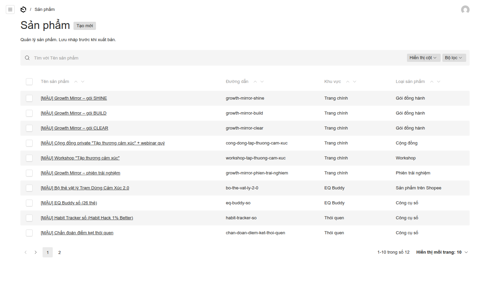
<!-- ẢNH 03: trang <ĐỊA CHỈ DEMO>/admin/collections/products, danh sách sản phẩm hiển thị tiền tố [MẪU] ở đầu tên -->

---

## 3. Quản lý Sản phẩm, Giá bán và Tài nguyên

Mọi khóa học, công cụ số, tài liệu miễn phí, dịch vụ coaching hay gói đồng hành đều nằm tại mục **Sản phẩm**.

### 3.1. Tạo và chỉnh sửa sản phẩm: Giao diện 6 tab theo loại

**Mục đích**: Giúp Hana dễ dàng tạo và quản lý toàn bộ rổ sản phẩm số, gói đồng hành, sách điện tử và dịch vụ với giao diện tab chuyên biệt, tự động ẩn đi các trường không liên quan theo từng loại sản phẩm.

#### 1. Cấu trúc 6 tab và Cột bên phải (Sidebar)

Biểu mẫu Sản phẩm được chia thành 6 thẻ (tabs) chuyên biệt cùng cột Sidebar cố định bên phải:

1. **Tab 1: Cơ bản**:
   - **Tên sản phẩm**: Tên hiển thị công khai trên website (tiêu đề trang chi tiết, thẻ sản phẩm).
   - **Đường dẫn (slug)**: Đường dẫn tĩnh trên URL website (chỉ dùng chữ thường không dấu, số và dấu gạch ngang, ví dụ: `habit-tracker-so`).
   - **Thứ tự**: Số nguyên xác định vị trí xuất hiện (số nhỏ hiển thị trước).
   - **Ảnh bìa**: Ảnh đại diện sản phẩm (tỉ lệ khuyến nghị 1:1 hoặc 4:3, hiển thị trên card, trang chi tiết và khi chia sẻ liên kết mạng xã hội).
   - **Chặng trải nghiệm**: Chọn chặng tương ứng trong hành trình cảm xúc (**Dừng lại** `pause`, **Cảm nhận** `feel`, **Gọi tên** `name`, **Lựa chọn** `choose`, **Rèn luyện** `practice`).
2. **Tab 2: Giá & bán**:
   - **Giá bán (VND)**: Giá niêm yết chuẩn của sản phẩm.
   - **Giá ưu đãi (VND)**: Mức giá khuyến mại thực tế khi áp dụng ưu đãi (ví dụ `178.000đ`).
   - **Hạn ưu đãi**: Ngày giờ kết thúc chương trình ưu đãi (nếu để trống, ưu đãi áp dụng cố định).
   - **Số ngày dùng thử**: Số ngày khách được trải nghiệm miễn phí trước khi quyết định mua (mặc định 21 ngày cho công cụ số).
   - **Thời hạn sử dụng (ngày)**: Số ngày khách được truy cập sau khi mua (để trống nghĩa là dùng trọn đời / vĩnh viễn).
3. **Tab 3: Nội dung trang**:
   - **Mô tả ngắn**: 1–2 câu tóm tắt nổi bật (hiển thị trên thẻ sản phẩm và bảng so sánh gói).
   - **Giới thiệu chi tiết**: Bài viết chi tiết, định dạng văn bản phong phú (tiêu đề, in đậm, danh sách) xuất hiện trên trang chi tiết sản phẩm.
   - **Khó khăn của khách**: Mô tả nỗi đau, điểm kẹt cảm xúc hoặc thói quen của khách hàng.
   - **Kết quả đạt được**: Giá trị chuyển hóa, kết quả tích cực mà khách nhận được sau khi sử dụng.
   - **Bao gồm những gì**: Danh sách các gạch đầu dòng những quyền lợi / thành phần đi kèm sản phẩm.
   - **Ảnh xem trước**: Ảnh chụp màn hình hoặc tài liệu xem trước cho khách tham khảo.
   - **Câu hỏi thường gặp (FAQ)**: Danh sách các câu hỏi và câu trả lời thắc mắc thường gặp.
   - **Sản phẩm liên quan**: Các sản phẩm khác gợi ý cho khách xem thêm ở chân trang chi tiết.
4. **Tab 4: Gói & quyền** _(chỉ hiển thị với loại Gói đồng hành)_:
   - **Cấu phần của gói**: Bảng danh sách các thành phần (Workshop, phiên Coaching 1:1, tư vấn hướng nghiệp, công cụ số, nhóm cộng đồng...). Mỗi cấu phần gồm tên, số lượng, đơn giá và sản phẩm cấp quyền tương ứng.
   - **Tổng giá trị (VND)**: Ô chỉ đọc, hệ thống **tự động tính** bằng tổng `Số lượng × Đơn giá` của tất cả các cấu phần.
   - **Ưu đãi (%)**: Ô chỉ đọc, hệ thống **tự động tính** theo công thức so sánh Tổng giá trị với Giá bán thực tế (ví dụ: `30%`, `50%`, `60%`).
5. **Tab 5: Tài liệu giao** _(chỉ hiển thị với Sách điện tử / Bộ tài nguyên)_:
   - **Tài liệu được giao**: Danh sách các tệp PDF/EPUB trong kho Tài liệu riêng tư. Hệ thống sẽ tự động tạo liên kết tải về an toàn và gửi qua email cho khách sau khi mua hoặc nhận quà.
6. **Tab 6: Liên kết ngoài** _(chỉ hiển thị khi dẫn sang sàn thương mại điện tử hoặc lịch hẹn)_:
   - **Liên kết của nút**: Địa chỉ web dẫn khách đến (ví dụ: link gian hàng Shopee `https://shopee.vn/...` hoặc link đặt lịch hẹn).
   - **Nhãn của nút**: Chữ hiển thị trên nút bấm (ví dụ: `Mua trên Shopee`, `Đặt lịch tư vấn`).
   - **Loại hành động của nút (CTA)**: Mua trực tiếp, Dẫn link ngoài, Đặt lịch hay Tải về.

_Cột Sidebar bên phải_:

- **Loại sản phẩm (`type`)**: Tiêu chí cốt lõi quyết định form sẽ bật/tắt các trường nào (xem bảng bên dưới).
- **Khu vực (`web`)**: Phân bổ hiển thị trên `site` (Trang chính), `habit` (Thói quen) hoặc `eq` (EQ Buddy).
- **Trạng thái bán (`saleStatus`)**: Chọn Đang bán (`on_sale`), Sắp ra mắt (`coming_soon`), Miễn phí (`free`), Cần tư vấn (`consult`), hoặc Ẩn (`hidden`).
- **Trạng thái xuất bản**: Lưu nháp (`draft`) hoặc Đã xuất bản (`published`).

---

#### 2. Bảng tra cứu: "Loại nào điền gì?"

Hệ thống đã tự động ẩn đi các ô không liên quan để Hana không bị rối mắt. Khi chọn **Loại sản phẩm** ở cột bên phải, các tab sẽ tự động thích ứng:

| Loại sản phẩm (`type`)                                                                                | Các tab & trường cần điền                                                                                                                                                                | Trường hệ thống tự động ẩn                                           |
| :---------------------------------------------------------------------------------------------------- | :--------------------------------------------------------------------------------------------------------------------------------------------------------------------------------------- | :------------------------------------------------------------------- |
| **Công cụ số** (`digital_tool`)                                                                       | • Cơ bản (Tên, slug, ảnh bìa)<br>• Giá & bán (Giá niêm yết, giá ưu đãi, số ngày dùng thử 21 ngày, thời hạn sử dụng)<br>• Nội dung trang (Mô tả, Giới thiệu, Bao gồm, FAQ)                | Cấu phần gói đồng hành, Tài liệu tệp đính kèm, Liên kết Shopee ngoài |
| **Sách điện tử / Bộ tài nguyên** (`ebook`, `toolkit`)                                                 | • Cơ bản (Tên, slug, ảnh bìa)<br>• Giá & bán (Giá bán, hoặc 0đ nếu là quà tặng miễn phí)<br>• Tài liệu giao (chọn tệp PDF từ kho Tài liệu riêng tư)<br>• Nội dung trang (Mô tả, Bao gồm) | Số ngày dùng thử, Cấu phần gói, Liên kết Shopee ngoài                |
| **Gói đồng hành** (`package`)                                                                         | • Cơ bản (Tên, slug, ảnh bìa)<br>• Giá & bán (Giá bán của gói)<br>• Gói & quyền (Bảng cấu phần; xem Tổng giá trị và % ưu đãi tự tính)<br>• Nội dung trang (Giới thiệu, Bao gồm, FAQ)     | Số ngày dùng thử, Tài liệu giao đính kèm, Liên kết ngoài             |
| **Sản phẩm trên Shopee** (`physical_external`)                                                        | • Cơ bản (Tên, slug, ảnh bìa bộ thẻ)<br>• Liên kết ngoài (Dán link Shopee và nhập nhãn "Mua trên Shopee")                                                                                | Giá bán trên web, Số ngày dùng thử, Cấu phần gói, Tệp đính kèm       |
| **Phiên trải nghiệm / Workshop / Cộng đồng / B2B** (`coaching_trial`, `workshop`, `community`, `b2b`) | • Cơ bản (Tên, slug, ảnh bìa)<br>• Giá & bán (Giá vé/phí, hoặc để trống nếu tư vấn riêng)<br>• Nội dung trang & Liên kết đặt lịch hẹn nếu có                                             | Cấu phần gói đồng hành, Số ngày dùng thử                             |

---

#### 3. Quy tắc Lưu nháp và Kiểm tra an toàn khi Xuất bản

Để Hana an tâm soạn thảo mà không lo bị hệ thống chặn hay làm mất bài:

1. **Lưu nháp thoải mái (`draft`)**:
   - Khi đang ở chế độ Bản nháp, Hana có thể bấm **Lưu bản nháp** bất kỳ lúc nào, kể cả khi chưa kịp điền giá, chưa tải ảnh bìa hay chưa xong nội dung.
   - Bản nháp được lưu trữ an toàn trong hệ thống và hoàn toàn không hiển thị ra ngoài website cho khách.
2. **Kiểm tra an toàn khi bấm Xuất bản (`published`) + Đang bán (`on_sale`)**:
   - Khi bạn chọn Trạng thái bán là **Đang bán** và bấm **Xuất bản**, hệ thống sẽ kích hoạt bộ kiểm tra an toàn tự động để bảo vệ trải nghiệm khách hàng:
     - **Giá bán**: Bắt buộc phải nhập số tiền cụ thể (trừ sản phẩm Shopee mua ngoài sàn).
     - **Ảnh bìa**: Bắt buộc phải chọn ảnh đại diện để giao diện ngoài web không bị vỡ bố cục.
     - **Đường dẫn (slug)**: Bắt buộc phải có slug hợp lệ để khách có thể truy cập trang.
   - Nếu thiếu bất kỳ thông tin nào trong 3 mục trên, hệ thống sẽ **từ chối xuất bản** và hiển thị thông báo lỗi tiếng Việt rõ ràng, chỉ đích danh tab và trường cần bổ sung.
   - Với các trạng thái bán khác như _Sắp ra mắt_, _Miễn phí_, _Cần tư vấn_ hoặc _Ẩn_, hệ thống cho phép xuất bản linh hoạt theo tính chất sản phẩm.

---

### 3.1b. Tạo sản phẩm bằng trình hướng dẫn (5 bước)

**Mục đích**: Giúp Hana và cộng sự tạo sản phẩm mới nhanh chóng, trực quan và không bị quá tải. Thay vì phải đối mặt với hàng chục ô nhập liệu cùng lúc, trình hướng dẫn dẫn dắt bạn qua 5 bước tuần tự, tự động điền sẵn các thiết lập tối ưu theo từng loại sản phẩm và cho phép xem trước diện mạo thực tế trước khi lưu.

#### 1. Lối tắt vào Trình hướng dẫn Tạo sản phẩm

Hana có thể mở trình hướng dẫn bằng một trong hai cách:

- **Cách 1**: Từ trang chủ admin (Dashboard "Hôm nay"), tại mục _Tạo nhanh_, bấm vào thẻ màu hồng **Tạo sản phẩm**.
- **Cách 2**: Trong menu bên trái, vào **Sản phẩm & bán hàng** -> **Sản phẩm**, bấm vào nút **+ Tạo sản phẩm (từng bước)** đặt nổi bật phía trên danh sách sản phẩm.
- Địa chỉ truy cập trực tiếp: `<ĐỊA CHỈ DEMO>/admin/tao-san-pham`.

#### 2. Chi tiết 5 bước tạo sản phẩm

##### Bước 1: Chọn loại sản phẩm

- Hệ thống hiển thị 9 thẻ sản phẩm tương ứng với 9 mô hình bán hàng của Trạm Dừng Cảm Xúc:
  1. **Công cụ số** (`digital_tool`): Habit Tracker số, EQ Buddy số. Tự động gắn quyền dùng thử 21 ngày, thuộc phân hệ Habit/EQ.
  2. **Sách điện tử** (`ebook`): Ebook "Tập thương cảm xúc". Tự động thiết lập nút tải về và liên kết tệp PDF an toàn.
  3. **Bộ tài nguyên** (`toolkit`): Bộ biểu mẫu, bài tập rèn luyện cảm xúc tải về.
  4. **Gói đồng hành** (`package`): Gói CLEAR, BUILD, SHINE. Mở trình quản lý cấu phần và tự động tính tổng giá trị.
  5. **Thẻ vật lý Shopee** (`physical_external`): Bộ thẻ in ấn bán qua sàn Shopee.
  6. **Workshop** (`workshop`): Buổi học Zoom "Tập thương cảm xúc".
  7. **Coaching trải nghiệm** (`coaching_trial`): Phiên trải nghiệm Growth Mirror 149.000đ.
  8. **Nhóm cộng đồng** (`community`): Cộng đồng rèn luyện cảm xúc private.
  9. **Doanh nghiệp B2B** (`b2b`): Chương trình đào tạo và khai vấn doanh nghiệp.
- Bấm chọn loại sản phẩm bạn muốn tạo, thẻ được chọn sẽ sáng viền màu tím nhung (`deep-navy`) và hồng điểm nhấn. Bấm **Tiếp tục**.

##### Bước 2: Thông tin cơ bản

- **Tên sản phẩm**: Nhập tên tiếng Việt có dấu (ví dụ: `Habit Tracker 21 ngày`).
- **Đường dẫn (slug)**: Hệ thống **tự động sinh** từ tên sản phẩm theo chuẩn chữ thường không dấu (ví dụ: `habit-tracker-21-ngay`). Bạn có thể sửa thủ công hoặc bấm nút **Tạo lại slug** kế bên.
- **Khu vực web**: Chọn phân hệ hiển thị (`Trang chính`, `Habit Formation` hoặc `EQ Buddy`).
- **Chặng trải nghiệm**: Gắn sản phẩm với 1 trong 5 chặng hành trình: _Dừng lại_, _Cảm nhận_, _Gọi tên_, _Lựa chọn_, _Rèn luyện_.
- **Mô tả ngắn**: 1–2 câu tóm tắt điểm nổi bật của sản phẩm.
- **Ảnh bìa sản phẩm**: chọn trong danh sách thả xuống **-- Chọn ảnh bìa từ Thư viện ảnh --**. Trình hướng dẫn chỉ chọn được ảnh **đã có** trong **Trang web → Thư viện ảnh và tài liệu** (ảnh hiện kèm mô tả ảnh trong ngoặc). Chưa có ảnh: tải ảnh lên Thư viện ảnh trước (bắt buộc nhập mô tả ảnh), rồi quay lại. Sản phẩm **Đang mở bán** phải có ảnh bìa mới xuất bản được.

##### Bước 3: Thiết lập giá và cách bán

- Giao diện bước 3 tự động biến đổi thông minh theo loại sản phẩm đã chọn ở Bước 1 (dựa trên helper điều kiện `showFor`):
  - **Với Công cụ số & Khóa học**: Hiển thị ô nhập Giá niêm yết, Giá ưu đãi (ví dụ `178.000đ`), Hạn ưu đãi, Số ngày dùng thử (mặc định 21 ngày), và Thời hạn sử dụng (để trống là vĩnh viễn).
  - **Với Gói đồng hành (Growth Mirror)**:
    - Nhập Giá bán của gói.
    - Bấm nút **+ Thêm cấu phần** để bổ sung các thành phần: nhập Tên cấu phần (ví dụ `Coaching 1:1`), Số lượng, Đơn giá, và chọn Sản phẩm cấp quyền tương ứng.
    - Mỗi cấu phần mới có sẵn **Số lượng 1** và **Đơn giá 500000** – nhớ sửa lại cho đúng (ví dụ workshop 2 buổi: Số lượng `2`).
    - Hệ thống **tự động tính trực tiếp**:
      - **Tổng giá trị thực tế của gói**: Tổng thành tiền của tất cả cấu phần.
      - **Mức ưu đãi dành cho khách**: Tỷ lệ tiết kiệm (ví dụ: `30%`, `50%`, `60%`).
    - Hai con số này hiện trong ô **Tổng giá trị thực tế của gói** ở cuối danh sách cấu phần (kéo xuống dưới) – không cần tự tính.

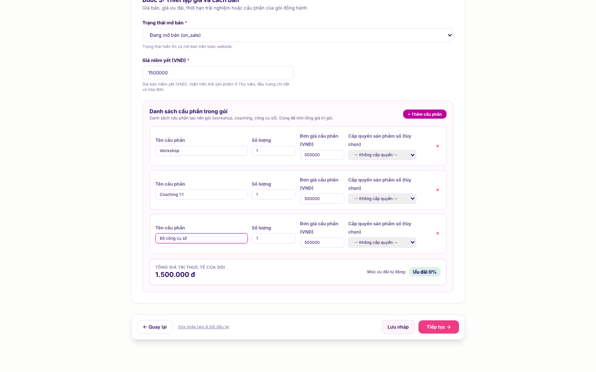

- **Với Sản phẩm Shopee**: Ẩn ô giá web, chỉ hiển thị ô nhập Đường dẫn Shopee và Nhãn nút bấm.
- **Với Ebook / Quà tặng miễn phí**: Giá bán mặc định 0đ và nút hành động chuyển sang "Tải về".

##### Bước 4: Nội dung giới thiệu

- **Bao gồm những gì**: Bấm **+ Thêm mục** để gạch đầu dòng các quyền lợi khách sẽ nhận được (ví dụ: `Bảng theo dõi 21 ngày kèm 10 cảm xúc`, `Hướng dẫn sử dụng chi tiết`).
- **Khó khăn của khách**: Mô tả ngắn gọn vấn đề hoặc điểm kẹt mà khách đang gặp phải.
- **Kết quả đạt được**: Mô tả giá trị chuyển hóa sau khi hoàn thành.
- **Câu hỏi thường gặp (FAQ)**: Bấm **+ Thêm câu hỏi** để bổ sung các cặp Câu hỏi & Câu trả lời giải đáp băn khoăn cho khách.

##### Bước 5: Xem trước và lưu sản phẩm

- **Bộ chọn kích thước xem trước**: Bấm vào các nút ngay dưới tiêu đề bước để kiểm tra giao diện hiển thị:
  - **📱 Điện thoại (375px)**
  - **Máy tính bảng** (768px)
  - **Máy tính** (1440px)
- Khung xem trước hiển thị trực tiếp trang chi tiết sản phẩm với đúng phong cách thương hiệu Trạm Dừng Cảm Xúc.
- **Lựa chọn lưu sản phẩm**:
  - **💾 Lưu nháp (Mặc định)**: Lưu sản phẩm ở trạng thái nháp an toàn (`draft`), chưa hiển thị ra ngoài website. Phù hợp khi bạn muốn xem lại sau hoặc tiếp tục bổ sung nội dung.
  - **🚀 Xuất bản**: Xuất bản sản phẩm trực tiếp lên website (`published`). Hệ thống sẽ tự động kiểm tra an toàn (bắt buộc có giá và ảnh bìa nếu đang mở bán).
- Sau khi bấm Lưu, hệ thống sẽ tự động chuyển hướng về form quản lý chuẩn của bản ghi tại `/admin/collections/products/[id]`, sẵn sàng cho các tinh chỉnh nâng cao nếu cần. Nhìn dòng **Trạng thái** trên đầu form: phải là **Đã xuất bản** nếu bạn vừa bấm Xuất bản.

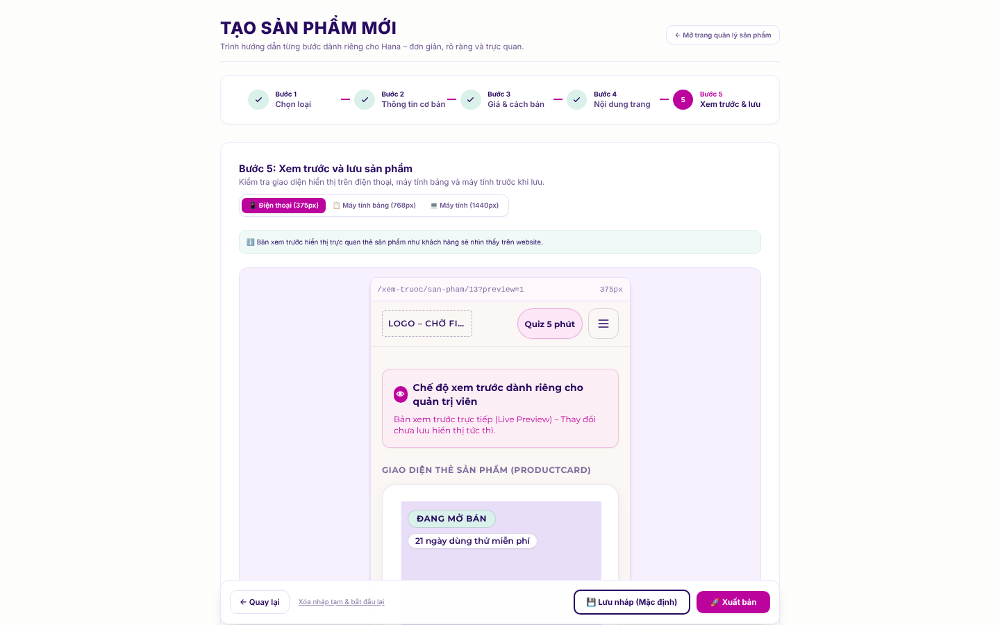

#### 3. Các tính năng bảo vệ an toàn cho Hana trong trình hướng dẫn

1. **Tự động lưu nháp vào trình duyệt (`localStorage`)**:
   - Khi bạn đang nhập dở mà vô tình tải lại trang (`F5`) hoặc máy tính mất điện, dữ liệu đã nhập ở các bước sẽ tự động khôi phục nguyên vẹn.
   - Khi đã lưu thành công lên hệ thống, bản nháp tạm này sẽ tự động được dọn sạch.
   - Bạn cũng có thể bấm nút **Xóa bản nháp trên máy này** ở góc dưới để bắt đầu nhập lại từ đầu.
2. **Cảnh báo rời trang khi chưa lưu**:
   - Nếu bạn bấm nút quay lại trình duyệt hoặc đóng tab khi đang nhập dở, trình duyệt sẽ hiện hộp thoại nhắc nhở để tránh mất công sức nhập liệu.
3. **Giữ nguyên dữ liệu khi lùi bước**:
   - Bạn có thể bấm nút **Quay lại** ở bất kỳ bước nào để chỉnh sửa thông tin ở bước trước mà không làm mất các dữ liệu đã nhập ở bước sau.

---

### 3.1c. Đổi tên gói, tagline và tên sản phẩm số (CLEAR / BUILD / SHINE, Habit Hack, EQ Buddy)

**Mục đích**: Khi cần điều chỉnh tên gọi chiến lược của các gói giải pháp, câu định vị (tagline) hoặc tên thương mại của các công cụ số (ví dụ: đổi tên gói từ CLEAR / BUILD / SHINE sang tên mới, đổi tagline "Chuyển mình không chênh vênh", đổi tên "Habit Hack" thành "Habit Formation"...), Hana chỉ cần sửa tại một nơi duy nhất trong mục **Sản phẩm**. Mọi trang web, bảng so sánh và khối kéo thả sẽ tự động đồng bộ ngay lập tức mà không cần vào Puck Editor sửa tay.

#### 1. Nguyên tắc quan trọng: Sửa trong Sản phẩm, KHÔNG sửa trong Puck

- **Dữ liệu nguồn duy nhất**: Các khối hiển thị sản phẩm trên website (như bảng so sánh 3 gói `PackageComparison`, thẻ gói `PackageCards`, lưới sản phẩm `ProductGrid`, thẻ giá `PriceTag`) **không lưu trữ câu chữ hay giá bán cố định bên trong Puck Editor**. Các khối này chỉ lưu mã nhận diện (ID) của sản phẩm và tự động truy xuất dữ liệu mới nhất từ danh mục **Sản phẩm** (`products`).
- **Lợi ích**: Bạn không cần phải mở từng trang một trong Puck Editor để sửa đi sửa lại câu chữ. Chỉ cần chỉnh sửa 1 lần trong **Sản phẩm**, toàn bộ các trang trên website đang giới thiệu gói đó sẽ tự động cập nhật đồng loạt.

#### 2. Các bước đổi tên gói và câu định vị (Tagline)

1. Ở menu bên trái, tìm nhóm **Khách hàng & Bán hàng** -> bấm vào **Sản phẩm** (`products`).
2. Tìm và bấm vào gói bạn muốn sửa (ví dụ: gói `CLEAR`, `BUILD`, hoặc `SHINE`).
3. Tại tab **Cơ bản**:
   - **Tên sản phẩm (`name`)**: Nhập tên mới của gói (ví dụ: nếu sau này đổi tên gói từ `CLEAR` sang một tên truyền cảm hứng khác).
   - **Mô tả ngắn (`shortDescription`)** hoặc **Câu định vị**: Sửa câu mô tả cô đọng tóm tắt ý nghĩa của gói.
4. Tại tab **Giá & bán**:
   - Sửa giá bán mới nếu có điều chỉnh.
   - Nếu đổi cấu phần (thêm bớt buổi khai vấn hay workshop), hãy chỉnh trong bảng cấu phần; hệ thống sẽ tự tính lại Tổng giá trị và % ưu đãi.
5. Bấm **Lưu thay đổi** (hoặc **Xuất bản** nếu đang ở bản nháp).
6. Mở trang chủ (`/`), trang lộ trình (`/lo-trinh-chuyen-minh`) hoặc trang thanh toán ngoài đời, bạn sẽ thấy tên gói mới và tagline mới đã tự động hiển thị mượt mà.

#### 3. Các bước đổi tên Habit Hack và EQ Buddy

1. Trong danh sách **Sản phẩm** (`products`), mở sản phẩm `Habit Tracker số` hoặc `EQ Buddy số`.
2. Tại tab **Cơ bản**:
   - Sửa **Tên sản phẩm**: Đổi tên hiển thị mà khách hàng sẽ nhìn thấy trên toàn hệ thống.
   - Sửa **Mô tả ngắn**: Cập nhật câu giới thiệu ngắn gọn.
3. Bấm **Lưu thay đổi**. Tên mới sẽ tự động cập nhật trên toàn bộ các thanh điều hướng, thẻ sản phẩm và trang thanh toán.

---

### 3.2. Sửa giá bán, giá ưu đãi và hạn ưu đãi

**Mục đích**: Thay đổi giá niêm yết hoặc thiết lập chương trình ưu đãi có thời hạn cho sản phẩm mà không cần can thiệp vào mã nguồn.

**Các bước thực hiện**:

1. Trong biểu mẫu sản phẩm, cuộn tới khu vực thông tin tài chính:
   - **Giá bán**: Nhập số tiền gốc bằng đồng Việt Nam (chỉ gõ số liền nhau, ví dụ `250000`).
   - **Giá ưu đãi**: Nếu có khuyến mại, nhập mức giá sau giảm vào ô này (ví dụ `178000`). Nếu không giảm giá, để trống ô này.
   - **Hạn ưu đãi**: Bấm vào biểu tượng lịch để chọn ngày giờ kết thúc khuyến mại (tùy chọn).
2. Bấm nút **Xuất bản** (hoặc **Lưu**) để áp dụng mức giá mới ngay lập tức. Mọi khối hiển thị sản phẩm trên website sẽ tự động cập nhật giá mới sau vài giây.

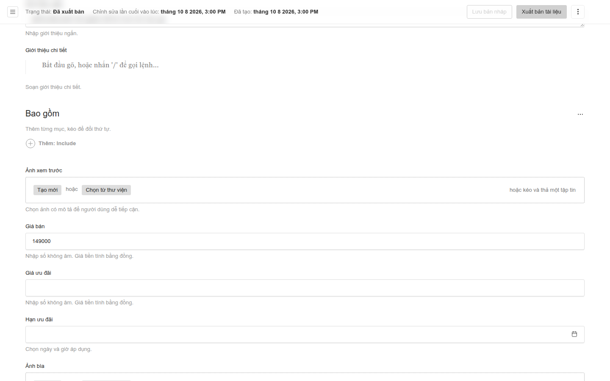
<!-- ẢNH 04: trang <ĐỊA CHỈ DEMO>/admin/collections/products/[id], khu vực các trường Giá bán, Giá ưu đãi và Hạn ưu đãi -->

> **Nếu gặp lỗi**: Hãy đảm bảo không nhập các ký tự đặc biệt như `đ`, `.` hay `,` vào ô giá tiền (chỉ nhập số).

---

### 3.3. Đổi 5 trạng thái bán và ảnh hưởng hiển thị trên website

**Mục đích**: Quyết định cách thức sản phẩm xuất hiện và hành động của nút bấm đối với độc giả.

Tại trường **Trạng thái bán** (`saleStatus`), Hana có thể chọn 1 trong 5 trạng thái:

| Trạng thái                     | Hiển thị ngoài website             | Nút hành động tương ứng                                           | Trường hợp sử dụng                                                 |
| :----------------------------- | :--------------------------------- | :---------------------------------------------------------------- | :----------------------------------------------------------------- |
| **Sắp ra mắt** (`coming_soon`) | Hiện thông tin, chưa cho mua       | Nút _"Nhận thông báo"_                                            | Sản phẩm đang trong giai đoạn chuẩn bị, mở đăng ký trước.          |
| **Đang bán** (`on_sale`)       | Hiện giá và mở đặt mua             | Nút _"Mua ngay"_ (hoặc _"Dùng thử 21 ngày"_ nếu có ngày dùng thử) | Sản phẩm hoặc công cụ số đã sẵn sàng mở bán chính thức.            |
| **Miễn phí** (`free`)          | Cho phép tải hoặc nhận quà         | Nút _"Nhận miễn phí"_                                             | Ebook, tài liệu quà tặng tải qua email, bài tập mẫu.               |
| **Cần tư vấn** (`consult`)     | Báo giá riêng, cần trao đổi        | Nút _"Đăng ký tư vấn"_ / _"Trao đổi"_                             | Các gói lớn Growth Mirror, chương trình đào tạo Doanh nghiệp.      |
| **Ẩn** (`hidden`)              | Không hiển thị trên danh mục chung | Không hiển thị thẻ                                                | Các cấu phần nội bộ đi kèm gói lớn hoặc sản phẩm tạm dừng phục vụ. |

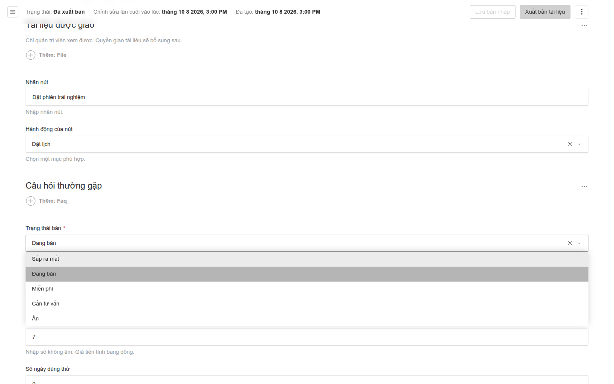
<!-- ẢNH 05: trang chỉnh sửa sản phẩm, danh sách thả xuống của trường Trạng thái bán với 5 lựa chọn -->

---

### 3.4. Cài đặt "Liên kết của nút" và trang Sắp ra mắt

Ô **Liên kết của nút (ngoài web hoặc trong web)** (`externalUrl`) cho phép bạn chỉ định nơi dẫn khách đến khi bấm nút trên thẻ sản phẩm:

- **Liên kết ngoài**: Dán đường link đầy đủ bắt đầu bằng `https://` (ví dụ: Shopee dán `https://shopee.vn/bo-the-eq-buddy` để mở gian hàng Shopee ở tab mới an toàn).
- **Công cụ trong web**: Gõ đường dẫn bắt đầu bằng một dấu `/` (ví dụ: công cụ trong web gõ `/habit/chan-doan` để dẫn thẳng vào bài test).
- **Sản phẩm "Sắp ra mắt"**: Khi chọn trạng thái _Sắp ra mắt_, website tự động chuyển hướng khách đến trang `/sap-ra-mat` để khách để lại email. Mọi thông tin khách đăng ký được lưu tại mục **Khách tiềm năng** với thẻ `sap-ra-mat:<slug>` (hoặc có thêm `dung-thu:<slug>` nếu có ngày dùng thử).

---

### 3.5. Điểm đặc biệt của Gói đồng hành (Growth Mirror)

**Mục đích**: Xây dựng gói đồng hành có nhiều thành phần đi kèm (phiên coaching, workshop, cộng đồng, công cụ số).

**Quy tắc vận hành an toàn**:

1. Khi mở gói sản phẩm loại **Gói đồng hành** (như gói CLEAR, BUILD, SHINE), tìm tới bảng **Cấu phần của gói**.
2. Hana bấm **Thêm cấu phần** để bổ sung các thành phần:
   - Nhập tên cấu phần, số lượng và đơn giá thành phần.
3. **Tổng giá trị** và **Ưu đãi (%)** được hệ thống **tự động tính toán 100%**:
   - Hệ thống tự cộng dồn giá trị các thành phần để ra dòng Tổng giá trị gạch ngang.
   - Hệ thống tự so sánh tổng giá trị với giá bán của gói để tính ra con số phần trăm ưu đãi (ví dụ: `30%`, `50%`, `60%`).
   - Hai ô này được khóa chế độ chỉ đọc để chống tính toán sai lệch. Bạn không cần và không thể nhập tay.

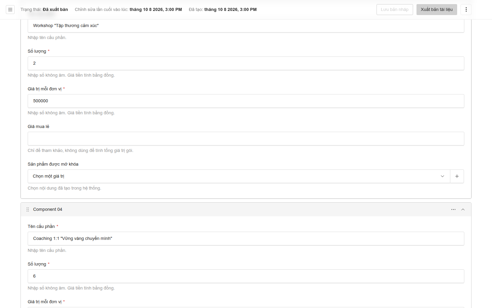
<!-- ẢNH 06: trang chi tiết một gói Growth Mirror, bảng Cấu phần của gói và hai ô Tổng giá trị, Ưu đãi (%) bị làm mờ chỉ đọc -->

---

### 3.6. Tải tài liệu PDF vào "Tài liệu riêng tư" và gắn vào sản phẩm miễn phí

**Mục đích**: Đăng tải các tệp quà tặng (Ebook PDF, tài liệu hướng dẫn) được bảo vệ an toàn để giao tự động qua email khi khách đăng ký.

**Các bước thực hiện**:

1. Ở cột menu bên trái, tìm nhóm **Sản phẩm & bán hàng**, bấm vào **Tài liệu riêng tư**.
2. Bấm nút **Tạo mới** ở góc trên bên phải.
3. Bấm nút tải tệp và chọn tệp PDF (hoặc ZIP, EPUB) từ máy tính của bạn.
4. Nhập tóm tắt vào ô **Mô tả tài liệu** (ví dụ: _Ebook và bộ công cụ EQ bản chính thức PDF_).
5. Bấm nút **Lưu** để hệ thống lưu tệp vào vùng bảo mật.
6. **Gắn tệp vào sản phẩm**:
   - Mở mục **Sản phẩm** -> bấm vào sản phẩm miễn phí bạn muốn tặng (ví dụ: `[MẪU] Ebook và bộ công cụ EQ`).
   - Cuộn tới khu vực **Tài liệu được giao**, bấm **Thêm mới**.
   - Tại ô chọn tài liệu, chọn tệp PDF bạn vừa tải lên ở Bước 5.
   - Bấm **Xuất bản** sản phẩm.

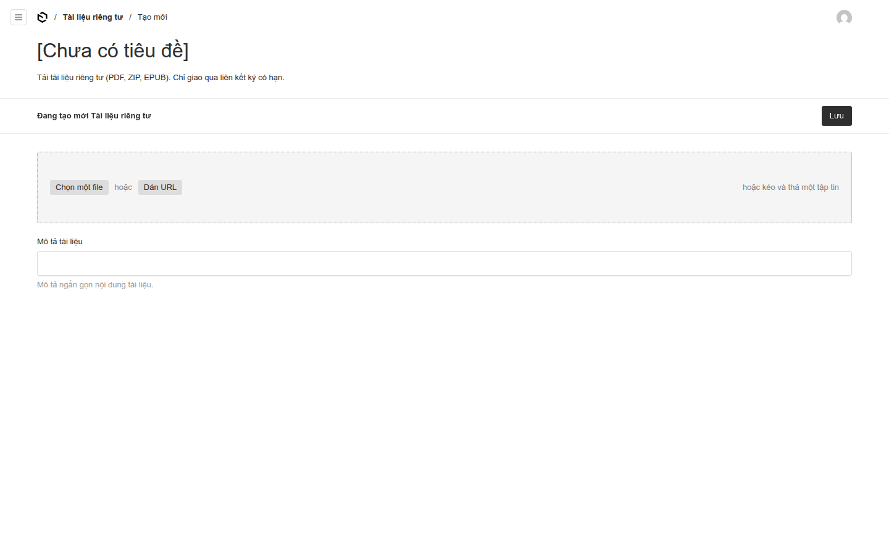
<!-- ẢNH 07: trang <ĐỊA CHỈ DEMO>/admin/collections/privateFiles, danh sách tệp riêng tư và form tải lên tệp PDF -->

> **Nếu gặp lỗi**: Đảm bảo tệp tải lên có định dạng hợp lệ (`.pdf`, `.zip`, `.epub`). Các định dạng tệp lạ sẽ bị hệ thống từ chối để ngăn chặn mã độc.

---

### 3.7. Xem trước trước khi xuất bản (Live Preview)

**Mục đích**: Nhìn thấy ngay trang hiển thị thực tế khi đang soạn thảo nội dung (sản phẩm, bài học, thẻ EQ, lời chia sẻ, trang pháp lý, workshop, dịch vụ, chương trình, bài viết hoặc cài đặt website) trước khi xuất bản mà không cần chuyển qua lại giữa nhiều tab.

#### Bảng ánh xạ: Nội dung sửa trong CMS → Trang xem trước ngoài website

Hệ thống tự động nhận biết loại nội dung bạn đang mở và dẫn khung xem trước đến đúng trang tương ứng:

| Bảng nội dung (Collection)                 | Điều kiện phân loại                                     | Trang xem trước hiển thị      | Nội dung hiển thị trong khung xem trước                                                               |
| :----------------------------------------- | :------------------------------------------------------ | :---------------------------- | :---------------------------------------------------------------------------------------------------- |
| **Sản phẩm** (`products`)                  | Công cụ số Thói quen (`digital_tool` thuộc web `habit`) | `/habit/1-percent-better`     | Trang giới thiệu công cụ số 1% Better, bảng chẩn đoán và ưu đãi.                                      |
| **Sản phẩm** (`products`)                  | Sách điện tử hoặc Bộ tài nguyên (`ebook`, `toolkit`)    | `/tai-nguyen/[slug]`          | Trang chi tiết tài nguyên, ảnh bìa, tóm tắt và form nhận tài liệu.                                    |
| **Sản phẩm** (`products`)                  | Gói đồng hành (`package`)                               | `/coaching/growth-mirror`     | Trang 3 gói Growth Mirror, tự động hiển thị bảng giá và cấu phần.                                     |
| **Sản phẩm** (`products`)                  | Còn lại (Shopee, Workshop, Phiên trải nghiệm, B2B...)   | `/xem-truoc/san-pham/[id]`    | Tuyến xem trước riêng hiển thị thẻ sản phẩm (`ProductCard`) chuẩn nhận diện và bảng giá (`PriceTag`). |
| **Bài học** (`lessons`)                    | Tất cả bài học khóa Habit                               | `/habit/hoc/[id]`             | Trang học tập, video bài giảng, tóm tắt và tài liệu thực hành.                                        |
| **Thẻ EQ Buddy** (`eqCards`)               | Tất cả 26 thẻ EQ                                        | `/eq-buddy/the/[qrSlug]`      | Giao diện mở từ mã QR: từ khóa mặt trước, thông điệp, 3 câu hỏi suy ngẫm mặt sau.                     |
| **Lời chia sẻ** (`testimonials`)           | Cảm nhận khách hàng                                     | `/xem-truoc/loi-chia-se/[id]` | Tuyến xem trước riêng hiển thị thẻ cảm nhận (`TestimonialCard`) với avatar và vai trò.                |
| **Trang pháp lý** (`legalPages`)           | Điều khoản, bảo mật, quy chế...                         | `/[slug]`                     | Trang điều khoản hoặc chính sách hoàn chỉnh trên website.                                             |
| **Lịch workshop** (`workshops`)            | Buổi học trực tuyến                                     | `/xem-truoc/workshop/[id]`    | Tuyến xem trước riêng hiển thị thẻ workshop, thời gian bắt đầu/kết thúc và gói áp dụng.               |
| **Dịch vụ đồng hành** (`services`)         | Gói coaching 1:1                                        | `/coaching/[slug]`            | Trang chi tiết dịch vụ coaching và nút đặt lịch.                                                      |
| **Chương trình doanh nghiệp** (`programs`) | Đào tạo B2B                                             | `/doanh-nghiep/[slug]`        | Trang chi tiết chương trình đào tạo doanh nghiệp.                                                     |
| **Bài viết & Video** (`posts`)             | Blog, bài chia sẻ                                       | `/blog/[slug]`                | Trang bài viết blog chi tiết.                                                                         |
| **Cài đặt Website** (`siteSettings`)       | Cài đặt chung toàn trang                                | `/` (Trang chủ)               | Trang chủ website, xem trước thay đổi thông tin liên hệ, thương hiệu, mạng xã hội.                    |
| **Menu điều hướng** (`navigation`)         | Menu chính & Menu chân trang                            | `/` (Trang chủ)               | Trang chủ website, xem trước sự thay đổi của thanh menu trên cùng và footer dưới cùng.                |

#### Ba kích thước xem trước chuẩn Brand Book 2026

Ở thanh trên cùng của khung xem trước có ô chọn kích thước (mặc định ghi **Responsive**). Bấm vào ô này và chọn 1 trong 3 kích thước chuẩn:

- 📱 **Điện thoại di động (Mobile - 375px)**: Kiểm tra khả năng hiển thị trên màn hình nhỏ (iPhone / Android).
- 📱 **Máy tính bảng (Tablet - 768px)**: Kiểm tra bố cục trên iPad và máy tính bảng xoay dọc.
- 💻 **Máy tính để bàn (Desktop - 1440px)**: Màn hình rộng tiêu chuẩn trên laptop và máy tính bàn.

#### Các bước thực hiện:

1. Mở bất kỳ bản ghi nào trong các bảng nêu trên (ví dụ: mở một sản phẩm hoặc một thẻ EQ).
2. Bấm **biểu tượng con mắt** 👁 ngay bên trái nút **Lưu bản nháp** (mục 1.4b). Khung xem trước mở ra bên phải form; bấm lại con mắt để đóng.
3. **Nếu là bản ghi mới tạo**: Nhập các thông tin cơ bản bắt buộc (như Tên và Đường dẫn slug) rồi bấm **Lưu nháp** một lần để hệ thống sinh đường dẫn xem trước. Nếu chưa lưu nháp lần đầu, hệ thống sẽ hiện thông báo nhẹ nhàng: _"Lưu nháp để xem trước"_.
4. **Sửa nội dung trực tiếp**: Khi bạn gõ từng ký tự vào ô tên, tiêu đề, từ khóa, mô tả... khung xem trước bên cạnh sẽ **cập nhật ngay lập tức theo thời gian thực** mà bạn chưa cần bấm Lưu.
5. Khi hoàn toàn ưng ý với giao diện:
   - Bấm **Lưu bản nháp** nếu muốn tiếp tục hoàn thiện sau.
   - Bấm **Xuất bản tài liệu** khi muốn đưa nội dung mới ra website công khai cho độc giả.

> **Bảo mật và an toàn dữ liệu tuyệt đối (`// REVIEW-REQUIRED:`)**:
>
> - Khung xem trước chỉ hiển thị bản nháp khi bạn **đã đăng nhập tài khoản quản trị** (`owner` hoặc `editor`).
> - Khách vãng lai và học viên dù có bấm vào link xem trước hoặc thêm `?preview=1` thì hệ thống vẫn **chỉ hiển thị bản đã xuất bản**, tuyệt đối không xem được bản nháp.
> - Các tuyến xem trước riêng (`/xem-truoc/*`) sẽ tự động trả về lỗi **404 (Không tìm thấy trang)** đối với khách vãng lai và học viên, đảm bảo không rò rỉ thông tin sản phẩm hay lời chia sẻ nội bộ.
> - Khi quản trị viên xem trước bài học trả phí, hệ thống **không cấp quyền xem video cho khách** và **không ghi nhận tiến độ học tập**, giữ nguyên vẹn tính toàn vẹn của dữ liệu học viên.
> - Khi quản trị viên xem trước trang mở từ mã QR của thẻ EQ (`/eq-buddy/the/[qrSlug]`), hệ thống **tự động vô hiệu hóa bộ đếm lượt quét QR** để không làm sai lệch số liệu thống kê thực tế từ người dùng.

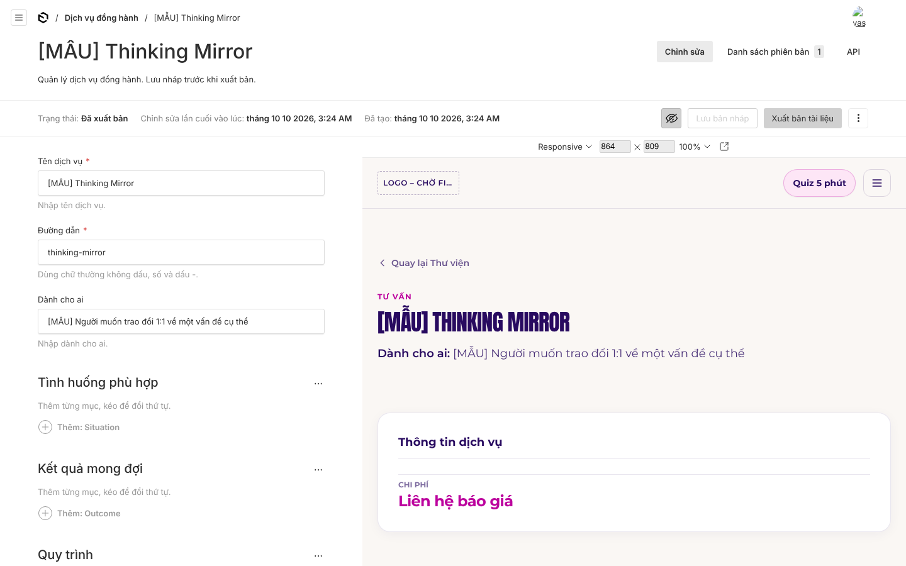
<!-- ẢNH 27: Form sửa dịch vụ với Xem trước đang mở, tiêu đề chưa lưu hiện trong iframe và bộ chọn ba kích thước. -->

---

### 3.8. Quản lý Lịch workshop và quyền tham gia (Workshops)

**Mục đích**: Lên lịch các buổi workshop tương tác trực tuyến (ví dụ: workshop "Tập thương cảm xúc" thuộc các gói Growth Mirror), chọn các sản phẩm/gói được tham gia, và nhập liên kết phòng học trực tuyến (Zoom, Google Meet...).

**Các bước thực hiện**:

1. Ở menu bên trái, tìm nhóm **Khóa Habit**, bấm chọn **Lịch workshop**.
2. Bấm nút **Tạo mới** (ở góc trên bên phải).
3. Điền các trường thông tin:
   - **Tên workshop**: Tiêu đề buổi workshop (ví dụ: _Workshop "Tập thương cảm xúc" – Buổi 1_).
   - **Sản phẩm workshop**: (Tùy chọn) Chọn sản phẩm tương ứng nếu workshop được bán lẻ.
   - **Bắt đầu**: Chọn ngày và giờ bắt đầu buổi học (theo giờ Việt Nam).
   - **Kết thúc**: Chọn ngày và giờ kết thúc buổi học.
   - **Liên kết tham gia**: Nhập đường link phòng họp trực tuyến (Zoom, Google Meet...).
   - **Sản phẩm được tham gia**: Chọn các gói đồng hành hoặc sản phẩm mà học viên đã mua sẽ được quyền tham gia (ví dụ: các gói Growth Mirror CLEAR, BUILD, SHINE).
4. Bấm **Xuất bản** để kích hoạt lịch workshop trên hệ thống.

**Quy tắc bảo vệ liên kết phòng học & nhắc lịch tự động**:

- **Ai được thấy lịch workshop**: Chỉ những khách hàng đã có đơn hàng thanh toán thành công (`Đã thanh toán`) chứa ít nhất một sản phẩm nằm trong danh sách `Sản phẩm được tham gia` mới nhìn thấy buổi workshop đó trong mục **"Lịch workshop của tôi"** tại trang `/tai-khoan`.
- **Khi nào link phòng học mở**: Để bảo mật phòng học, nút **"Vào phòng"** chứa liên kết tham gia **chỉ hiển thị trong khoảng 60 phút trước giờ bắt đầu đến hết giờ kết thúc**. Ngoài khoảng thời gian này, học viên chỉ thấy thông báo: _"Link sẽ mở 60 phút trước giờ học"_.
- **Email nhắc tự động trước 24 giờ**: Hệ thống tự động quét và gửi email nhắc lịch cho học viên đủ điều kiện trước 24 giờ. Email dẫn về trang tài khoản để lấy link phòng học chứ không gửi trực tiếp qua email để đảm bảo bảo mật.

---

### 3.8b. Lên lịch workshop bằng Trình hướng dẫn (3 bước)

**Mục đích**: Giúp Hana lên lịch các buổi workshop Zoom/Google Meet đồng hành cùng học viên một cách nhanh chóng và an toàn tuyệt đối: không lo nhầm lẫn múi giờ, chọn đúng gói học viên được tham gia, và xem trước giao diện email nhắc nhở 24 giờ mà không gửi email thật.

#### 1. Cách mở Trình hướng dẫn lên lịch workshop

Bạn có thể mở trình hướng dẫn bằng 3 cách rất thuận tiện:

- **Từ trang chủ Dashboard "Hôm nay"**: Tại ô phím tắt nhanh, bấm vào **"Lên lịch workshop"**.
- **Từ bảng danh sách Lịch workshop**: Vào menu **Khóa Habit** -> chọn **Lịch workshop**, bạn sẽ nhìn thấy banner màu tím nổi bật ở ngay đầu trang -> bấm nút **+ Lên lịch workshop (từng bước)**.
- **Nhập trực tiếp đường dẫn**: Truy cập thẳng vào `/admin/len-lich-workshop`.

#### 2. Các bước thiết lập chi tiết

##### Bước 1: Đối tượng tham gia

- **Tên buổi workshop**: Nhập tiêu đề buổi học (ví dụ: `Workshop "Tập thương cảm xúc" – Kỳ 1`).
- **Chọn sản phẩm được tham gia**: Tích chọn các gói đồng hành (CLEAR, BUILD, SHINE) hoặc sản phẩm workshop bán lẻ mà học viên đã mua sẽ được quyền vào phòng.
  - Có sẵn nút **Chọn tất cả** hoặc **Bỏ chọn** để thao tác nhanh chỉ với 1 cú nhấp chuột.
  - Thẻ sản phẩm hiển thị nhãn phân loại rõ ràng (`Gói đồng hành` hoặc `Workshop`).
- Bấm **Tiếp tục**.

##### Bước 2: Thời gian và địa điểm

- **Ngày và Giờ bắt đầu (theo giờ Việt Nam)**: Chọn ngày diễn ra và giờ bắt đầu bình thường theo múi giờ sinh hoạt tại Việt Nam (ICT, UTC+7).
- **Hệ thống tự động quy đổi múi giờ chuẩn quốc tế (UTC)**:
  - Ngay khi bạn chọn giờ, hệ thống sẽ tính toán và hiển thị chuỗi thời gian quốc tế tương đương.
  - **Xử lý thông minh rạng sáng 0h–7h**: Nếu bạn lên lịch vào khung giờ rạng sáng (ví dụ: 02:00 sáng ngày 25/10 tại Việt Nam), hệ thống sẽ tự động hiểu và lưu chính xác là 19:00 ngày 24/10 theo giờ quốc tế (UTC), tránh hoàn toàn lỗi lệch ngày khi gửi email nhắc nhở.
- **Liên kết tham gia**: Dán đường link phòng họp trực tuyến (Google Meet hoặc Zoom, ví dụ: `https://meet.google.com/abc-defg-hij`). Hệ thống sẽ kiểm tra định dạng đường link ngay khi bạn nhập.
- **Kiểm lại trước khi đi tiếp**: đọc khung xanh **Thời gian hiển thị cho học viên** – phải đúng giờ Việt Nam bạn muốn (ví dụ `20:00 ngày 30/10/2026 (Giờ VN - UTC+7)`). Ô ngày / giờ có thể hiện kiểu tháng/ngày hoặc AM/PM tùy cài đặt máy; khung xanh này luôn ghi theo kiểu Việt Nam.
- Bấm **Tiếp tục**.

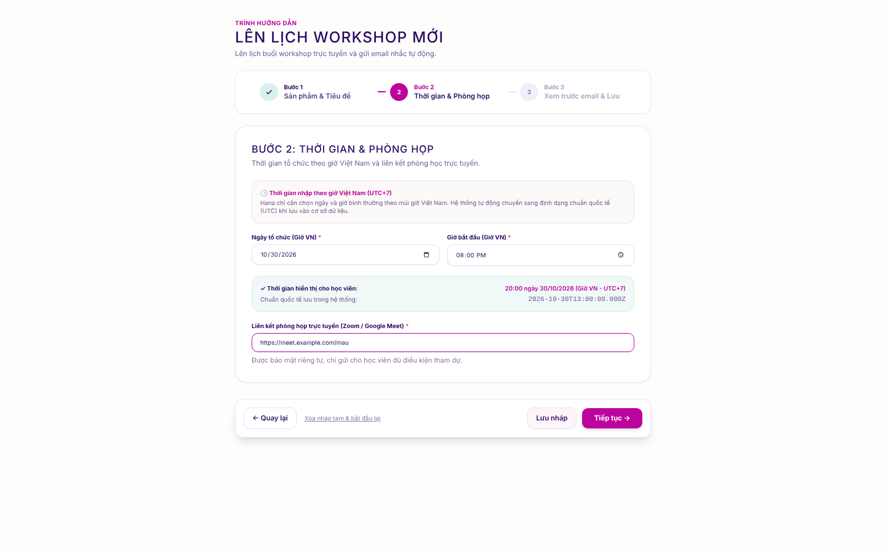

##### Bước 3: Xem trước thông báo và lưu

- **Khung xem trước email nhắc nhở 24 giờ**:
  - Hệ thống sử dụng chính mẫu email thật của Trạm Dừng Cảm Xúc để hiển thị bản xem trước sinh động với tên workshop, ngày giờ Việt Nam chuẩn xác và nút truy cập tài khoản học viên.
  - Bạn có thể chuyển đổi giữa chế độ **Điện thoại** (375px) và **Máy tính** (100%) để kiểm tra độ hiển thị đẹp mắt.
  - **An toàn tuyệt đối**: Bước này chỉ nhằm mục đích giúp bạn duyệt trước nội dung, hệ thống **hoàn toàn KHÔNG gửi email thật** ra ngoài.
- **Lưu lịch workshop**:
  - **Lưu nháp (Mặc định)**: Lưu lịch ở trạng thái nháp an toàn (`draft`) để chuẩn bị trước.
  - **Xuất bản**: Mở lịch chính thức trên hệ thống (`published`) để học viên thấy trong trang tài khoản `/tai-khoan`.
- Sau khi bấm Lưu, hệ thống sẽ tự động chuyển hướng về form chuẩn tại `/admin/collections/workshops/[id]`.

#### 3. Tính năng an toàn cho Hana

- **Tự động lưu nháp vào máy**: Nếu bạn lỡ tay đóng tab hay mất điện, dữ liệu đang nhập sẽ tự động khôi phục khi bạn quay lại.
- **Cảnh báo rời trang**: Trình duyệt sẽ hỏi xác nhận nếu bạn rời đi khi chưa lưu.
- **Lùi bước linh hoạt**: Bạn có thể bấm **Quay lại** bất kỳ lúc nào để chỉnh sửa mà không bị mất dữ liệu ở các bước khác.

---

### 3.9. Chương trình dùng thử 21 ngày cho công cụ số

**Mục đích**: Cho phép độc giả trải nghiệm trọn vẹn công cụ số (Habit Tracker số và EQ Buddy số) trong 21 ngày miễn phí trước khi quyết định mua sở hữu trọn đời.

**Quy trình vận hành tự động của hệ thống**:

1. **Kích hoạt dùng thử trên thẻ sản phẩm**:
   - Khi sản phẩm có **Loại sản phẩm** là `Công cụ số`, **Trạng thái bán** là `Đang bán` (`on_sale`), và ô **Số ngày dùng thử** có giá trị `21`:
   - Website tự động hiển thị nút bấm **"Bắt đầu dùng thử 21 ngày"** dẫn khách hàng đến trang giới thiệu `/dung-thu?san-pham=<slug>`.
   - Khách hàng đăng nhập bằng mã OTP gửi qua email và bấm xác nhận kích hoạt dùng thử. Hệ thống tự động gửi email chào mừng và chuyển hướng ngay vào công cụ.
2. **Tự động đổi nút kêu gọi (CTA) tại kết quả Quiz chẩn đoán**:
   - Khi bài test chẩn đoán thói quen kết thúc, nếu sản phẩm Habit Tracker số đang mở chương trình dùng thử, nút kêu gọi hành động sẽ tự động dẫn thẳng đến trang dùng thử Habit Tracker số thay vì gói Growth Mirror.
3. **Banner đếm ngược trong công cụ**:
   - Khách hàng đang trong thời gian dùng thử khi truy cập trang thói quen sẽ nhìn thấy thanh thông báo nhẹ nhàng ở đầu trang: _"Còn {n} ngày dùng thử"_ kèm nút _"Mua để dùng tiếp"_.
   - Hết 21 ngày, thanh thông báo sẽ chuyển sang: _"Thời gian dùng thử đã kết thúc – dữ liệu của bạn vẫn được giữ"_.
4. **Email nhắc hạn tự động (Mốc ngày 18 và ngày 21)**:
   - Hệ thống quét tự động mỗi giờ:
     - **Ngày 18 (còn 3 ngày)**: Gửi email nhắc nhở kèm mức giá ưu đãi sở hữu trọn đời.
     - **Ngày 21 (ngày cuối cùng)**: Gửi email thông báo ngày trải nghiệm cuối và hướng dẫn nâng cấp.
   - **Mức giá ưu đãi trong email hoàn toàn tự động**: Hệ thống đọc trực tiếp từ ô **Giá bán** và **Giá ưu đãi** của sản phẩm trong CMS. Hana có thể đổi giá bất kỳ lúc nào mà không cần sửa code.
   - Nếu khách hàng đã thanh toán mua sản phẩm (`active`), hệ thống tự động ngừng gửi email nhắc.

**Cách Hana bật, tắt hoặc điều chỉnh**:

- **Tắt chương trình dùng thử**: Xóa ô **Số ngày dùng thử** (hoặc đặt về `0`). Toàn bộ nút dùng thử trên website và Quiz CTA sẽ tự động chuyển về luồng mua hàng thông thường.
- **Thay đổi giá bán ưu đãi**: Chỉnh sửa ô **Giá bán** (ví dụ `250000`) và **Giá ưu đãi** (ví dụ `178000`). Toàn bộ website và email nhắc sẽ tự động cập nhật ngay lập tức.

### 3.10. Quản lý Bài học và Video khóa học (Habit Hack)

**Mục đích**: Đăng tải và sắp xếp các bài học, lộ trình video thực hành thói quen trên trang Góc học tập `/habit/hoc`.

**Các bước thực hiện**:

1. **Quản lý Nhóm bài học (`courseModules`)**:
   - Ở cột menu bên trái, tìm nhóm **Khóa Habit**, bấm vào **Nhóm bài học**.
   - Bấm **Tạo mới** hoặc bấm vào nhóm có sẵn để sửa.
   - Nhập **Tên nhóm bài học** (ví dụ: _Giai đoạn 1: Hiểu mình & Điểm nghẽn_).
   - Chọn **Nhóm nội dung**: chọn 1 trong 3 nhóm chuẩn gồm _Hiểu mình_ (`insight`), _Nguyên tắc_ (`principle`), hoặc _Kỹ thuật_ (`technique`). Lộ trình trên website sẽ tự động gom các bài học theo thứ tự 3 nhóm này.
   - Nhập **Thứ tự** hiển thị (số nhỏ hơn đứng trước).
   - Bấm **Xuất bản**.

2. **Quản lý Bài học (`lessons`)**:
   - Trong nhóm **Khóa Habit**, bấm vào **Bài học**.
   - Bấm **Tạo mới** và điền các trường:
     - **Tiêu đề**: Tên bài học hiển thị cho học viên.
     - **Nhóm bài học**: Chọn nhóm bài học đã tạo ở bước 1.
     - **Tóm tắt**: Ghi chú ngắn gọn về nội dung hoặc câu hỏi gợi mở cho học viên.
     - **Thời lượng (giây)**: Tổng số giây của video (ví dụ: `300` tương đương 5 phút).
     - **Thứ tự**: Thứ tự xuất hiện trong nhóm (số nhỏ hơn đứng trước).
     - **Cho phép xem thử**: Tích chọn ô này nếu bạn muốn bài học mở tự do cho mọi người xem trước (kể cả khách chưa đăng nhập hoặc chưa mua gói). Nếu bỏ tích, bài học sẽ yêu cầu khách hàng đăng nhập và kích hoạt dùng thử 21 ngày hoặc mua sản phẩm Habit Tracker số mới xem được.
     - **Mã video**: Điền mã định danh video từ dịch vụ lưu trữ Bunny Stream. Ô này được bảo mật tuyệt đối, chỉ quản trị viên nhìn thấy trong admin. Khi hệ thống ở chế độ thử nghiệm nội bộ (sandbox), bài học sẽ hiển thị khung phát thử nghiệm; khi kết nối dịch vụ Bunny chính thức, video sẽ được phát an toàn chống tải lậu cho học viên.
   - Bấm **Xuất bản** để đưa bài học lên Góc học tập.

### 3.10.1. Cách nhập video Bunny Stream cho bài học

**Mục đích**: Nhập video bài giảng chất lượng cao từ kho lưu trữ Bunny Stream vào bài học trên website để học viên xem trực tiếp, được bảo vệ chống sao chép và tải lậu.

**Các bước thực hiện**:

1. **Tải video lên kho Bunny Stream**:
   - Truy cập trang quản trị Bunny Stream (`https://dash.bunny.net/stream`).
   - Vào thư viện video của Trạm Dừng Cảm Xúc.
   - Bấm **Upload Video** và chọn file video bài học từ máy tính để tải lên. Đợi video tải lên và hoàn tất xử lý (trạng thái chuyển sang _Finished_).

2. **Lấy Mã video (GUID)**:
   - Bấm vào video vừa tải lên để mở trang chi tiết.
   - Nhìn vào ô **Direct Play URL** hoặc dòng **Video ID** (hoặc chuỗi mã nằm trong đường dẫn URL trình duyệt), bạn sẽ thấy một chuỗi mã định danh chuẩn GUID có dạng 36 ký tự gồm các chữ cái và số ngăn cách bởi dấu gạch nối: `xxxxxxxx-xxxx-xxxx-xxxx-xxxxxxxxxxxx` (ví dụ: `a1b2c3d4-e5f6-7890-abcd-ef1234567890`).
   - Bấm nút sao chép (Copy) chuỗi mã này.

3. **Dán vào bài học trong CMS**:
   - Quay lại trang quản trị CMS (`/admin`) -> Vào nhóm **Khóa Habit** -> chọn **Bài học**.
   - Bấm vào bài học bạn muốn gắn video.
   - Cuộn đến trường **Mã video (Bunny)** (`videoId`) và dán chính xác chuỗi mã GUID vừa sao chép vào.
   - Bấm nút **Lưu** hoặc **Xuất bản**.

4. **Kiểm tra hiển thị**:
   - Bấm nút mở bài học trên Góc học tập (`/habit/hoc/[id]`).
   - Video được phát qua trình phát bảo mật của hệ thống; tiến độ xem của học viên được tự động ghi nhận sau mỗi 15 giây.

---

### 3.10.2. Thêm bài học bằng Trình hướng dẫn (4 bước)

**Mục đích**: Hỗ trợ Hana đăng tải bài học mới vào lộ trình khóa học một cách nhanh gọn và trực quan nhất: vừa chọn chương vừa có thể tạo nhanh chương mới ngay tại chỗ, gắn bài học vào 4 chặng Habit Loop, tự động kiểm tra mã video Bunny và gõ thời lượng theo dạng phút:giây quen thuộc, kèm theo màn hình xem trước 3 kích thước trước khi lưu.

#### 1. Cách mở Trình hướng dẫn thêm bài học

Bạn có 3 cách rất dễ dàng:

- **Từ Dashboard "Hôm nay"**: Tại ô phím tắt nhanh, bấm vào **"Thêm bài học"**.
- **Từ bảng danh sách Bài học**: Vào menu **Khóa Habit** -> chọn **Bài học**, bạn sẽ nhìn thấy banner màu tím nổi bật ở ngay đầu trang -> bấm nút **+ Thêm bài học (từng bước)**.
- **Nhập trực tiếp đường dẫn**: Truy cập thẳng vào `/admin/them-bai-hoc`.

#### 2. Các bước thiết lập chi tiết

##### Bước 1: Chọn chương học

- **Danh sách nhóm bài học hiện có**: Hiển thị toàn bộ các chương đã có trên hệ thống, kèm theo nhãn phân loại (_Hiểu mình_, _Nguyên tắc_, hoặc _Kỹ thuật_) và số thứ tự chương. Bạn chỉ cần nhấp chuột vào thẻ chương mong muốn để chọn.
- **Tạo nhanh nhóm bài học mới ngay tại chỗ**: Nếu bài học thuộc một chương mới toanh chưa có trên website, bạn không cần phải quay ra ngoài menu khác:
  - Bấm nút **+ Tạo nhóm bài học mới**.
  - Nhập **Tên nhóm bài học** (ví dụ: `Chương 4: Tự tin duy trì thói quen`).
  - Chọn **Nhóm nội dung** (`Hiểu mình`, `Nguyên tắc`, hoặc `Kỹ thuật`).
  - Bấm **Tạo nhóm ngay**. Nhóm mới sẽ tự động được tạo và chọn ngay cho bạn.
- Bấm **Tiếp tục**.

##### Bước 2: Thông tin bài học

- **Tiêu đề bài học**: Nhập tên bài giảng hiển thị cho học viên (ví dụ: `Bài 1: Nhận diện tín hiệu kích hoạt`).
- **Tóm tắt bài học**: Viết ngắn gọn 1–2 câu giới thiệu nội dung hoặc câu hỏi gợi mở suy ngẫm.
- **Chặng thói quen (Habit Loop)**: Chọn 1 trong 5 nút lựa chọn:
  - _Gợi ý (Cue)_: Tín hiệu kích hoạt thói quen.
  - _Khao khát (Craving)_: Động lực và cảm xúc thúc đẩy.
  - _Phản hồi (Response)_: Hành động thực hiện thói quen.
  - _Phần thưởng (Reward)_: Lợi ích và cảm giác thỏa mãn nhận được.
  - _Không áp dụng_: Bài học nhập môn hoặc tổng kết chung không thuộc vòng lặp 4 bước.
- **Thứ tự hiển thị trong chương**: Hệ thống **tự động gợi ý** số thứ tự tiếp theo (bằng số thứ tự lớn nhất trong chương cộng 1). Bạn có thể sửa lại số này nếu muốn chèn bài vào vị trí khác.
- Bấm **Tiếp tục**.

##### Bước 3: Video bài học & Thời lượng

- **Mã video Bunny Stream (GUID)**:
  - Dán chuỗi mã định danh 36 ký tự từ Bunny Stream (ví dụ: `a1b2c3d4-e5f6-7a8b-9c0d-1e2f3a4b5c6d`).
  - Hệ thống **kiểm tra định dạng thời gian thực**: nếu mã đúng chuẩn GUID, hệ thống sẽ hiện dấu tích xanh `✓ Định dạng GUID hợp lệ`. Nếu mã bị thiếu ký tự hoặc nhầm link web, hệ thống sẽ nhắc nhở ngay lập tức để bạn sửa.
- **Thời lượng video**:
  - Bạn có thể nhập theo dạng **phút:giây** quen thuộc (ví dụ gõ `12:30` hoặc `05:45`).
  - Hệ thống **tự động chuyển đổi** sang tổng số giây (`750` giây hoặc `345` giây) hiển thị ngay bên cạnh và lưu chuẩn xác vào cơ sở dữ liệu.
- **Cho phép học viên xem thử miễn phí bài học này**: Tích chọn ô này nếu bạn muốn bài học mở tự do cho mọi khách xem trước mà không cần đăng nhập hay mua khóa học.
- Bấm **Tiếp tục**.

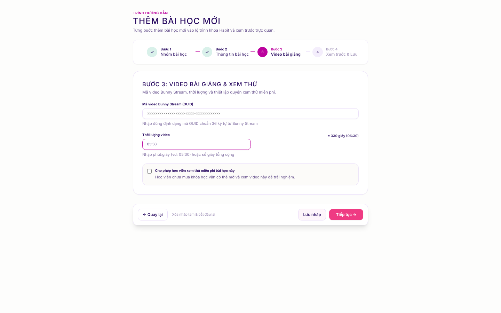

##### Bước 4: Xem trước và lưu bài học

- **Khung xem trước trực quan**:
  - Hệ thống tự động tạo bản nháp tạm thời và tải trực tiếp giao diện phát video bài học thực tế bên trong khung xem trước.
  - Bạn có thể chuyển đổi giữa 3 kích thước:
    - **Điện thoại** (375px)
    - **Máy tính bảng** (768px)
    - **Máy tính** (1440px)
- **Lưu bài học**:
  - **Lưu nháp (Mặc định)**: Lưu bài học ở trạng thái nháp an toàn (`draft`).
  - **Xuất bản**: Mở bài học chính thức trên Góc học tập `/habit/hoc` (`published`).
- Sau khi bấm Lưu, hệ thống tự động chuyển hướng về trang bài học chuẩn tại `/admin/collections/lessons/[id]`.

#### 3. Tính năng an toàn cho Hana

- **Tự động lưu nháp vào máy**: Không lo mất nội dung khi mất điện hoặc vô tình đóng trình duyệt.
- **Cảnh báo rời trang**: Tránh việc bấm nhầm nút quay lại khi đang nhập dở.
- **Khôi phục dữ liệu**: Bạn có thể bấm nút **Quay lại** ở bất kỳ bước nào để chỉnh sửa thông tin mà không sợ mất các bước đã nhập.

---

### 3.11. Habit Hack – Hành trình 28 ngày: 6 bước thiết kế & Tracker đồng hành

**Mục đích**: Hướng dẫn toàn diện cách quản trị và cấu hình toàn bộ hệ sinh thái thói quen Habit Hack 28 ngày, bao gồm trình hướng dẫn 3 giai đoạn / 6 bước tại `/habit/5-phut` và màn hình theo dõi đồng hành tại `/habit/tracker`.

Toàn bộ nội dung chữ được quản trị tập trung tại menu bên trái: **Khóa Habit → Nội dung hành trình Habit** (`habitJourneyContent`) và danh mục **Kế hoạch thói quen** (`habitPlans`).

---

#### 3.11.1. Sáu bước thiết kế vòng lặp thói quen (`/habit/5-phut`)

Trình hướng dẫn thiết kế thói quen 5 phút được cấu trúc khoa học theo 3 giai đoạn:

1. **Giai đoạn 1 · Khám & Thấu cảm**: Bước 1 (_Khám đúng bệnh_) → Bước 2 (_Nguyên lý 1%_).
2. **Giai đoạn 2 · Neo & Định danh**: Bước 3 (_Tìm Mentor – Bảng điểm thói quen_) → Bước 4 (_Gọi tên thói quen_).
3. **Giai đoạn 3 · Vòng lặp & Lên chuyến**: Bước 5 (_Vòng lặp thói quen – Kỹ thuật thực hành_) → Bước 6 (_Boarding Pass & Bắt đầu hành trình_).

##### 1. Bước 1 – Khám đúng bệnh

- **Mục tiêu**: Giúp học viên tự chẩn đoán điểm nghẽn hành vi chính trong 4 mắt xích (Tín hiệu, Khao khát, Phản hồi, Phần thưởng).
- **Cấu hình trong CMS**:
  - **Tiêu đề & Lời mở**: Lời dẫn nhập dịu dàng, khích lệ.
  - **Câu trích dẫn (`diagnose.quote`)**: Bắt buộc có đủ Tác giả và Nguồn đã kiểm chứng (luật HB-07 / AGENTS §14).
  - **Các con số dẫn chứng** (tối đa 6): Mỗi con số bắt buộc đi kèm ý nghĩa và **Nguồn kiểm chứng**.
  - **Câu hỏi khảo sát** (8 câu mẫu, tối đa 12 câu): Chia đều cho 4 giai đoạn, thang điểm 1–5. Điểm trung bình cao nhất sẽ xác định nút thắt.
  - **Nhập ở đâu:** `/admin` → nhóm **Khóa Habit** → **Nội dung hành trình Habit** → mục **Bước 1 – Khám đúng bệnh** → **Câu hỏi khảo sát** → bấm **Lưu**.
  - **Để trống mục Câu hỏi khảo sát** thì bước 1 tự dùng các câu đã xuất bản trong **Khóa Habit → Câu hỏi chẩn đoán**, xếp theo cột Thứ tự (cùng bộ câu với quiz `/habit/chan-doan`, xem mục 9). Khi bạn nhập câu riêng ở mục Câu hỏi khảo sát, bước 1 chỉ dùng câu riêng đó.
  - **Nhãn mức 1 / 5** và **Gợi ý theo nút thắt**: 4 giải pháp tương ứng cho 4 giai đoạn.
- **Trải nghiệm học viên**: Có nút "Bỏ qua phần khám" cho học viên muốn vào thẳng bước 2; thanh tiến trình hiển thị rõ `Bước 1 / 6`.

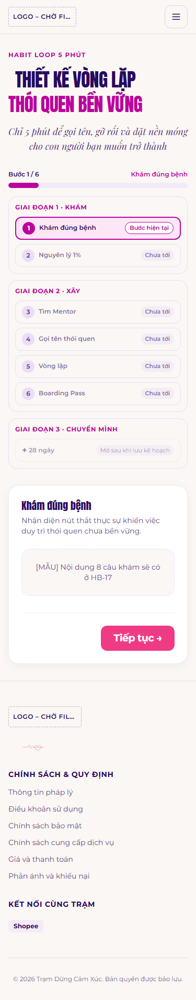

##### 2. Bước 2 – Nguyên lý 1%

- **Mục tiêu**: Làm rõ triết lý cải thiện 1% mỗi ngày thay vì nỗ lực cực đoan.
- **Cấu hình trong CMS**:
  - **Tiêu đề & Giới thiệu**: Hỗ trợ tiêu đề 2 tầng màu qua ký tự gạch đứng `|` (dòng 1 `deep-navy`, dòng 2 `bright-magenta`).
  - **Câu trích dẫn Bước 2**: Nằm ở mục **Câu trích từng bước → Bước 2 (1% Better)** (`stepQuotes.onePercent`).
  - **3 điều có thể bạn chưa biết (`onePercent.unknowns`)**: 3 góc nhìn khoa học hành vi giải phóng áp lực tâm lý.
  - **Câu đúc kết (`onePercent.closing`)**: Thông điệp chốt lại ở cuối khối.
  - **Thanh kéo mô phỏng**: Cho phép học viên kéo xem sự tăng trưởng lũy tiến 1% mỗi ngày. (Lưu ý: mục số liệu dẫn chứng cũ `facts` đã ẩn và không còn hiển thị trong flow).

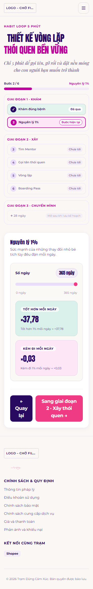

##### 3. Bước 3 – Tìm Mentor (Bảng điểm thói quen)

- **Mục tiêu**: Học viên soi lại lịch trình một ngày, nhận diện các việc hiện tại và chọn ra một "thói quen neo" (Anchor Habit) vững chắc để ghép thói quen mới vào sau.
- **Trải nghiệm học viên**:
  - Thêm các việc thường làm trong ngày (kèm giờ thực hiện tùy chọn).
  - Gắn nhãn thói quen: **Có ích (+)**, **Chưa tốt (-)**, **Trung tính (=)**.
  - Chọn 1 việc có ích (+) làm Thói quen neo qua nút radio. Nút "Tiếp tục" chỉ bật khi học viên đã chọn được Thói quen neo.

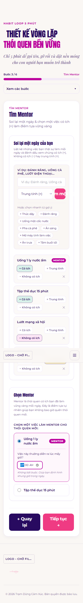
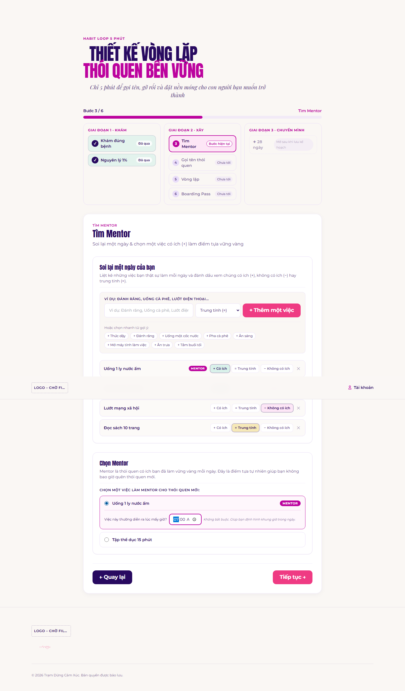

##### 4. Bước 4 – Gọi tên thói quen

- **Mục tiêu**: Thiết lập định danh, cam kết nhịp tuần rèn luyện và chọn ngày xuất phát.
- **Nội dung học viên điền**:
  - **Hành động cụ thể** và **Con người muốn trở thành**: Ghép thành câu Tuyên ngôn định danh chuẩn Atomic Habits: _"Tôi sẽ [hành động] để trở thành [con người mới]"_.
  - **Nhịp tuần rèn luyện (`rhythmDays`)**: Học viên chọn tần suất (ví dụ 5 ngày/tuần, 6 ngày/tuần hoặc trọn vẹn 7 ngày/tuần).
  - **Bản tối giản dưới 2 phút (`twoMinuteAction`)**: Hành động siêu nhỏ dưới 2 phút giúp giữ đà trong những ngày kiệt sức.
  - **Ngày bắt đầu (`startDate`)**: Học viên tự chọn ngày xuất phát qua bộ chọn ngày (từ hôm nay đến tối đa 14 ngày tới). Hệ thống tự tính ngày về đích chính xác theo giờ Việt Nam.

##### 5. Bước 5 – Vòng lặp thói quen

- **Mục tiêu**: Lựa chọn kỹ thuật Atomic Habits thực chiến cho từng mắt xích và ghi hành động cụ thể.
- **Cấu hình trong CMS**:
  - **Lời mở**, **Ghi chú (`loop.note`)**: Giải thích hai giai đoạn đầu (Cue, Craving) thuộc về nhận thức; hai giai đoạn sau (Response, Reward) thuộc về hành động.
  - **Gợi ý kỹ thuật (`loop.techniqueHint`)**: Nhắc nhở tập trung kỹ thuật vào giai đoạn nút thắt đã tìm thấy ở Bước 1.
  - **Kỹ thuật thực hành**: Lấy tự động từ danh mục `techniques`.
- **Trải nghiệm học viên**: Chọn ít nhất 1 kỹ thuật và viết cam kết hành động tương ứng cho từng giai đoạn đã chọn.

##### 6. Bước 6 – Boarding Pass & Lên chuyến

- **Mục tiêu**: Trao tấm vé Boarding Pass khởi hành và lưu kế hoạch vào tài khoản.
- **Cấu hình trong CMS**:
  - **Câu trích dẫn trước giờ xuất phát (`stepQuotes.boardingPass`)**: Kèm tác giả và nguồn gốc.
  - **Lời dặn trước giờ khởi hành (`boardingPass.intro`)**.
  - **Caption gợi ý chia sẻ (`boardingPassCaption`)**: Điền tự động qua 3 biến: `{tuyen_ngon}`, `{so_ngay}`, `{ngay_bat_dau}`.
- **Trải nghiệm học viên**:
  - Tải ảnh vé dọc (9:16) làm hình nền điện thoại hoặc ảnh vuông/ngang (4:5) đăng mạng xã hội.
  - Bấm "Sao chép caption gợi ý" để dán kèm ảnh chia sẻ.
  - Điền Họ tên, Email, tick đồng thuận bảo mật và bấm **"Lên chuyến · Bắt đầu 28 ngày →"**.
  - Sau khi lưu, màn hình chúc mừng xuất hiện dẫn học viên vào thẳng Tracker đồng hành.

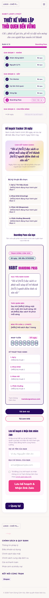
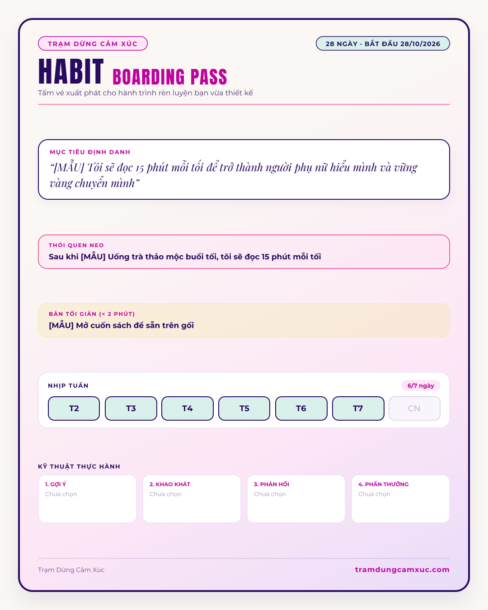

---

#### 3.11.2. Màn hình Tracker theo dõi 28 ngày (`/habit/tracker`)

Màn hình Tracker là không gian rèn luyện hàng ngày của học viên, được đồng bộ trực tiếp với các thiết lập kế hoạch và nội dung CMS.

##### 1. Hiển thị ngày lịch thực tế & Lời nhắc lý do riêng (HB-23)

- **Ngày lịch thực tế**: Mỗi ô ngày hiển thị ngày tháng thực tế dạng `dd/MM` tính theo trường `startDate` của kế hoạch theo giờ Việt Nam.
- **Khoảng ngày từng trạm**: Tiêu đề mỗi trạm hiển thị khoảng ngày lịch `(dd/MM – dd/MM)`.
- **Khởi hành & Về đích**: Đầu trang hiển thị rõ ràng ngày **Khởi hành: dd/MM/yyyy** và **Ngày 28 · Về đích: dd/MM/yyyy**, kèm nguyên tắc động viên: _"Lỡ một ngày là bình thường. Chỉ cần đừng lỡ hai ngày bỏ phiếu liền."_
- **Nhắc lại lý do riêng tư**: Khi học viên lỡ từ 1 ngày bỏ phiếu trở lên, hệ thống tự động hiển thị khối _"Vì sao điều này quan trọng với bạn?"_ kèm nguyên văn lý do học viên đã viết. Nội dung này hoàn toàn riêng tư cho riêng học viên.

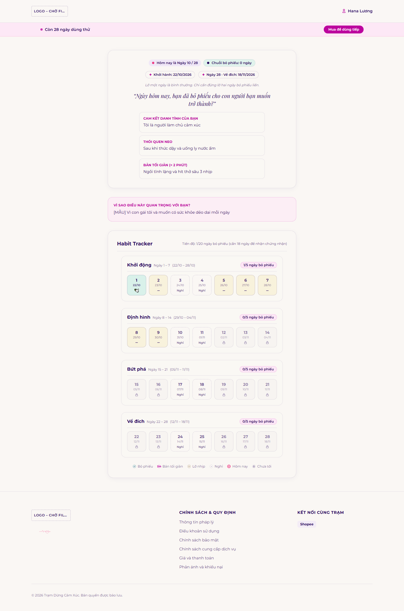
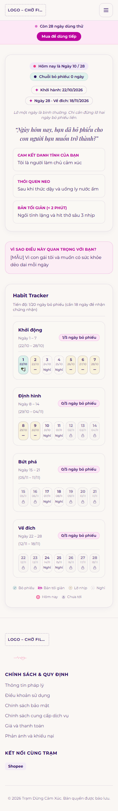

##### 2. Check-in 4 trạng thái theo nhịp tuần (HB-11)

- Học viên bấm vào ngày hiện tại để mở modal check-in với 4 trạng thái thích ứng:
  - `Bỏ phiếu` (`voted`): Thực hiện đủ hành động cam kết.
  - `Bản tối giản` (`minimal`): Làm phiên bản dưới 2 phút (được tính là hoàn thành và tính vào 90%).
  - `Lỡ nhịp` (`missed`): Chủ động ghi nhận hôm nay lỡ nhịp.
  - `Nghỉ theo nhịp` (`rest`): Ghi nhận ngày nghỉ.
- **Quy tắc an toàn**: Không thể chọn "Nghỉ theo nhịp" vào ngày bỏ phiếu. Vào ngày nghỉ, học viên tự do ghi nhận cảm xúc và không bị phạt đứt chuỗi hay trừ điểm 90%.

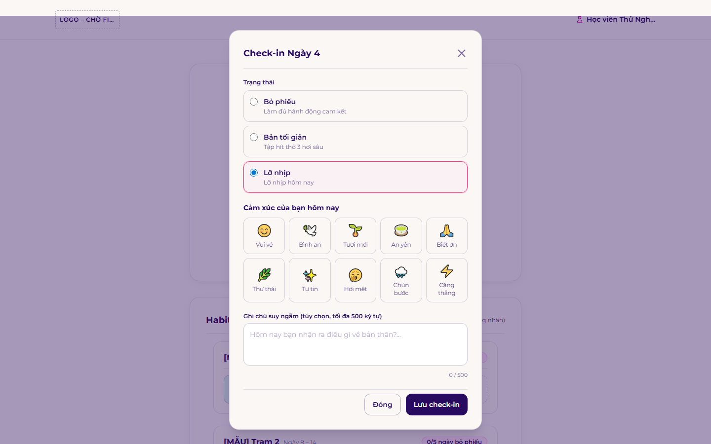
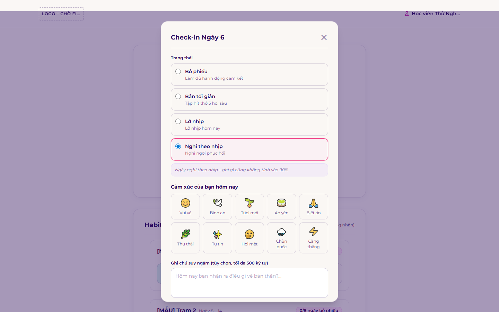

##### 3. Suy ngẫm cuối mỗi trạm (HB-12)

- Hành trình được chia thành 4 trạm. Tại CMS, Hana thêm tối đa 5 câu hỏi suy ngẫm cho từng trạm.
- Khi ngày hiện tại vượt qua ngày cuối cùng của trạm, trên card trạm sẽ xuất hiện nút **"Suy ngẫm trạm"**.
- Học viên điền suy ngẫm và lưu lại. Card chuyển sang huy hiệu **"Đã suy ngẫm"** và cho phép xem lại hoặc chỉnh sửa bất kỳ lúc nào.
- Dữ liệu suy ngẫm được bảo vệ nghiêm ngặt (`selfCustomerOnlyField`), chỉ học viên sở hữu tài khoản mới đọc được.

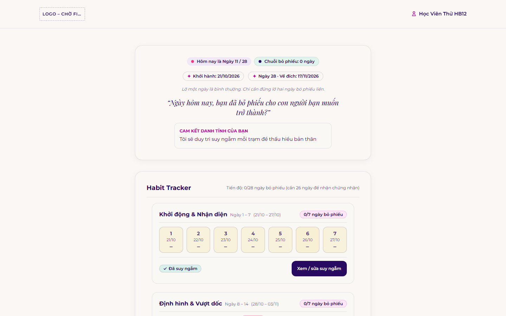
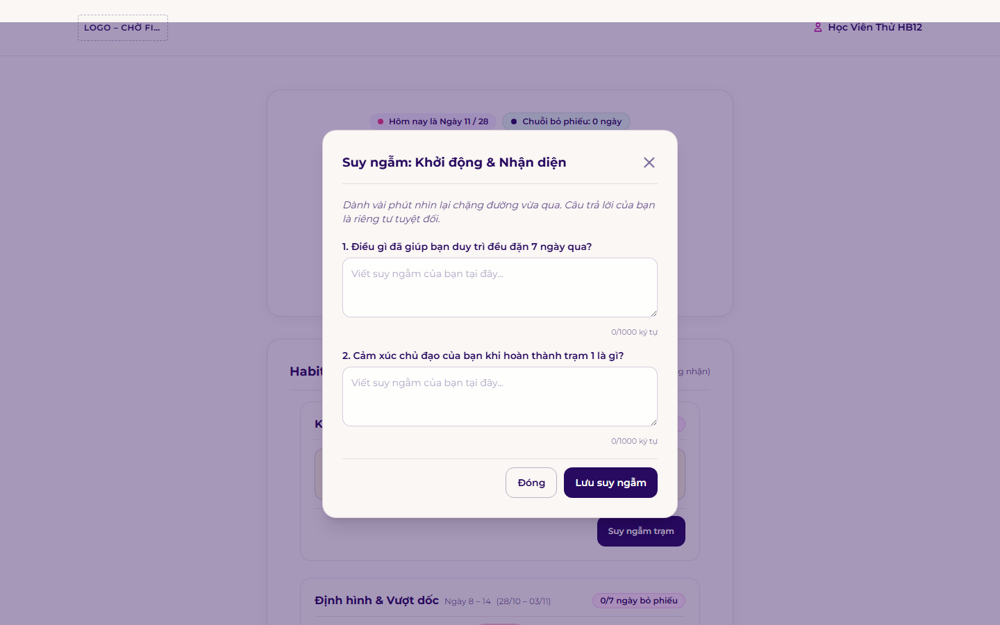

##### 4. Khối "Dữ liệu của bạn" (HB-13)

- Nằm ở cuối trang Tracker, trao toàn quyền làm chủ dữ liệu cho học viên:
  - **Tải bản sao lưu (JSON)**: Xuất toàn bộ kế hoạch và lịch sử check-in về máy.
  - **Tải bảng 28 ngày (CSV)**: Mở trực tiếp bằng Excel / Google Sheets với tiếng Việt chuẩn UTF-8 BOM.
  - **Khôi phục từ file**: Tải file JSON lên để phục hồi dữ liệu khi cần.
  - **Sao chép gửi Coach**: Tạo nhanh văn bản tóm tắt tiến độ để gửi Coach Hana qua Zalo/email.
  - **Bắt đầu hành trình mới**: Bắt đầu thiết kế thói quen mới tại `/habit/5-phut` trong khi vẫn bảo tồn 100% dữ liệu kế hoạch cũ trong CMS.

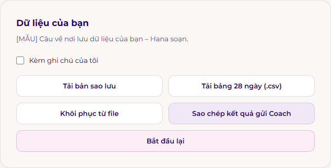
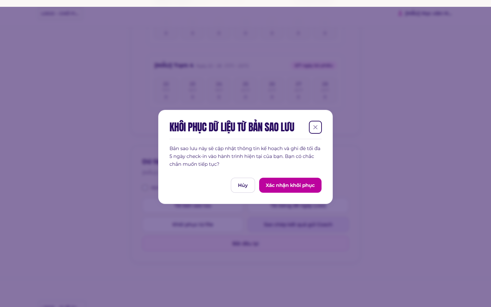

##### 5. Khối "Đồng hành sau 28 ngày" (HB-14)

- **Nội dung thông điệp**: Lấy từ CMS (`tracker.afterJourneyTitle` và `tracker.afterJourneyText`).
- **Nút "Đặt lịch với Habit Coach"**: Gắn link booking coach từ **Cài đặt website → Công cụ số → habitCoachBookingUrl**. Tự ẩn nếu không có link.
- Khối không còn nút "Ủng hộ" (CF-02, 02/11): học viên ủng hộ qua **nút ly cà phê** hiện ở mọi trang (mục 7.1b).
- **Vị trí hiển thị thông minh**:
  - Khi đang trong hành trình: Nằm gọn gàng ở cuối trang, dưới khối _Dữ liệu của bạn_.
  - Khi đến ngày cuối (ngày 28) hoặc khi đã hoàn thành/nhận chứng nhận: Đưa lên vị trí trang trọng **TRÊN** lưới các trạm, đồng thời tự ẩn nút đặt lịch phiên 149k để tránh trùng lặp CTA.

---

#### 3.11.3. Theo dõi Kế hoạch trong trang quản trị (`habitPlans`)

**Mục đích**: Xem danh sách các kế hoạch thiết lập thói quen (`habitPlans`) và tiến độ check-in 28 ngày của khách hàng/học viên.

**Các bước xem trong trang quản trị**:

1. Ở cột menu bên trái, tìm nhóm **Khách hàng** (hoặc danh mục **Kế hoạch thói quen** – `habitPlans`).
2. Bấm vào một kế hoạch để xem chi tiết:
   - **Khách hàng sở hữu**: Tên và email của khách hàng gắn với kế hoạch.
   - **Độ dài hành trình (`journeyDays`)**: Số ngày hành trình được khóa cố định lúc tạo (mặc định 28 ngày; các kế hoạch tạo trước đợt nâng cấp được lưu cố định 21 ngày). Trường chỉ đọc.
   - **Kết quả hành trình (`outcome`)**: Trạng thái kết quả hiện tại gồm `Đang diễn ra` (`in_progress`), `Đạt chứng nhận` (`completed`), hoặc `Đã trải nghiệm` (`experienced`). Trường chỉ đọc.
   - **Bảng điểm thói quen (`scorecard`)**: Bảng đánh giá thói quen hiện tại (tốt, trung tính, chưa tốt) kèm giờ làm thói quen (`time`, dạng HH:mm, ví dụ `07:30`).
   - **Thói quen neo (`anchorHabit`)**: Thói quen gắn sau một thói quen có sẵn ("Sau khi [thói quen cũ], tôi sẽ [thói quen mới]"). Tối đa 120 ký tự.
   - **Nhịp tuần – ngày bỏ phiếu (`rhythmDays`)**: Các ngày trong tuần học viên chọn thực hành (Thứ 2 đến Chủ nhật; để trống = mọi ngày là ngày bỏ phiếu). Học viên tự thiết lập và sửa được khi chưa có check-in nào; sau check-in đầu tiên, trường này khóa với học viên (quản trị viên vẫn có thể hỗ trợ sửa khi cần).
   - **Hành động dưới 2 phút (`twoMinuteAction`)**: Phiên bản tối giản dưới 2 phút ("bản tối giản") giúp duy trì đà thực hành trong những ngày năng lượng thấp.
   - **Câu định danh cam kết (`identityStatement`)**: Cam kết danh tính cho hành trình ("Tôi sẽ... để trở thành...").
   - **Kỹ thuật đã chọn (`chosenTechniques`)**: Danh sách các kỹ thuật rèn luyện thói quen học viên đã lựa chọn theo từng giai đoạn.
   - **Lý do riêng tư (`privateReason`)**: Lý do cá nhân sâu kín của học viên ("Vì sao điều này quan trọng với bạn?"). Để đảm bảo quyền riêng tư theo thiết kế, trường này bảo mật tuyệt đối: chỉ học viên sở hữu tài khoản mới đọc được; quản trị viên (`editor` / `owner`) không đọc được trong CMS và hệ thống không bao giờ đưa trường này lên Boarding Pass hay gửi ra analytics.
   - **Bạn đồng hành (`companionName`)**: Tên người bạn cùng đồng hành do học viên đặt để hiển thị nhắc nhở (không lưu trữ thông tin liên lạc).
   - **Ngày bắt đầu (`startDate`)**: Thời điểm kích hoạt hành trình theo giờ Việt Nam. Học viên được tự chọn ngày bắt đầu khi tạo kế hoạch ở Bước 4 "Gọi tên thói quen" (từ hôm nay đến tối đa 14 ngày tới theo giờ Việt Nam; mặc định là hôm nay). Sau khi kế hoạch được tạo, trường này khóa với học viên (không tự ý sửa hay đặt lùi ngày để tốt nghiệp sớm). Quản trị viên (`editor` / `owner`) vẫn xem và sửa được trong CMS khi cần hỗ trợ học viên điều chỉnh lịch rèn luyện.
   - **Danh sách ngày check-in (`habitCheckins`)**: Nhật ký check-in từng ngày của học viên trong hành trình, gồm các trường:
     - **Kế hoạch (`plan`)**: Kế hoạch thói quen tương ứng.
     - **Ngày thứ (`day`)**: Số thứ tự ngày trong hành trình (từ ngày 1 đến tối đa `journeyDays`).
     - **Trạng thái (`status`)**: 4 trạng thái hành vi rèn luyện (`voted`, `minimal`, `missed`, `rest`).
     - **Đã hoàn thành (`done`)**: Ô đánh dấu chỉ đọc, tự động tính từ trạng thái.
     - **Cảm xúc (`emotion`) & Ghi chú (`note`)**: Cảm xúc trong ngày và chia sẻ cá nhân của học viên (chỉ tài khoản `owner` xem được).

**Email nhắc lỡ nhịp tự động theo nhịp tuần (HB-06)**:

- Hệ thống cron tự động quét và gửi email nhắc nhở khi học viên lỡ từ **2 ngày bỏ phiếu liên tiếp** trở lên, hoàn toàn bỏ qua các ngày nghỉ theo nhịp.

---

### 3.11.4. Quản trị câu chữ giao diện Habit Journey & Script nạp DP-01d

**Mục đích**: Giúp Hana tự sửa đổi toàn bộ câu chữ hiển thị trên trình hướng dẫn 6 bước `/habit/5-phut`, chân trang, hộp check-in và bảng điều khiển `/habit/tracker` ngay trong CMS mà không cần đụng đến lập trình.

**Các nhóm trường mới trong `habitJourneyContent`**:

1. **Đầu trang (Header)**:
   - **Huy hiệu trên cùng** (`badgeText`): Ví dụ `CONTENT CREATOR HUB • TRẠM DỪNG CẢM XÚC`.
   - **Dòng tiêu đề 1 (Navy)** (`titleLine1`): Ví dụ `Xây Thói Quen`.
   - **Dòng tiêu đề 2 (Magenta)** (`titleLine2`): Ví dụ `Dựng Thương Hiệu`.
   - **Huy hiệu chuỗi** (`seriesBadge`): Ví dụ `FORM HABIT · BUILD IDENTITY`.
   - **Dòng cảm xúc / Khẩu hiệu** (`tagline`): Ví dụ `Đều đặn một điều — mọi điều đều đặn`.
   - **Đoạn văn dẫn nhập** (`introText`): Lời dặn 3 giai đoạn 28 ngày.
   - **Tiêu đề & Mô tả cho 3 giai đoạn**: `stage1Title`, `stage1Desc`, `stage2Title`, `stage2Desc`, `stage3Title`, `stage3Desc`.

2. **Bước 1 – Khám thói quen** (`step1`):
   - **Lời dẫn mở đầu bước 1** (`leadIn`).
   - **Bộ 8 câu hỏi khảo sát** (`diagnose.questions`): Đã được nạp chuẩn nguyên văn từ bản zip.
   - **Lời chẩn đoán 4 giai đoạn nút thắt**: `cueDiagnosis` (Tín hiệu), `cravingDiagnosis` (Khao khát), `responseDiagnosis` (Phản hồi), `rewardDiagnosis` (Phần thưởng) hiển thị khi giai đoạn tương ứng có điểm trung bình cao nhất.

3. **Bước 2 – Nguyên lý 1%** (`step2`):
   - **Lời dẫn mở đầu bước 2** (`leadIn`).
   - **Tiêu đề biểu đồ** (`chartTitle`) & **Mô tả dưới tiêu đề biểu đồ** (`chartSubtitle`).

4. **Bước 3 – Tìm Mentor** (`step3`):
   - **Lời dẫn mở đầu bước 3** (`leadIn`).
   - **Tiêu đề & Mô tả bảng soi một ngày** (`scorecardTitle`, `scorecardDesc`).
   - **Tiêu đề & Mô tả chọn Mentor** (`mentorTitle`, `mentorDesc`).
   - **Gợi ý khi chưa đánh dấu việc có ích** (`emptyMentorHint`).
   - **Nhãn câu hỏi giờ & Gợi ý xác nhận** (`mentorTimeLabel`, `mentorSuccessHint`).

5. **Bước 4 – Gọi tên thói quen** (`step4`):
   - **Lời dẫn mở đầu bước 4** (`leadIn`).
   - **Lời dẫn in đậm** (`leadInEmphasis`): Dòng chữ in đậm nhấn mạnh ở đầu bước 4 (ví dụ: *Thương hiệu cá nhân không phải việc làm thêm — nó là cách bạn xuất hiện mỗi ngày.*).
   - **Tiêu đề & Mô tả tuyên ngôn** (`statementTitle`, `statementDesc`).
   - **Gợi ý vai trò** (`suggestedRoles`): Nhập mỗi dòng 1 vai trò gợi ý (hiển thị thành các nút chip).
   - **Tiêu đề, Mô tả, Lưu ý ngày nghỉ của Nhịp điệu** (`rhythmTitle`, `rhythmDesc`, `rhythmNote`).
   - **Tiêu đề, Mô tả thói quen hạt nhân** (`atomicHabitTitle`, `atomicHabitDesc`).
   - **Gợi ý thói quen hạt nhân** (`suggestedAtomicHabits`): Nhập mỗi dòng 1 thói quen gợi ý.
   - **Tiêu đề, Nhãn, Placeholder & Lưu ý vì sao quan trọng** (`commitmentTitle`, `whyImportantLabel`, `whyImportantPlaceholder`, `whyImportantNote`).

6. **Bước 5 – Thiết kế vòng lặp** (`step5` & `loop`):
   - **Lời dẫn mở đầu bước 5** (`leadIn`).
   - **Lý thuyết 4 giai đoạn**: `theoryCue`, `theoryCraving`, `theoryResponse`, `theoryReward` giải thích cơ chế tâm lý của từng góc vòng lặp.
   - **Tên 4 quy tắc vàng**: `ruleCue`, `ruleCraving`, `ruleResponse`, `ruleReward`.
   - **Lời gợi ý chọn kỹ thuật**: `techniqueHintCue`, `techniqueHintCraving`, `techniqueHintResponse`, `techniqueHintReward`.
   - **Placeholder khi ghi chú áp dụng** (`customActionPlaceholder`).
   - **4 quy luật hành vi** (`loop.laws`): Gồm chip luật, tiêu đề, subLabel, câu hỏi khơi gợi và link video bài giảng.
   - **Khối lưu ý riêng cho Quy luật 1 Cue** (`loop.cueBox`): Chữ in đậm, đoạn văn và nhãn nút xem lại bước 3.
   - **11 kỹ thuật Atomic Habits** (quản trị tại danh mục **Kỹ thuật thói quen** `techniques`): Đã nạp đủ thứ tự, tên, mô tả, 2 ví dụ, mẫu gợi ý và video reel.

7. **Bước 6 – Thẻ lên tàu (Boarding Pass)** (`step6`):
   - **Lời dẫn mở đầu bước 6** (`leadIn`).
   - **Tiêu đề lớn & Tiêu đề phụ trên thẻ** (`passTitle`, `passSubtitle`).
   - **Lời xác nhận cam kết / điều khoản** (`termsText`).

8. **Bảng theo dõi 28 ngày (Tracker / Dashboard)**:
   - **Tiêu đề kế hoạch**: Tự động hiển thị `28 NGÀY THÀNH {personText}` theo mẫu người học viên đã chọn tại bước 4.
   - **Giải thích khối Dữ liệu của bạn** (`myDataNotice`): Đoạn ghi chú về sao lưu và lưu trữ dữ liệu an toàn.

9. **Hộp thoại Check-in ngày** (`checkIn`):
   - **Lời dẫn ngày cần check-in** (`postDayHint`).
   - **Lời dẫn ngày nghỉ theo nhịp** (`restDayHint`).
   - **Placeholder ô ghi chú cảm xúc** (`notePlaceholder`).

10. **Chân trang (Footer)** (`footer`):
   - **Khẩu hiệu thương hiệu** (`slogan`).
   - **Thông tin tác giả / Coach** (`authorInfo`).
   - **Đoạn ghi nhận nguồn sách** (`bookCredits`).

**Cách chạy script nạp tự động nội dung chuẩn zip (`dp01d-habit-content.ts`)**:

- Script này được thiết kế để nạp/cập nhật 11 kỹ thuật, 4 quy luật, 8 câu hỏi khảo sát và toàn bộ câu chữ mặc định của các màn vào database một cách an toàn và không trùng lặp.
- **Chế độ kiểm tra (Dry-run - Mặc định, không ghi vào database)**:
  ```bash
  pnpm payload run scripts/dp01d-habit-content.ts < /dev/null
  ```
- **Chế độ áp dụng (Apply - Ghi vào database và tự sao lưu bản dự phòng)**:
  ```bash
  APPLY=true pnpm payload run scripts/dp01d-habit-content.ts < /dev/null
  ```
  Khi chạy với `APPLY=true`, script sẽ tự động tạo một file sao lưu JSON trong thư mục `backups/` trước khi ghi, bảo toàn mọi dữ liệu hiện có. Các trường mà Hana đã tùy chỉnh khác với mặc định sẽ được giữ nguyên, không bị ghi đè.

---

### 3.12. Quản lý và Thu hồi Chứng nhận (Certificates)

**Mục đích**: Theo dõi danh sách chứng nhận tốt nghiệp hành trình thói quen đã được cấp cho học viên, kiểm tra thông tin xác minh, hoặc thu hồi / tạm ẩn link công khai khi cần thiết.

**Các bước xem và quản lý trong trang quản trị**:

1. Ở cột menu bên trái, tìm nhóm **Học viên & khách**, bấm chọn **Chứng nhận thói quen** (`certificates`).
2. Màn hình danh sách hiển thị các cột:
   - **Mã xác minh (`code`)**: Chuỗi mã duy nhất được hệ thống sinh ngẫu nhiên tự động (ví dụ: `wF9d_a`).
   - **Khách hàng (`customer`)**: Tên học viên được trao chứng nhận.
   - **Ngày cấp (`issuedAt`)**: Thời điểm chứng nhận được tạo.
3. Bấm vào một dòng chứng nhận để xem chi tiết:
   - **Khách hàng (`customer`)**: Tên và tài khoản của học viên.
   - **Kế hoạch (`plan`)**: Kế hoạch thói quen tương ứng.
   - **Câu định danh (`identityStatement`)**: Cam kết danh tính của học viên lúc cấp chứng nhận.
   - **Số ngày hoàn thành (`daysCompleted`)**: Tổng số ngày học viên đã tick hoàn thành trong hành trình (tối đa theo độ dài kế hoạch, ví dụ 28 ngày).
   - **Mã xác minh (`code`)**: Mã tra cứu công khai (chế độ chỉ đọc, không sửa).
   - **Cho phép xem công khai (`isPublic`)**: Trạng thái hiển thị ra bên ngoài.

**Cách thu hồi hoặc tạm ẩn chứng nhận**:

- Khi học viên yêu cầu không công khai thông tin, hoặc bạn phát hiện hành vi gian lận cần tạm dừng xác minh:
  1. Mở chứng nhận đó trong CMS.
  2. **Bỏ dấu tick** ở ô **Cho phép xem công khai** (`isPublic`).
  3. Bấm nút **Lưu thay đổi**.
  4. Ngay lập tức:
     - Đường dẫn tra cứu công khai `https://tramdungcamxuc.com/chung-nhan/[mã]` sẽ trả về thông báo lỗi 404 (Không tìm thấy trang) với người ngoài.
     - Đường dẫn tải ảnh `.../anh/4x5` và `.../anh/9x16` sẽ có hiệu lực ngay lập tức với mọi lượt tải mới và trả về lỗi 404 (do ảnh được cấu hình kiểm tra lại tức thì `max-age=0, must-revalidate`; đối với file ảnh đã được người khác tải lưu về máy từ trước thì không thể thu hồi được).
     - Chỉ duy nhất học viên sở hữu (khi đã đăng nhập đúng tài khoản) mới có thể xem lại chứng nhận của mình kèm thông báo nhắc nhở: _"Link công khai đang tắt"_.
- Nếu cần xóa hoàn toàn: Chỉ tài khoản `owner` mới có nút xóa chứng nhận khỏi hệ thống.

**Sửa tên in sai trên chứng nhận**:

- Tên trên chứng nhận lấy từ trường **Họ tên** của khách. Khách nhập tên khi bấm "Nhận chứng nhận" (nếu chưa có tên). Sau khi đã có chứng nhận, khách **không** tự đổi tên được nữa.
- Khách báo tên in sai: vào **Khách hàng** → tìm theo email → sửa **Họ tên** → **Lưu**. Trang xác minh và ảnh chứng nhận cập nhật ngay ở lần tải sau.

**Cài đặt độ dài hành trình và điều kiện cấp chứng nhận (Site Settings)**:

Trong **Cài đặt** -> **Cài đặt Website** (`siteSettings`), Hana có thể tùy chỉnh 2 thông số:

1. **Độ dài hành trình thói quen (`habitJourneyDays`)**: Mặc định là **28 ngày** (4 tuần, chốt họp 20/10/2026). Hana có thể điều chỉnh từ 7 đến 60 ngày nếu tổ chức các chiến dịch đặc biệt (ví dụ thử thách 14 ngày hoặc 30 ngày).
2. **Tỷ lệ ngày bỏ phiếu tối thiểu để nhận chứng nhận (`certificateMinPercent`)**: Mặc định là **90%** (cho phép nhập từ 50% đến 100%).

> **Quy tắc vận hành quan trọng cần lưu ý**:
>
> 1. **Khóa cố định vào từng kế hoạch**: Khi Hana thay đổi `habitJourneyDays`, thay đổi này **chỉ áp dụng cho các học viên bắt đầu tạo kế hoạch mới sau đó**. Những học viên đang thực hiện dở dang kế hoạch cũ vẫn giữ nguyên số ngày ban đầu (ví dụ kế hoạch cũ giữ 21 ngày, kế hoạch mới 28 ngày) để đảm bảo tính công bằng và nhất quán.
> 2. **Cách tính ngưỡng 90% theo ngày bỏ phiếu**: Tỷ lệ được tính trên tổng số ngày bỏ phiếu thực tế theo nhịp tuần đã đăng ký. Với nhịp cả tuần (7 ngày/tuần) trong hành trình 28 ngày, học viên cần đạt tối thiểu **26 ngày** (hệ thống làm tròn lên: `ceil(28 × 90%) = 26 ngày`).
> 3. **Phân định kết quả "Đạt chứng nhận" và "Đã trải nghiệm"**:
>    - **Đạt từ 90% trở lên**: Kết quả là **Đạt chứng nhận** (`completed`). Sau khi kết thúc hành trình, học viên thấy form nhập tên và bấm nút **"Nhận chứng nhận"**.
>    - **Dưới 90% (ví dụ đạt 25/28 ngày)**: Kế hoạch chuyển sang trạng thái **"Đã trải nghiệm"** (`experienced`). Khối tổng kết trên Tracker hiển thị thông điệp ghi nhận ấm áp: hành trình đã khép lại, mọi bước đi đều đáng giá, và **hoàn toàn không có nút nhận chứng nhận** hay link công khai. Người học có thể tạo hành trình mới khi sẵn sàng.

---

### 3.13. Quản lý 26 thẻ EQ Buddy

**Mục đích**: Quản lý kho nội dung 26 lá thẻ của công cụ số EQ Buddy (`/eq-buddy`) và trang chi tiết mở qua mã QR trên bộ thẻ vật lý 2.0 (`/eq-buddy/the/[qrSlug]`).

**Cấu trúc lá thẻ**: Được thiết kế chuẩn hóa theo đúng bộ thẻ in thực tế ngoài đời thực của Hana:

1. **Mặt trước**:
   - **Mã thẻ (`code`)**: Mã số quản lý duy nhất theo thứ tự từ `TDCX-01` đến `TDCX-26`.
   - **Từ khóa mặt trước (`keywordEn`)**: Bắt buộc khi xuất bản, tối đa 40 ký tự. Là từ khóa tiếng Anh tương ứng 26 chữ cái A → Z (ví dụ: _Abundance_, _Belonging_, _Clarity_...).
   - **Thông điệp mặt trước (`message`)**: Bắt buộc khi xuất bản. Câu thông điệp ấm áp, sâu sắc trên mặt trước lá thẻ.
2. **Mặt sau – 3 câu hỏi**:
   - Nằm trong nhóm **Mặt sau – 3 câu hỏi** với đúng 3 ô cố định theo cấu trúc in:
     - **Gợi nhớ (`promptRecall`)**: Câu hỏi kích hoạt suy ngẫm, kết nối lại trải nghiệm trong quá khứ (bắt buộc khi xuất bản).
     - **Gói ghém (`promptPack`)**: Câu hỏi giúp đúc kết bài học, chuyển hóa cảm xúc (bắt buộc khi xuất bản).
     - **Ghi nhận (`promptAcknowledge`)**: Câu hỏi ghi nhận nỗ lực và giá trị của bản thân (bắt buộc khi xuất bản).
   - _Lưu ý_: Khi lưu nháp (`Draft`), Hana có thể để trống; nhưng khi bấm **Xuất bản** (`Published`), hệ thống yêu cầu điền đủ cả 3 câu hỏi để đảm bảo trải nghiệm người dùng hoàn chỉnh.
3. **Các trường bổ sung (không bắt buộc – bộ thẻ in hiện không có, Hana có thể thêm sau)**:
   - **Từ khóa tiếng Việt (`keywordVi`)**: Tối đa 40 ký tự (ví dụ: _Thấu hiểu_, _Gắn kết_).
   - **Câu chuyện (`story`)**: Soạn thảo câu chuyện truyền cảm hứng hoặc bài học mở rộng cho thẻ.
   - **Hành động nhỏ (`smallAction`)**: Một việc làm cụ thể, nhẹ nhàng học viên có thể thực hành ngay trong ngày.
   - **Danh mục (`category`)**: Nhóm thẻ theo 4 góc nhìn cảm xúc (ví dụ: _Tự thân_, _Người khác_, _Tình huống_, _Hành động_). Hiển thị ở góc thẻ.
   - **Bảng màu nền pastel (`gradientTheme`)**: Chọn 1 trong 10 bộ màu chuyển sắc gradient sang trọng phối từ 8 mã màu chuẩn Brand Book 2026.
   - **Nhãn cảm xúc (`emotionTags`)**: Chọn một hoặc nhiều cảm xúc liên quan từ bộ 10 cảm xúc cố định của Brand Book 2026.
4. **Mã QR và thông tin xuất bản**:
   - **Mã đường dẫn QR (`qrSlug`)**: Bắt buộc. Viết thường không dấu của từ khóa tiếng Anh (ví dụ: `abundance`, `belonging`... `zero`).
     - Đường dẫn quét QR trên điện thoại sẽ là: `https://tramdungcamxuc.com/eq-buddy/the/[qrSlug]`.
   - **Ngày đã in (`printedAt`)**: Ngày gửi file đi in tại xưởng in.
   - **Ảnh thẻ (`image`)**, **Ảnh chia sẻ 4:5 (`shareImage45`)**, **Ảnh chia sẻ 9:16 (`shareImage916`)**: Tải lên các file thiết kế của thẻ. Nếu để trống ảnh chia sẻ, hệ thống sẽ tự động tạo ảnh thương hiệu khi người dùng bấm chia sẻ.

> **QUY TẮC BẢO VỆ BẮT BUỘC: KHÔNG ĐỔI MÃ QR SAU KHI IN**
>
> - Khi gửi bộ thẻ vật lý đi in tại xưởng, hãy nhập ngày in vào ô **Ngày đã in** (`printedAt`) và bấm **Xuất bản** (chỉ lưu nháp thì chưa khóa). Cách xuất file in: mục 3.14.
> - **Ngay sau khi xuất bản với ngày in**, hệ thống sẽ **TỰ ĐỘNG KHÓA VĨNH VIỄN** trường **Mã đường dẫn QR** và trường **Ngày đã in**. Ô nhập mã QR sẽ chuyển sang chế độ bảo vệ cố định, và bạn không thể thay đổi hay xóa ngày in.
> - Cơ chế này nhằm bảo vệ bạn tuyệt đối: tránh tình trạng vô tình sửa đổi mã đường dẫn trên web làm đứt gãy liên kết, khiến hàng nghìn lá thẻ vật lý đã in ngoài đời thực không quét được QR nữa!

### 3.13b. Sửa câu chuyện của một thẻ và xem trước

1. Menu trái → nhóm **EQ Buddy** → **Thẻ EQ Buddy**. Bấm vào mã thẻ cần sửa (thẻ số 1 là dòng đầu tiên).
2. Kéo xuống ô **Câu chuyện** (nằm dưới nhóm **Mặt sau – 3 câu hỏi**), bấm vào ô và sửa chữ.
3. Bấm **biểu tượng con mắt** 👁 cạnh nút **Lưu bản nháp**: khung bên phải hiện trang thẻ như khi khách quét QR; kéo xuống phần câu chuyện để xem chữ vừa sửa (cập nhật ngay, chưa cần lưu).
4. Ưng ý thì bấm **Xuất bản tài liệu**. Chỉ **Lưu bản nháp** thì khách vẫn thấy câu chuyện cũ.

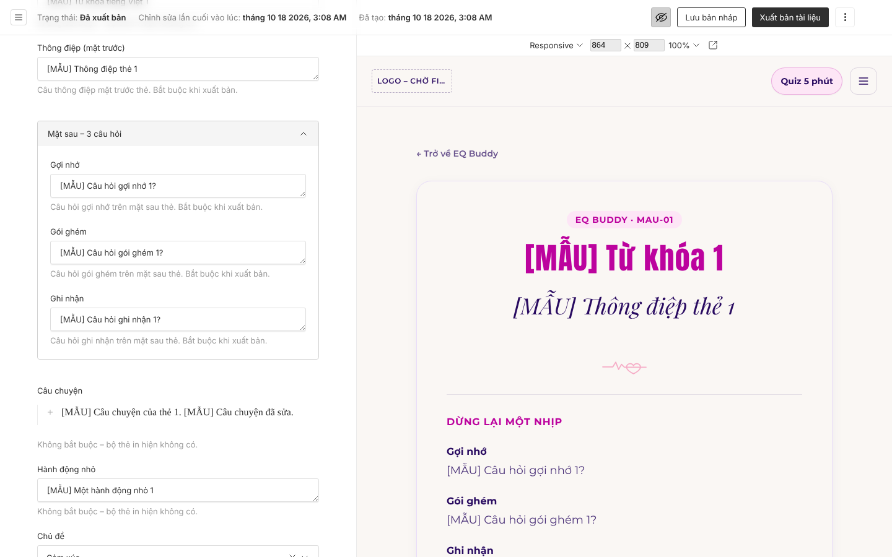

---

### 3.14. In QR cho bộ thẻ EQ Buddy (EqCards)

**Mục đích**: Xuất danh sách liên kết mã QR và tải ảnh QR chất lượng cao (1200×1200 px) gửi cho nhà in để in trực tiếp lên bộ thẻ vật lý EQ Buddy.

**Các bước thực hiện**:

1. **Chuẩn bị và kiểm tra thẻ trong CMS**:
   - Ở cột menu bên trái, tìm nhóm **EQ Buddy** -> chọn **Thẻ EQ Buddy**.
   - Mỗi thẻ cần có **Mã thẻ** (`code`), **Thông điệp** (`message`) và **Mã đường dẫn QR** (`qrSlug`), và đã bấm **Xuất bản**. File in chỉ lấy bản đã xuất bản – sửa mà chưa xuất bản thì chưa vào file in.
   - Link trên QR luôn là `https://tramdungcamxuc.com/eq-buddy/the/<mã QR>` (kể cả khi tải từ trang quản trị demo), nên QR in ra dùng được lâu dài.
   - Đường dẫn quét mã của thẻ là cố định: `https://tramdungcamxuc.com/eq-buddy/the/[qrSlug]`. Trang này mở tự do cho khách mua bộ thẻ vật lý quét mã xem thông điệp, từ khóa và 3 câu hỏi mặt sau (cùng câu chuyện nếu có) mà không cần đăng nhập hay mua thêm gói.
   - Thẻ cần được bấm **Xuất bản** trước khi khách hàng quét thực tế.

2. **Xuất danh sách QR tổng hợp (CSV)**:
   - Trên màn hình danh sách Thẻ EQ Buddy, bấm nút **Xuất danh sách QR (CSV)** ở góc trên bên phải bảng.
   - Hệ thống tải về file `eq-qr-YYYY-MM-DD.csv` chuẩn UTF-8 (có BOM mở tốt trên Excel mà không lỗi font tiếng Việt).
   - Danh sách chứa đầy đủ các cột: `code`, `qrSlug`, `url`, `trạng thái` (Đã xuất bản / Bản nháp), `ngày in`, `link PNG`.
   - File này có thể gửi trực tiếp cho đơn vị thiết kế / in ấn để đối chiếu mã và đường dẫn.

3. **Tải file ảnh QR từng thẻ (PNG)**:
   - Bấm vào một thẻ EQ Buddy cụ thể để vào trang chỉnh sửa chi tiết.
   - Ở cột bên phải (sidebar), bấm nút **Tải ảnh QR (PNG)**.
   - Trình duyệt sẽ tải về file ảnh `qr-<code>.png` chất lượng cao kích thước 1200×1200 px, mức sửa lỗi 'Q' (25% phục hồi), màu nhận diện thương hiệu Deep Navy `#280A60` trên nền trắng có viền an toàn 4 ô (quiet zone) cho máy quét mã vạch / camera điện thoại.

4. **Đánh dấu ngày in sau khi gửi file in (RẤT QUAN TRỌNG)**:
   - Sau khi hoàn tất rà soát và gửi file cho nhà in ấn, Hana mở thẻ và điền thời điểm vào ô **Ngày đã in** (`printedAt`), sau đó bấm **Xuất bản** (chỉ lưu nháp thì mã QR **chưa** bị khóa).
   - **Cơ chế khóa bảo vệ**: Ngay sau khi lưu ngày in, hệ thống sẽ **khóa vĩnh viễn** trường `qrSlug` và `printedAt`. Không ai (kể cả quản trị viên) có thể thay đổi hoặc xóa mã QR của thẻ đã in. Điều này đảm bảo mã QR in trên bộ thẻ vật lý đã xuất xưởng không bao giờ bị sai lệch hay mất liên kết.

---

### 3.15. Ảnh chia sẻ thẻ EQ Buddy và Liên kết Shopee bộ thẻ vật lý

#### 3.15.1. Ảnh chia sẻ thẻ trên mạng xã hội (Tỷ lệ 4:5 và 9:16)

**Mục đích**: Học viên khi rút được thẻ có thể bấm nút tải ảnh về máy để đăng lên Facebook, Instagram (dạng bài đăng hoặc Story) hoặc chia sẻ qua Zalo/tin nhắn.

**Cơ chế hoạt động**:

1. **Hệ thống tự động sinh ảnh đẹp chuẩn nhận diện**:
   - Mặc định, mỗi khi khách bấm "Tải ảnh 4:5" hoặc "Tải ảnh 9:16", hệ thống sẽ tự động ghép **từ khóa** và thông điệp của thẻ trên nền gradient pastel thương hiệu Trạm Dừng Cảm Xúc, kèm huy hiệu mã thẻ, chữ ký thương hiệu Trạm Dừng Cảm Xúc và tên miền `tramdungcamxuc.com`.
   - Hana không cần làm gì thêm, mọi thẻ tạo mới đều có sẵn tính năng tải ảnh chia sẻ tự động.
2. **Nếu Hana muốn dùng ảnh thiết kế riêng (ví dụ ảnh xuất từ Canva hoặc Photoshop)**:
   - Mở chi tiết thẻ trong mục **EQ Buddy** -> **Thẻ EQ Buddy**.
   - Cuộn xuống tìm 2 ô tải ảnh:
     - **Ảnh chia sẻ 4:5** (`shareImage45`): Dùng cho bài đăng Facebook/Instagram feed. Kích thước chuẩn khuyến nghị: **1080 × 1350 px**.
     - **Ảnh chia sẻ 9:16** (`shareImage916`): Dùng cho tin/story 24h trên Facebook/Instagram/TikTok. Kích thước chuẩn khuyến nghị: **1080 × 1920 px**.
   - Sau khi tải ảnh lên, bấm **Xuất bản** (chỉ lưu nháp thì khách chưa thấy).
   - Trong vòng khoảng 10 phút, nút tải ảnh trên web sẽ trả về ảnh thiết kế riêng của Hana thay cho ảnh tự sinh (trình duyệt và máy chủ giữ ảnh cũ một lúc).

#### 3.15.2. Cấu hình liên kết gian hàng Shopee cho Bộ thẻ vật lý

**Mục đích**: Bán bộ 26 thẻ vật lý trên gian hàng Shopee của Hana. Trên website chỉ đặt nút "Mua bộ thẻ trên Shopee" dẫn khách sang Shopee đặt hàng, không xây giỏ hàng phức tạp và không xử lý giao vận trên website.

**Các bước thực hiện**:

1. Vào menu **Sản phẩm** -> **Sản phẩm**.
2. Mở sản phẩm bộ thẻ vật lý có sẵn (đường dẫn `bo-the-vat-ly-2-0`) – **không** tạo sản phẩm mới, website tìm đúng sản phẩm này:
   - **Website**: Chọn `eq` (EQ Buddy).
   - **Loại sản phẩm**: Chọn **Bộ thẻ vật lý (Shopee)** (`physical_external`).
   - **Đường dẫn ngoài (externalUrl)**: Dán liên kết sản phẩm trên gian hàng Shopee của Hana (bắt đầu bằng `https://`).
   - **Trạng thái mở bán**: Chọn **Đang mở bán** (`on_sale`).
3. Bấm **Xuất bản**.

> **Hana lưu ý**: Website sẽ **tự động gắn các mã đo lường chiến dịch (UTM)** như `utm_source=tramdungcamxuc&utm_medium=website` vào đường dẫn khi khách click nút mua. Hana chỉ cần dán link Shopee gốc bình thường, không cần tự thêm tham số UTM thủ công.

---

### 3.16. Trang giới thiệu bộ thẻ và Kích hoạt dùng thử EQ Buddy số

#### 3.16.1. Nội dung trang giới thiệu `/eq-buddy`

**Mục đích**: Trang `/eq-buddy` đóng vai trò là cửa ngõ trải nghiệm bộ thẻ EQ Buddy số trên website, hiển thị lời giới thiệu, cách sử dụng bộ thẻ và nút dẫn khách vào luồng rút thẻ (`/eq-buddy/rut-the`).

**Cách cập nhật nội dung**:

- Nội dung trang được liên kết trực tiếp với sản phẩm **EQ Buddy số** (đường dẫn cố định: `eq-buddy-so`).
- Vào menu **Sản phẩm** -> **Sản phẩm** -> mở sản phẩm `EQ Buddy số`:
  - **Tên sản phẩm**: Tiêu đề chính của trang (mặc định: _EQ Buddy số (26 thẻ)_).
  - **Mô tả ngắn**: Câu thông điệp cảm xúc hiển thị dưới tiêu đề chính.
  - **Giới thiệu chi tiết** (RichText): Hana dán toàn bộ nội dung "Giới thiệu bộ thẻ", triết lý thiết kế và "Cách sử dụng" vào ô này. Hỗ trợ định dạng văn bản phong phú (chữ đậm, chữ nghiêng, danh sách hoa thị, trích dẫn).
- Bấm **Xuất bản** để cập nhật ngay lập tức lên trang `/eq-buddy`.

#### 3.16.2. Kích hoạt tính năng dùng thử 21 ngày cho EQ Buddy số

**Mục đích**: Mở quyền cho học viên và khách hàng đăng ký dùng thử công cụ số EQ Buddy trong 21 ngày hoàn toàn miễn phí.

**Quy tắc hệ thống**:

- Trong cấu hình mặc định (seed), sản phẩm `EQ Buddy số` (`eq-buddy-so`) có trạng thái mở bán là **Sắp ra mắt** (`coming_soon`). Ở trạng thái này, trang `/dung-thu` sẽ từ chối để tránh việc mở dùng thử sớm ngoài kế hoạch.
- **Khi Hana sẵn sàng mở cho học viên dùng thử**:
  1. Vào menu **Sản phẩm** -> **Sản phẩm** -> chọn sản phẩm **EQ Buddy số** (`eq-buddy-so`).
  2. Tìm trường **Trạng thái mở bán** (`saleStatus`).
  3. Đổi giá trị từ _Sắp ra mắt_ (`coming_soon`) sang **Đang mở bán** (`on_sale`).
  4. Đảm bảo ô **Số ngày dùng thử** (`trialDays`) được đặt là `21`.
  5. Bấm **Xuất bản** (hoặc **Lưu thay đổi**).
- Sau khi bật bán:
  - Khách vãng lai (chưa đăng nhập) khi truy cập `/eq-buddy/rut-the` được rút **1 thẻ đầu tiên miễn phí**. Khi rút tiếp lá thứ 2, hệ thống sẽ tự động hiển thị màn hình hướng dẫn đăng nhập OTP để kích hoạt 21 ngày dùng thử.
  - Khách hàng đã đăng nhập và kích hoạt dùng thử 21 ngày (hoặc đã mua gói số) sẽ được rút thẻ không giới hạn.
  - _Lưu ý quan trọng_: Giới hạn dùng thử này chỉ áp dụng cho công cụ số trên website, **không ảnh hưởng** đến các trang xem thẻ quét từ mã QR (`/eq-buddy/the/[qrSlug]`) – các trang QR luôn mở tự do cho mọi người mua bộ thẻ in vật lý theo đúng thiết kế.

#### 3.16.3. Cài đặt toàn cục EQ Buddy (`eq-buddy-content`) và Công tắc chế độ truy cập (Quyết định E3)

**Mục đích**: Tự do điều chỉnh toàn bộ câu chữ của ứng dụng EQ Buddy số trên giao diện kéo thả/zip và linh hoạt chuyển đổi giữa **Chế độ dùng thử có Paywall** (`trial`) và **Chế độ mở tự do hoàn toàn** (`free`).

**Cách thực hiện trong CMS**:

1. Ở menu bên trái, tìm nhóm **Cài đặt toàn cục** -> chọn **Nội dung EQ Buddy** (`eq-buddy-content`).
2. **Tab Quyền truy cập & Bán hàng**:
   - **Chế độ truy cập EQ (`eqAccessMode`)**:
     - `trial` (Mặc định): Áp dụng luồng dùng thử chuẩn (khách vãng lai rút 1 thẻ miễn phí, từ thẻ thứ 2 yêu cầu đăng nhập/dùng thử; tab "Tất cả 26 thẻ" chỉ hiển thị thông điệp khi đã kích hoạt).
     - `free`: Mở tự do 100% cho cộng đồng. Khách rút bao nhiêu thẻ tùy thích, không hiện Paywall chặn và tab "Tất cả 26 thẻ" mở toàn bộ câu hỏi gợi nhớ/gói ghém/ghi nhận. *(Lưu ý: Chỉ tài khoản `owner` của Hana mới được phép thay đổi trường này).*
   - **Link Shopee bộ thẻ vật lý (`shopeeUrl`)**: Nhập đường link gian hàng Shopee của Hana để nút "Chạm vào thẻ thật ngoài đời" dẫn khách tới mua bộ thẻ in.
3. **Tab Giới thiệu & Cẩm nang**:
   - Tự do sửa câu chữ giới thiệu 2 bước: `Tiêu đề chính`, `Mô tả ngắn`, `4 góc nhìn cảm xúc` (Tự thân, Người khác, Tình huống, Hành động), và `4 bước thực hành mỗi ngày` (Tĩnh lặng, Rút thẻ, Lắng nghe, Khám phá).
   - `Lời dặn trong cẩm nang`: Câu châm ngôn ấm áp hiển thị ở cuối cửa sổ hướng dẫn pop-up.
4. Bấm **Lưu thay đổi** để áp dụng ngay lên trang `/eq-buddy` và `/eq-buddy/rut-the`.

---

### 3.17. Quản lý Thẻ đã lưu và Bảo mật suy ngẫm của khách hàng (SavedCards)

**Mục đích**: Theo dõi danh sách các lá thẻ cảm xúc EQ Buddy mà học viên và khách hàng đã lưu vào tài khoản cá nhân, đồng thời đảm bảo an toàn và bảo mật tuyệt đối cho dữ liệu suy ngẫm nhạy cảm của người dùng.

**Cách xem trong trang quản trị**:

1. Ở cột menu bên trái, tìm nhóm **EQ Buddy** -> chọn **Thẻ đã lưu** (`savedCards`).
2. Bảng danh sách hiển thị các thông tin:
   - **Khách hàng (`customer`)**: Tên hoặc email của người đã lưu thẻ.
   - **Thẻ (`card`)**: Thẻ EQ Buddy tương ứng được lưu.
   - **Lưu lúc (`savedAt`)**: Thời điểm khách hàng lưu thẻ.

**Quy tắc phân quyền và Bảo mật dữ liệu nhạy cảm (CỰC KỲ QUAN TRỌNG)**:

- **Bảo vệ quyền riêng tư cảm xúc**: Nội dung suy ngẫm (`reflection`) là dữ liệu riêng tư nhạy cảm của học viên.
- **Tài khoản Biên tập (`editor`)**: Các bạn trợ lý hoặc cộng sự ở vai trò biên tập viên **hoàn toàn không thể đọc được nội dung suy ngẫm** của khách hàng (ô suy ngẫm sẽ bị ẩn đi khi mở xem chi tiết). Biên tập viên chỉ thấy thông tin khách hàng đã lưu thẻ nào vào lúc nào để hỗ trợ kỹ thuật khi cần.
- **Tài khoản Chủ sở hữu (`owner`)**: Chỉ riêng tài khoản của Hana mới có quyền xem nội dung suy ngẫm khi cần thiết để hỗ trợ khách hàng hoặc tham vấn chuyên môn.
- **Khách hàng xem tại `/tai-khoan`**: Khách hàng chỉ xem được danh sách thẻ và suy ngẫm của chính mình trong khối **"Thẻ đã lưu"**. Khách hàng có thể mở lại chi tiết thẻ hoặc chủ động bấm nút "Xóa" kèm hộp thoại xác nhận.
- **Khi khách hàng xóa tài khoản**: Theo đúng quy định bảo vệ dữ liệu cá nhân (Nghị định 13/2023/NĐ-CP và tính năng T2-16), khi một khách hàng yêu cầu xóa tài khoản và được duyệt xóa, toàn bộ dữ liệu thẻ đã lưu cùng suy ngẫm của khách hàng đó sẽ **bị xóa vĩnh viễn** khỏi cơ sở dữ liệu một cách an toàn.

---

## 4. Quản lý Lời chia sẻ của khách hàng (Testimonials)

### 4.1. Thêm một lời chia sẻ mới

**Mục đích**: Đăng tải cảm nhận, phản hồi tích cực của học viên và khách hàng lên website để xây dựng niềm tin.

**Các bước thực hiện**:

1. Ở cột menu bên trái, tìm nhóm **Trang web**, bấm chọn **Lời chia sẻ**.
2. Bấm nút **Tạo mới** ở góc trên bên phải.
3. Điền các thông tin:
   - **Tên người chia sẻ**: Tên hoặc danh xưng của khách hàng (ví dụ: _Chị Minh Anh_).
   - **Vai trò**: Ngữ cảnh hoặc vị trí công việc (ví dụ: _Quản lý nhân sự, học viên Growth Mirror_).
   - **Lời chia sẻ**: Trích đoạn cảm nghĩ chân thực của khách hàng.
   - **Sản phẩm hoặc dịch vụ liên quan**: Chọn khóa học hoặc phiên coaching mà khách hàng đã trải nghiệm.
   - **Ảnh người chia sẻ**: Tải ảnh chân dung của khách hàng (tùy chọn).
4. Kéo xuống cuối form, tick **Đã đồng ý cho phép hiển thị** khi khách đã đồng ý (mục 4.2).
5. **Xem thẻ lời chia sẻ trông thế nào**: bấm **Lưu bản nháp** một lần (bản ghi mới chưa có nút xem trước), rồi bấm **biểu tượng con mắt** 👁 cạnh nút **Lưu bản nháp**. Khung bên phải hiện thẻ lời chia sẻ; nếu chưa tick đồng ý, khung báo _"Chưa đồng ý cho phép hiển thị… đang ẩn trên website"_.
6. Bấm **Xuất bản tài liệu**.

---

### 4.2. Quy tắc bắt buộc: Đồng ý hiển thị (Consent)

**Mục đích**: Tuân thủ luật bảo vệ dữ liệu cá nhân (Nghị định 13/2023) và giữ trọn vẹn sự tôn trọng với khách hàng.

**Quy tắc hệ thống**:

- Trong form có ô tick: **Đã đồng ý cho phép hiển thị**.
- **Chỉ khi khách hàng đã chính thức đồng ý** cho phép chia sẻ câu chuyện lên truyền thông, Hana mới tick vào ô này.
- **Nếu chưa tick vào ô này mà bạn bấm Xuất bản**, hệ thống sẽ **chặn lại ngay lập tức** và hiện thông báo lỗi: _"Cần có sự đồng ý trước khi xuất bản lời chia sẻ."_
- Trên toàn bộ website công khai, các khối hiển thị lời chia sẻ chỉ quét những bản ghi đã có ô tick này.

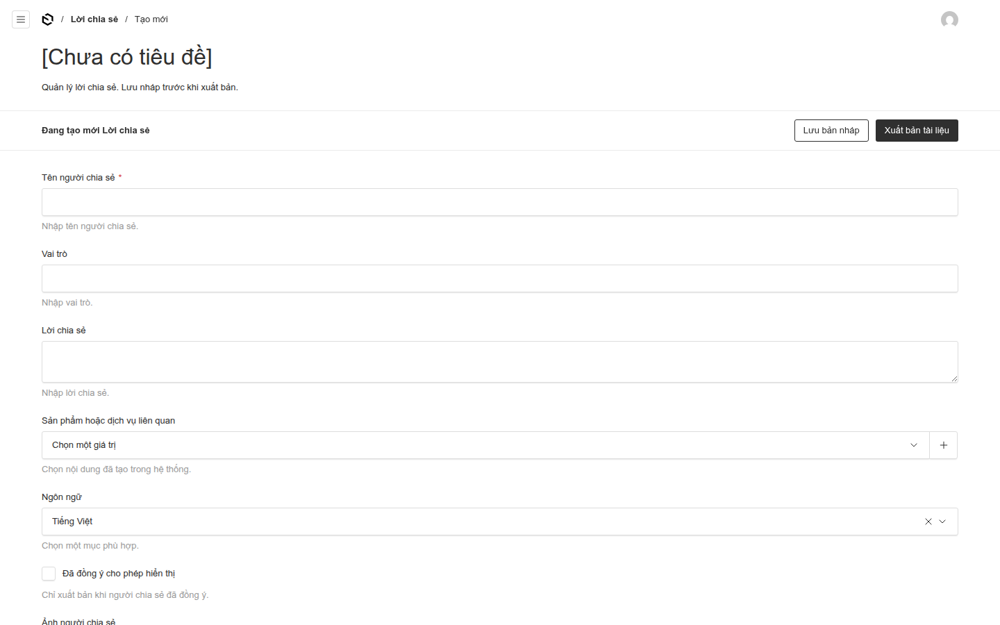
<!-- ẢNH 08: trang <ĐỊA CHỈ DEMO>/admin/collections/testimonials/create, form nhập cảm nhận và khoanh đỏ ô tick Đã đồng ý cho phép hiển thị -->

### 4.3. Câu chuyện "Trước / Sau" của khách hàng

Trong form **Lời chia sẻ** có thêm:

- **Tuổi** (không bắt buộc) và **Vai trò** – chức danh hiện trên thẻ (VD: _Project Manager_). Chỉ nhập khi khách đồng ý hiện các thông tin này.
- Nhóm **Câu chuyện**: _Trước / Vấn đề ban đầu_, _Quá trình nhận thức_ (không bắt buộc), _Sau / Kết quả_. Dùng cho các thẻ câu chuyện trên trang lộ trình và trang Coach 1:1.
- **Sản phẩm hoặc dịch vụ liên quan**: chọn gói (CLEAR / BUILD / SHINE…) để thẻ hiện nhãn "Gói đồng hành".

Quy tắc đồng ý ở mục 4.2 vẫn áp dụng: chưa tick đồng ý thì không xuất bản được.

### 4.4. Câu hỏi thường gặp (FAQ) dùng chung

Menu trái → nhóm **Trang web** → **Câu hỏi thường gặp**.

1. Bấm **Tạo mới**, nhập **Câu hỏi** và **Trả lời** (xuống dòng được giữ nguyên trên web).
2. Bên phải chọn **Nhóm** (Chung, Lộ trình, Coaching 1:1, Sản phẩm số, Doanh nghiệp, Thanh toán) và **Thứ tự** (số nhỏ đứng trước).
3. Bấm **Xuất bản**.

Mỗi câu chỉ cần nhập **một lần**: trang nào hiện FAQ theo nhóm đó sẽ tự cập nhật khi bạn sửa. Câu trả lời về thanh toán cần đúng chính sách: chuyển khoản QR, **không hoàn tiền**, phiên trải nghiệm 149.000đ để thử trước.

### 4.5. Đội ngũ chuyên gia

Menu trái → nhóm **Trang web** → **Đội ngũ**.

- Chỉ thêm **người thật** đã đồng ý cho Trạm hiện tên và ảnh trên web.
- Điền Họ tên, Vai trò, Chuyên môn, Giới thiệu ngắn (tối đa 400 ký tự), Ảnh chân dung (có mô tả ảnh).
- Bên phải tick **Người này đã đồng ý hiện tên, ảnh trên web** rồi mới bấm **Xuất bản** – chưa tick thì hệ thống chặn lại.
- Chưa có ai thì để trống: khối Đội ngũ trên trang Về Trạm sẽ tự ẩn.

---

## 5. Dựng trang trực quan bằng công cụ kéo thả (Puck Editor)

Đây là công cụ mạnh mẽ nhất giúp Hana tự tay tạo ra các landing page chiến dịch, trang dịch vụ hay trang sự kiện một cách trực quan như xếp các khối hình ảnh mà không cần chạm vào code.

### 5.1. Tạo trang mới từ Mẫu trang có sẵn

**Mục đích**: Tạo một trang web hoàn chỉnh chỉ trong vài phút bằng cách kế thừa bố cục chuyên nghiệp đã được thiết kế sẵn.

**Các bước thực hiện**:

1. Ở cột menu bên trái, tìm nhóm **Trang web**, bấm chọn **Trang nội dung**.
2. Bấm nút **Tạo mới** ở góc trên bên phải.
3. Nhập **Tên trang** (ví dụ: _Chiến dịch Chuyển mình Cuối năm_).
4. Nhập **Đường dẫn**: Viết chữ thường không dấu, ví dụ `chien-dich-cuoi-nam` (riêng Trang chủ là đúng một dấu `/`).
5. Tại ô **Mẫu trang**, bấm chọn 1 trong 4 mẫu có sẵn:
   - **Landing chiến dịch**: Bố cục phễu thu hút độc giả, gồm Hero, Câu chuyện, Lời chia sẻ và Form đăng ký.
   - **Trang dịch vụ**: Dành cho giới thiệu dịch vụ coaching 1:1 chuyên sâu.
   - **Trang workshop**: Dành cho sự kiện đào tạo hoặc workshop sắp diễn ra.
   - **Trang sự kiện**: Dành cho các hoạt động cộng đồng.
6. Bấm nút **Lưu** ở thanh công cụ dưới đáy màn hình. Hệ thống sẽ tự động khởi tạo trang với toàn bộ các khối chuẩn theo mẫu bạn chọn!

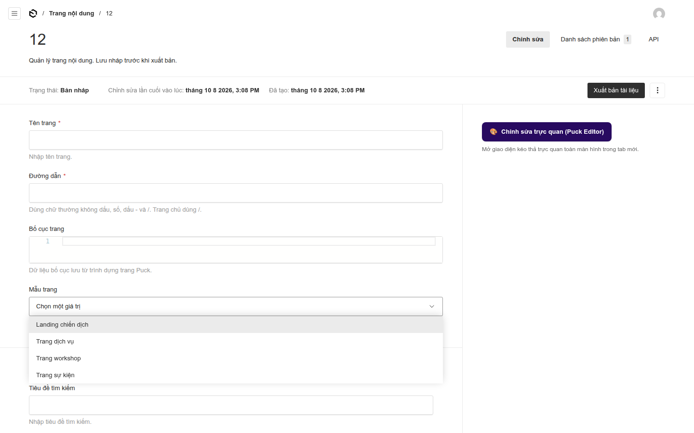
<!-- ẢNH 09: trang <ĐỊA CHỈ DEMO>/admin/collections/pages/create, trường chọn Mẫu trang với danh sách Landing chiến dịch, Trang dịch vụ... -->

---

### 5.2. Mở trình chỉnh sửa trực quan

**Mục đích**: Chuyển từ màn hình nhập liệu sang màn hình kéo thả toàn cảnh.

**Các bước thực hiện**:

1. Sau khi trang đã được bấm Lưu, nhìn sang cột bên phải (sidebar).
2. Bấm vào nút màu xanh tím nổi bật: **🎨 Chỉnh sửa trực quan (Puck Editor)**.
3. Màn hình sẽ chuyển sang trình dựng kéo thả toàn màn hình.

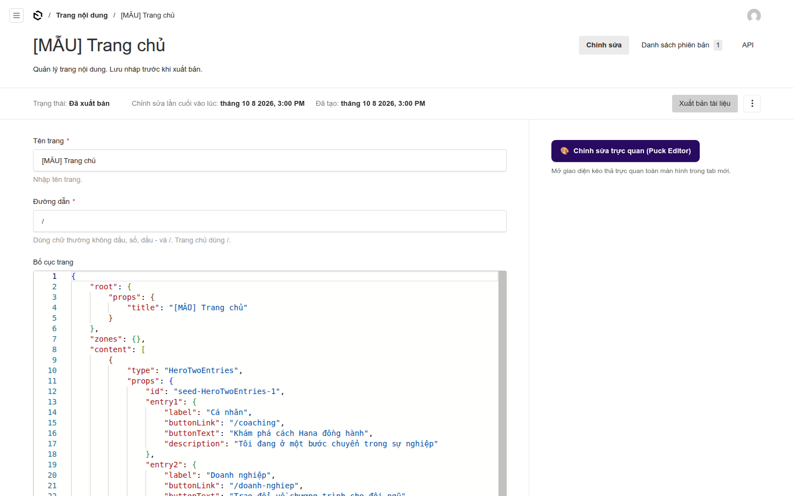
<!-- ẢNH 10: trang chi tiết Trang nội dung, khoanh nút Chỉnh sửa trực quan (Puck Editor) ở cột bên phải -->

---

### 5.3. Thao tác với các khối: Thêm, sửa chữ, đổi màu nền, nhân bản và xóa

**Mục đích**: Tùy biến toàn bộ nội dung và diện mạo từng khối trên trang theo ý thích của bạn.

Màn hình trình dựng gồm 3 khu vực theo bố cục trực quan phong cách Elementor:

- **Cột bên trái (LeftPanel ~280px)**:
  - **Tab "Khối"**:
    - **Ô tìm kiếm trên cùng**: Gõ từ khoá bất kỳ (ví dụ: `hero`, `anh`, `cot`, `trich dan`...) để lọc khối ngay lập tức (không phân biệt dấu tiếng Việt hay chữ hoa/thường). Có nút bấm **X** để xoá nhanh nội dung tìm kiếm.
    - **Các nhóm khối thu gọn/mở**: Nhấp chuột vào tiêu đề nhóm (_Mở đầu_, _Nội dung_, _Bố cục_, _Bán hàng_, _Niềm tin_, _Chuyển đổi_) để đóng/mở danh mục. Hệ thống tự động ghi nhớ trạng thái các nhóm bạn đã mở.
    - **Lưới khối 2 cột**: Mỗi ô gồm biểu tượng SVG nét mảnh chuẩn thương hiệu và tên tiếng Việt rõ ràng, chiều cao 88px, rê chuột vào sẽ nổi viền nhấn ấm áp.
  - **Tab "Cấu trúc"**: Nhấp vào tab này để xem toàn bộ cây phân cấp các khối trên trang (Outline/Navigator). Bạn có thể bấm chọn khối, xem khối cha con và kéo thả sắp xếp lại thứ tự các phần tử.
- **Khu vực ở giữa (Canvas)**:
  - Khung trang web hiển thị trực quan (được mở rộng thoáng đãng hơn trên màn hình 1440px).
  - **Thanh công cụ đáy canvas (Toolbar)**:
    - Nút bật/tắt cột trái (thu gọn để xem trọn màn hình, đặc biệt tiện trên laptop hoặc máy tính bảng).
    - Nút phím tắt mở tab Cấu trúc.
    - Bộ 3 nút chuyển nhanh khổ xem trước: **Điện thoại (375px)**, **Máy tính bảng (768px)**, **Máy tính (1440px)**.
    - Nút **Hoàn tác** (Undo, phím tắt Ctrl+Z) và **Làm lại** (Redo, phím tắt Ctrl+Shift+Z) – tự động vô hiệu hoá khi không còn bước nào để lùi.
    - Nút **Xem trang** (mở trang ngoài web thật ở tab mới; tự động tắt và hiện nhắc nhở nếu trang chưa từng xuất bản).
- **Cột bên phải**: Bảng thuộc tính chi tiết của khối đang được nhấp chọn.

#### 5.3.1. Các thao tác cơ bản

- **Thêm khối mới**: Trong tab "Khối" ở cột bên trái, giữ chuột trái vào ô khối mong muốn trong lưới 2 cột, kéo sang vùng canvas ở giữa rồi thả tay ra.
- **Sửa câu chữ**: Bấm chuột vào khối cần sửa ở giữa. Nhìn sang cột bên phải và gõ lại tiêu đề, dòng cảm xúc, đoạn văn bản theo ý bạn.
- **Soạn thảo trực tiếp trên trang (Inline Editing)**: Với các khối tiêu đề như **Tiêu đề phân đoạn** (`SectionHeader`), bạn có thể nhấp chuột trực tiếp vào dòng chữ trên màn hình xem trước ở giữa và gõ sửa chữ ngay tại chỗ mà không cần nhìn sang bảng thuộc tính bên phải.
- **Đổi màu nền**: Trong bảng thuộc tính bên phải, bấm vào ô **Màu nền** và chọn 1 trong các màu pastel nhẹ nhàng của Brand Book 2026 (_Ngà ấm_, _Hồng phấn_, _Tím sương_, _Bạc hà_, _Kem bơ_, _Xanh thẫm_).
- **Nhân bản khối**: Rê chuột lên góc trên khối ở giữa, bấm vào biểu tượng hai ô vuông (**Nhân bản**) để nhân đôi khối đó ngay bên dưới.
- **Xóa khối**: Rê chuột lên khối, bấm vào biểu tượng thùng rác (**Xóa**) để loại bỏ khối khỏi trang.

#### 5.3.2. Định dạng cỡ chữ và màu chữ cho Tiêu đề phân đoạn (SectionHeader v2)

Khối **Tiêu đề phân đoạn** (`SectionHeader`) cho phép Hana tự do điều chỉnh màu sắc và cỡ chữ cho từng tầng nội dung mà vẫn tuyệt đối giữ vững nhận diện thương hiệu:

1. **Tùy chỉnh màu sắc từng tầng chữ**:
   - **Màu tiêu đề dòng 1** (`line1Color`): Mặc định là **Xanh thẫm** (`deep-navy`), mang lại vẻ sang trọng, rõ ràng.
   - **Màu tiêu đề dòng 2** (`line2Color`): Mặc định là **Hồng sen** (`bright-magenta`), tạo điểm nhấn ấm áp, thu hút. Dòng 1 và Dòng 2 luôn hiện trên 2 hàng; muốn tiêu đề một hàng thì chỉ điền Dòng 1.
   - **Màu nhãn series** (`eyebrowColor`): Mặc định là **Hồng sen** (`bright-magenta`).
   - **Màu dòng cảm xúc** (`emotionColor`): Mặc định là **Xanh thẫm** (`deep-navy`), thể hiện dòng suy ngẫm sâu lắng.

2. **Tùy chỉnh kích thước và căn lề**:
   - **Cỡ chữ tiêu đề** (`titleSize`): Gồm 3 mức **Nhỏ** (`sm`), **Vừa** (`md` – mặc định), **Lớn** (`lg`). Kích thước tự động co giãn hài hòa theo cấp độ thẻ HTML bạn chọn (`H1`, `H2` hoặc `H3`).
   - **Cỡ chữ dòng cảm xúc** (`emotionSize`): Gồm 3 mức **Nhỏ** (`sm`), **Vừa** (`md` – mặc định), **Lớn** (`lg`) với font chữ nghiêng Playfair Display thanh lịch.
   - **Căn lề** (`align`): Chọn **Căn giữa** (`center` – mặc định trang trọng) hoặc **Căn trái** (`left` – hiện đại, phù hợp bài viết/giới thiệu).

#### 5.3.3. Cơ chế bảo vệ độ tương phản chuẩn WCAG AA (Lưới an toàn thị giác)

> **Hana yên tâm**: _"Tại sao khi đổi màu nền trang hoặc cỡ chữ, danh sách màu chữ trong ô chọn lại tự động thay đổi?"_

Website Trạm Dừng Cảm Xúc tích hợp hệ thống **Lưới an toàn thị giác thông minh** tuân thủ nghiêm ngặt tiêu chuẩn trợ năng quốc tế **WCAG 2.1 AA** (độ tương phản tối thiểu ≥ 4.5:1 đối với chữ thông thường và ≥ 3.0:1 đối với chữ lớn):

- **Trên nền tối (Xanh thẫm `deep-navy`)**:
  - Hệ thống chỉ cho phép chọn **Trắng** (tỷ lệ tương phản cực cao 16.12:1) hoặc **Hồng phấn** (tỷ lệ 13.69:1).
  - Tự động ẩn các màu tối như Xanh thẫm hay Hồng sen để ngăn chặn hoàn toàn tình trạng chữ bị chìm vào nền tối khiến độc giả không thể đọc được.
- **Trên nền sáng pastel thông thường (`warm-ivory`, `soft-pink`, `mint-haze`, `butter-cream`)**:
  - Luôn mở sẵn màu **Xanh thẫm** (tỷ lệ 12.18–14.88:1) và **Hồng sen** (tỷ lệ 5.03–6.15:1).
  - Riêng màu **Hồng đậm** (`accent-pink`) chỉ xuất hiện khi bạn chọn cỡ chữ **Lớn** (`lg`) vì tỷ lệ tương phản ~3.2:1 đạt chuẩn quốc tế cho chữ tiêu đề cỡ lớn nhưng chưa đủ an toàn cho chữ nhỏ.
- **Trên nền Tím sương (`lavender-mist`)**:
  - Với chữ nhỏ/vừa, hệ thống chỉ cho phép dùng màu **Xanh thẫm** (tỷ lệ 10.80:1). Màu **Hồng sen** (tỷ lệ 4.44:1) chỉ mở khi bạn chọn cỡ chữ **Lớn** (`lg`) để đảm bảo không bị lóa mắt bạn đọc.

Nhờ cơ chế này, Hana và cộng sự có thể thỏa sức sáng tạo diện mạo cho các chiến dịch mà hệ thống luôn tự động bảo vệ trang web giữ vững tinh thần **Rõ ràng (Clarity), Ấm áp (Warmth) và Đáng tin cậy (Emotional Trust)**!

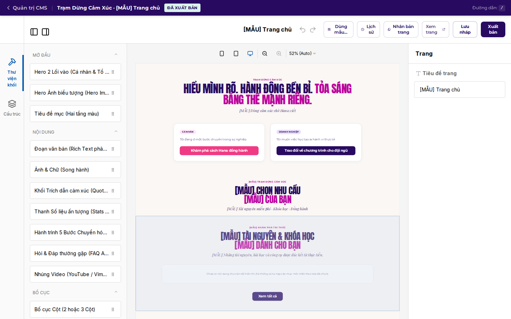
<!-- ẢNH 11: toàn cảnh màn hình Puck Editor gồm 3 cột: thư viện khối bên trái, canvas ở giữa và bảng thuộc tính bên phải -->

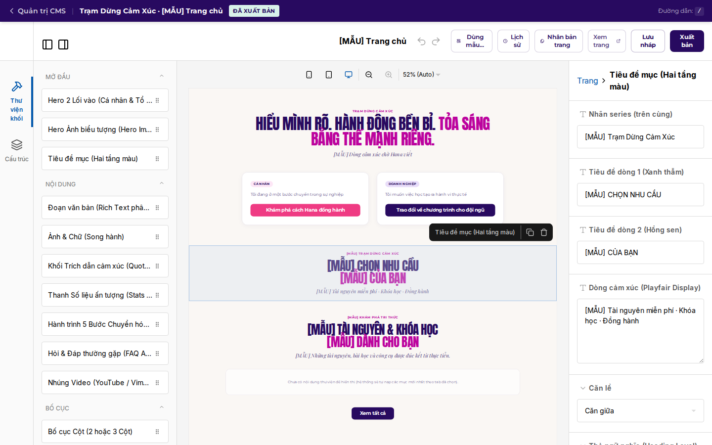
<!-- ẢNH 12: thao tác chọn một khối trên canvas và sửa câu chữ, màu nền ở cột bên phải -->

---

### 5.4. Sửa tiêu đề Hero trang chủ & Quy tắc khóa khối (Hero 2 Lối vào)

**Mục đích**: Thay đổi lời chào đón đầu trang chủ mà vẫn giữ an toàn cho trải nghiệm điều hướng của độc giả.

**Cách sửa câu chữ Hero Trang chủ**:

1. Vào **Trang nội dung** -> chọn trang có đường dẫn `/` (Trang chủ) -> bấm **Chỉnh sửa trực quan**.
2. Bấm chuột vào khối trên cùng (**Hero 2 Lối vào**).
3. Nhìn sang cột bên phải để sửa:
   - Dòng tiêu đề 1 (Xanh thẫm): Mặc định là _"Hiểu mình rõ. Hành động bền bỉ."_
   - Dòng tiêu đề 2 (Hồng sen): Mặc định là _"Tỏa sáng bằng thế mạnh riêng."_
   - Dòng cảm xúc: Dòng chữ in nghiêng mang lại cảm giác bình yên.
   - Câu chữ trên 2 nút lối vào (_Cá nhân_ và _Doanh nghiệp_).

**Quy tắc khóa khối bảo vệ trang chủ**:

- Khối **Hero 2 Lối vào** trên Trang chủ đóng vai trò phân luồng sống còn giữa khách hàng cá nhân và doanh nghiệp.
- Vì vậy, hệ thống đã **khóa chức năng xóa** đối với khối này trên Trang chủ. Bạn sẽ thấy biểu tượng thùng rác bị ẩn hoặc vô hiệu hóa. Đây là cơ chế chủ đích giúp trang chủ không bao giờ bị mất đi lối vào chính yếu.

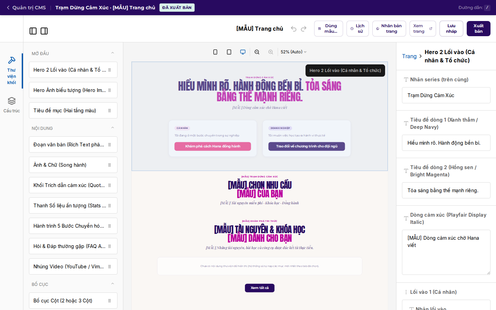
<!-- ẢNH 13: khối Hero 2 Lối vào trên trang chủ không có nút xóa và được bảo vệ cấu trúc -->

---

### 5.5. Xem thử trên 3 kích thước màn hình (375px, 768px, 1440px)

**Mục đích**: Đảm bảo trang web hiển thị thoáng đãng, vừa vặn và không bao giờ bị tràn ngang trên điện thoại của độc giả.

**Cách thực hiện**:

- Trên thanh công cụ (Toolbar) ở dưới đáy của khung canvas, bấm vào 3 nút kích thước tiện lợi:
  - **Điện thoại (375px)**: Kiểm tra xem giao diện di động có đẹp mắt và chữ có dễ đọc không.
  - **Máy tính bảng (768px)**: Xem thử trên màn hình iPad/tablet.
  - **Máy tính (1440px)**: Xem trên màn hình máy tính để bàn hoặc laptop.

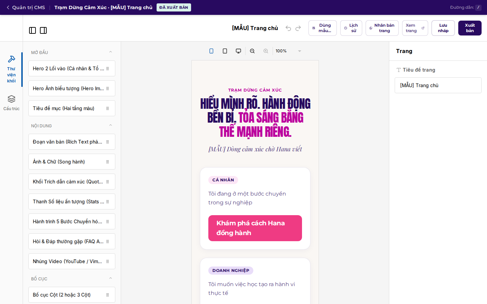
<!-- ẢNH 14: thanh công cụ đáy canvas khoanh 3 biểu tượng chuyển đổi kích thước màn hình -->

---

### 5.6. Lịch sử phiên bản và Khôi phục bản cũ

**Mục đích**: Tự tin thử nghiệm chỉnh sửa mà không sợ hỏng trang, có thể quay lại bản cũ bất cứ lúc nào.

**Cách thực hiện**:

1. Trên thanh công cụ trên cùng của trình dựng Puck, bấm vào nút **Lịch sử**.
2. Một bảng danh sách các phiên bản đã lưu trước đó sẽ hiện ra, hiển thị rõ ngày giờ lưu.
3. Chọn phiên bản bạn muốn quay lại, bấm nút **Khôi phục**.
4. Toàn bộ bố cục và câu chữ của phiên bản đó sẽ được khôi phục ngay lập tức về màn hình soạn thảo.

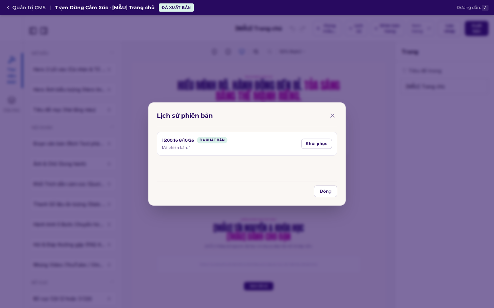
<!-- ẢNH 15: cửa sổ popup Lịch sử phiên bản hiển thị danh sách các bản lưu theo thời gian và nút Khôi phục -->

---

### 5.7. Nhân bản toàn bộ trang

**Mục đích**: Tạo một trang chiến dịch mới có bố cục tương tự trang hiện tại mà không phải kéo thả lại từ đầu.

**Cách thực hiện**:

1. Trong màn hình trình dựng của trang bạn muốn sao chép, bấm nút **Nhân bản trang** trên thanh công cụ trên cùng.
2. Hệ thống sẽ tự động tạo một trang mới với toàn bộ khối giống hệt và mở trang bản sao ra để bạn sửa đổi tên và câu chữ.

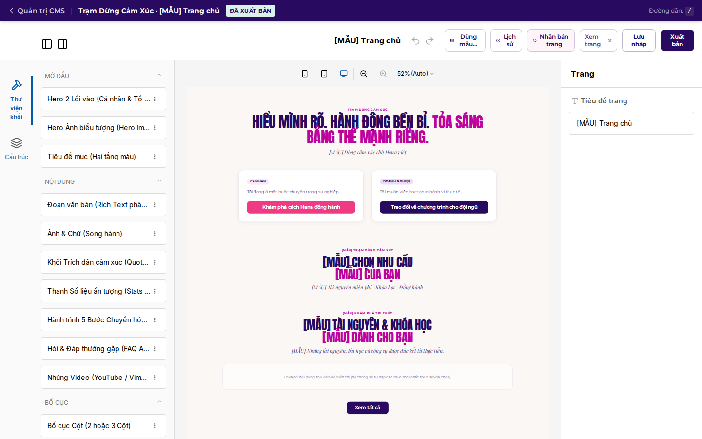
<!-- ẢNH 16: thanh trên cùng của Puck Editor, khoanh nút Nhân bản trang -->

---

### 5.8. Lưu nháp, Xuất bản và Xem trang công khai

**Mục đích**: Quản lý quy trình đưa nội dung lên mạng một cách an toàn.

- **Tự động lưu (Autosave)**: Cứ mỗi 30 giây, trình dựng sẽ tự động lưu nháp công việc của bạn.
- **Nút Lưu nháp**: Bấm khi bạn muốn chủ động lưu lại mà chưa muốn độc giả ngoài mạng nhìn thấy.
- **Nút Xuất bản**: Bấm khi trang đã hoàn thiện. Lúc này hệ thống sẽ đưa nội dung ra website thật và hiện thông báo xanh _"Đã xuất bản thành công"_.
- **Nút Xem trang**: Xuất hiện ở thanh công cụ dưới đáy canvas và ở thanh điều hướng trên cùng khi trang đã xuất bản. Bấm vào để mở một tab mới xem trang web thật ngoài đời! Nếu trang chưa xuất bản lần nào, nút ở thanh công cụ đáy sẽ tắt kèm gợi ý _"Xuất bản để xem"_.

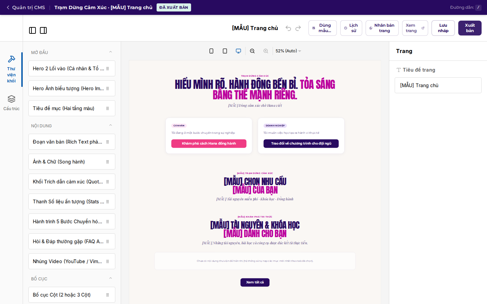
<!-- ẢNH 17: thanh trên cùng của Puck Editor với các nút Lưu nháp, Xuất bản và Xem trang -->

---

### 5.9. Các khối mới (Sitemap v2)

Trong đợt nâng cấp Sitemap v2 (SM-03), hệ thống bổ sung 5 khối kéo thả mới và nâng cấp 7 khối hiện có để Hana dễ dàng tùy biến Trang chủ và Trang Lộ trình chuyển mình:

#### 1. Khối Lưới thẻ icon / số thứ tự (`IconCardGrid`)

- **Vị trí**: Nhóm **Nội dung**.
- **Mục đích**: Trình bày danh sách đặc điểm, lợi ích hoặc các bước tiến trình một cách gọn gàng, trực quan.
- **Cách dùng**:
  - Chọn **Kiểu hiển thị**:
    - `Icon`: Hiển thị biểu tượng cảm xúc hữu cơ (hoa sen `lotus`, chiếc lá `leaf`, bướm `butterfly`, ngọn đuốc, trái tim...).
    - `Số thứ tự`: Hiển thị số đếm nổi bật `01, 02, 03` thích hợp cho các bước quy trình.
  - Chọn **Số cột**: Hỗ trợ 2, 3 hoặc 4 cột linh hoạt.
  - Mỗi thẻ cho phép nhập: Tiêu đề thẻ, Mô tả chi tiết, Nhãn phụ (badge) và Link điều hướng (tùy chọn).

#### 2. Khối Điểm nhấn thông điệp (`Callout`)

- **Vị trí**: Nhóm **Nội dung**.
- **Mục đích**: Thu hút ánh nhìn vào một câu trích dẫn tâm đắc, lời cam kết đồng hành hoặc thông điệp cốt lõi của Hana.
- **Cách dùng**:
  - Chọn **Sắc thái (`tone`)**:
    - `Mặc định` (`default`): Thẻ nền xanh thẫm `deep-navy` sang trọng, chữ trắng, câu quote font Playfair Display Italic và nút kêu gọi hành động `accent-pink` rực rỡ.
    - `Tĩnh lặng` (`calm`): Thẻ nền tím sương `lavender-mist` nhẹ nhàng, chữ xanh thẫm sâu lắng.
  - Nhập Tiêu đề lớn, Câu nói/trích dẫn, Tên tác giả, Chức danh và Nút hành động (nếu muốn dẫn về trang Đặt lịch).

#### 3. Khối Thẻ gói Growth Mirror (`PackageCards`)

- **Vị trí**: Nhóm **Bán hàng**.
- **Mục đích**: Hiển thị trực quan 3 gói đồng hành (CLEAR, BUILD, SHINE) với đầy đủ cấu phần, giá trị thực tế và mức ưu đãi.
- **Cách dùng**:
  - Chọn danh sách các gói đồng hành từ mục `products` (loại `package`).
  - **Gói nổi bật (`highlightPackageId`)**: Chọn gói bạn muốn khuyến nghị học viên nhất (ví dụ: gói `BUILD`). Gói được chọn sẽ khoác nền xanh thẫm `deep-navy` nổi bật với huy hiệu `ĐỀ XUẤT CHO BẠN`.
  - Hệ thống **tự động tính tổng giá trị và % ưu đãi** từ cấu phần gói trong CMS, Hana không cần nhập tay.
  - Nút bấm tự động dẫn về form đặt lịch tư vấn gói tương ứng, tuyệt đối không tạo đơn thanh toán trực tiếp.

#### 4. Khối Hệ sinh thái giải pháp (`SolutionEcosystem`)

- **Vị trí**: Nhóm **Bán hàng**.
- **Mục đích**: Giới thiệu toàn cảnh giải pháp của Trạm Dừng Cảm Xúc dành cho cá nhân và doanh nghiệp.
- **Cách dùng (Cập nhật PK-19 - Bố cục "Theo nhóm" chuẩn thiết kế 2026)**:
  - **Bố cục (`layout`)**:
    - `Dạng thẻ (Mặc định cho trang cũ)`: Giữ nguyên bố cục thẻ truyền thống.
    - `Theo nhóm (Thiết kế 2026)`: Bố cục chuẩn mới phân nhóm trực quan, mỗi cột có icon trong ô vuông bo tròn, vạch màu trên đầu thẻ, các nhóm phân cấp rõ ràng (khung viền hồng / bình thường, kiểu dòng gọn `row` hoặc thẻ con `card`, nút viền `outline` hoặc nút đặc `filled`).
  - **Cấu hình từng cột**:
    - Chọn **Biểu tượng (Icon)** từ bộ icon thương hiệu chuẩn (`target`, `compass`, `leaf`, `team`,...).
    - Chọn **Vạch màu trên đầu thẻ (Accent)**: Một trong 8 màu brand book (VD: Cột 1 `accent-pink`, Cột 3 `deep-navy`).
    - Thêm các **Nhóm giải pháp**: Điền nhãn nhóm (VD `SIGNATURE PROGRAM`), tiêu đề nhóm, chọn kiểu khung (`outlined` viền hồng hoặc `plain`), kiểu hiển thị (`row` dòng gọn hoặc `card` thẻ con), kiểu nút (`outline` hoặc `filled`), và chọn sản phẩm / dịch vụ / chương trình từ CMS.
    - Có thể điền ghi đè **Tiêu đề dòng/thẻ** và **Chữ trên nút** cho từng mục; câu ngắn cạnh tên tự động lấy từ ô **Tagline** của sản phẩm (sửa trực tiếp ở trang quản lý Sản phẩm).
    - Đoạn giới thiệu dưới tiêu đề lớn điền ở ô **"Mô tả"**, không nhầm lẫn với ô "Dòng cảm xúc" (Playfair nghiêng).
  - Dữ liệu được liên kết trực tiếp từ danh mục **Sản phẩm** (`products`), **Dịch vụ đồng hành** (`services`) và **Chương trình doanh nghiệp** (`programs`).
  - **Lưu ý về trạng thái bán của gói Growth Mirror**: Theo quyết định thiết kế kinh doanh (DECISIONS Q4), các gói Growth Mirror không bán trực tiếp mà đi qua phiên trải nghiệm 149.000đ. Vì vậy trong danh mục Sản phẩm, Hana nên đặt **Trạng thái mở bán** của các gói này là **`Tư vấn` (`consult`)** (thay vì `on_sale`). Khi để `consult`, nút bấm ở Cột 1 sẽ hiển thị "Đăng ký tư vấn / Đặt phiên trải nghiệm" thay vì "Mua ngay". Trang công khai sẽ tự động ẩn các cột chưa có dữ liệu; khi Hana đang ở chế độ chỉnh sửa (Puck Editor), hệ thống hiển thị dòng ghi chú nhắc nhở để Hana thuận tiện lựa chọn.

#### 5. Khối Chuyển đổi chân trang (`CTASection`)

- **Vị trí**: Nhóm **Chuyển đổi**.
- **Mục đích**: Khối kêu gọi hành động quyết định đặt ở cuối mỗi trang, thôi thúc độc giả đăng ký phiên trải nghiệm hoặc kết nối.
- **Cách dùng**:
  - Chọn **Biến thể (`variant`)**: `Mặc định` (đầy đủ tiêu đề 2 tầng màu, dòng cảm xúc và dải chỉ số niềm tin) hoặc `Tối giản` (gọn gàng, tập trung).
  - Bật/tắt **Dải chỉ số niềm tin (`showProofStrip`)**: Hiển thị nhanh các con số bảo chứng (10+ năm kinh nghiệm, 500+ giờ khai vấn, tiêu chuẩn ICF ACC...).
  - Thiết lập nút kêu gọi dẫn về trang Đặt phiên trải nghiệm 149.000đ hoặc trang Khai vấn.

---

### 5.10. Các khối mới – đợt B (Sitemap v2: Về Trạm + Coach 1:1)

Trong đợt nâng cấp Sitemap v2 (SM-04), hệ thống bổ sung **4 khối kéo thả mới** và nâng cấp **4 khối hiện có** để Hana xây dựng trang Về Trạm (`/ve-tram`), trang Giới thiệu Hana (`/ve-hana`) và trang Khai vấn 1:1 (`/coaching`):

#### 1. Khối Tầm nhìn & Sứ mệnh (`VisionMission`)

- **Vị trí**: Nhóm **Nội dung**.
- **Mục đích**: Khắc họa định hướng tương lai và tôn chỉ phụng sự của Trạm Dừng Cảm Xúc qua 2 thẻ đối xứng trang nhã kèm câu trích dẫn đúc kết.
- **Cách dùng**:
  - Nhập **Tiêu đề 2 tầng màu** và **Nhãn series**.
  - Thẻ **Tầm nhìn** (bên trái, viền tím sương): Nhập Tiêu đề tầm nhìn, Nội dung phân đoạn (các đoạn cách nhau một dòng trống) và chọn Icon biểu tượng (mặc định la bàn `compass`).
  - Thẻ **Sứ mệnh** (bên phải, viền bạc hà): Nhập Tiêu đề sứ mệnh, Nội dung phân đoạn và chọn Icon biểu tượng (mặc định trái tim `heart`).
  - **Câu trích dẫn đúc kết (`quote`)**: Hiển thị bên dưới dạng quote trang trọng với biểu tượng đường nét trái tim `HeartLine`.

#### 2. Khối Lưới dịch vụ chuyên biệt (`ServiceCards`)

- **Vị trí**: Nhóm **Bán hàng**.
- **Mục đích**: Giới thiệu các lộ trình đồng hành cá nhân hóa (Coaching 1:1, Tư vấn hướng nghiệp, Workshop may đo) với thông tin lấy trực tiếp từ CMS.
- **Cách dùng**:
  - Thêm các dịch vụ muốn hiển thị bằng cách bấm **+ Thêm dịch vụ** và chọn mã dịch vụ từ danh mục **Dịch vụ đồng hành** (`services`).
  - **Dịch vụ nổi bật (`highlightServiceId`)**: Điền mã ID của dịch vụ bạn muốn khuyến khích học viên đăng ký nhất. Dịch vụ đó sẽ tự động khoác nền xanh thẫm `deep-navy`, chữ trắng và huy hiệu nổi bật.
  - **Tự động đồng bộ**: Khi bạn chỉnh sửa tên, mô tả hay quyền lợi của dịch vụ trong danh mục `services`, khối trên trang web sẽ **tự động cập nhật tức thì**, không cần chỉnh sửa lại trang kéo thả.
  - **An toàn hiển thị**: Nếu danh sách dịch vụ đang trống hoặc chưa xuất bản dịch vụ nào, trang công khai sẽ tự động ẩn khối; trong màn hình Puck Editor sẽ hiển thị khung viền nét đứt màu xám nhắc nhở để bạn biết.

#### 3. Khối Hai lối đi Cá nhân & Doanh nghiệp (`TwoPathCards`)

- **Vị trí**: Nhóm **Chuyển đổi**.
- **Mục đích**: Điều hướng người truy cập chọn đúng hành trình dành riêng cho họ (Khách hàng cá nhân tự thấu hiểu hoặc Doanh nghiệp muốn gắn kết đội ngũ).
- **Cách dùng**:
  - Nhập thông tin cho **Lối 1 (Cá nhân)**: Nhãn nhóm (`Lộ trình Cá nhân`), Tiêu đề, Đoạn mô tả, Câu chữ trên nút, Kiểu nút (mặc định là nút nền màu `solid` nổi bật).
  - Nhập thông tin cho **Lối 2 (Doanh nghiệp)**: Nhãn nhóm (`Giải pháp Tổ chức`), Tiêu đề, Đoạn mô tả, Câu chữ trên nút, Kiểu nút (mặc định là nút viền mảnh `outline` thanh lịch).
  - **Chọn liên kết linh hoạt**: Bạn có thể chọn dẫn đến một đường dẫn tùy ý (ví dụ `/coaching`) hoặc chọn trực tiếp một **Trang nội dung** đã tạo trên website.

#### 4. Khối Đội ngũ chuyên môn & Cộng sự (`TeamGrid`)

- **Vị trí**: Nhóm **Niềm tin**.
- **Mục đích**: Tăng cường sự tin cậy bằng cách giới thiệu đội ngũ chuyên gia tâm lý, coach và cộng sự cùng đồng hành tại Trạm.
- **Cách dùng**:
  - Dữ liệu được hệ thống tự động tải từ danh mục **Đội ngũ** (`teamMembers`).
  - **Bảo mật quyền riêng tư (Bắt buộc)**: Để bảo vệ thông tin cá nhân của các cộng sự, hệ thống chỉ hiển thị những thành viên đã được tích chọn **"Người này đã đồng ý hiện tên, ảnh trên web"** trong trang quản trị.
  - **Hiển thị linh hoạt**: Nếu thành viên chưa kịp chụp ảnh đại diện chuyên nghiệp, hệ thống sẽ tự động hiển thị chữ cái đầu tiên của tên thành viên trên nền tròn màu hồng sen thanh lịch, đảm bảo giao diện luôn chỉn chu.
  - Nếu danh mục chưa có thành viên nào, khối sẽ tự ẩn trên website ngoài đời để không để lại khoảng trống.

#### 5. Các tính năng nâng cấp trên các khối hiện có (v2)

- **`JourneySteps` (5 bước hành trình cảm xúc)**:
  - Bổ sung **Kiểu hiển thị (`variant`)**: Hỗ trợ 3 kiểu gồm Vòng tròn truyền thống (`circles`), Thẻ bài học độc lập (`cards`), và Danh sách từng bước dọc (`list`).
  - **Bước trọng tâm (`highlightStep`)**: Nhập số thứ tự bước bạn muốn làm nổi bật (ví dụ gõ `2` để làm nổi bật bước _Cảm nhận - Feel_). Bước được chọn sẽ đổi sang nền xanh thẫm `deep-navy`.
  - **Phụ đề cho từng bước**: Cho phép nhập phụ đề ngắn gọn ngay dưới tên bước (ví dụ: _Tạo khoảng lặng_, _Lắng nghe cơ thể_...).
- **`HanaStory` (Câu chuyện người sáng lập)**:
  - Bổ sung **Sắc thái (`tone`)**: Chọn `Sáng` (mặc định) hoặc `Nền tối` (`dark`) với nền xanh thẫm tạo cảm giác sâu lắng, trang trọng.
  - Bổ sung **Bố cục (`layout`)**: Chọn dạng kể chuyện truyền thống (`story`), **Bức thư ngỏ (`letter`)**, hoặc **Ảnh trong khung cong (`spotlight`)** (PK-17).
    - Với bố cục **Ảnh trong khung cong**: chọn **Sắc thái Tối** + vị trí ảnh **Bên phải** để đạt chuẩn thiết kế Brand Book; tên Coach điền ở **Dòng 1** (màu trắng nổi bật trên nền tối); câu trích dẫn có vạch hồng dọc trang trọng và **không cần** gõ ngoặc kép (hệ thống tự động lọc bỏ ngoặc kép bọc ngoài).
  - **Chữ ký người sáng lập**: Khi chọn dạng Thư ngỏ (`letter`), hệ thống sẽ tự động chèn ảnh chữ ký viết tay của Hana ở cuối thư. Hana có thể tải ảnh chữ ký lên tại: **Cài đặt website** -> tab **Nhận diện thương hiệu** -> ô **Chữ ký người sáng lập**.
  - **Huy hiệu chứng chỉ (`chips`)**: Nhập danh sách các chứng chỉ ngắn gọn (như _ICF Associate Certified Coach (ACC)_, _10+ năm kinh nghiệm_) hiển thị dưới ảnh chân dung.
  - **Màu nút liên kết (PK-15)**: ô **Màu nút** chọn 1 trong 8 màu thương hiệu (để **Tự động** thì nút hồng nhấn, chữ trắng). Ô **Màu chữ trên nút** chỉ liệt kê các màu đọc rõ trên màu nút đã chọn; để **Tự động** thì hệ thống chọn chữ trắng nếu đọc rõ, không thì chọn màu tương phản tốt nhất. Nút trùng màu nền khối sẽ tự có viền để không bị chìm.
- **`ImageText` (Ảnh & Đoạn văn)**:
  - Bổ sung trường **Trích dẫn nổi bật (`quote`)**: Hiển thị đoạn văn ngắn có dấu ngoặc kép và đường viền hồng sen trang trọng.
  - Bổ sung **Nhãn ảnh (`imageLabel`)**: Hiển thị chú thích nhỏ ghim ở góc dưới ảnh chụp thực tế.
  - **Màu nút liên kết (PK-15)**: giống khối Câu chuyện Hana, chọn **Màu nút** và **Màu chữ trên nút** trong bảng màu thương hiệu.
- **`LogoStrip` (Dải logo đối tác & Chứng nhận)**:
  - Bổ sung tính năng **Phân nhóm logo (`groups`)**: Cho phép chia logo thành các nhóm riêng biệt (như nhóm _Chứng chỉ chuyên môn_, nhóm _Doanh nghiệp đồng hành_) có tiêu đề nhóm rõ ràng.

#### 6. Nâng cấp biểu mẫu Đặt phiên trải nghiệm (Booking Form)

- **Thay đổi nhãn câu hỏi**: Ô nhập trăn trở được đổi thành câu hỏi đồng cảm hơn: _"Bạn đang trăn trở điều gì?"_.
- **Lựa chọn lộ trình quan tâm**: Học viên có thể chọn trực tiếp lộ trình mà họ hướng tới trong danh sách thả xuống (lấy từ các dịch vụ đang mở bán của Trạm, hoặc chọn _"Chưa chắc chắn"_ nếu cần tư vấn thêm).
- **Ghi nhận gói quan tâm từ liên kết**: Khi học viên bấm vào nút Đặt lịch từ một gói đồng hành cụ thể (ví dụ bấm từ gói `CLEAR`, `BUILD`, hoặc `SHINE`), biểu mẫu sẽ hiển thị một dòng thông báo nhỏ xác nhận: _"Gói quan tâm: [Tên gói]"_. Khi đơn được gửi, hệ thống tự động lưu tên lộ trình và gói quan tâm vào phần **Ghi chú đơn hàng** trong CMS để Hana nắm rõ trước khi bước vào phiên khai vấn 1:1.
- **Liên kết đặt phiên tự động**: Nút đặt phiên tự dẫn tới sản phẩm phiên trải nghiệm đang bán đầu tiên (theo thứ tự); không có sản phẩm đang bán thì nút tự ẩn.

---

### 5.11. Trang Tài nguyên (Sitemap v2)

Trong đợt nâng cấp Sitemap v2 (SM-05), trang **Tài nguyên** (`/tai-nguyen`) được kết hợp linh hoạt giữa các khối kéo thả Puck trực quan và ứng dụng danh sách bài viết/tài liệu tự động.

#### 1. Chỉnh sửa phần đầu và phần cuối trang bằng Puck Editor

- Mở danh mục **Trang nội dung** (`pages`), tìm trang có đường dẫn `tai-nguyen`.
- Bấm nút **"Chỉnh sửa trực quan"** ở thanh công cụ phía trên để mở màn hình kéo thả Puck Editor.
- Phần đầu trang thường gồm: Khối tiêu đề `SectionHeader` và Khối trượt tài nguyên miễn phí `LeadMagnetCarousel`.
- Phần cuối trang thường gồm: Khối đăng ký nhận bản tin `NewsletterForm` và Khối kêu gọi chuyển đổi `CTASection`.

#### 2. Khối Vị trí danh sách bài viết (`ResourcePostsSlot`)

- **Vị trí**: Nhóm **Bố cục**.
- **Mục đích**: Đánh dấu vị trí hiển thị khu ứng dụng bài viết (thanh tìm kiếm, bộ lọc chủ đề, bài viết nổi bật, lưới bài viết và phân trang).
- **Cách dùng**:
  - Kéo khối `ResourcePostsSlot` vào vị trí bạn muốn danh sách bài viết xuất hiện trên trang (thường đặt ở giữa khối `LeadMagnetCarousel` và `NewsletterForm`).
  - Khối không có trường cài đặt. Trong màn hình chỉnh sửa Puck, khối hiển thị khung nét đứt thông báo _"Vị trí danh sách bài viết (ResourcePostsSlot) – Danh sách bài viết, ô tìm kiếm và bộ lọc chủ đề sẽ tự động hiển thị tại vị trí này trên trang công khai"_.
  - Trên trang công khai ngoài website, hệ thống sẽ tự động tách nội dung Puck thành 2 phần: các khối đặt trước khối này sẽ hiện ở trên, và các khối đặt sau sẽ hiện ở dưới khu bài viết.
  - _Lưu ý_: Chỉ khối `ResourcePostsSlot` nằm trực tiếp ở cấp ngoài cùng mới có hiệu lực (không đặt lồng bên trong khối Cột `Columns`). Nếu không có khối này, khu bài viết sẽ tự động hiển thị ở cuối toàn bộ nội dung Puck.

#### 3. Khối Trượt tài nguyên miễn phí (`LeadMagnetCarousel`)

- **Vị trí**: Nhóm **Chuyển đổi**.
- **Mục đích**: Trình bày danh sách tài nguyên miễn phí (Ebook, Toolkit, tài liệu hướng dẫn) dạng slide trượt mượt mà kèm biểu mẫu đăng ký nhận nhanh qua email (link ký hạn 7 ngày an toàn).
- **Cách dùng**:
  - Chọn **Chế độ hiển thị (`mode`)**:
    - `Tự động (`auto`)`: Tự động tải tất cả các sản phẩm có trạng thái **Miễn phí** (`saleStatus = free`), đã xuất bản và có đính kèm tệp tải về (tối đa 12 tài nguyên, sắp xếp theo thứ tự).
    - `Thủ công (`manual`)`: Tự tay lựa chọn từ 1 đến 12 sản phẩm tài nguyên cụ thể từ danh mục Sản phẩm.
  - Trên trang công khai, độc giả có thể bấm nút chuyển slide trước/sau, bấm các chấm tròn vị trí hoặc vuốt cảm ứng trên điện thoại.
  - Độc giả chỉ cần điền tên, email và tích chọn đồng ý là hệ thống tự động gửi email chứa link tải tệp bảo mật có thời hạn 7 ngày.
  - _Lưu ý_: Nếu chưa có tài nguyên miễn phí nào đủ điều kiện, khối sẽ tự ẩn trên trang công khai.

#### 4. Đánh dấu Bài viết nổi bật (Featured Post)

- Vào danh mục **Bài viết** (`posts`) ở cột menu bên trái.
- Chọn bài viết chất lượng cao mà bạn muốn làm tâm điểm trên trang Tài nguyên.
- Tích chọn ô **Đánh dấu là bài viết nổi bật** (`featured`).
- Trên trang `/tai-nguyen`, bài viết nổi bật mới nhất sẽ được hiển thị thành một thẻ lớn trang trọng ở đầu danh sách (kèm ảnh bìa lớn, huy hiệu chủ đề, tiêu đề, tóm tắt và thời gian đọc dự kiến). Thẻ này sẽ không bị lặp lại trong lưới bài viết bên dưới.

#### 5. Tạo tài nguyên miễn phí trong CMS

- Vào danh mục **Sản phẩm** (`products`) -> **Tạo mới**.
- **Tab 1: Cơ bản**: Nhập tên tài nguyên, đường dẫn slug, mô tả ngắn, chọn chủ đề và tải lên ảnh bìa.
- **Tab 2: Giá & bán**: Ở mục **Trạng thái mở bán**, chọn **`Miễn phí` (`free`)**. (Giá bán để `0`).
- **Tab 5: Tệp đính kèm**: Bấm tải lên tài liệu PDF hoặc bộ công cụ mà bạn muốn tặng độc giả.
- Bấm **Lưu** hoặc **Xuất bản**. Tài nguyên sẽ tự động xuất hiện trong khối `LeadMagnetCarousel` và trong bộ lọc chủ đề "Tài liệu" trên trang Tài nguyên.

#### 6. Khối Đăng ký nhận bản tin (`NewsletterForm`) & Quản lý Leads

- **Vị trí**: Nhóm **Chuyển đổi**.
- **Mục đích**: Thu hút độc giả đăng ký nhận bản tin chia sẻ cảm xúc và bài viết mới từ Hana.
- **Cách cấu hình trong Puck**: Hana có thể tùy chỉnh Tiêu đề, Đoạn mô tả, Chữ trên nút đăng ký và Câu cam kết bảo mật.
  - _Lưu ý từ nguyên tắc nội dung_: Chỉ hứa những điều Trạm đang thực hiện đều đặn (không hứa tần suất cố định như "mỗi tuần" hay định dạng chưa có như "podcast").
- **Cơ chế chống gửi trùng**: Nếu một độc giả đăng ký lại bằng cùng email, hệ thống vẫn hiện thông báo thành công ấm áp nhưng không tạo thêm bản ghi trùng lặp trong cơ sở dữ liệu.
- **Xem và xuất danh sách độc giả đăng ký newsletter**:
  - Vào mục **Khách tiềm năng** (`leads`) ở menu bên trái.
  - Trong danh sách, các độc giả đăng ký qua khối này sẽ được gắn thẻ nhãn `newsletter` và nhu cầu `Tài nguyên` (`resource`).

### 5.12. Trang Liên hệ & Câu hỏi thường gặp (Sitemap v2)

Trong đợt nâng cấp Sitemap v2 (SM-06), website được bổ sung trang **Liên hệ** (`/lien-he`) kết nối trực tiếp với trang **Câu hỏi thường gặp** (`/cau-hoi-thuong-gap`), giúp Hana quản lý tập trung thông tin kết nối và ngân hàng câu hỏi giải đáp.

#### 1. Sửa Email, Hotline và Mạng xã hội tại Cài đặt chung

- **Nguyên tắc an toàn dữ liệu**: Khối **Thông tin liên hệ (`ContactInfo`)** trên các trang web **không nhập thông tin trực tiếp trong trình dựng Puck**. Mọi dữ liệu liên hệ được quản lý tập trung tại một nơi duy nhất để đảm bảo tính nhất quán trên toàn bộ hệ sinh thái.
- **Cách chỉnh sửa**:
  1. Vào menu bên trái, tìm nhóm **Cài đặt**, bấm vào **Cài đặt chung** (`siteSettings`).
  2. Chuyển sang tab **Liên hệ & Zalo**.
  3. Cập nhật các mục:
     - **Email liên hệ**: Hộp thư chính thức tiếp nhận thư của Trạm.
     - **Hotline / Số điện thoại**: Số hotline hỗ trợ (có thể nhập `0901 234 567` hoặc `0901.234.567`, hệ thống tự chuẩn hóa link gọi điện thoại thông minh).
     - **Địa chỉ văn phòng**: Địa điểm gặp gỡ, làm việc trực tiếp.
     - **Link chat Zalo**: Đường dẫn kết nối nhanh qua Zalo Official Account hoặc Zalo cá nhân.
     - **Mạng xã hội**: Đường dẫn LinkedIn, Facebook Fanpage và kênh YouTube chính thức của Trạm.
  4. Bấm **Lưu thay đổi**. Tất cả các trang đang nhúng khối `ContactInfo` (như trang `/lien-he`) sẽ tự động cập nhật ngay lập tức.
  5. _Lưu ý_: Nếu mục nào để trống, thẻ tương ứng sẽ tự động ẩn trên website ngoài đời.

#### 2. Cấu hình danh sách "Tình trạng hiện tại" (Dành cho Form Cá nhân B2C)

- Trên biểu mẫu liên hệ cá nhân, học viên có thể chọn nhanh tình trạng tâm lý/cảm xúc mà họ đang trải qua (ví dụ: _Đang căng thẳng, quá tải_, _Cần định hướng lại thói quen_...).
- **Cách thay đổi các lựa chọn này**:
  1. Trong trang **Cài đặt chung** (`siteSettings`), tại tab **Liên hệ & Zalo**.
  2. Cuộn xuống mục **Lựa chọn tình trạng học viên** (`leadStatusOptions`).
  3. Hana có thể bấm **+ Thêm dòng**, chỉnh sửa nhãn hiển thị hoặc xóa bớt dòng cũ.
  4. Bấm **Lưu thay đổi**. Dropdown "Tình trạng hiện tại" trên form liên hệ sẽ hiển thị danh sách mới. Nếu danh sách này để trống, ô chọn sẽ tự động ẩn trên form mà không gây lỗi.

#### 3. Thêm và sắp xếp Câu hỏi thường gặp theo nhóm

- Toàn bộ ngân hàng câu hỏi giải đáp được lưu tập trung tại danh mục **Câu hỏi thường gặp** (`faqs`).
- **Tạo câu hỏi mới**:
  1. Vào menu bên trái -> **Website** -> **Câu hỏi thường gặp** (`faqs`) -> Bấm **Tạo mới**.
  2. Nhập **Câu hỏi** và **Trả lời** (nội dung câu trả lời hỗ trợ xuống dòng tự nhiên, giữ nguyên khoảng cách ngắt đoạn khi hiển thị trên web).
  3. Ở cột bên phải, chọn **Nhóm câu hỏi (`group`)**:
     - `Chung` (`general`): Câu hỏi cơ bản về Trạm Dừng Cảm Xúc.
     - `Lộ trình` (`journey`): Về 5 bước thực hành cảm xúc.
     - `Coaching 1:1` (`coaching`): Về hình thức, thời lượng, cách chuẩn bị khi tham gia khai vấn.
     - `Sản phẩm số` (`digital`): Về dùng thử 21 ngày, kích hoạt công cụ số Habit Tracker / EQ Buddy.
     - `Doanh nghiệp` (`business`): Về đào tạo may đo, giải pháp sức khỏe tinh thần cho tổ chức.
     - `Thanh toán` (`payment`): Về hình thức chuyển khoản VietQR, nhận tài nguyên.
  4. Nhập số **Thứ tự (`order`)**: Số nhỏ hơn sẽ đứng trước (ví dụ: `1`, `2`, `3`).
  5. Bấm **Xuất bản**. Câu hỏi sẽ tự động xuất hiện trên trang `/cau-hoi-thuong-gap` theo đúng nhóm và đúng thứ tự.

#### 4. Dùng khối FAQ ở chế độ "Lấy theo nhóm" trong Puck Editor

- Khi dựng bất kỳ trang nào (Trang chủ, Lộ trình, Về Trạm, Liên hệ...), bạn có thể kéo khối **FAQ** vào trang và cấu hình:
  - **Nguồn câu hỏi (`source`)**: Chuyển từ `Nhập thủ công` sang **`Lấy theo nhóm` (`group`)**.
  - **Chọn nhóm (`group`)**: Chọn nhóm chủ đề mong muốn (ví dụ chọn nhóm `Coaching 1:1`).
  - **Số lượng câu hỏi (`limit`)**: Giới hạn số câu hiển thị (mặc định 5 câu).
  - **Link xem thêm (`seeAllLink`)**: Nếu để trống, hệ thống sẽ tự động tạo nút "Xem thêm câu hỏi về [Tên nhóm]" dẫn trực tiếp đến phần tương ứng trên trang Câu hỏi thường gặp (ví dụ `/cau-hoi-thuong-gap#coaching`).
  - **Tự động cập nhật**: Khi Hana thêm mới hoặc sửa câu trả lời trong mục `faqs`, các trang đang nhúng khối FAQ này sẽ tự động hiển thị nội dung mới mà không cần vào Puck Editor sửa lại.

#### 5. Quản lý và lọc Khách tiềm năng (Leads) theo Form Liên hệ

- Khi học viên hoặc đối tác gửi biểu mẫu qua khối `ContactForms` trên trang `/lien-he`:
  - **Khách hàng cá nhân**: Lead được lưu với nhu cầu `Cá nhân` (`personal`), nguồn form là `contact-b2c`. Ghi nhận thông tin dịch vụ quan tâm và tình trạng hiện tại.
  - **Khách hàng doanh nghiệp**: Lead được lưu với nhu cầu `Doanh nghiệp` (`business`), nguồn form là `contact-b2b`. Ghi nhận vai trò người liên hệ (`contactRole`), tên công ty, quy mô đội ngũ, chương trình quan tâm và thách thức cần hỗ trợ.
- **Email thông báo tự động**: Ngay khi khách gửi form, Hana sẽ nhận được email thông báo chi tiết đầy đủ các thông tin trên để kịp thời phản hồi trong vòng 24 giờ.
- **Lọc danh sách trong CMS**:
  1. Vào menu bên trái -> **Khách hàng & Bán hàng** -> **Khách tiềm năng** (`leads`).
  2. Bấm vào nút **Lọc (Filter)** ở đầu bảng.
  3. Chọn điều kiện: `Nguồn form` (`source.form`) bằng `contact-b2c` (để xem riêng khách cá nhân liên hệ) hoặc `contact-b2b` (để xem riêng đề xuất từ doanh nghiệp).
  4. Hana có thể cập nhật trạng thái chăm sóc (`Mới`, `Đã liên hệ`, `Đang trao đổi`...) và bấm **Xuất CSV** khi cần bàn giao.

---

### 5.13. Mẫu trang Sitemap v2 & bản nháp

Trong đợt nâng cấp Sitemap v2 (SM-07), website được trang bị **5 mẫu trang chuyên sâu mới** dựng sẵn theo đúng cấu trúc chuẩn của Trạm Dừng Cảm Xúc.

#### 1. Danh sách 5 Mẫu trang Sitemap v2

| Mẫu trang                      | Mục đích sử dụng                     | Các khối chính trong mẫu                                                                                                                                                                                                                                                                                                                             |
| ------------------------------ | ------------------------------------ | ---------------------------------------------------------------------------------------------------------------------------------------------------------------------------------------------------------------------------------------------------------------------------------------------------------------------------------------------------- |
| **Trang chủ v2 (`home-v2`)**   | Trang chủ chính thức toàn diện       | Hero 2 lối vào (Cá nhân & Tổ chức), 3 gói giải pháp CLEAR/BUILD/SHINE, 4 bước nhận diện cảm xúc, Trích dẫn sâu lắng, Quiz chẩn đoán thói quen, Hành trình chuyển hóa 5 bước, Câu chuyện người sáng lập Hana, Dải số liệu bảo chứng, Lời chia sẻ của khách hàng, Hệ sinh thái giải pháp, Câu hỏi thường gặp và Form kết nối nhanh (dạng tab B2C/B2B). |
| **Trang lộ trình (`journey`)** | Giới thiệu lộ trình chuyển mình      | Hero ảnh lớn, 4 nỗi đau thường gặp (thẻ đánh số 1–4), Khối điểm dừng chiêm nghiệm (Callout), 3 gói đồng hành chi tiết, Bảng so sánh quyền lợi cấu phần và giá trị, Câu chuyện khách hàng thực tế (Testimonial story), Câu hỏi thường gặp và Khối kêu gọi hành động cuối trang kèm dải ảnh bảo chứng.                                                 |
| **Trang Về Trạm (`about`)**    | Kể câu chuyện thương hiệu & Triết lý | Hero ảnh đại diện, Câu chuyện "Tại sao lại là Trạm Dừng", Tầm nhìn & Sứ mệnh, 4 giá trị cốt lõi, Khung phương pháp 5 bước, Bức thư ngỏ từ người sáng lập Hana (kèm chữ ký viết tay), Đội ngũ chuyên gia khai vấn, Tiêu chuẩn & Cam kết quốc tế, Dải logo đối tác/chứng nhận và 2 lối vào hành động tiếp theo.                                        |
| **Trang Coach 1:1 (`coach`)**  | Dịch vụ khai vấn cá nhân chuyên sâu  | Hero khai vấn, 4 tình huống cần một tấm gương phản chiếu, 2 dịch vụ chính (Growth Mirror & Thinking Mirror), 3 yếu tố diễn ra trong một phiên khai vấn, Khái niệm không gian an toàn, Câu chuyện chuyển hóa 3 chặng, Tiến trình 5 bước và Khối đặt phiên trải nghiệm.                                                                                |
| **Trang Liên hệ (`contact`)**  | Cổng kết nối và tiếp nhận thông tin  | Hero kết nối, 3 cam kết hồi đáp từ Trạm, Khối thông tin liên hệ chính thức (Email, Hotline, Văn phòng, Mạng xã hội), Biểu mẫu liên hệ 2 cột song song (Dành cho Cá nhân & Dành cho Doanh nghiệp) và Câu hỏi thường gặp theo nhóm chung.                                                                                                              |

#### 2. Cơ chế Bản nháp mẫu an toàn (Sample Drafts)

Để Hana có thể xem thử diện mạo mới của 5 trang chính mà **không làm ảnh hưởng đến trang đang hoạt động trên website**:

- **Bản công khai vẫn an toàn 100%**: Bản đang chạy công khai ngoài website vẫn giữ nguyên nội dung ban đầu. Độc giả và khách hàng truy cập website không nhìn thấy bất kỳ xáo trộn nào.
- **Xem trước bản nháp trong Puck Editor**:
  1. Vào menu bên trái -> **Website** -> **Trang nội dung** (`pages`).
  2. Bấm vào trang bạn muốn xem (ví dụ: trang chủ `/`, trang `/ve-tram`, `/lo-trinh-chuyen-minh`, `/coaching`, hoặc `/lien-he`).
  3. Bấm nút **"Chỉnh sửa trực quan"** ở thanh công cụ phía trên.
  4. Màn hình Puck Editor sẽ mở ra với toàn bộ bố cục của mẫu mới đã được sắp đặt sẵn. Hana có thể chỉnh sửa câu chữ, thay ảnh hoặc thay đổi thứ tự các khối theo ý thích.
- **Nếu thích bản mới**: Bấm nút **"Xuất bản"** ở góc trên bên phải. Bản mẫu mới sẽ chính thức hiển thị ra ngoài website.
- **Nếu chưa muốn dùng hoặc muốn quay lại bản cũ**:
  1. Trong trang quản trị của trang đó, nhìn sang cột bên phải tìm mục **Lịch sử phiên bản (Versions)**.
  2. Bấm vào phiên bản đã xuất bản trước đó (`Published`).
  3. Bấm **Khôi phục phiên bản này (Restore)** để trở về bản cũ ngay lập tức.

#### 3. Cách tạo trang mới hoàn toàn từ Mẫu có sẵn

Khi bạn muốn tạo một chiến dịch mới, một trang dịch vụ mới hoặc một trang sự kiện mới:

1. Vào menu bên trái -> **Website** -> **Trang nội dung** (`pages`) -> Bấm **Tạo mới**.
2. Nhập **Tiêu đề trang** (ví dụ: _Chiến dịch Mùa Thu 2026_) và **Đường dẫn (slug)** (ví dụ: `mua-thu-2026`).
3. Ở ô **Mẫu trang (`Template`)**, bấm chọn một trong 11 mẫu có sẵn:
   - _Trang chủ v2_
   - _Trang lộ trình_
   - _Trang Về Trạm_
   - _Trang Coach 1:1_
   - _Trang Liên hệ_
   - _Trang Cộng đồng_
   - _Trang Doanh nghiệp_
   - _Landing chiến dịch_
   - _Trang dịch vụ_
   - _Trang workshop_
   - _Trang sự kiện_
4. Bấm **Lưu bản nháp**. Hệ thống sẽ tự động điền sẵn toàn bộ bố cục, các khối và nội dung mẫu tương ứng vào trang.
5. Bấm nút **"Chỉnh sửa trực quan"** để vào Puck Editor tinh chỉnh nội dung và hình ảnh trước khi xuất bản.

---

### 5.14. Trang Cộng đồng & Doanh nghiệp (Sitemap v2)

Trong đợt nâng cấp hoàn thiện Sitemap v2 (SM-08), website được bổ sung **2 mẫu trang chuyên sâu** cho hai trụ cột quan trọng: trang **Cộng đồng** (`/cong-dong`) và trang **Doanh nghiệp** (`/doanh-nghiep`).

#### 1. Mẫu trang Cộng đồng (`community`)

- **Mục đích**: Dành cho trang giới thiệu không gian sinh hoạt, rèn luyện cảm xúc chung của Trạm Dừng Cảm Xúc (`/cong-dong`), giúp học viên hiểu rõ giá trị khi đồng hành cùng cộng đồng và dễ dàng tham gia nhóm Zalo.
- **Thứ tự các khối trong mẫu**:
  1. `HeroImage`: Hình ảnh mở đầu ấm áp, tiêu đề chào đón và lời dẫn truyền cảm hứng về cộng đồng.
  2. `IconCardGrid`: 3–4 thẻ biểu tượng nêu bật những giá trị thực tế nhận được khi tham gia (không gian an toàn, thực hành định kỳ, chia sẻ nâng đỡ nhau...).
  3. `ImageText`: Hình ảnh sinh hoạt thực tế kết hợp câu chuyện kết nối, giải thích văn hóa ứng xử và sinh hoạt của Trạm.
  4. `TestimonialGrid`: Cảm nhận và chia sẻ chân thật của các thành viên đã gắn bó cùng cộng đồng.
  5. `ZaloButton`: Nút kết nối nhanh đưa người dùng tham gia trực tiếp vào nhóm Zalo cộng đồng.
  6. `FAQ`: Giải đáp các thắc mắc thường gặp về cộng đồng (chế độ lấy theo nhóm `group = general`).

- **Cách cấu hình Link nhóm Zalo cộng đồng**:
  1. Vào menu bên trái -> **Hệ thống** -> **Cài đặt website** (`siteSettings`).
  2. Chuyển sang tab **Liên hệ & Zalo**.
  3. Tại ô **Nhóm Zalo** (`zaloGroupUrl`), dán đường dẫn link tham gia nhóm Zalo của bạn (ví dụ: `https://zalo.me/g/...`).
  4. Bấm **Lưu thay đổi**. Khối nút Zalo trên trang cộng đồng sẽ tự động trỏ đúng vào nhóm này.

#### 2. Mẫu trang Doanh nghiệp (`business`)

- **Mục đích**: Dành cho trang giải pháp tổ chức (`/doanh-nghiep`), phục vụ đối tượng lãnh đạo, HRD, L&D và quản lý đội ngũ đang tìm kiếm chương trình nâng cao sức khỏe tinh thần và trí tuệ cảm xúc cho nhân viên.
- **Thứ tự các khối trong mẫu**:
  1. `HeroImage`: Tiêu đề định vị giải pháp đào tạo và đồng hành doanh nghiệp.
  2. `IconCardGrid`: Các thách thức, nỗi đau phổ biến mà tổ chức thường gặp phải (áp lực quá tải, thiếu gắn kết, mất kết nối cảm xúc...).
  3. `SolutionEcosystem`: Giới thiệu hệ sinh thái các chương trình đào tạo may đo của Trạm (tự động đọc dữ liệu từ danh mục **Chương trình doanh nghiệp**).
  4. `LogoStrip`: Dải logo các đối tác, tổ chức hoặc doanh nghiệp đã đồng hành.
  5. `TestimonialGrid`: Lời nhận xét, phản hồi từ các quản lý và học viên doanh nghiệp.
  6. `B2BBriefForm`: Biểu mẫu tiếp nhận yêu cầu đề xuất đào tạo (brief) chuyên nghiệp dành riêng cho doanh nghiệp.

- **Cách nhập 2 Chương trình doanh nghiệp trong CMS**:
  1. Vào menu bên trái -> **Khách hàng & Bán hàng** -> **Chương trình doanh nghiệp** (`programs`) -> Bấm **Tạo mới**.
  2. Nhập các thông tin chi tiết của chương trình:
     - **Tên chương trình**: Tên khóa học/giải pháp (ví dụ: _Trí tuệ cảm xúc dành cho Lãnh đạo_, _Xây dựng văn hóa thấu cảm trong đội ngũ_...).
     - **Đường dẫn (slug)**: Đường dẫn trang con (ví dụ: `tri-tue-cam-xuc-lanh-dao`).
     - **Hành vi mục tiêu**: Các hành vi cụ thể mà chương trình hướng tới giúp học viên thay đổi.
     - **Nhóm người học**: Đối tượng tham gia (ví dụ: _Cấp quản lý, Trưởng nhóm, Nhân sự chủ chốt_).
     - **Hình thức**: Trực tiếp tại doanh nghiệp (In-house offline), Online qua Zoom, hoặc Kết hợp (Hybrid).
     - **Thời lượng**: Ví dụ: _1 ngày chuyên sâu (8 giờ)_, _4 buổi tối Zoom_...
     - **Kết quả bàn giao**: Những tài liệu, bộ công cụ hoặc chứng nhận trao cho doanh nghiệp sau khóa học.
     - **Đồng hành sau chương trình**: Kế hoạch theo dõi 21 ngày tiếp theo.
     - **Trạng thái bán**: Chọn **Đang mở bán** hoặc **Cần tư vấn** -> Bấm **Xuất bản**.
  3. Tạo tiếp chương trình doanh nghiệp thứ hai tương tự.

- **Cách sửa menu "Dành cho Doanh nghiệp" trỏ đúng chương trình mới**:
  1. Vào menu bên trái -> **Trang web** -> **Menu điều hướng** (`navigation`).
  2. Trong mục **Menu chính** (`mainMenu`), tìm dòng **Sản phẩm**.
  3. Mở phần **Menu con** (`children`) -> tìm nhóm **Dành cho Doanh nghiệp**.
  4. Tại danh sách các mục con:
     - Bấm vào mục chương trình bạn muốn chỉnh sửa.
     - Ở ô **Loại liên kết**, bạn có thể chọn **Liên kết** và dán đường dẫn `/doanh-nghiep/<slug-chuong-trinh>` của chương trình bạn vừa tạo ở trên.
     - Sửa lại **Tên mục** và **Mô tả ngắn** cho phù hợp.
  5. Bấm **Lưu thay đổi**. Menu "Sản phẩm" ngoài đời thực sẽ dẫn khách hàng doanh nghiệp thẳng tới chương trình bạn mong muốn.

---

### 5.15. Quản lý Thẻ con trong Lưới Thẻ Biểu Tượng / Đánh Số (IconCardGrid)

Trong bản nâng cấp mới, khối **Lưới Thẻ Biểu Tượng / Đánh Số** (`IconCardGrid`) đã được cải tiến thành **dạng kéo thả trực quan** (trải nghiệm kiểu Elementor). Hana không còn phải mở popup mảng ở thanh cài đặt để sửa từng thẻ nữa, mà có thể thao tác trực tiếp trên màn hình vẽ (canvas).

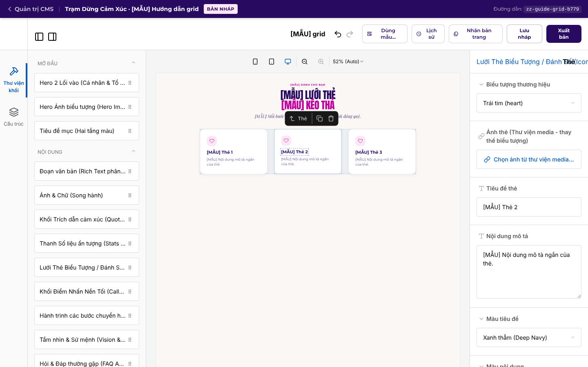

#### 1. Nhóm "Thẻ con (kéo vào khối cha)" ở menu bên trái

- Khối **Thẻ** (`Card`) và các khối con khác (ô số liệu, bước, thẻ dịch vụ, **thẻ gói**, câu hỏi FAQ, thẻ lối vào, thẻ lối đi, thẻ Tầm nhìn / Sứ mệnh) nằm trong nhóm **Thẻ con (kéo vào khối cha)** ở cuối menu bên trái (bấm để mở nhóm).
- Mỗi thẻ con **chỉ thả được vào đúng khối cha của nó**. Ví dụ: **Thẻ gói** chỉ vào được khối **gói Growth Mirror (Package Cards)**. Thả ra ngoài trang hoặc vào khối khác thì hệ thống không nhận. Thẻ, ô số liệu, thẻ dịch vụ và thẻ gói cũng vào được các cột của khối **Cột**.
- Khối cha đang trống (VD khối gói Growth Mirror mới kéo vào): mở nhóm **Thẻ con**, kéo **Thẻ gói** thả vào khung trống của khối, rồi chọn gói ở cột phải. Lặp lại cho từng gói.
- Khối **Lưới Thẻ Biểu Tượng / Đánh Số** mới kéo vào đã có sẵn **3 thẻ mẫu**.

#### 2. Thao tác trực tiếp với từng thẻ trên màn hình vẽ (Canvas)

Hana chỉ cần rê chuột và nhấp vào bất kỳ chiếc thẻ nào trên màn hình:

1. **Nhân bản thẻ (Duplicate)**: Khi bấm chọn một thẻ, thanh công cụ của Puck sẽ xuất hiện ngay trên thẻ đó. Bấm vào biểu tượng **hai ô vuông chồng nhau (Duplicate)** để nhân bản thêm một thẻ mới giống hệt vị trí cạnh bên.
2. **Kéo đổi chỗ các thẻ (Reorder)**: xem khung **Cách kéo** ngay bên dưới.
3. **Xoá thẻ**: Bấm vào biểu tượng **thùng rác (Delete)** trên thanh công cụ của thẻ khi muốn bỏ bớt thẻ khỏi lưới.

> **Cách kéo** (áp dụng cho mọi khối con: thẻ, ô số liệu, bước, thẻ dịch vụ, thẻ gói, câu hỏi FAQ):
>
> - **Cách dễ nhất – tab Cấu trúc**: bấm **Cấu trúc** ở cột trái, bấm mũi tên để mở khối cha, **giữ chuột khoảng nửa giây** trên tên khối con rồi kéo lên / xuống; thả khi vạch xanh nằm đúng chỗ. Cũng kéo được một thẻ vào **Nội dung Cột 1 / 2 / 3** của khối Cột.
> - **Kéo trên màn hình vẽ**: **giữ chuột khoảng nửa giây ở vùng trống của thẻ** (không giữ lên chữ – chữ là ô sửa trực tiếp, giữ lên chữ sẽ bôi đen chữ thay vì kéo), rồi kéo sang vị trí mới.
> - Kéo **từ từ**: vạch / ô xanh sẽ chạy theo chuột tới chỗ thả. Nếu ô xanh chưa nhích, kéo chậm lại một chút hoặc dùng tab **Cấu trúc**.
> - Thả thẻ ra ngoài khối cha (VD xuống khoảng trống cuối trang) thì hệ thống **không nhận**: thẻ tự quay về chỗ cũ, trang không bị thêm thẻ lẻ.
> - Kéo sai chỗ: bấm **Hoàn tác** (mũi tên cong trên thanh công cụ).
> - Sau khi kéo, bấm **Lưu nháp** hoặc **Xuất bản** như bình thường.

> **Thêm thẻ mới**: nhân bản một thẻ có sẵn rồi sửa chữ, hoặc kéo khối con từ nhóm **Thẻ con (kéo vào khối cha)** ở menu bên trái thả vào khối cha. Lỡ xóa hết thẻ cũng không sao: kéo thẻ con mới vào lại.

#### 3. Tự động đánh số thứ tự (01, 02, 03...)

- Nếu ở khối cha (Lưới Thẻ), Hana chọn **Kiểu đánh dấu thẻ** là **Đánh số thứ tự (01, 02...)**:
  - Toàn bộ các con số thứ tự `01`, `02`, `03`... sẽ được **tự động tính toán và hiển thị**.
  - Khi Hana kéo đổi chỗ hai thẻ, hoặc nhân bản thêm thẻ mới, các con số sẽ **tự động cập nhật lại đúng thứ tự từ trái qua phải** mà Hana không cần phải sửa tay từng con số một.

#### 4. Chỉnh sửa chi tiết một thẻ ở thanh bên phải

Khi nhấp chọn một chiếc thẻ, cột bên phải sẽ hiển thị các ô cài đặt riêng cho thẻ đó:

- **Biểu tượng thương hiệu**: Chọn 1 trong 16 biểu tượng độc quyền của Trạm Dừng Cảm Xúc (`target`, `spark`, `heart`, `compass`, `mirror`...).
- **Ảnh thẻ (Thư viện media - thay thế biểu tượng)**: Nếu muốn thẻ hiển thị ảnh minh họa thay vì biểu tượng, Hana bấm chọn ảnh từ Thư viện media. _Lưu ý: Ảnh tải lên bắt buộc phải có dòng chữ mô tả (Alt text) trong thư viện Media để đảm bảo tiêu chuẩn trợ năng quốc tế WCAG._
- **Tiêu đề thẻ & Nội dung mô tả**: Hana có thể gõ sửa trực tiếp ngay trên khung vẽ hoặc nhập vào các ô tương ứng ở thanh bên phải.
- **Màu tiêu đề & Màu nội dung**: Hệ thống tự động lọc danh sách màu an toàn (đạt chuẩn tương phản WCAG AA dựa trên màu nền của thẻ):
  - Khi thẻ ở nền sáng: Hệ thống gợi ý `Xanh thẫm (Deep Navy)` và `Hồng sen (Bright Magenta)`.
  - Khi thẻ ở nền tối: Hệ thống gợi ý `Trắng` và `Hồng phấn (Soft Pink)`.
- **Cỡ chữ tiêu đề & Cỡ chữ nội dung**: Lựa chọn linh hoạt `Nhỏ` (`sm`), `Vừa` (`md`), `Lớn` (`lg`).
- **Căn lề**: `Căn trái` (mặc định) hoặc `Căn giữa` (phù hợp với các thẻ ngắn, trang trọng).

---

### 5.16. Quản lý Ô số liệu trong Thanh Số Liệu (StatsBar)

Khối **Thanh số liệu** (`StatsBar`) đã được nâng cấp lên dạng kéo thả trực quan: mỗi con số giờ là một khối con **Ô số liệu** (`Stat`) nằm ngay trên màn hình vẽ (canvas).

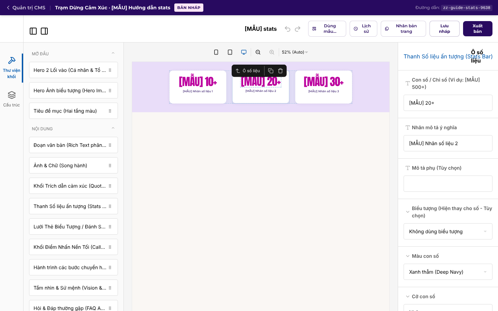

#### 1. Thao tác trực tiếp với từng ô số liệu

- **Nhân bản ô số liệu (Duplicate)**: Nhấp chọn một ô số liệu, bấm vào nút **Nhân bản (Duplicate)** trên thanh công cụ nổi để thêm một ô số liệu mới.
- **Kéo đổi thứ tự (Reorder)**: Nhấp giữ vào thanh kéo (hoặc biểu tượng 6 chấm) của ô số liệu để di chuyển sang vị trí mong muốn.
- **Xóa bớt ô số liệu**: Bấm biểu tượng **thùng rác (Delete)** trên thanh công cụ của ô để loại bỏ.
- **Thêm ô mới**: nhân bản một ô có sẵn, hoặc kéo **Ô số liệu** từ nhóm **Thẻ con (kéo vào khối cha)** ở menu bên trái thả vào khối Thanh số liệu.

#### 2. Cài đặt số cột hiển thị của khối cha (StatsBar)

Khi nhấp chọn thanh viền của khối cha **Thanh số liệu**, ở cột bên phải Hana có thể chọn:

- **Số cột hiển thị trên máy tính (columns)**: Chọn `2`, `3`, hoặc `4` cột tùy theo số lượng con số Hana muốn làm nổi bật (trên điện thoại luôn tự động hiển thị 1 cột thẳng hàng gọn gàng).
- **Màu nền section**: `Vàng kem (Warm Ivory)`, `Hồng phấn (Soft Pink)`, `Tím sương (Lavender Mist)`, `Xanh hà (Mint Haze)`, `Vàng bơ (Butter Cream)`, hoặc `Xanh thẫm (Deep Navy)`.

#### 3. Chỉnh sửa chi tiết một ô số liệu ở thanh bên phải

Khi nhấp chọn một ô số liệu:

- **Con số / Chỉ số (`value`)**: Nhập con số hoặc chỉ số (ví dụ: `[MẪU] 500+`, `10+`, `2,5 giờ`).
- **Nhãn mô tả (`label`)**: Dòng chữ diễn giải ngắn gọn bên dưới con số (ví dụ: `Học viên`, `Năm kinh nghiệm`).
- **Mô tả phụ (`description`)**: Dòng chú thích chi tiết thêm (tùy chọn).
- **Biểu tượng (`icon`)**: Nếu không muốn hiển thị con số mà muốn hiển thị icon thương hiệu, Hana có thể chọn icon từ danh sách 16 biểu tượng độc quyền.
- **Màu con số & Màu nhãn**: Tự động lọc danh sách màu an toàn theo chuẩn WCAG AA:
  - Trên nền sáng: Gợi ý `Hồng sen (Bright Magenta)`, `Hồng đậm (Accent Pink)`, `Xanh thẫm (Deep Navy)`.
  - Trên nền navy tối: Tự động chuyển sang `Trắng` và `Hồng phấn (Soft Pink)` để luôn sắc nét, nổi bật.
- **Cỡ con số & Cỡ nhãn**: Chọn `Nhỏ` (`sm`), `Vừa` (`md`), hoặc `Lớn` (`lg`).
- **Căn lề**: `Căn giữa` (khuyên dùng cho số liệu) hoặc `Căn trái`.

---

### 5.17. Quản lý Bước hành trình trong Hành Trình Các Bước (JourneySteps)

Khối **Hành trình các bước** (`JourneySteps`) thể hiện tiến trình thấu cảm và chuyển hóa. Nay mỗi bước đã là một khối con **Bước hành trình** (`Step`) độc lập, cho phép Hana tùy biến sâu từng bước.

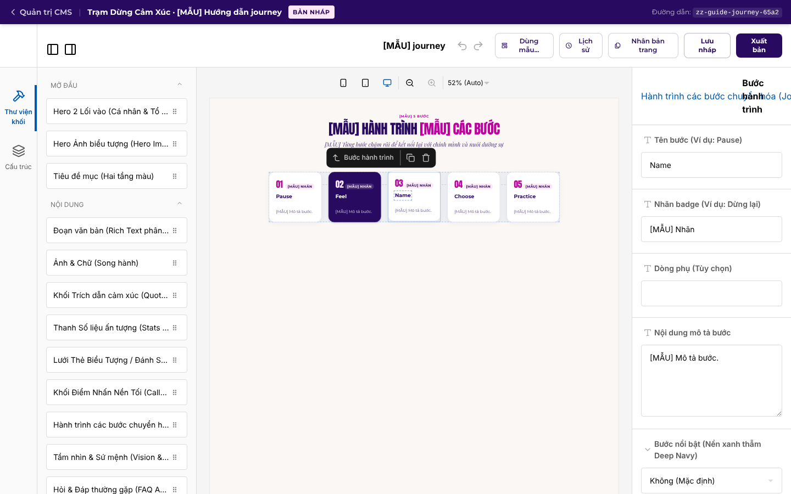

#### 1. Tự động đánh số thứ tự (01, 02, 03...)

- Số thứ tự `01`, `02`, `03`... được **hệ thống tự động đánh số bằng CSS counter**.
- Khi Hana kéo đổi chỗ các bước hoặc nhân bản thêm bước mới, các con số sẽ **tự động cập nhật lại đúng thứ tự từ trên xuống dưới / từ trái qua phải**, không bao giờ bị nhảy sai số.

#### 2. Thao tác trực tiếp trên màn hình vẽ

- **Nhân bản bước**: Chọn một bước, bấm nút **Nhân bản (Duplicate)** để nhân bản thêm một bước tiếp theo.
- **Kéo đổi thứ tự**: Nhấp giữ và kéo rê bước sang vị trí mới.
- **Xóa bước**: Bấm nút **thùng rác (Delete)** trên bước cần xóa. Muốn thêm bước, nhân bản một bước có sẵn hoặc kéo **Bước** từ nhóm **Thẻ con (kéo vào khối cha)** thả vào khối hành trình.

#### 3. 5 bước Pause → Practice là gợi ý chuẩn phương pháp

- Khung chuyển hóa 5 bước của Trạm Dừng Cảm Xúc gồm:
  1. **Pause (Dừng lại)**: Tạo khoảng dừng cần thiết giữa kích hoạt và phản hồi.
  2. **Feel (Cảm nhận)**: Cảm nhận trọn vẹn những rung động bên trong cơ thể.
  3. **Name (Gọi tên)**: Gọi tên chính xác cảm xúc và nhu cầu cốt lõi.
  4. **Choose (Lựa chọn)**: Lựa chọn phản hồi tích cực và góc nhìn đa chiều.
  5. **Practice (Thực hành)**: Thực hành chuyển hóa bền bỉ mỗi ngày.
- **Lưu ý chuyên môn**: 5 bước này là nội dung gợi ý chuẩn phương pháp độc bản của Trạm. Khi Hana chỉnh sửa nội dung, xin lưu ý **tự giữ đúng mạch phương pháp** để trải nghiệm của học viên luôn nhất quán.

#### 4. Bật "Bước nổi bật" ở từng bước riêng biệt

- Ở phiên bản trước, Hana phải nhập số thứ tự bước muốn làm nổi bật ở khối cha.
- Nay ở bản v3, Hana **chỉ cần bấm vào bước muốn làm nổi bật**, ở thanh bên phải tìm mục **Bước nổi bật (Nền xanh thẫm Deep Navy)** và chọn **Có (Bước nổi bật - Nền Navy)**.
- Khi hiển thị:
  - Ở kiểu **Vòng tròn (`circles`)**: Bước nổi bật sẽ có vòng tròn số tô màu hồng sen `accent-pink`, chữ số trắng, không viền (chuẩn thiết kế Brand Book 2026).
  - Ở kiểu **Thẻ (`cards`)**: Bước nổi bật sẽ khoác lên mình màu nền xanh thẫm Deep Navy cao cấp, đồng thời màu chữ tiêu đề và mô tả sẽ tự động chuyển sang màu sáng (Trắng / Hồng phấn) đạt chuẩn tương phản cao.
- **Mẹo**: Thường chỉ nên làm nổi bật 1 bước trọng tâm trong hành trình (ví dụ bước 05 hoặc bước chuyển hoá chính) để tạo điểm nhấn thị giác rõ ràng.

#### 5. Cài đặt khối cha (JourneySteps)

Khi nhấp chọn thanh viền của khối cha **Hành trình các bước**:

- **Kiểu hiển thị (variant)**:
  - `Vòng tròn số (circles)`: Phong cách tối giản đúng thiết kế, hiện vòng tròn số lớn (~80px) viền 3px ở phía trên mỗi bước, không đóng khung viền thẻ. Bước nổi bật tô hồng `accent-pink`.
  - `Thẻ hành trình (cards)`: Phong cách dạng thẻ hiện đại có viền và đường nối liền mạch.
  - `Danh sách dọc (list)`: Phong cách danh sách dọc từng hàng trang trọng, thích hợp cho trang chi tiết dịch vụ hoặc sự kiện.
    _(Các bước con sẽ tự động đổi kiểu hiển thị theo lựa chọn này)._
- **Số cột hiển thị (columns)**: Chọn `3`, `4`, `5` hoặc `6` cột trên màn hình lớn (mặc định là `5` cột tương ứng 5 bước).
- **Tiêu đề 2 tầng & Dòng cảm xúc**: Nhập `Dòng 1`, `Dòng 2`, và `Dòng cảm xúc (in nghiêng)`.

---

### 5.18. Quản lý Thẻ dịch vụ trong Các Thẻ Dịch Vụ Coaching (ServiceCards)

Khối **Các thẻ dịch vụ coaching** (`ServiceCards`) đã được nâng cấp lên dạng kéo thả trực quan. Giờ đây, mỗi chiếc thẻ dịch vụ là một khối con **Thẻ dịch vụ** (`ServiceCard`) độc lập trên khung vẽ (canvas).

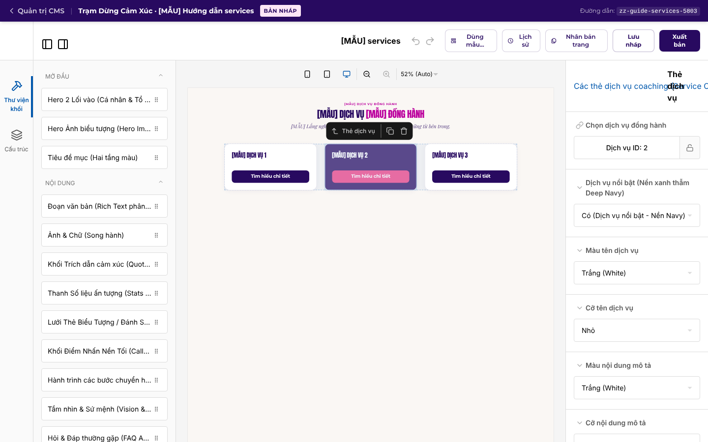

#### 1. Thao tác trực tiếp với từng thẻ dịch vụ

- **Nhân bản thẻ dịch vụ (Duplicate)**: Nhấp chọn một thẻ dịch vụ, bấm nút **Nhân bản (Duplicate)** trên thanh công cụ nổi để thêm một thẻ mới.
- **Kéo đổi thứ tự (Reorder)**: Nhấp giữ vào thanh kéo của thẻ dịch vụ để di chuyển thay đổi thứ tự ưu tiên giới thiệu.
- **Xóa thẻ**: Bấm biểu tượng **thùng rác (Delete)** trên thanh công cụ của thẻ khi muốn ẩn hoặc bớt dịch vụ khỏi trang.
- **Thêm thẻ mới**: nhân bản một thẻ có sẵn, hoặc kéo **Thẻ dịch vụ** từ nhóm **Thẻ con (kéo vào khối cha)** ở menu bên trái thả vào khối.

#### 2. Dữ liệu dịch vụ lấy từ CMS, không nhập tay trên trang

- **Chọn dịch vụ (`serviceId`)**: Khi bấm vào một thẻ dịch vụ, ở thanh bên phải, Hana chỉ cần bấm vào ô **Chọn dịch vụ từ CMS** để chọn đúng lộ trình coaching tương ứng trong danh mục `services`.
- **Tên, giá, mô tả và ảnh dịch vụ**: Được quản lý tập trung tại mục **Dịch vụ (`services`)** trong trang quản trị. Mọi thay đổi về nội dung, giá hay ảnh minh họa trong form Dịch vụ sẽ **tự động đồng bộ** ra toàn bộ các trang đang hiển thị thẻ đó mà không cần Hana phải vào Puck Editor chỉnh sửa lại.

#### 3. Bật "Thẻ nổi bật" ở từng thẻ dịch vụ

- Mỗi thẻ dịch vụ có công tắc **Thẻ nổi bật (Nền xanh thẫm Deep Navy)** riêng biệt:
  - Khi chọn **Có**: Thẻ sẽ mang màu nền xanh thẫm `Deep Navy` sang trọng (như dịch vụ tâm điểm thu hút học viên).
  - Màu chữ tiêu đề và văn bản bên trong thẻ sẽ được hệ thống tự động lọc sang các tông màu sáng chuẩn trợ năng WCAG AA (`Trắng`, `Hồng phấn Soft Pink`) để đảm bảo luôn sắc nét, dễ đọc.

#### 4. Cài đặt số cột ở khối cha (ServiceCards)

Khi nhấp chọn thanh viền của khối cha **Các thẻ dịch vụ coaching**:

- **Số cột hiển thị trên máy tính (columns)**: Chọn `1` cột (căn giữa trang trọng), `2` cột (rộng rãi, nổi bật), hoặc `3` cột (mặc định, lưới 3 dịch vụ cân đối). Trên điện thoại, bố cục luôn tự động tối ưu hiển thị 1 cột thẳng hàng mượt mà.

---

### 5.19. Quản lý Thẻ gói trong Khối Các Gói Growth Mirror (PackageCards)

Khối **Khối các gói Growth Mirror** (`PackageCards`) giới thiệu 3 gói chuyển hóa (CLEAR, BUILD, SHINE). Nay mỗi gói là một khối con **Thẻ gói** (`PackageCard`) linh hoạt, cho phép kéo thả và sắp đặt tự do.

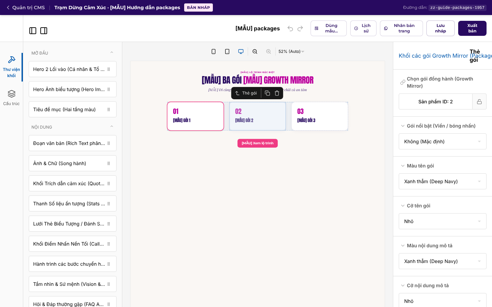

#### 1. Thao tác kéo thả và không còn giới hạn 3 gói

- **Nhân bản & Sắp xếp**: Hana có thể nhân bản một gói, kéo rê đổi thứ tự giữa các gói ngay trên khung vẽ.
- **Không còn giới hạn 3 gói**: Nếu Hana muốn giới thiệu thêm gói thứ 4, thứ 5 (ví dụ: gói doanh nghiệp, gói quà tặng đặc biệt), Hana chỉ cần bấm nhân bản. Lưới hiển thị chuẩn 3 cột trên máy tính sẽ tự động đẩy gói thứ 4 xuống hàng tiếp theo một cách ngay ngắn và thẩm mỹ.
- **Thêm thẻ gói**: khối gói Growth Mirror mới kéo vào có khung trống. Mở nhóm **Thẻ con (kéo vào khối cha)** ở menu bên trái, kéo **Thẻ gói** thả vào khung trống, rồi chọn gói (CLEAR / BUILD / SHINE) ở cột phải. Lặp lại cho từng gói, hoặc nhân bản một thẻ gói có sẵn.

#### 2. Dữ liệu gói và giá bán lấy tự động từ CMS

- **Chọn gói (`packageId`)**: Bấm vào thẻ gói, ở cột bên phải chọn đúng gói trong danh mục **Sản phẩm (loại Gói)**. Ô chọn hiện **tên gói** (VD "Gói BUILD"); trong lúc tải sẽ hiện "Đang tải…", nếu gói đã bị xóa sẽ hiện "Không tìm thấy (ID: …)" – khi đó chọn lại gói khác. Các ô chọn dịch vụ, trang, chương trình, lời chia sẻ, ảnh cũng hiện tên như vậy.
- **Giá bán, tổng giá trị, % ưu đãi và danh sách cấu phần**: Hoàn toàn do hệ thống CMS tự động tính toán từ bảng giá chuẩn (`Growth_Mirror_Pricing_Calculator.xlsx`). Trang web **hoàn toàn không có ô nhập giá thủ công**, triệt tiêu nguy cơ nhầm lẫn giá bán.
- **Tự động đánh số thứ tự**: Khi khối cha chọn kiểu hiển thị **Đánh số thứ tự (numbered)**, các con số `01`, `02`, `03`... sẽ được tự động đánh số bằng CSS counter theo đúng vị trí của gói từ trái qua phải.

#### 3. Bật "Thẻ nổi bật" ở từng thẻ gói

- Hana có thể chọn bất kỳ gói nào để làm nổi bật (ví dụ chọn gói BUILD hoặc SHINE) bằng cách nhấp vào gói đó và chọn **Thẻ nổi bật (Viền / Ring Accent Pink) = Có**.
- Gói được chọn sẽ được bao quanh bởi viền màu hồng đậm `Accent Pink` độc quyền cùng hiệu ứng bóng mềm, nổi bật rõ nét giữa các gói còn lại.

---

### 5.20. Quản lý Câu hỏi thường gặp trong Khối FAQ (FaqItem)

Khối **Câu hỏi thường gặp** (`FAQ`) phiên bản 4 mang lại sự tự do tối đa cho Hana khi chỉnh sửa và sắp xếp các câu hỏi giải đáp:

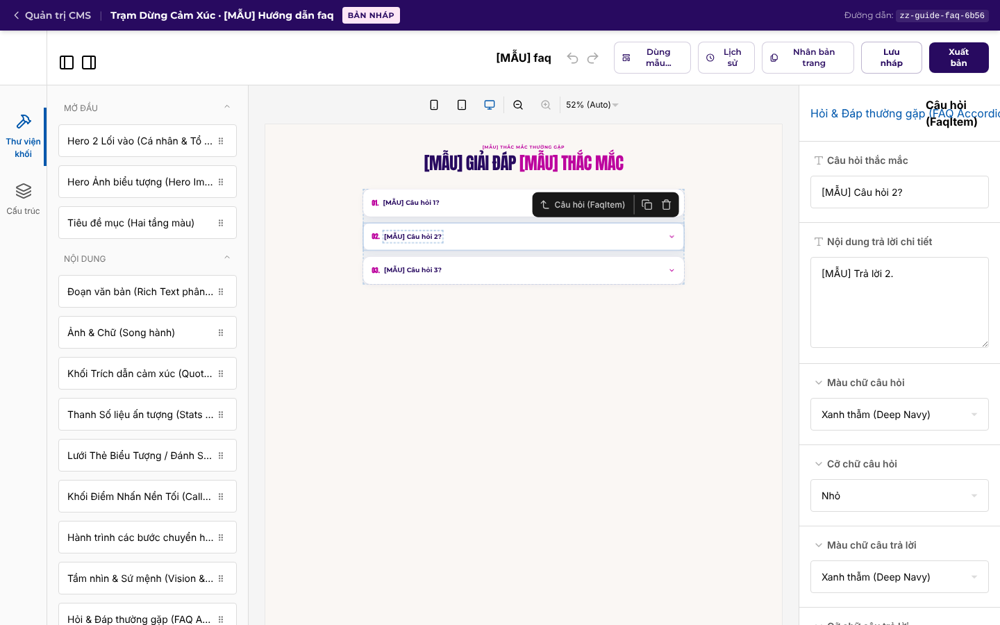

#### 1. Hai chế độ linh hoạt: Thủ công và Lấy theo nhóm từ CMS

Khi chọn khối cha `FAQ` trên khung vẽ, ở thanh bên phải Hana có thể chọn **Nguồn câu hỏi (`source`)**:

- **Nhập thủ công (`manual`)**: Từng câu hỏi là một khối con **Câu hỏi thường gặp (`FaqItem`)** độc lập xuất hiện ngay trên khung vẽ. Hana có thể:
  - Bấm trực tiếp vào câu hỏi để sửa tiêu đề câu hỏi và nội dung giải đáp chi tiết ở thanh bên phải.
  - Bấm **Nhân bản (Duplicate)** để tạo nhanh câu hỏi mới.
  - Bấm biểu tượng thùng rác để xóa câu hỏi không cần thiết.
  - Kéo rê thanh tay cầm để đổi thứ tự các câu hỏi.
- **Lấy theo nhóm từ CMS (`group`)**: Hệ thống tự động tải các câu hỏi thuộc nhóm tương ứng (Chung, Lộ trình, Coaching 1:1, Sản phẩm số, Doanh nghiệp, Thanh toán) từ danh mục **Câu hỏi thường gặp** (`faqs`). Mọi thay đổi trong form quản trị `faqs` sẽ tự động hiển thị ra ngoài trang web.

#### 2. Tự động đánh số thứ tự thông minh (numbered = true)

- Khi Hana bật tùy chọn **Đánh số thứ tự = Có** ở khối cha, hệ thống sử dụng bộ đếm CSS hiện đại để tự động sinh ra các số thứ tự `01.`, `02.`, `03.`... màu hồng tươi `Bright Magenta` trước mỗi câu hỏi.
- Khi Hana kéo đổi thứ tự hoặc nhân bản câu hỏi, các con số sẽ tự động nhảy lại theo đúng thứ tự mới mà không bao giờ bị trùng hay nhảy cách số.

#### 3. Cỡ chữ và màu sắc an toàn chuẩn thương hiệu

- Mỗi câu hỏi `FaqItem` cho phép Hana chọn cỡ chữ câu hỏi (`Nhỏ`, `Vừa`, `Lớn`) và cỡ chữ câu trả lời.
- Màu sắc được hệ thống tự động lọc theo độ tương phản cao chuẩn WCAG AA:
  - Trên nền sáng (`Warm Ivory`, `Soft Pink`...): chữ mang sắc xanh thẫm `Deep Navy` hoặc hồng tươi `Bright Magenta`.
  - Trên nền tối (`Deep Navy`): chữ tự động chuyển sang sắc trắng thanh thoát hoặc hồng phấn `Soft Pink`.

#### 4. Phân tách tối ưu: Tải trang nhanh & Hiệu ứng đóng mở mượt mà

- Khối cha `FAQ` được xử lý tối ưu phía máy chủ (Server Component) giúp bài viết chuẩn SEO và trang tải nhanh như chớp.
- Từng câu hỏi `FaqItem` là thành phần tương tác phía người dùng (Client Component) với hiệu ứng mũi tên xoay chuyển động mượt mà khi bấm mở/đóng và hỗ trợ đầy đủ công nghệ trợ năng cho người khiếm thị.

#### 5. Thẻ liên hệ bên cạnh có ảnh, nhãn viên bo tròn & biểu tượng + / − (Cập nhật PK-19)

- **Đoạn mô tả ngắn dưới tiêu đề**: Điền tại ô **"Mô tả"** ở khối cha, hiển thị trang nhã, căn giữa dưới tiêu đề 2 tầng màu.
- **Kiểu nhãn series (`seriesLabelStyle`)**: Có thể chọn `Viên bo tròn có viền (Pill)` để nhãn series mang viền hồng `Accent Pink` bo tròn nổi bật, hoặc `Chữ thường` như cũ.
- **Biểu tượng đóng/mở (`iconStyle`)**: Chọn `Cộng / Trừ (+ / −)` để hiển thị dấu `+` khi đóng và dấu `−` khi mở; khi câu hỏi đang mở, tiêu đề sẽ tự động chuyển màu hồng sen `Bright Magenta` rạng rỡ (hoặc `Soft Pink` trên nền tối Deep Navy).
- **Khối bên cạnh (`aside`)**:
  - Chọn **`Thẻ liên hệ có ảnh (Contact Card)`** để hiển thị thẻ tư vấn cá nhân hóa bên trái:
    - Chọn ảnh đại diện tròn tại ô **Ảnh liên hệ** (nếu chưa chọn, hệ thống tự động hiển thị icon người đại diện trang nhã).
    - Tùy chỉnh huy hiệu (`contactBadge`), tiêu đề (VD: `Đặt lịch gọi 15 phút`), mô tả, và nút đặt lịch bo tròn ở giữa.
    - Bật **Hiển thị email** để xuất hiện dòng "Hoặc email: ..." gạch chân lịch sự.
  - Chọn **`Khối đặt lịch`** (`booking`) để giữ nguyên giao diện đặt lịch nền Deep Navy trước đây.

---

### 5.21. Khối Cột (Columns) hỗ trợ đa dạng khối con

Khối **Cột** (`Columns`) được mở rộng toàn diện, cho phép Hana sắp đặt bố cục đa dạng và sáng tạo:

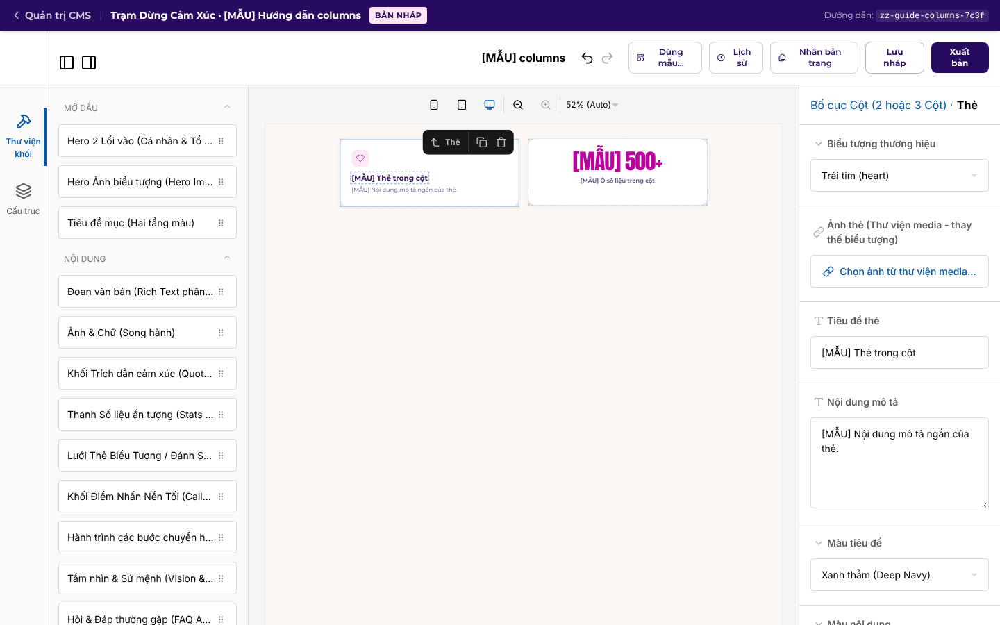

#### 1. Các khối con được phép đặt vào từng Cột (`col1`, `col2`, `col3`)

Hana có thể thả các khối con phong phú vào bên trong bất kỳ cột nào của khối Cột:

- **Thẻ nội dung (`Card`)**: Tạo các thẻ giới thiệu có biểu tượng hoặc đánh số.
- **Ô số liệu (`Stat`)**: Hiển thị các chỉ số ấn tượng (10+ năm, 500+ giờ khai vấn...).
- **Thẻ dịch vụ (`ServiceCard`)**: Giới thiệu các lộ trình coaching kết nối dữ liệu CMS.
- **Thẻ gói (`PackageCard`)**: Hiển thị các gói Growth Mirror tự động tính giá và ưu đãi.

#### 2. Khối con tiếp tục bị chặn trong Cột: Bước hành trình (`Step`) & Câu hỏi (`FaqItem`)

Để bảo vệ trải nghiệm thị giác và logic phương pháp của Trạm Dừng Cảm Xúc, hai khối con sau **tiếp tục không được phép** thả vào khối Cột:

- **Bước hành trình (`Step`)**: Luôn phải nằm trong khối cha `JourneySteps` để giữ đúng tiến trình 5 bước chuyển hóa (Pause → Feel → Name → Choose → Practice), đường nối liên kết giữa các bước và hiệu ứng bước nổi bật.
- **Câu hỏi (`FaqItem`)**: Luôn phải nằm trong khối cha `FAQ` để đảm bảo bộ đếm số thứ tự tự động và khối chứa câu hỏi accordion trợ năng hoạt động chuẩn xác.

---

### 5.22. Cơ chế tự động sửa màu lệch nền (Child Color Fallback)

Khi thiết kế giao diện, Hana hoàn toàn có thể tự do thử nghiệm đổi màu nền khối cha mà không sợ văn bản bị mờ hay biến mất:

- **Tự động rà soát tương phản**: Khi Hana đổi màu nền của một khối (như `IconCardGrid`, `StatsBar`, `FAQ`, hay `Columns`) từ **Nền sáng** (như `Warm Ivory`, `Soft Pink`) sang **Nền xanh thẫm Deep Navy**, hoặc ngược lại.
- **Tự động chuyển đổi màu an toàn**:
  - Nếu màu chữ con đang là màu sáng (`Trắng`) mà nền cha chuyển sang nền sáng: hệ thống tự động đổi chữ về màu xanh thẫm `Deep Navy` chuẩn mực.
  - Nếu màu chữ con đang là màu tối (`Deep Navy`) mà nền cha chuyển sang xanh thẫm: hệ thống tự động chuyển chữ sang màu `Trắng` tinh khôi.
- Mọi tiêu chuẩn tương phản đều tuân thủ nghiêm ngặt chuẩn quốc tế WCAG AA (tỷ lệ tương phản từ 4.5:1 trở lên), mang lại sự ấm áp, dễ đọc và chuyên nghiệp cho độc giả.

---

### 5.23. Section tự do: kéo thả từng phần tử

> [!NOTE]
> **Section tự do đã thay bằng Khung 2 cột / Container:** Nhóm Section tự do trong thư viện khối hiện được ẩn đi để Hana thao tác bố cục nhanh và trực quan hơn bằng **Khung chứa (Container)** và mẫu sẵn **Khung 2 cột (ảnh + chữ)**. Các trang cũ đã dựng bằng Section tự do vẫn được lưu giữ và hiển thị hoàn toàn bình thường.

Các khối như Hero, CTA, Ảnh & Chữ có **bố cục cố định**: Hana sửa được chữ, cỡ và màu, nhưng không kéo đổi chỗ tiêu đề, ảnh hay nút. Khi muốn **tự xếp từng phần tử**, dùng khối **Section tự do**.

1. Ở menu trái, mở nhóm **Section tự do (kéo thả từng phần tử)**, kéo khối **Section tự do** vào trang. Khối mới có sẵn: nhãn series, tiêu đề 2 tầng, dòng cảm xúc, đoạn văn, nút.
2. Kéo thêm phần tử từ cùng nhóm thả vào **Cột 1** (hoặc **Cột 2**): **Nhãn series**, **Tiêu đề 2 tầng**, **Đoạn văn**, **Dòng cảm xúc (chữ nghiêng)**, **Ảnh**, **Nút**. Khối **Khoảng đệm (Spacer)** (nhóm Bố cục) cũng thả được vào cột.
3. **Đổi chỗ**: giữ chuột khoảng nửa giây trên vùng trống của phần tử rồi kéo lên / xuống, hoặc kéo trong tab **Cấu trúc**.
4. **Cỡ chữ**: chọn phần tử, ở cột phải chọn **Cỡ chữ**: Nhỏ / Vừa / Lớn / Rất lớn. **Màu chữ** chỉ hiện các màu đọc rõ trên màu nền của section.
5. **Chia 2 cột** (VD chữ bên trái, ảnh bên phải): chọn khối Section tự do, đặt **Số cột** = 2 cột, rồi kéo phần tử sang **Cột 2**. Trên điện thoại hai cột tự xếp thành một.
6. **Căn lề, màu nền, khoảng đệm** chỉnh ở khối Section tự do và áp dụng cho mọi phần tử bên trong.

> - Phần tử chỉ thả được vào cột của Section tự do. Thả ra ngoài trang thì hệ thống không nhận.
> - **Tiêu đề 2 tầng** có ô **Cấp tiêu đề**: mỗi trang chỉ nên có **một** H1 (tiêu đề chính); các tiêu đề còn lại để H2.
> - **Ảnh** phải có mô tả (alt) trong thư viện media mới hiện lên trang.

### 5.24. Chỉnh kiểu từng khối: tab Nội dung / Kiểu / Nâng cao (EB-04)

Bấm vào một khối trên trang. Cột phải hiện 3 tab:

- **Nội dung**: chữ, ảnh, đường dẫn… của khối, như trước đây.
- **Kiểu**:
  - các ô định dạng có sẵn của khối (màu chữ, cỡ chữ, căn lề, nền…);
  - **Nền**, **Chữ** (màu, font, cỡ, độ đậm, giãn dòng, căn lề), **Viền & bo góc**, **Bóng**;
  - **Thẻ con → Khung thẻ (PK-17)**: khi khối đang chọn chứa các thẻ con (như gói, bước, câu hỏi FAQ, ô số liệu, thẻ dịch vụ...), tab Kiểu sẽ có thêm mục **Khung thẻ** với 4 lựa chọn:
    - `Mặc định`: Giữ nguyên viền và bóng chuẩn theo thiết kế ban đầu của khối.
    - `Bỏ viền`: Ẩn viền xung quanh thẻ con, giữ lại màu nền và bóng nhẹ (nếu có).
    - `Bỏ viền và bóng`: Làm phẳng thẻ con, chỉ giữ lại màu nền của thẻ.
    - `Không khung`: Xoá sạch toàn bộ viền, bóng và nền thẻ con (thẻ trở nên trong suốt hoà vào nền khối; kể cả thẻ nổi bật cũng chuyển sang nền trong suốt).
- **Nâng cao**:
  - **Cách lề** trong / ngoài cho 4 cạnh; tick "Đặt cùng giá trị cho 4 cạnh" để đặt nhanh;
  - **Ẩn trên** máy tính / máy tính bảng / điện thoại;
  - **ID neo**, để làm link nhảy tới khối, ví dụ nút trỏ tới `#dang-ky`.

Tab đang chọn được giữ nguyên khi bấm sang khối khác.

**Chỉnh riêng cho điện thoại / máy tính bảng:**

1. Bấm nút thiết bị ở đầu tab (hoặc thanh dưới cùng): khung xem trước đổi khổ, và dòng "Đang chỉnh cho: …" cho biết đang sửa cho thiết bị nào.
2. Cách lề, cỡ chữ, căn lề đặt lúc này chỉ áp cho thiết bị đó.
3. Ô có nhãn **"Kế thừa"** là chưa đặt riêng: đang dùng giá trị của khổ lớn hơn (điện thoại lấy của máy tính bảng, máy tính bảng lấy của máy tính).

**Vì sao có lúc không thấy ô chọn màu tự do / ô nhập số / chọn font?** Các ô đó chỉ hiện khi công tắc tương ứng ở **Trang web → Thiết kế & thương hiệu** đang **Mở** (mục 7.0). Khi Khoá, chỉ chọn được màu trong bảng màu và các mức S / M / L.

- Chữ và nền khó đọc (tương phản dưới 4.5:1) thì hiện cảnh báo màu vàng. Nên đổi màu.
- **Đặt lại kiểu** xoá mọi chỉnh sửa ở tab đang mở, khối quay về như mặc định.
- Khối chưa chỉnh kiểu nào thì trang công khai giữ y hệt như trước.

### 5.25. Khung chứa linh hoạt (Container): hộp flexbox lồng nhau kiểu Elementor (EB-05)

Khối **Container** nằm ở đầu nhóm **Bố cục** trong bảng thư viện khối bên trái (có thể tìm nhanh bằng từ khoá: `container`, `hop`, `khung`).

**Cách sử dụng:**

1. **Kéo Container vào trang:** Thả vào vị trí bất kỳ trên trang hoặc thả vào bên trong một Container khác.
2. **Kéo khối vào trong Container:** Thả các khối chữ, ảnh, nút bấm, trích dẫn... vào vùng trống bên trong Container. Các khối bên trong tự sắp xếp theo bố cục của Container. Thẻ con (thẻ gói, câu hỏi FAQ, ô số liệu…) không thả vào Container được: chúng chỉ nằm trong khối cha của mình.
3. **Đổi hàng / cột theo thiết bị (Tab Nội dung):**
   - **Hướng sắp xếp**: Bấm chọn giữa **Hàng ngang**, **Cột dọc**, **Đảo hàng** hoặc **Đảo cột**.
   - **Chỉnh riêng cho Điện thoại / Máy tính bảng**: Chọn biểu tượng thiết bị ở đầu bảng. Ví dụ: Trên **Máy tính** để _Hàng ngang_ để các khối nằm cạnh nhau; chuyển sang **Điện thoại** bấm chọn _Cột dọc_ để các khối tự xếp chồng ngay ngắn.
   - **Căn theo chiều sắp xếp**: Bắt đầu, Ở giữa, Kết thúc, Cách đều hai đầu, Cách đều xung quanh, Cách đều nhau.
   - **Căn theo chiều còn lại**: Bắt đầu, Ở giữa, Kết thúc, Kéo giãn.
   - **Khoảng cách giữa các khối**: Chọn độ giãn giữa các khối con (Nhỏ, Vừa, Lớn...).
   - **Chiều rộng**: Chọn **Đóng khung** (nội dung gọn ở giữa trang, độ rộng chọn ở **Độ rộng khung nội dung**) hoặc **Tràn màn hình**. Nền của Container luôn trải hết chiều ngang, kể cả khi đóng khung.
   - **Chiều cao tối thiểu** và **Thẻ HTML**: chọn **Khối nội dung độc lập (section)** khi Container là một phần riêng của trang có tiêu đề, hoặc **Hộp chung (div)** cho các khung chứa thông thường.
   - Hướng, căn, khoảng cách và xuống dòng chỉnh riêng được theo thiết bị. Chiều rộng, chiều cao và thẻ HTML áp cho mọi thiết bị.
4. **Ảnh nền & Chuyển màu nâng cao (Tab Kiểu):**
   - Chuyển sang tab **Kiểu** -> nhóm **Nền nâng cao**:
     - **Ảnh nền**: Bấm _Chọn ảnh từ thư viện media_, chọn kích thước (_Bao phủ / Vừa vặn_) và bấm chọn vị trí trong lưới 9 ô (chính giữa, góc trên, góc dưới...).
     - **Chuyển màu (Gradient)**: Chọn màu bắt đầu, màu kết thúc từ bảng màu thương hiệu và góc xoay chuyển màu (0° đến 315°).
5. **Container lồng nhau:** Bạn có thể kéo một Container con thả vào bên trong một Container cha để chia các phân khu phức tạp.

> [!WARNING]
> **Khuyến nghị bố cục:** Chỉ nên lồng tối đa 2 đến 3 tầng Container. Việc lồng Container quá sâu (từ 4 tầng trở lên) sẽ làm cấu trúc trang bị rối, khó chọn đúng khối khi thao tác và làm chậm tốc độ hiển thị.

### 5.26. Widget cơ bản & tương tác: Tiêu đề, Văn bản, Ảnh, Nút, Icon, Tabs, Accordion, Bộ đếm (EB-06)

Nhóm **Cơ bản** đứng ở vị trí đầu tiên trong thư viện khối của trình dựng trang (trên cùng cột bên trái). Đây là tập hợp các widget linh hoạt kiểu Elementor, gồm 9 widget cơ bản & tương tác cùng 3 khối tiện ích quen thuộc (`Đường kẻ`, `Khoảng trống`, `Nhúng Video`):

#### Phân biệt Widget cơ bản với các loại khối khác

- **Khối thương hiệu (Brand Blocks):** Ví dụ như `HeroHaiLoiVao`, `CacGoiGrowthMirror`, `CauHoiThuongGap`... là các khối được thiết kế sẵn theo đúng nghiệp vụ và cấu trúc của Trạm Dừng Cảm Xúc.
- **Phần tử Section tự do (Element Blocks):** Ví dụ `HeadingEl`, `ParagraphEl`, `ImageEl`, `ButtonEl`... chỉ có thể đặt bên trong khối `Section tự do (FreeSection)`, không thể thả ở cấp gốc của trang hay bên trong `Container`.
- **Widget cơ bản & tương tác (Basic & Interactive Widgets):** Là các khối độc lập một chức năng (`HeadingWidget`, `TextWidget`, `ImageWidget`, `ButtonWidget`, `IconWidget`, `IconListWidget`, `TabsWidget`, `AccordionWidget`, `CounterWidget`). Bạn có thể thả chúng ở bất kỳ đâu trên trang: ở cấp gốc hoặc thả vào bên trong khối `Container`. Khi kết hợp với tab **Kiểu** và **Nâng cao** (EB-04), bạn có thể tùy biến màu sắc, cỡ chữ, căn lề và khoảng cách theo từng thiết bị.

---

#### Hướng dẫn chi tiết từng Widget

1. **Tiêu đề (HeadingWidget):**
   - **Nội dung:** Nhập chữ trực tiếp trên khung hiển thị hoặc ở ô "Nội dung tiêu đề". Chọn cấp thẻ HTML từ `H1` đến `H6` (mặc định là `H2`).
   - **Lưu ý SEO:** Mỗi trang chỉ nên có duy nhất một thẻ `H1` (thường nằm ở phần đầu trang) để công cụ tìm kiếm hiểu rõ chủ đề trang.
   - **Liên kết:** Gắn liên kết tới trang nội bộ của website hoặc dán một địa chỉ URL bất kỳ (có tuỳ chọn mở tab mới an toàn).
   - **Hình thức:** Chuyển sang tab **Kiểu** để chọn cỡ chữ, màu sắc theo bảng màu thương hiệu hoặc căn lề (trái/giữa/phải) cho từng thiết bị (Máy tính / Điện thoại).

2. **Văn bản (TextWidget):**
   - **Soạn thảo phong phú:** Khung soạn thảo văn bản cho phép in đậm, in nghiêng, gạch chân, tạo danh sách gạch đầu dòng, danh sách đánh số hoặc gắn liên kết trực tiếp vào từng đoạn chữ.
   - **Bảo mật tuyệt đối:** Mọi mã HTML đều được hệ thống tự động lọc sạch và kiểm tra an toàn trước khi hiển thị ra trang công khai.

3. **Ảnh (ImageWidget):**
   - **Chọn ảnh:** Bấm "Chọn ảnh từ thư viện media" để chọn hình ảnh đã tải lên website.
   - **Mô tả ảnh (Alt):** Bắt buộc ảnh phải có dòng mô tả ngắn để hỗ trợ người khiếm thị đọc màn hình và tối ưu SEO. Nếu ảnh chưa có dòng mô tả alt, hệ thống sẽ ẩn để bạn bổ sung trước.
   - **Kích thước & Bố cục:** Chọn độ rộng hiển thị (25%, 50%, 75%, 100%), thêm chú thích dưới ảnh (Caption) và tuỳ chọn gắn liên kết mở trang mới. Bo góc ảnh được chỉnh dễ dàng ở tab **Kiểu**.

4. **Nút bấm (ButtonWidget):**
   - **Nội dung & Liên kết:** Nhập chữ hiển thị trên nút và chọn liên kết (trang nội bộ hoặc URL ngoài). Mọi liên kết không an toàn (như mã script giả mạo) sẽ tự động bị hệ thống vô hiệu hoá.
   - **Kiểu dáng & Kích thước:** Chọn kiểu nút (Chính - Nền đậm, Phụ - Nền hồng nhạt, Viền - Trong suốt có viền...) và kích thước nút (Nhỏ / Vừa / Lớn).
   - **Biểu tượng:** Thêm biểu tượng thương hiệu vào trước hoặc sau chữ của nút để tăng điểm nhấn thị giác.
   - **Căn lề:** Chọn căn trái, căn giữa, căn phải hoặc kéo dài tràn viền (Full width).

5. **Biểu tượng (IconWidget):**
   - **Chọn biểu tượng:** Chọn từ bộ 15 biểu tượng thương hiệu (có ô tìm kiếm nhanh).
   - **Màu sắc & Kích thước:** Chọn màu sắc theo bảng màu chuẩn hoặc màu tự do; chọn kích cỡ từ Nhỏ (S) đến Rất lớn (XL).
   - **Kiểu hiển thị:** Chọn hiển thị dạng Trơn (Plain), Nền tròn (Circle Background) hoặc Viền tròn (Circle Border).
   - **Trợ năng:** Có ô nhập "Mô tả cho người khiếm thị" (`aria-label`) khi biểu tượng mang ý nghĩa điều hướng. Nếu chỉ là biểu tượng trang trí, hệ thống sẽ tự động ẩn với trình đọc màn hình.

6. **Danh sách biểu tượng (IconListWidget):**
   - **Danh sách mục:** Thêm không giới hạn các dòng danh sách (dùng thẻ `<ul>`/`<li>` chuẩn ngữ nghĩa). Mỗi mục gồm chữ hiển thị và liên kết tuỳ chọn.
   - **Biểu tượng chung & riêng:** Thiết lập biểu tượng và màu sắc mặc định cho toàn bộ danh sách, đồng thời có thể đổi biểu tượng riêng biệt cho từng dòng nếu muốn nhấn mạnh.
   - **Bố cục:** Chọn hiển thị theo Cột dọc (danh sách truyền thống) hoặc Hàng ngang (dùng làm thanh tính năng, tiện ích).

7. **Tabs (TabsWidget):**
   - **Danh sách tab:** Thêm/xoá không giới hạn số lượng tab. Mỗi tab có tiêu đề riêng và một vùng thả khối nội dung (slot).
   - **Đổi tên tab nhanh:** Ở ngay đầu tab **Nội dung**, bạn có thể đổi tên trực tiếp từng tab tại các ô "Tên tab 1", "Tên tab 2"... một cách nhanh chóng mà không cần bấm mở rộng từng dòng của danh sách bên dưới.
   - **Bố cục tab:** Chọn hiển thị thẻ theo **Hàng ngang** (mặc định) hoặc **Cột dọc** (phù hợp với các trang tài liệu, lộ trình chi tiết).
   - **Thao tác trong trình dựng trang:** Trong trình dựng, mọi tab hiện **xếp chồng** từ trên xuống, mỗi phần có dòng "Tab 1: …", "Tab 2: …" để chị kéo khối vào đúng tab. Trang công khai mới hiện dạng tab bấm chuyển. Khi kéo khối vào một tab đã có nội dung, giữ chuột trên khối cuối của tab một chút rồi mới thả.
   - **Trợ năng:** Hỗ trợ đầy đủ phím mũi tên bàn phím để chuyển đổi qua lại giữa các tab theo tiêu chuẩn WAI-ARIA.

8. **Hộp mở rộng (AccordionWidget):**
   - **Mục nội dung linh hoạt:** Khác với khối câu hỏi FAQ thông thường chỉ chứa chữ thuần, mỗi mục trong Accordion là một vùng thả khối tự do (bạn có thể thả tiêu đề, đoạn văn, ảnh, nút bấm hay danh sách vào bên trong).
   - **Đổi tên mục nhanh:** Ở ngay đầu tab **Nội dung**, bạn có thể đổi tên trực tiếp từng mục tại các ô "Tên câu hỏi 1", "Tên câu hỏi 2"... một cách nhanh chóng mà không cần mở rộng từng dòng.
   - **Trong trình dựng:** mọi mục đều mở sẵn để kéo khối vào; trang công khai đóng / mở theo cài đặt bên dưới.
   - **Chế độ mở:** Chọn **Chỉ mở một mục** (khi mở một mục thì mục khác tự đóng lại) hoặc **Mở nhiều mục** (cho phép mở đồng thời nhiều mục cùng lúc).
   - **Mục mở sẵn ban đầu:** Chọn mở sẵn mục đầu tiên, đóng toàn bộ hoặc mở sẵn tất cả các mục khi tải trang.
   - **Trợ năng:** Tự động điều chỉnh trạng thái thu phóng và tôn trọng chế độ giảm chuyển động trên thiết bị của khách hàng.

9. **Bộ đếm số (CounterWidget):**
   - **Hiển thị số liệu ấn tượng:** Nhập số bắt đầu, số kết thúc, tiền tố (ví dụ "+") và hậu tố (ví dụ "%", "học viên").
   - **Định dạng số:** Tự động định dạng dấu chấm phân cách hàng nghìn kiểu Việt Nam (`1.000`, `50.000`).
   - **Hiệu ứng đếm:** Tự động chạy số mượt mà khi người dùng cuộn màn hình tới vị trí khối.
   - **Tối ưu SEO:** Ngay khi tải trang, công cụ tìm kiếm và trình đọc màn hình đều nhận được số liệu chính xác ngay lập tức mà không cần chờ hiệu ứng chạy.

---

### 5.27. Cấu trúc và menu chuột phải (EB-07)

Trình dựng trang cung cấp hai công cụ đắc lực giúp bạn quản lý các trang có nhiều nội dung một cách dễ dàng và trực quan giống như Elementor: **Cây Cấu trúc (Navigator)** và **Menu chuột phải**.

#### 1. Cây Cấu trúc (Navigator)

- **Mở cây Cấu trúc:** Nhấp vào tab **Cấu trúc** ở trên đầu cột bên trái, hoặc bấm vào biểu tượng các dòng kẻ trên thanh công cụ ở chân trang canvas.
- **Xem cây phân cấp:** Toàn bộ bố cục trang được hiển thị dạng cây phân cấp (Khung chứa Container, Cột, Tabs, các widget con bên trong). Mỗi dòng đều có biểu tượng nhận diện riêng giúp bạn phân biệt nhanh từng loại khối.
- **Đặt tên gợi nhớ cho khối:**
  - Để phân biệt các khối cùng loại (ví dụ trang có 10 khối Tiêu đề hoặc 5 Container), bạn có thể đặt tên riêng cho từng khối (ví dụ: _"Khối mở đầu"_, _"Bảng so sánh 3 gói"_, _"Tiêu đề giới thiệu"_...).
  - **Cách 1 (Nhấp đúp hoặc phím F2):** Nhấp đúp chuột vào bất kỳ vị trí nào trên dòng khối trong tab Cấu trúc (kể cả mũi tên, biểu tượng hay tên), hoặc bấm chọn dòng khối đó rồi nhấn phím **F2** trên bàn phím. Ô nhập liệu sẽ mở ra tại chỗ: nhập tên (tối đa 60 ký tự) rồi bấm phím **Enter** để lưu (hoặc phím **Esc** để huỷ). Khi rê chuột vào từng dòng, hệ thống cũng hiển thị chú thích nhắc nhở _"Nhấp đúp hoặc F2 để đổi tên"_.
  - **Cách 2:** Nhấp chuột phải vào dòng khối và chọn "Đổi tên".
  - **Cách 3:** Chọn khối, chuyển sang tab **Nâng cao** ở bảng điều khiển bên phải và nhập vào ô _"Tên khối trong Cấu trúc"_.
  - _Lưu ý an toàn:_ Tên gợi nhớ này chỉ phục vụ cho việc quản lý nội bộ của bạn trong trình biên tập, hoàn toàn không hiển thị ra ngoài trang công khai và không ảnh hưởng đến SEO hay giao diện người xem.
- **Nhận diện khối ẩn theo thiết bị:** Khi bạn cài đặt một khối bị ẩn trên Điện thoại hoặc Máy tính bảng (trong tab Nâng cao), dòng khối đó trong cây Cấu trúc sẽ hiển thị biểu tượng con mắt gạch chéo kèm chú thích (ví dụ: _"Ẩn trên: Điện thoại"_).
- **Kéo thả sắp xếp:** Bạn có thể kéo thả các dòng khối trực tiếp trong cây Cấu trúc để đổi thứ tự trên trang một cách chính xác mà không sợ bị lệch vị trí chuột trên canvas.

#### 2. Menu chuột phải trên Canvas và Cấu trúc

Bạn có thể nhấp chuột phải trực tiếp vào bất kỳ khối nào trên khung thiết kế (Canvas) hoặc nhấp chuột phải vào từng dòng trong cây Cấu trúc để mở menu thao tác nhanh:

1. **Đổi tên:** Tự động mở ô chỉnh sửa tên gợi nhớ tại chỗ cho khối trong cây Cấu trúc.
2. **Nhân bản:** Tạo ngay một bản sao y hệt của khối ở vị trí liền kề phía sau.
3. **Sao chép:** Lưu khối vào bộ nhớ tạm. Bạn có thể dán khối này vào vị trí khác trên cùng trang hoặc mở một trang biên tập khác và dán sang.
4. **Dán:** Dán khối trong bộ nhớ tạm vào vị trí ngay sau khối bạn đang chọn trong cùng vùng hoặc khung chứa Container (các mã định danh nội bộ sẽ được hệ thống cấp mới tự động, tránh xung đột).
5. **Dán kiểu:** Chỉ áp dụng kiểu dáng (màu sắc, cỡ chữ, khoảng cách đệm, viền, bo góc...) từ khối đã sao chép sang khối đang chọn mà không làm thay đổi nội dung chữ của khối đó.
6. **Đặt lại kiểu:** Xoá sạch các tuỳ chỉnh kiểu dáng và đưa khối về kiểu dáng mặc định ban đầu.
7. **Xoá:** Xoá khối khỏi trang.

- **Bảo vệ khối bị khóa:** Với các khối đặc thù không được phép xoá hoặc nhân bản (ví dụ: khối _Hero 2 lối vào_ bắt buộc trên trang chủ), các mục thao tác tương ứng sẽ tự động làm mờ và hiển thị thông báo lý do khi bạn rê chuột vào.
- **Hoàn tác tiện lợi:** Mỗi thao tác thực hiện qua menu chuột phải (nhân bản, dán, dán kiểu, xoá...) đều được ghi nhận là một bước riêng biệt trong lịch sử, bạn có thể bấm nút **Hoàn tác (Undo)** trên thanh công cụ để khôi phục lại bất kỳ lúc nào.
- **Phím tắt nhanh:** Khi một khối đang được chọn, bạn có thể nhấn tổ hợp phím **Shift + F10** (hoặc phím Menu chuyên dụng trên bàn phím) để mở menu chuột phải mà không cần dùng chuột. Dùng phím mũi tên Lên/Xuống để duyệt và phím **Enter** để chọn.

---

### 5.28. Mẫu đã lưu và Lịch sử phiên bản (EB-08)

Tính năng **Mẫu đã lưu (Templates)** và **Lịch sử phiên bản nâng cao (Version History)** giúp Hana tái sử dụng các khối hoặc toàn bộ trang đẹp mắt một cách linh hoạt mà không cần thiết kế lại từ đầu, đồng thời yên tâm tuyệt đối khi thử nghiệm nhờ khả năng xem trước phiên bản cũ an toàn.

#### 1. Lưu khối thành mẫu và Chèn mẫu (Section Templates)

- **Lưu khối thành mẫu:**
  - Nhấp chuột phải vào bất kỳ khối nào trên canvas hoặc trong cây Cấu trúc (đặc biệt là khung chứa **Container** đã xếp sẵn nhiều widget đẹp).
  - Chọn **"Lưu thành mẫu"** từ menu chuột phải.
  - Hộp thoại mở ra: Nhập tên gợi nhớ (ví dụ: _"Khung 3 cột giới thiệu coaching"_, tối đa 80 ký tự) và mô tả tùy chọn, sau đó bấm **"Lưu mẫu"**.
  - Hệ thống sẽ hiển thị thông báo lưu thành công và lưu trữ mẫu vào hệ thống CMS.
- **Tìm kiếm và Chèn mẫu vào trang:**
  - Ở cột bên trái của trình dựng trang, nhấp vào tab **Mẫu** (nằm cạnh tab _Khối_ và tab _Cấu trúc_).
  - Danh sách các mẫu khối bạn đã lưu sẽ hiển thị kèm ô tìm kiếm nhanh (tìm kiếm thông minh không phân biệt chữ hoa, chữ thường hay dấu tiếng Việt).
  - Bấm nút **"Chèn"** ở mẫu bạn muốn: Khối sẽ xuất hiện ngay lập tức trên canvas phía sau khối bạn đang chọn (hoặc ở cuối trang nếu chưa chọn khối nào).
  - _Đặc điểm an toàn:_ Mọi mã định danh (ID) của khối và các widget con bên trong đều được hệ thống cấp mới tự động, đảm bảo bạn có thể chèn cùng một mẫu nhiều lần mà không bao giờ bị xung đột dữ liệu.
- **Xóa mẫu:** Bạn có thể bấm nút thùng rác nhỏ bên cạnh tên mẫu trong tab Mẫu để xóa mẫu không còn dùng nữa (hệ thống sẽ hỏi xác nhận để tránh bấm nhầm).

#### 2. Lưu toàn bộ trang thành mẫu và Áp dụng (Page Templates)

- **Lưu cả trang thành mẫu:**
  - Khi đã dựng xong một trang chiến dịch hoặc trang dịch vụ ưng ý, bấm nút **"Lưu trang thành mẫu"** trên thanh tiêu đề màu xanh đậm (Header) ở đầu màn hình.
  - Nhập tên mẫu trang (ví dụ: _"Mẫu trang sự kiện ra mắt sách"_) rồi bấm **"Lưu mẫu"**.
- **Áp dụng mẫu cho trang:**
  - Khi tạo hoặc mở một trang mới, bấm nút **"Dùng mẫu..."** trên thanh công cụ.
  - Hộp thoại chọn mẫu mở ra: Chị có thể xem các **Mẫu có sẵn** hoặc chuyển sang tab **Mẫu đã lưu**. Dưới phần mô tả của mỗi mẫu có sẵn luôn ghi rõ tóm tắt các khối chính ("Gồm: ...") để chị nắm nhanh cấu trúc trước khi áp dụng.
  - Bấm nút **"Áp dụng mẫu này"**: Thẻ mẫu sẽ hiện ngay hộp xác nhận an toàn tại chỗ với cảnh báo nội dung trang hiện tại sẽ được thay thế bằng mẫu mới.
  - Bấm **"Thay toàn bộ trang"** để xác nhận áp dụng, hoặc bấm **"Quay lại"** (hay nhấn phím **Esc**) nếu muốn huỷ và giữ nguyên trang đang làm. Mọi mã khối từ mẫu đều được cấp mới tự động.

#### 3. Lịch sử phiên bản: Xem trước an toàn & Khôi phục

- **Mở lịch sử phiên bản:**
  - Bấm nút **"Lịch sử phiên bản"** trên thanh tiêu đề.
  - Danh sách các lần lưu xuất hiện với thời gian được ghi rõ theo giờ Việt Nam dạng `Ngày/Tháng/Năm Giờ:Phút` (ví dụ: `02/11/2026 14:05`) và các huy hiệu nhận diện rõ ràng:
    - **Đã xuất bản** (màu xanh bạc hà): Phiên bản đã được phát hành cho người đọc xem.
    - **Bản nháp** (màu hồng phấn): Bản lưu thủ công của bạn.
    - **Tự lưu** (màu kem bơ): Bản được hệ thống tự động lưu mỗi 30 giây khi bạn đang sửa.
- **Xem trước phiên bản cũ an toàn (không sợ mất bản đang làm):**
  - Bấm nút **"Xem"** ở bất kỳ phiên bản nào trong danh sách.
  - Hộp thoại lịch sử sẽ đóng lại và trang canvas sẽ tạm thời hiển thị đúng nội dung của phiên bản đó.
  - Một thanh thông báo màu hồng tím nổi bật sẽ xuất hiện cố định ở đầu canvas: _"Đang xem phiên bản [Ngày Giờ]. Bản này chưa được khôi phục."_
  - **Thoát xem trước:** Nếu bạn chỉ muốn xem lại xem trước đây mình viết gì rồi quay về tiếp tục làm bản nháp hiện tại, bấm nút **"Thoát"**. Canvas sẽ ngay lập tức quay về trạng thái bạn đang làm dở dang mà không mất một chữ nào!
  - **Khôi phục phiên bản:** Nếu bạn quyết định muốn lấy lại hoàn toàn phiên bản cũ này, bấm nút **"Khôi phục"** (kèm hộp thoại xác nhận) để hệ thống khôi phục chính thức.
- **Xem thêm phiên bản cũ hơn:** Danh sách hiển thị 10 bản ghi gần nhất. Nếu muốn xem các bản cũ hơn nữa, bạn chỉ cần bấm nút **"Xem thêm"** ở cuối danh sách.

---

### 5.29. Tự chỉnh khoảng cách tiêu đề và giãn dòng Anton (PK-13)

**Mục đích**: Cho phép Hana chủ động tùy chỉnh giãn dòng của tiêu đề lớn (font Anton) và khoảng cách giữa nhãn series, tiêu đề 2 tầng và dòng cảm xúc để trang web luôn thoáng đẹp, hài hòa và đảm bảo các chữ hoa tiếng Việt có dấu mũ / móc chồng (như `Ỏ`, `Ằ`, `Ộ`, `Ễ`) không bao giờ bị dính dấu hay chồng đè lên nhau.

Hệ thống hỗ trợ 2 cấp độ thiết lập linh hoạt:

#### 1. Đổi mặc định chung cho toàn trang web (áp dụng xuyên suốt tất cả các trang)

Chỉ tài khoản **Chủ sở hữu** mới có quyền chỉnh thiết lập chung này:

1. Vào menu bên trái: nhóm **Trang web** → **Thiết kế & thương hiệu**.
2. Cuộn xuống nhóm **Khoảng cách tiêu đề & Giãn dòng**:
   - **Giãn dòng tiêu đề Anton**:
     - _Vừa (1.3)_: Chuẩn thương hiệu, gọn gàng, là mức tối thiểu an toàn để chữ hoa có dấu chồng tiếng Việt không chạm nét.
     - _Thoáng (1.45)_: Thoải mái, dễ thở hơn cho các tiêu đề nhiều dòng.
     - _Rất thoáng (1.6)_: Tạo khoảng không rộng rãi tối đa giữa các dòng tiêu đề lớn.
   - **Khoảng cách nhãn → tiêu đề**:
     - _Sát (8px)_: Nhãn series nằm gần sát dòng tiêu đề chính bên dưới.
     - _Vừa (16px)_: Chuẩn thương hiệu, phân tách vừa phải.
     - _Thoáng (24px)_: Tách biệt rõ ràng nhãn phía trên.
   - **Khoảng cách tiêu đề → dòng cảm xúc**:
     - _Sát (8px)_: Dòng cảm xúc chữ nghiêng áp sát đáy tiêu đề.
     - _Vừa (14px)_: Chuẩn thương hiệu, thanh thoát tự nhiên.
     - _Thoáng (24px)_: Khoảng thở rộng rãi trước khi bước vào câu cảm xúc.
3. Bấm **Lưu**. Toàn bộ website và các khối trong trình dựng trang sẽ tự động áp dụng các thông số mới này.

#### 2. Đổi riêng cho từng khối trong trình dựng trang (Puck Editor)

Khi bạn muốn một khối tiêu đề đặc biệt (ví dụ: khối Hero đầu trang, hoặc một khối SectionHeader nổi bật) có khoảng thở khác với mặc định của trang web:

1. Mở trang trong trình dựng trang trực quan (Puck Editor).
2. Bấm chuột vào khối cần chỉnh (hoặc bấm chọn khung **Container** / **Cột** bao ngoài nếu muốn tất cả khối con bên trong cùng nhận khoảng cách này).
3. Ở bảng thuộc tính bên phải, chuyển sang tab **Kiểu** (biểu tượng cọ vẽ).
4. Mở nhóm **Khoảng cách tiêu đề**:
   - **Giãn dòng tiêu đề**: Mặc định là `Mặc định (theo trang)` (sẽ tự nhận từ Cài đặt thiết kế chung). Bạn có thể bấm chọn `Vừa (1.3)`, `Thoáng (1.45)` hoặc `Rất thoáng (1.6)`.
   - **Khoảng cách nhãn → tiêu đề**: Mặc định là `Mặc định (theo trang)`. Có thể chọn `Sát (8px)`, `Vừa (16px)` hoặc `Thoáng (24px)`.
   - **Khoảng cách tiêu đề → dòng cảm xúc**: Mặc định là `Mặc định (theo trang)`. Có thể chọn `Sát (8px)`, `Vừa (14px)` hoặc `Thoáng (24px)`.
5. Bấm **Lưu nháp** hoặc **Xuất bản** để lưu thay đổi.

#### 3. Minh họa so sánh Trước và Sau (Dữ liệu [MẪU] chữ có dấu chồng)

Dưới đây là hình ảnh so sánh thực tế giữa mức mặc định (_Vừa 1.3 / Nhãn 16px / Cảm xúc 14px_) và mức thoáng (_Thoáng 1.45 / Nhãn 24px / Cảm xúc 24px_), đặc biệt với các chữ in hoa tiếng Việt dấu chồng: `Ở ĐÂY CÓ SỰ BÌNH YÊN`, `KHỞI ĐẦU CHẶNG ĐƯỜNG MỚI`.

**Trên màn hình máy tính (Desktop - 1440px):**

- _Chế độ Mặc định (Vừa 1.3 / 16px / 14px):_
  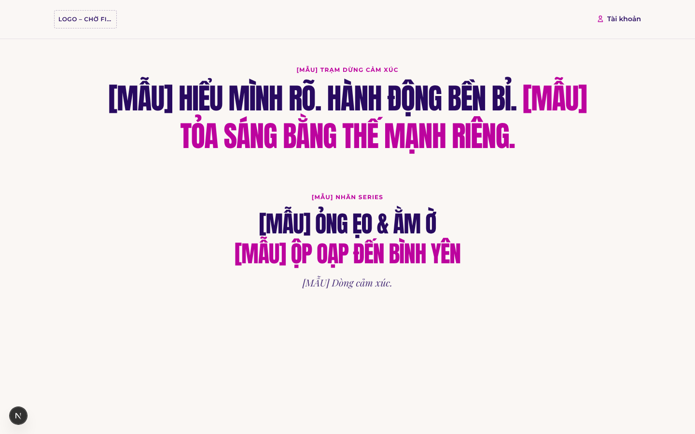

- _Chế độ Thoáng (1.45 / 24px / 24px):_
  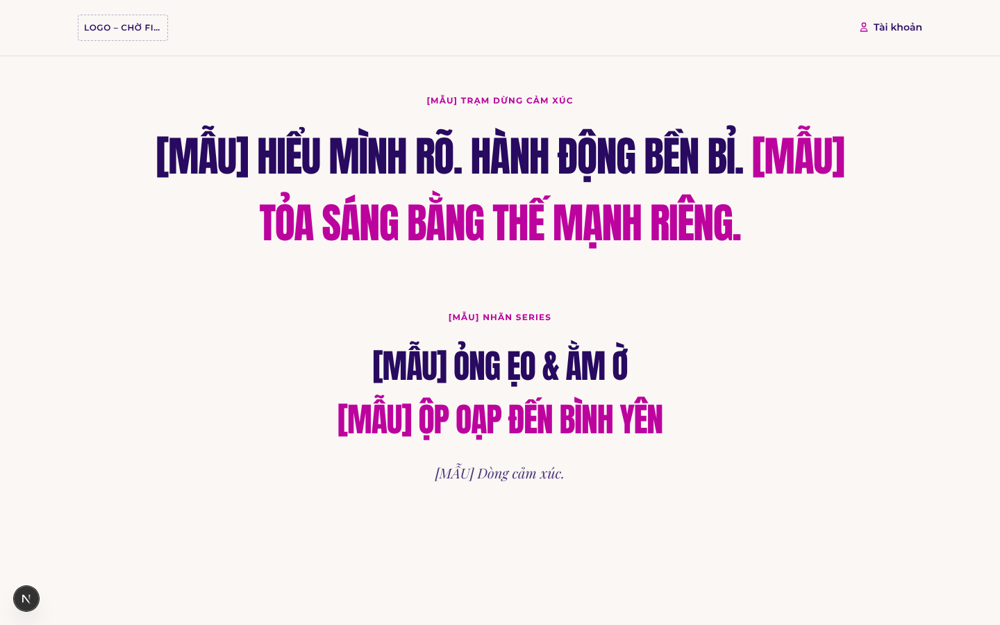

**Trên màn hình điện thoại di động (Mobile - 375px):**

- _Chế độ Mặc định (Vừa 1.3 / 16px / 14px):_
  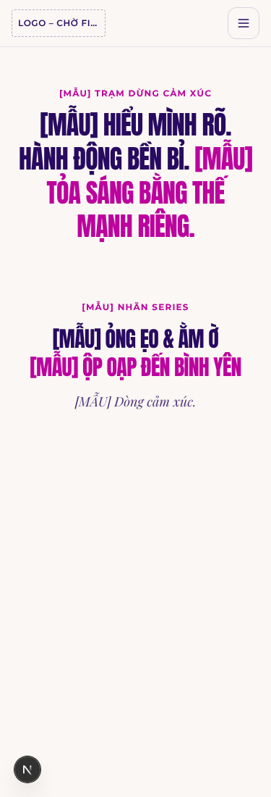

- _Chế độ Thoáng (1.45 / 24px / 24px):_
  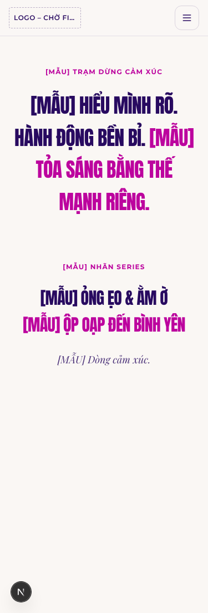

### 5.30. Nâng cao: CSS / HTML tuỳ chỉnh và hiệu ứng (EB-09)

Tính năng **CSS tuỳ chỉnh, widget HTML, class / z-index và hiệu ứng vào khung hình** giúp bạn tuỳ biến giao diện sâu hơn mà không làm ảnh hưởng đến độ an toàn và tốc độ tải trang của website.

> [!IMPORTANT]
> **Quyền hạn và Khóa an toàn:**
>
> - Các ô nhập CSS và widget HTML **chỉ hiển thị cho tài khoản Chủ sở hữu (Owner)**. Biên tập viên (`editor`) không nhìn thấy và không thể sửa các đoạn mã này.
> - **Mặc định tính năng này bị khoá** trong hệ thống để bảo vệ an toàn thương hiệu.
> - **Cách mở khoá:** Vào trang quản trị CMS (`/admin`) → Tìm mục **Hệ thống** → Chọn **Thiết kế hệ thống** (`designSystem`) → Tại nhóm _Khoá thương hiệu_, tìm dòng **CSS tuỳ chỉnh** (`customCss`) và chuyển từ **Khoá** sang **Mở** → Bấm **Lưu thay đổi**.

> [!NOTE]
> **Biên tập viên làm việc trên trang có mã của chủ site:** vẫn sửa chữ, ảnh, khoảng cách… và lưu bình thường. Hệ thống từ chối (thông báo "Chỉ chủ site được sửa CSS / HTML tuỳ chỉnh") khi biên tập viên thêm, sửa hoặc xoá mã CSS / HTML. Việc này gồm cả xoá hay nhân bản khối có mã, khôi phục một phiên bản cũ có mã khác, và lưu mẫu chứa mã. Luật áp dụng cả khi sửa qua trang quản trị lẫn qua API, không chỉ trong trình dựng trang. Khi tính năng đang khoá, khối HTML trên canvas chỉ hiện dòng "đang khoá" và trang công khai không hiện gì.

#### 1. CSS tuỳ chỉnh cho từng khối (Block Custom CSS)

- Chọn bất kỳ khối nào trên canvas hoặc cây Cấu trúc.
- Chuyển sang tab **Nâng cao** ở bảng bên phải → Cuộn xuống nhóm **CSS tuỳ chỉnh**.
- Nhập các quy tắc CSS bạn muốn:
  - Bắt buộc dùng từ khóa `selector` để trỏ vào chính khối đó. Ví dụ:
    ```css
    selector {
      outline: 3px solid #bc039e;
      border-radius: 16px;
    }
    selector:hover {
      opacity: 0.95;
    }
    ```
  - Nếu chỉ viết các thuộc tính ngắn (không có ngoặc `{}`), hệ thống sẽ tự động bọc vào khối hiện tại.
  - Bộ lọc thông minh của hệ thống sẽ tự động loại bỏ các đoạn mã độc hại, bảo vệ website khỏi nguy cơ tấn công hoặc vỡ giao diện.
  - Một số cách viết bị bỏ qua để CSS của khối không chạm khối khác: `selector ~ …` và `selector + …` (khối bên cạnh), quy tắc lồng trong quy tắc, `image-set(...)`. Có chuỗi chứa `{` `}` `;` thì cả ô CSS bị bỏ qua. Ảnh nền chỉ dùng `url(/api/media/file/...)` từ thư viện ảnh.

#### 2. CSS tuỳ chỉnh cho toàn trang (Page Custom CSS)

- Khi không chọn khối nào trên canvas (hoặc bấm chọn nút Cài đặt trang), bảng bên phải sẽ hiển thị các thiết lập trang.
- Bạn có thể viết CSS áp dụng cho toàn bộ trang trong ô **CSS tuỳ chỉnh**. Hệ thống sẽ tự động giới hạn phạm vi áp dụng bên trong vùng nội dung trang của bạn, không làm ảnh hưởng đến phần Menu đầu trang (Header), Chân trang (Footer) hay khu vực quản trị.

#### 3. Widget HTML an toàn (HtmlWidget)

- Trong thanh công cụ bên trái, tìm nhóm **Cơ bản** và kéo khối **HTML** vào canvas.
- Chọn khối HTML vừa kéo vào, bảng bên phải sẽ hiện ô nhập mã HTML (tối đa 20 000 ký tự).
- Cho phép sử dụng các thẻ khối và văn bản thông dụng (`div`, `p`, `span`, `h2`–`h6`, `table`, `ul`, `ol`, `li`, `a`, `img`...).
- **Quy tắc an toàn tuyệt đối:**
  - Hệ thống tự động ngăn chặn việc chạy mã JavaScript (`<script>`, các sự kiện `onclick`, `onerror`...).
  - Không cho phép nhúng `<iframe>`, `<form>` hoặc thẻ `<style>` trực tiếp.
  - Mọi hình ảnh trong thẻ `` chỉ được phép sử dụng từ thư viện ảnh đã tải lên của website (`/api/media/file/...`).

#### 4. Class CSS và Thứ tự hiển thị (z-index)

- Trong tab **Nâng cao** của bất kỳ khối nào, tìm nhóm **Class / z-index**:
  - **Class CSS:** Nhập tên class tùy biến (tối đa 5 class, viết chữ thường và cách nhau bởi dấu cách, ví dụ: `my-card highlight-box`). Class được lưu khi bạn rời ô hoặc bấm Enter.
  - **Thứ tự hiển thị (z-index):** Nhập số nguyên từ `-10` đến `100` để điều chỉnh lớp hiển thị trên/dưới khi các khối xếp đè lên nhau (hệ thống tự động thiết lập thuộc tính định vị tương đối `position: relative`).

#### 5. Hiệu ứng vào khung hình (Entrance Animations)

- Trong tab **Nâng cao**, tìm nhóm **Hiệu ứng vào khung hình**:
  - **Hiệu ứng:** Lựa chọn giữa _Hiện dần (Fade in)_, _Hiện dần trượt lên (Fade up)_, hoặc _Phóng to nhẹ (Zoom in)_.
  - **Độ trễ:** Chọn thời gian chờ trước khi chạy hiệu ứng (0ms, 150ms, 300ms, 500ms).
- **Thân thiện và Tinh tế:**
  - Trang web áp dụng kỹ thuật tăng cường lũy tiến: Nếu người đọc tắt JavaScript, toàn bộ nội dung vẫn hiển thị bình thường 100%, không bao giờ bị ẩn mất chữ.
  - Tự động nhận diện cài đặt giảm chuyển động (_Reduce Motion_) của thiết bị người dùng để tắt hiệu ứng, đảm bảo khả năng tiếp cận (Accessibility WCAG).
  - Trong màn hình chỉnh sửa trực quan của bạn (Canvas editor), hiệu ứng được tắt để bạn thao tác nhấp chọn và kéo thả dễ dàng nhất.

---

### 5.31. Thêm thẻ vào khối (gói, dịch vụ, số liệu, bước, câu hỏi…) bằng một nút bấm (PK-14)

**Mục đích**: Giúp Hana và người biên tập nội dung thêm các thẻ con vào khối (như các gói sản phẩm Growth Mirror, các dịch vụ coaching, ô số liệu, các bước hành trình, câu hỏi thường gặp FAQ...) một cách dễ dàng và trực quan nhất chỉ với một nút bấm, không cần phải tìm kiếm và kéo thả phức tạp.

#### 1. Hướng dẫn trực quan ngay trong khung trống (Empty Slot Hint)

Khi bạn kéo một khối cha vào trang (ví dụ khối **Các gói Growth Mirror**, **Thanh số liệu**, **Hành trình các bước**, **Câu hỏi thường gặp**...) mà khối đó chưa có thẻ con nào:

- Trên màn hình soạn thảo (Canvas) sẽ hiển thị ngay một khung viền nét đứt tinh tế với dòng chữ hướng dẫn rõ ràng:
  `Chưa có {nhãn thẻ con}. Bấm "+ Thêm {nhãn}" ở cột phải, hoặc kéo "{nhãn}" từ Khối → Thẻ con vào đây.`
- Dòng gợi ý này **chỉ hiển thị trong lúc chỉnh sửa**, hoàn toàn không hiển thị trên trang web công khai của khách hàng.

#### 2. Thêm thẻ bằng nút bấm một chạm ở cột phải (+ Thêm ...)

1. Bấm chuột vào khối cha trên trang soạn thảo để chọn khối.
2. Nhìn sang bảng thuộc tính bên phải (tab **Nội dung**), cuộn xuống dưới cùng bạn sẽ thấy:
   - Dòng nhỏ ghi số lượng: **Đã có N thẻ**.
   - Nút bấm nổi bật: **+ Thêm {nhãn thẻ con}** (ví dụ: `+ Thêm Thẻ gói`, `+ Thêm Thẻ dịch vụ`, `+ Thêm Ô số liệu`, `+ Thêm Bước hành trình`...).
3. Bấm vào nút này:
   - Hệ thống sẽ tự động tạo ngay một thẻ mới đặt vào cuối danh sách.
   - Đồng thời, cột bên phải lập tức chuyển sang chế độ chọn dữ liệu cho thẻ vừa thêm (ví dụ chọn gói sản phẩm, nhập số liệu, chọn câu hỏi...).
   - Nếu bạn bấm nhầm, chỉ cần bấm nút **Hoàn tác** trên thanh công cụ trên cùng để hủy thao tác.

#### 3. Nhóm Thẻ con bên trái tự mở và làm nổi bật

Khi bạn bấm chọn một khối cha:

- Nhóm **Thẻ con (kéo vào khối cha)** ở cột Thư viện khối bên trái sẽ tự động mở bung ra.
- Ô thẻ con tương ứng với khối cha đó sẽ được **viền nổi bật màu hồng sen (bright-magenta)** và tự động cuộn vào tầm nhìn để bạn nhận biết ngay lập tức.
- Khi bạn bỏ chọn khối cha, nhóm thẻ con sẽ trở lại trạng thái đóng/mở bình thường.

#### 4. Danh sách 9 khối cha hỗ trợ nút thêm thẻ con

| Khối cha                                   | Nút bấm ở cột phải       | Thẻ con tương ứng           |
| ------------------------------------------ | ------------------------ | --------------------------- |
| **Các gói Growth Mirror** (`PackageCards`) | `+ Thêm Thẻ gói`         | Thẻ gói (`PackageCard`)     |
| **Các dịch vụ Coaching** (`ServiceCards`)  | `+ Thêm Thẻ dịch vụ`     | Thẻ dịch vụ (`ServiceCard`) |
| **Lưới thẻ biểu tượng** (`IconCardGrid`)   | `+ Thêm Thẻ biểu tượng`  | Thẻ biểu tượng (`Card`)     |
| **Thanh số liệu ấn tượng** (`StatsBar`)    | `+ Thêm Ô số liệu`       | Ô số liệu (`Stat`)          |
| **Hành trình các bước** (`JourneySteps`)   | `+ Thêm Bước hành trình` | Bước (`Step`)               |
| **Câu hỏi thường gặp** (`FAQ`)             | `+ Thêm Câu hỏi FAQ`     | Câu hỏi FAQ (`FaqItem`)     |
| **Hero 2 Lối vào** (`HeroTwoEntries`)      | `+ Thêm Thẻ lối vào`     | Thẻ lối vào (`EntryCard`)   |
| **Hai lối đi** (`TwoPathCards`)            | `+ Thêm Thẻ lối đi`      | Thẻ lối đi (`PathCard`)     |
| **Tầm nhìn & Sứ mệnh** (`VisionMission`)   | `+ Thêm Thẻ giá trị`     | Thẻ giá trị (`VisionCard`)  |

#### 5. Hình ảnh minh họa thực tế [MẪU] trên trình dựng trang (Desktop - 1440px)

- _Khung nét đứt gợi ý trong khối trống và nút "+ Thêm Thẻ gói" ở cột phải khi chọn khối:_
  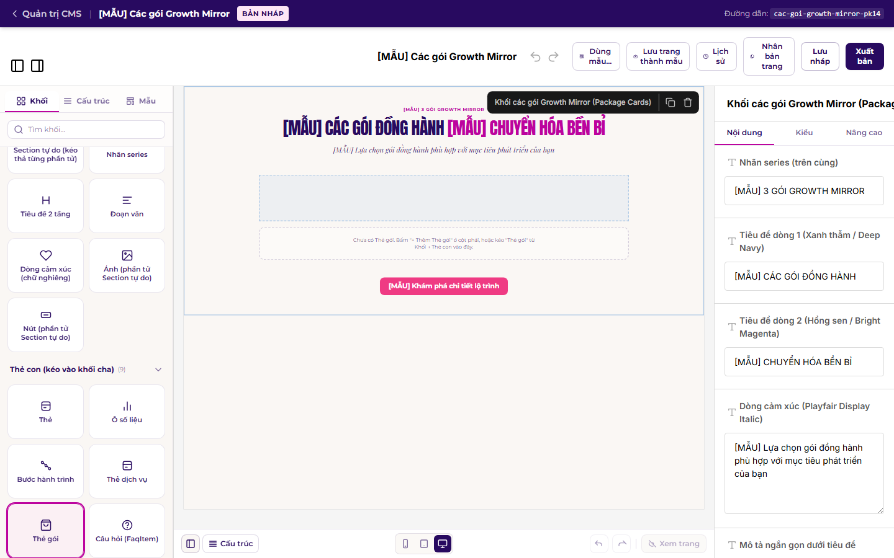

- _Ba thẻ gói đã được thêm nhanh vào khối Các gói Growth Mirror:_
  

### 5.32. Đầu trang và chân trang dựng bằng trình soạn thảo (EB-10)

Hana có thể tự thiết kế và thay đổi bố cục của **Đầu trang (Header)** và **Chân trang (Footer)** toàn website bằng trình soạn thảo trực quan Puck mà không cần nhờ can thiệp vào code:

#### 1. Cách tạo Đầu trang hoặc Chân trang mới

1. Vào mục **Trang web** -> **Trang nội dung** -> bấm **Tạo mới**.
2. Đặt tiêu đề (ví dụ: `Đầu trang chiến dịch hè` hoặc `Chân trang chính`).
3. Ở cột bên phải (Sidebar), tìm ô **Loại trang**:
   - Chọn **Đầu trang** nếu muốn tạo thanh menu trên cùng.
   - Chọn **Chân trang** nếu muốn tạo phần chân trang dưới cùng.
   - _Lưu ý:_ Loại trang chỉ được chọn lúc tạo mới và không thể đổi sau khi đã lưu để đảm bảo an toàn cấu trúc.
4. Bấm **Lưu nháp** hoặc **Xuất bản**:
   - Hệ thống sẽ **tự động nạp mẫu chuẩn**: Mẫu Đầu trang sẽ có sẵn Logo, Menu chính, Nút tài khoản và Nút CTA; mẫu Chân trang sẽ có Logo, Câu khẩu hiệu, Mạng xã hội và Chân trang pháp lý.
5. Bấm nút **Chỉnh sửa trực quan** để mở trình kéo thả.

#### 2. Chỉnh sửa trong trình soạn thảo trực quan

- **Khung xem trước:** Trong trình soạn thảo, bên dưới Đầu trang (hoặc bên trên Chân trang) sẽ có một khung trang giả mờ để Hana dễ quan sát khoảng cách thực tế khi gắn vào website. Khung này hoàn toàn vô hình đối với độc giả.
- **Cố định đầu trang khi cuộn (Sticky):** Nhấp chuột ra ngoài cùng (hoặc chọn tab Trang ở cột phải), trong mục **Cố định khi cuộn**, Hana có thể chọn:
  - _Không (cuộn bình thường)_: Thanh đầu trang trôi đi khi khách cuộn xuống.
  - _Dính ở đầu trang (Sticky)_: Thanh đầu trang luôn dính chặt ở mép trên cùng khi khách cuộn trang.
- **Thêm/sửa nút CTA và Menu:** Hana có thể thêm các nút bấm, widget ảnh, hoặc đổi màu nền của khung chứa Container.

#### 3. Chuyển sang dùng trên toàn website

Sau khi đã thiết kế xong và bấm **Xuất bản** trang đầu/chân trang:

1. Vào menu bên trái: **Hệ thống** -> **Menu điều hướng**.
2. Cuộn xuống nhóm **Đầu trang / chân trang** (ở dưới cùng):
   - **Nguồn đầu trang:** Chọn _Dựng bằng Builder_.
   - **Trang đầu trang (Builder):** Chọn đúng trang đầu trang Hana vừa xuất bản.
   - Bấm vào nút **Chỉnh sửa trực quan** màu tím bên dưới để xem lại nhanh nếu muốn.
   - Tương tự cho **Nguồn chân trang**.
3. Bấm **Lưu thay đổi**. Ngay lập tức toàn bộ website sẽ chuyển sang hiển thị Đầu trang/Chân trang mới!

#### 4. Quay lại bản code mặc định an toàn

Nếu muốn quay lại giao diện lập trình mặc định ban đầu:

- Trong **Menu điều hướng**, chuyển **Nguồn đầu trang** hoặc **Nguồn chân trang** về lại **Giao diện mặc định (Code)**.
- Bấm **Lưu thay đổi**.
- Nếu trang Builder được chọn bị chuyển về bản nháp (Draft) hoặc có lỗi dữ liệu, website cũng sẽ **tự động quay về bản code mặc định** để không bao giờ làm gián đoạn trải nghiệm của khách.

#### 5. Vì sao không thể xoá khối "Chân trang pháp lý"?

- Theo quy định bắt buộc của Bộ Công Thương Việt Nam và quy chuẩn thương hiệu Trạm Dừng Cảm Xúc, mọi trang web thương mại đều bắt buộc phải hiển thị công khai **6 liên kết pháp lý** (Điều khoản, Chính sách bảo mật, Giao hàng, Hoàn tiền, Đổi trả, Pháp lý) và thông tin đăng ký của Hana.
- Do đó, khối **Chân trang pháp lý (LegalFooter)** trong Chân trang được cài đặt khóa bảo vệ vĩnh viễn:
  - Nút **Xoá** và nút **Nhân bản** của khối này bị vô hiệu hoá.
  - Trình soạn thảo và máy chủ sẽ tự động từ chối nếu trang Chân trang thiếu khối này.
  - Nhờ vậy, Hana có thể thoải mái kéo thả thay đổi vị trí mà không bao giờ sợ sơ suất làm mất thông tin pháp lý bắt buộc.

---

### 5.33. Thanh thao tác nhanh và phím tắt (EB-13a)

Khi Hana nhấp chuột chọn bất kỳ khối nào trên khung soạn thảo (canvas), một **thanh thao tác nhanh nổi** (Action Bar) màu tím than thương hiệu sẽ hiện ngay trên mép khối giúp Hana sắp xếp và thao tác tức thì mà không cần kéo chuột vất vả:

#### 1. Các nút trên thanh thao tác nổi

- **Chọn khối cha**: Hiện ra khi Hana đang chọn một phần tử con (như Tiêu đề, Văn bản hoặc Nút bên trong Khung chứa Container / Cột). Nhấp nút này để lập tức chuyển vùng chọn sang Khung chứa cha bên ngoài để chỉnh lề hoặc đổi màu nền. Khối ngoài cùng (gốc trang) sẽ tự động ẩn nút này.
- **Tên khối**: Hiển thị tên loại khối (hoặc tên gợi nhớ Hana đã đặt trong tab Nâng cao).
- **↑ Lên / ↓ Xuống**: Đổi thứ tự khối lên trên hoặc xuống dưới trong cùng khung/vùng. Nếu khối đang nằm ở đầu hàng thì nút **↑** sẽ mờ đi; nếu đang ở cuối hàng thì nút **↓** sẽ mờ đi.
- **Nhân bản (Biểu tượng hai trang giấy)**: Tạo nhanh một bản sao giống hệt ngay bên dưới. (Khối bị khoá như Hero trang chủ hoặc Chân trang pháp lý sẽ ẩn nút này).
- **Xoá (Biểu tượng thùng rác)**: Xoá khối đang chọn khỏi trang. (Khối bị khoá sẽ không có nút này).

#### 2. Bộ phím tắt tiện lợi (khi đang chọn khối)

Hana có thể dùng bàn phím để thao tác cực nhanh (khi con trỏ không nằm trong ô nhập chữ hoặc khung viết bài):

- **Alt + ↑** (hoặc Option + ↑ trên Mac): Đổi chỗ khối lên trên.
- **Alt + ↓** (hoặc Option + ↓ trên Mac): Đổi chỗ khối xuống dưới.
- **Esc**: Chọn ngay khung cha bên ngoài (tương đương nút _Chọn khối cha_).
- **Ctrl + D** (hoặc Cmd + D trên Mac): Nhân bản khối đang chọn.
- **Delete**: Xoá khối đang chọn.

#### 3. Chuột phải chính xác vào khối đang chọn

Khi Hana đã chọn một khung chứa (ví dụ Container lớn có nhiều ảnh, chữ con bên trong), Hana chỉ cần nhấp chuột phải **ở bất kỳ đâu trong khung** (kể cả nhấp trúng ảnh hay chữ con) thì bảng menu tác vụ vẫn ưu tiên mở cho **chính Khung chứa đang chọn**, giúp Hana sao chép kiểu dáng hoặc lưu mẫu khung nhanh chóng mà không bị chọn nhầm sang khối con.

Muốn mở menu cho **một khối con** bên trong (ví dụ dán vào ngay sau một đoạn chữ trong khung): bấm chuột trái chọn khối con đó trước, rồi mới nhấp chuột phải.

### 5.34. Bấm để chèn khối (EB-13b)

Trước đây, để thêm một khối hoặc widget vào trang, Hana phải giữ chuột và kéo thả chính xác vào vị trí mong muốn. Việc này có thể khó thao tác trên màn hình nhỏ hoặc khi cần căn thả chuẩn xác vào bên trong một khung chứa.

Giờ đây, Hana chỉ cần **bấm một cái (click)** vào bất kỳ khối nào trong menu bên trái để chèn ngay lập tức mà không cần kéo thả:

1. **Khi đang chọn một Khung chứa (Container, Cột, Tab...):**
   - Bấm vào khối bất kỳ trong thư viện bên trái, khối mới sẽ tự động được **chèn vào cuối khung chứa** đó.
   - Trình dựng sẽ tự động chọn khối mới vừa chèn và cuộn màn hình đến đúng vị trí để Hana tiếp tục chỉnh sửa.
2. **Khi đang chọn một khối thường (Tiêu đề, Văn bản, Ảnh, Nút...):**
   - Bấm vào khối mới trong thư viện, khối đó sẽ được **chèn ngay phía dưới** khối đang chọn trong cùng một hàng/vùng.
3. **Khi không chọn khối nào:**
   - Khối mới sẽ được **chèn vào cuối trang**.
4. **Nút "+ Thêm phần tử" trong Khung chứa trống:**
   - Mỗi khi kéo hoặc tạo một Khung chứa (Container) mới chưa có nội dung, giữa khung sẽ xuất hiện nút **"+ Thêm phần tử"**.
   - Bấm nút này: thanh thư viện bên trái sẽ tự động mở ra và Khung chứa được chọn sẵn.
   - Bấm tiếp bất kỳ khối nào ở menu trái, khối đó sẽ nằm ngay ngắn bên trong Khung chứa. Nút này chỉ xuất hiện trong trình soạn thảo, không bao giờ hiện ở trang công khai.
5. **Mẫu sẵn "Khung 2 cột (ảnh + chữ)":**
   - Ở ngay đầu nhóm **Bố cục** tại thư viện bên trái, Hana sẽ thấy mẫu sẵn **Khung 2 cột (ảnh + chữ)**.
   - Bấm vào mục này, một khung chứa chuẩn 2 cột responsive (ngang trên máy tính, dọc trên điện thoại) gồm sẵn khối Ảnh và khối Chữ mẫu sẽ được tạo ngay lập tức.
6. **Bảo vệ quy tắc thương hiệu:**
   - Nếu Hana bấm chọn một khối không phù hợp với vị trí hiện tại (ví dụ: cố tình đặt khối gốc lớn vào trong một thẻ con), hệ thống sẽ từ chối và hiện thông báo giải thích rõ ràng, giúp trang web luôn giữ đúng quy chuẩn thiết kế.

### 5.35. Hero ảnh nền (EB-14a)

Hana có thể biến khối Hero đầu trang (`Hero 2 Lối vào` hoặc `Hero Ảnh biểu tượng`) thành một màn chào ấn tượng với hình ảnh phủ trọn màn hình, được làm mờ nhẹ và phủ lớp màu tinh tế, tiêu đề cùng các nút bấm nằm nổi bật ngay trên ảnh.

#### Các bước thực hiện:

1. **Chọn khối Hero trên trang:**
   - Trong trình soạn thảo Puck, bấm chuột chọn khối Hero (trên trang chủ là khối `Hero 2 Lối vào`, hoặc các trang khác là khối `Hero Ảnh biểu tượng`).
2. **Đổi kiểu bố cục:**
   - Ở cột cài đặt bên phải, tìm mục **Kiểu bố cục**.
   - Bấm chuyển từ _Ảnh bên cạnh chữ_ sang **Ảnh làm nền, chữ nằm trên ảnh**.
3. **Chọn ảnh minh họa Hero:**
   - Chọn ảnh từ Thư viện media (bắt buộc ảnh phải có mô tả alt).
4. **Tùy chỉnh lớp phủ và hiệu ứng:**
   - **Tông phủ nền:** Chọn _Phủ tối (chữ trắng)_ (màu xanh thẫm `deep-navy`) hoặc _Phủ sáng (chữ tím than)_ (màu ngà ấm `warm-ivory`). Chữ và các nút sẽ tự động đổi màu tương phản chuẩn WCAG AA để luôn dễ đọc.
   - **Độ đậm lớp phủ:** Chọn _Vừa (60%)_, _Đậm (75%)_ hoặc _Rất đậm (85%)_. Muốn chữ đọc rõ hơn thì tăng độ đậm lớp phủ; hệ thống không có lựa chọn nhạt hơn 60% để đảm bảo luôn đọc được chữ trên mọi loại ảnh nền.
   - **Độ mờ ảnh:** Chọn _Không mờ_, _Mờ nhẹ (4px)_ hoặc _Mờ vừa (8px)_ để tạo chiều sâu dịu mắt cho hậu cảnh.
   - **Vị trí trọng tâm ảnh:** Chọn 1 trong 9 vị trí căn chỉnh ảnh (Chính giữa, Trên – giữa, Dưới – giữa...).
   - **Căn lề nội dung:** Chọn _Căn giữa_ hoặc _Căn trái_.
   - **Chiều cao tối thiểu:** Chọn _Vừa (480px)_, _Lớn (640px)_ hoặc _Toàn màn hình (trừ header)_.
5. **Xem trước trên điện thoại:**
   - Bấm nút xem trước màn hình 375px ở góc trên bên phải để kiểm tra bố cục hiển thị hoàn hảo trên thiết bị di động.

#### Xếp thẻ lối vào trên – dưới (`Hero 2 Lối vào`):

Hana có thể linh hoạt sắp đặt 2 thẻ lối vào của `Hero 2 Lối vào` theo thiết kế mới:

1. **Bố cục thẻ lối vào:** Chọn _2 cột cạnh nhau_ (mặc định) hoặc _Xếp hàng trên – dưới_. Khi chọn xếp hàng trên – dưới, mỗi thẻ sẽ trải dài dạng thanh ngang: bên trái là nhãn và mô tả in đậm, bên phải là nút bấm gọn gàng cùng hàng trên máy tính; trên điện thoại thẻ tự động chuyển về dạng dọc dễ thao tác.
2. **Vị trí thẻ lối vào:** (Chỉ áp dụng khi chọn kiểu bố cục _Ảnh bên cạnh chữ_ và có ảnh):
   - _Dưới cả ảnh và chữ_: Thẻ nằm rộng phía dưới như trước.
   - _Trong cột chữ, dưới đoạn mô tả_: 2 thẻ sẽ được đưa thẳng vào cột bên trái ngay dưới phần giới thiệu, tạo bố cục cân đối và ảnh bên phải sẽ tự mở rộng chiều cao bằng trọn vẹn cột chữ.

### 5.36. Khối bị khoá và cách mở khoá

Trên website Trạm Dừng Cảm Xúc, một số khối đặc thù được hệ thống tự động khoá một phần hoặc toàn bộ thao tác nhằm bảo vệ tính toàn vẹn của nhận diện thương hiệu và quy chuẩn bắt buộc:

- **Hero 2 lối vào (`HeroTwoEntries`) trên trang chủ:** Khối cửa ngõ đón khách của trang chủ, mặc định không thể kéo đổi chỗ, nhân bản hay xoá.
- **Chân trang pháp lý (`LegalFooter`):** Khối điều khoản và liên kết pháp lý bắt buộc phải có ở cuối mọi trang, không thể xoá.
- **Khối HTML tuỳ chỉnh (`HtmlWidget`):** Khi tính năng "Mở khoá CSS / HTML" trong Thiết kế hệ thống đang tắt, khối này không thể chỉnh sửa mã HTML trực tiếp.

#### 1. Nhận biết khối đang bị khoá

Khi Hana bấm chọn một khối đang bị khoá trong trình soạn thảo:

1. **Trên thanh thao tác nhanh nổi (Action Bar):** Xuất hiện nhãn **🔒 Đã khoá**. Rà chuột hoặc chạm vào nhãn sẽ hiển thị lý do khối bị giới hạn.
2. **Các nút thao tác bị giới hạn (Đổi chỗ, Nhân bản, Xoá):** Vẫn hiển thị đầy đủ trên thanh công cụ nhưng ở trạng thái mờ (`aria-disabled`). Khi Hana bấm vào nút mờ, hệ thống sẽ hiện thông báo nổi (toast) giải thích rõ lý do thay vì im lặng.
3. **Cây cấu trúc (thẻ Cấu trúc bên trái):** Xuất hiện biểu tượng ổ khoá 🔒 ngay cạnh tên khối.
4. **Bảng thuộc tính bên phải:** Trên cùng bảng thuộc tính luôn có dải thông báo màu be (`butter-cream`) nêu rõ khối đang bị khoá những thao tác gì (không xoá / không đổi chỗ / không nhân bản) cùng lý do cụ thể.

#### 2. Ai được quyền mở khoá?

- **Chỉ Chủ tài khoản (`owner`):** Mới có quyền bấm nút **"Mở khoá"** để chủ động di chuyển hoặc sắp xếp lại bố cục khối.
- **Người biên tập (`editor`):** Chỉ thấy thông báo _"Chỉ chủ tài khoản mở khoá được khối này"_ và không thể bấm mở khoá.

#### 3. Cách mở khoá và xác nhận an toàn

1. Chọn khối đang khoá (ví dụ khối Hero 2 lối vào trên trang chủ).
2. Bấm nút **"Mở khoá"** trên thanh thao tác nổi hoặc trên dải thông báo màu be bên phải.
3. Một hộp thoại xác nhận an toàn sẽ hiện ra, giải thích rõ:
   - Thao tác mở khoá **chỉ có hiệu lực tạm thời trong phiên chỉnh sửa hiện tại**.
   - Khi tải lại trang (reload) hoặc đóng trình duyệt, khối sẽ tự động khoá bảo vệ trở lại.
   - Nhắc nhở quy tắc bắt buộc: _"Trang chủ vẫn phải còn ít nhất 1 Hero 2 lối vào khi lưu."_
4. Bấm **"Mở khoá"** trong hộp thoại:
   - Khối chuyển sang trạng thái **🔓 Đang mở khoá**.
   - Hana có thể dùng phím tắt `Alt + ↓` / `Alt + ↑` hoặc các nút mũi tên để đổi vị trí khối theo ý muốn (ví dụ: đưa khối Hero xuống dưới một khối khác khi sắp đặt lại chiến dịch).
   - Nếu muốn khoá lại ngay lập tức mà không cần chờ tải lại trang, Hana bấm nút **"Khoá lại"**.

#### 4. Quy tắc an toàn bắt buộc khi mở khoá

- **Bảo vệ khối bắt buộc duy nhất:** Dù đang trong trạng thái mở khoá, nếu Hana cố tình xoá khối Hero 2 lối vào **duy nhất** trên trang chủ (hoặc khối Chân trang pháp lý duy nhất ở chân trang), trình soạn thảo sẽ lập tức chặn lại và hiện thông báo nhắc nhở, ngăn không để trang chủ bị mất cửa ngõ đón khách.
- **Khối HTML khoá bởi Thiết kế hệ thống:** Không thể mở khoá tạm thời trong trình soạn thảo. Muốn chỉnh sửa khối này, Chủ tài khoản cần vào **Admin → Thiết kế hệ thống** để bật công tắc cho phép.

### 5.37. Đổi màu, cỡ chữ từng dòng chữ

Trong các khối hiển thị văn bản (như Hero 2 lối vào, Hero ảnh biểu tượng, Tiêu đề phân đoạn, Câu chuyện Hana, Trích dẫn, Khối kêu gọi chuyển đổi lớn, Ảnh & Chữ, và các widget Tiêu đề / Đoạn văn / Nút bấm), Hana có thể tuỳ chỉnh màu sắc, cỡ chữ, độ đậm và căn lề cho **từng ô chữ riêng biệt** mà không ảnh hưởng đến các dòng chữ khác trong khối.

#### 1. Nhận biết nút "Aa" cạnh ô chữ

Khi bấm chọn khối trong trình soạn thảo trực quan:

1. Nhìn vào bảng thuộc tính bên phải, cạnh nhãn của các ô chữ (ví dụ: "Tiêu đề dòng 1", "Tiêu đề dòng 2", "Dòng cảm xúc", "Nhãn series", "Chữ trên nút"), Hana sẽ thấy một nút nhỏ hình chữ **"Aa"**.
2. **Chấm hồng báo hiệu:** Nếu ô chữ đó đang có kiểu dáng tuỳ chỉnh riêng, góc nút "Aa" sẽ có một chấm tròn màu hồng (`accent-pink`) và nút có viền nổi bật để dễ dàng nhận biết.

#### 2. Các tuỳ chọn trong bảng kiểu chữ (Popover)

Bấm vào nút **"Aa"**, một bảng popover nhỏ gọn sẽ mở ra ngay cạnh nút:

1. **Màu chữ:**
   - Chỉ gồm 8 màu nhận diện thương hiệu trong Brand Book 2026 (Xanh thẫm, Hồng sen, Hồng đậm CTA, Hồng phấn, Tím nhạt, Xanh bạc hà, Be ấm, Trắng).
   - **Tự động bảo vệ độ tương phản (WCAG AA):** Hệ thống tự động phân tích màu nền của khối. Những màu không đạt độ tương phản chuẩn (khó đọc, gây chói mắt người xem) sẽ bị làm mờ, không cho chọn và hiện cảnh báo _"Khó đọc trên nền này (chưa đạt chuẩn tương phản AA)"_.
2. **Cỡ chữ theo từng thiết bị (Đáp ứng đa thiết bị):**
   - Có 3 thẻ thiết bị: **Máy tính** (Desktop), **Máy tính bảng** (Tablet), và **Điện thoại** (Mobile).
   - Hana có thể chọn cỡ chữ khác nhau cho từng thiết bị (ví dụ: trên máy tính chọn chữ lớn "XL", trên điện thoại chọn vừa "MD" để không bị tràn dòng).
3. **Độ đậm chữ:**
   - Gồm 3 mức: _Thường (400)_, _Đậm vừa (600)_, và _Đậm (700)_.
4. **Căn lề chữ:**
   - Trái, Giữa, Phải.
5. **Nút "Về mặc định":**
   - Khi muốn bỏ toàn bộ tuỳ chỉnh riêng của dòng chữ này để quay về kiểu chữ mặc định theo thiết kế chuẩn của khối, Hana chỉ cần bấm nút **"Về mặc định"**.
6. **Đóng bảng:**
   - Bấm nút **"Đóng"**, bấm chuột ra ngoài vùng bảng, hoặc nhấn phím **Escape** trên bàn phím.

---

### 5.38. Căn lề thẻ và icon

Hana có thể linh hoạt căn chỉnh bố cục của các thẻ (icon, số thứ tự, hình ảnh, tiêu đề, mô tả và nút bấm) sang **Trái** hoặc **Giữa** mà không lo biểu tượng bị lệch vị trí.

#### 1. Căn lề đồng loạt cho cả khung lưới thẻ ("Căn lề tất cả thẻ")

Khi chỉnh sửa một khối dạng lưới chứa nhiều thẻ con (như **Lưới thẻ biểu tượng / đánh số**, **Khối các gói Growth Mirror**, **Các thẻ dịch vụ coaching**, **Hai lối đi Cá nhân / Doanh nghiệp**, **Tầm nhìn & Sứ mệnh**, **Hành trình các bước chuyển hóa**):

1. Bấm chọn vào khối lưới bên ngoài.
2. Tại cột bên phải, tìm trường **Căn lề tất cả thẻ**:
   - **Theo từng thẻ (Mặc định):** Mỗi thẻ con sẽ tự quyết định căn trái hay căn giữa theo cài đặt riêng của nó.
   - **Căn trái:** Toàn bộ các thẻ con trong lưới lập tức căn lề trái.
   - **Căn giữa:** Toàn bộ các thẻ con trong lưới lập tức căn đều vào giữa.
3. Khi chọn **Căn trái** hoặc **Căn giữa** ở khung lưới, nếu Hana bấm vào từng thẻ con bên trong, trường "Căn lề" của thẻ con sẽ hiển thị dòng chữ nhắc nhở: **Căn lề (Đang theo khung)** để Hana biết thẻ đang chịu sự điều khiển của khung lưới cha.

#### 2. Căn lề cho từng thẻ riêng lẻ

Nếu khung lưới đang để chế độ _Theo từng thẻ (Mặc định)_, Hana có thể bấm trực tiếp vào từng thẻ con để chỉnh trường **Căn lề** của thẻ đó thành _Căn trái_ hoặc _Căn giữa_.

#### 3. Căn bằng tab Kiểu

Bấm khối lưới (hoặc một thẻ) → tab **Kiểu** → nhóm **Chữ** → ô **Căn lề**: chọn _Giữa_ (hoặc _Trái_ / _Phải_). Mọi thẻ bên trong khối đó đi theo: chữ, icon, số thứ tự, nhãn, nút. Có thể đặt riêng cho điện thoại / máy tính bảng như các ô khác ở tab Kiểu.

#### 4. Icon, số thứ tự, nhãn và nút đi cùng chữ

Trước đây chữ căn giữa nhưng icon vẫn nằm bên trái. Nay icon, ảnh nhỏ, số thứ tự (01, 02…), nhãn và nút luôn đi cùng tiêu đề, cả ở máy tính lẫn điện thoại.

#### 5. Khi nhiều cách căn cùng được đặt

Thứ tự ưu tiên, từ cao xuống thấp:

1. **Căn lề tất cả thẻ** của khung lưới (Căn trái / Căn giữa).
2. **Căn lề** ở tab Kiểu của khối bao ngoài hoặc của chính thẻ.
3. Field **Căn lề** của từng thẻ.

Ví dụ: khung lưới để _Căn trái_ thì thẻ con vẫn căn trái, dù tab Kiểu chọn _Giữa_.

---

## 6. Quản lý Trang pháp lý và Thông tin người bán

### 6.1. Chỉnh sửa nội dung một trang pháp lý

**Mục đích**: Cập nhật văn bản điều khoản, chính sách bảo mật hoặc hướng dẫn giải quyết khiếu nại theo đúng quy định pháp luật.

**Các bước thực hiện**:

1. Ở cột menu bên trái, tìm nhóm **Hệ thống**, bấm chọn **Trang pháp lý**.
2. Bấm vào trang bạn muốn cập nhật nội dung (ví dụ: _Chính sách giá và thanh toán_).
3. Sử dụng khung soạn thảo **Nội dung** để chỉnh sửa văn bản (có thể in đậm, gạch đầu dòng, tạo tiêu đề nhỏ...).
4. Chọn **Ngày cập nhật nội dung** là ngày hiện tại.
5. Bấm **Xuất bản** để trang ngoài chân trang website tự cập nhật.


<!-- ẢNH 18: trang <ĐỊA CHỈ DEMO>/admin/collections/legalPages/[id], khung soạn thảo nội dung của trang pháp lý -->

---

### 6.2. Nhập thông tin người bán (`sellerInfo`)

**Mục đích**: Công khai minh bạch thông tin đơn vị kinh doanh ở chân trang và trang thông tin pháp lý theo quy định thương mại điện tử.

**Các bước thực hiện**:

1. Ở cột menu bên trái, tìm nhóm **Hệ thống**, bấm vào **Cài đặt website**.
2. Bấm chọn tab **Người bán**.
3. Nhập đầy đủ thông tin:
   - **Tên người bán hoặc hộ kinh doanh**: Tên đăng ký kinh doanh chính thức.
   - **Mã số thuế**: Mã số thuế cá nhân hoặc hộ kinh doanh.
   - **Địa chỉ**: Địa chỉ liên hệ hoặc văn phòng làm việc.
   - **Điện thoại**: Số hotline liên hệ hỗ trợ.
   - **Email người bán**: Email chính thức tiếp nhận thông tin pháp lý.
4. Bấm nút **Lưu** để cập nhật lên chân trang của toàn bộ website.


<!-- ẢNH 19: trang <ĐỊA CHỈ DEMO>/admin/globals/siteSettings, tab Người bán với các ô Tên, MST, Địa chỉ, SĐT, Email -->

---

## 7. Cài đặt Website, Kênh liên hệ và Thanh toán

### 7.0. Thiết kế & thương hiệu: bảng màu, font, khoá / mở chỉnh kiểu (EB-01)

> **Có tác dụng ngay trên trang web (từ EB-02):** đổi màu, font, bo góc, khoảng thở rồi bấm Lưu thì mọi trang và trình dựng trang đổi theo (tải lại trang để thấy). Ảnh chia sẻ (Boarding Pass, chứng nhận, thẻ EQ) và email **chưa** đổi theo. Các ô chỉnh màu / font / cỡ tự do trong trình dựng trang có từ EB-04; các công tắc khoá / mở chưa có tác dụng tới lúc đó.

**Ai sửa được**: chỉ tài khoản **Chủ sở hữu** (owner). Biên tập viên xem được nhưng không lưu được.

1. Vào nhóm **Trang web** → **Thiết kế & thương hiệu**.
2. **Bảng màu**:
   - Bấm vào một dòng để mở. Đổi màu bằng ô chọn màu, hoặc gõ mã HEX (dạng `#280A60`).
   - Dưới ô màu có số **tương phản** với nền trắng và nền warm-ivory. Chữ thường cần từ **4.5:1** trở lên mới dễ đọc.
   - 8 màu gốc (`deep-navy`, `bright-magenta`, `accent-pink`, `soft-pink`, `lavender-mist`, `mint-haze`, `butter-cream`, `warm-ivory`) **không xoá và không đổi mã được**, vì giao diện đang dùng tên này. Đổi màu HEX và tên gọi thì được.
   - Thêm màu mới: **Thêm Màu**, đặt mã bằng chữ thường, số, gạch nối (ví dụ `xanh-la`). Tối đa 16 màu.
3. **Font chữ**: chọn font cho Tiêu đề lớn, Nhãn / nút, Câu trích, Đoạn văn. Danh sách chỉ có font Google hiển thị đúng dấu tiếng Việt. Font khác bộ mặc định được tải từ Google Fonts nên trang tải chậm hơn một chút; giữ ít font khác nhau.
4. **Bo góc thẻ**, **Khoảng thở**: số px.
5. **Khoảng cách tiêu đề & Giãn dòng (PK-13)**: chỉnh giãn dòng tiêu đề Anton, khoảng cách nhãn → tiêu đề, tiêu đề → dòng cảm xúc mặc định cho toàn trang web (xem chi tiết tại mục [5.29](#529-tự-chỉnh-khoảng-cách-tiêu-đề-và-giãn-dòng-anton-pk-13)).
6. **Khoá / mở chỉnh kiểu**:

   | Công tắc             | Khoá                                   | Mở                                                   |
   | -------------------- | -------------------------------------- | ---------------------------------------------------- |
   | Màu                  | Người biên tập chỉ chọn màu trong bảng | Thêm ô chọn màu tự do                                |
   | Font                 | Font theo vai trò ở mục 3              | Chọn font cho từng phần tử                           |
   | Cỡ chữ, khoảng cách  | Chỉ các mức S / M / L                  | Nhập số (px, rem, %)                                 |
   | CSS / HTML tuỳ chỉnh | Không có                               | Chủ sở hữu thêm CSS và khối HTML (không chạy script) |
   - **Cảnh báo chữ khó đọc**: bật thì trình dựng trang báo khi chữ và nền dưới chuẩn WCAG AA.
   - Mặc định mọi công tắc đều **Khoá**. Khi có công tắc **Mở**, màn hình hiện dòng "Đang mở – trang có thể lệch bộ nhận diện".
   - **Site Trạm Dừng Cảm Xúc**: theo quyết định 31/10, Chủ sở hữu chuyển các công tắc sang **Mở** để Hana tự chỉnh.

7. Bấm **Lưu**.

### 7.1. Cài đặt tài khoản ngân hàng chuyển khoản (VietQR)

**Mục đích**: Cung cấp số tài khoản và thông tin hiển thị mã QR để khách thanh toán khóa học hoặc đặt phiên trải nghiệm.

**Cách thực hiện** _(Chỉ tài khoản Chủ sở hữu mới nhìn thấy tab này)_:

1. Vào nhóm **Hệ thống** -> **Cài đặt website** -> chọn tab **Thanh toán**.
2. Nhập các thông tin ngân hàng của bạn:
   - **Mã ngân hàng VietQR**: Mã ngân hàng liên minh Napas (ví dụ `970436` cho Vietcombank, `970415` cho VietinBank...).
   - **Tên ngân hàng**: Tên đầy đủ (ví dụ: _Vietcombank_).
   - **Số tài khoản**: Số tài khoản thụ hưởng của Hana.
   - **Tên chủ tài khoản**: Tên in hoa không dấu của chủ tài khoản.
   - **Đầu mã chuyển khoản**: Mặc định là `TDCX` (dùng để sinh mã nội dung chuyển khoản cho từng khách).
3. Bấm **Lưu**.


<!-- ẢNH 21: trang Cài đặt website, tab Thanh toán với các trường cấu hình VietQR -->

---

### 7.1b. Cài đặt widget "Ly cà phê" ủng hộ qua mã QR MoMo (CF-01)

**Mục đích**: Cho phép độc giả quý mến Trạm có thể tùy tâm mời Hana một ly cà phê ấm áp qua mã QR MoMo, xuất hiện dưới dạng icon ly cà phê nổi ở góc dưới bên phải màn hình.

**Cách lấy ảnh QR nhận tiền trong app MoMo**:

1. Mở ứng dụng MoMo trên điện thoại cá nhân.
2. Chọn mục **Nhận tiền** (hoặc biểu tượng QR cá nhân để nhận tiền).
3. Bấm **Lưu hình ảnh mã QR** về thư viện ảnh điện thoại.
4. **Cắt sát mã QR** (chỉ giữ khung mã QR, có thể để tên người nhận ngay bên dưới) bằng công cụ cắt ảnh của điện thoại. **Không** tải nguyên ảnh chụp màn hình: khi đó mã QR chỉ chiếm khoảng 1/3 ảnh, hiện trên web còn rất nhỏ và **điện thoại khác không quét được** (lỗi gặp ngày 02/11). Ảnh cắt sát nên rộng ít nhất 600 px.
5. ⚠️ **LƯU Ý BẢO MẬT:** Tuyệt đối **không** tải lên ảnh chụp màn hình có chứa số dư ví, lịch sử chuyển tiền hay thông tin tài khoản riêng tư nào khác ngoài khung mã QR.

**Cấu hình trên CMS** _(Chỉ tài khoản Chủ sở hữu mới được sửa)_:

1. Vào nhóm **Hệ thống** -> **Cài đặt website** -> chọn tab **Thanh toán**.
2. Cuộn xuống phần **Ly cà phê ủng hộ (MoMo)** ở cuối tab:
   - **Hiện nút ly cà phê**: Tick chọn để bật widget nổi trên website (bỏ tick để tắt).
   - **Mã QR MoMo**: Bấm chọn/tải lên ảnh mã QR vừa lưu. Khi tải lên, bắt buộc điền mô tả ảnh (Alt) như `Mã QR MoMo ủng hộ Trạm Dừng Cảm Xúc`. _Lưu ý: Nếu bật nút mà chưa chọn ảnh, hệ thống sẽ báo lỗi và không cho lưu._
   - **Tiêu đề**: Nhập tiêu đề hiện trong khung ủng hộ (tối đa 80 ký tự, ví dụ: _Mời Trạm một ly cà phê_). Nếu để trống, hệ thống tự lấy tiêu đề mặc định.
   - **Lời nhắn**: Lời nhắn gửi tới bạn đọc (tối đa 300 ký tự).
   - **Liên kết MoMo (không bắt buộc)**: Nếu có đường link nhận tiền MoMo trực tiếp dạng `https://me.momo.vn/...`, hãy dán vào đây để hiện thêm nút "Mở MoMo". Bắt buộc phải bắt đầu bằng `https://`.
3. Bấm **Lưu thay đổi** (hoặc Save).

**Xem thử & tự kiểm tra**:

- Mở trang chủ hoặc các trang giới thiệu, bạn sẽ thấy icon ly cà phê nổi màu trắng, viền tím nhạt, icon tím hoa cà xinh xắn nằm ngay phía trên nút Zalo.
- Khi tắt nút Zalo, nút ly cà phê sẽ tự động hạ sát đáy màn hình.
- Bấm vào ly cà phê: khung hiển thị mã QR cùng lời nhắn sẽ hiện lên. Người dùng trên điện thoại có thể chụp màn hình để quét trong MoMo; người dùng trên máy tính quét trực tiếp bằng camera điện thoại.
- Mã QR hiện to tối đa 340 px, giữ nguyên độ nét của ảnh gốc (CF-03). Dưới mã có link **"Mở ảnh QR cỡ lớn"** để khách phóng to hoặc lưu ảnh.
- **Tự kiểm**: dùng một điện thoại khác quét mã QR trên màn hình máy tính – phải ra đúng tên người nhận.
- Bấm phím **Esc** hoặc bấm vùng ngoài để đóng khung.
- Widget hiện ở **mọi trang** (chốt 02/11, CF-02), kể cả trang học, tracker 28 ngày, rút thẻ EQ, thanh toán và dùng thử. Nút Zalo vẫn ẩn ở trang học, tracker và rút thẻ như cũ – khi đó ly cà phê nằm sát đáy.

---

### 7.2. Cài đặt liên kết Zalo và bật nút trò chuyện nổi (FloatingChat)

**Mục đích**: Cho phép độc giả bấm nút trò chuyện nổi ở góc màn hình để nhắn tin trực tiếp qua Zalo với Hana.

**Cách thực hiện**:

1. Vào **Cài đặt website** -> chọn tab **Liên hệ & Zalo**.
2. Dán đường dẫn Zalo của bạn vào ô **Liên kết trò chuyện Zalo** (ví dụ: `https://zalo.me/090xxxxxxx`).
3. Tick chọn vào ô **Hiện nút trò chuyện Zalo**.
4. Bấm **Lưu**. Nút trò chuyện màu xanh tím với cánh bướm ấm áp sẽ xuất hiện ở góc phải bên dưới website.


<!-- ẢNH 20: trang Cài đặt website, tab Liên hệ & Zalo với ô Liên kết trò chuyện Zalo và công tắc bật nút chat -->

---

### 7.3. Cài đặt liên kết đặt lịch coaching sau phiên trải nghiệm

**Mục đích**: Gắn đường dẫn lịch hẹn (Cal.com hoặc Google Calendar) để khách hàng chủ động chọn khung giờ 1:1.

**Cách thực hiện**:

1. Ở cột menu bên trái, tìm nhóm **Sản phẩm & bán hàng**, bấm vào **Dịch vụ đồng hành**.
2. Bấm vào dịch vụ _Growth Mirror_ hoặc _Thinking Mirror_.
3. Dán link đặt lịch cá nhân của bạn vào ô **Liên kết đặt lịch** (`bookingUrl`).
4. Bấm **Lưu** hoặc **Xuất bản**.


<!-- ẢNH 22: trang chỉnh sửa Dịch vụ đồng hành, trường Liên kết đặt lịch -->

---

### 7.3b. Thông tin liên hệ, mạng xã hội và lựa chọn "Tình trạng hiện tại"

**Cài đặt website** → tab **Liên hệ & Zalo**:

- **Hotline / Zalo**: chỉ dùng số, khoảng trắng, dấu chấm và dấu + ở đầu (VD: `+84 930 000 000`).
- **Địa điểm văn phòng**: có thể chỉ ghi thành phố.
- **LinkedIn**, **Facebook / Fanpage**, **YouTube**: dán liên kết bắt đầu bằng `https://`. Ô để trống thì trang Liên hệ không hiện kênh đó.
- **Lựa chọn "Tình trạng hiện tại"**: các lựa chọn khách thấy trong form liên hệ (thay các mục `[MẪU]`), kéo để đổi thứ tự.

Tab **Chung** có thêm **Ảnh chữ ký nhà sáng lập** (PNG nền trong) cho khối "Lời chào từ nhà sáng lập".

### 7.3c. Nút sau kết quả quiz chẩn đoán

**Cài đặt website** → tab **Công cụ số** → **Nút sau kết quả quiz dẫn tới đâu**: nhập đường dẫn trong web (bắt đầu bằng `/`) hoặc liên kết `https://`. Để trống thì nút dẫn tới trang lộ trình. Khi Habit Tracker số đang mở dùng thử, nút luôn mời dùng thử.

### 7.3e. Liên kết Coach (HB-14 / HB-18)

**Cài đặt website** → tab **Công cụ số**:

1. **Liên kết đặt lịch Coach (Habit)** (`habitCoachBookingUrl`): Dán đường dẫn đặt lịch coaching 1:1 chuyên biệt về thói quen (Cal.com, Google Calendar... bắt đầu bằng `https://`).
   - **Vị trí hiển thị trên màn hình Tracker (`/habit/tracker`)**:
     - Nút **"Đặt lịch với Habit Coach"** hiển thị tại khối _Đồng hành sau 28 ngày_.
     - Khi học viên đang trong hành trình (từ ngày 1 đến ngày 27), khối nằm gọn gàng ở cuối trang, bên dưới khối _Dữ liệu của bạn_.
     - Khi học viên đến ngày cuối (ngày 28) hoặc đã kết thúc hành trình / nhận chứng nhận, khối sẽ tự động được đưa lên vị trí trang trọng **TRÊN** lưới các trạm để khích lệ bước tiếp theo.
     - **Tối ưu trải nghiệm**: Khi có link đặt lịch Habit Coach, nút đặt lịch phiên trải nghiệm 149.000đ ở thẻ tổng kết sẽ tự động ẩn đi để tránh trùng lặp nút bấm (CTA).
     - Nếu để trống ô này, nút đặt lịch coach sẽ tự động ẩn.

> Mục ủng hộ (Habit Donation) cũ ở tab này đã ẩn từ 02/11 (CF-02). Ủng hộ đi qua **Ly cà phê ủng hộ (MoMo)** ở tab Thanh toán (mục 7.1b).

### 7.3f. Nội dung hành trình Habit & Câu trích từng bước (HB-14 / HB-18 / HB-26)

Vào nhóm **Habit** → **Nội dung hành trình thói quen** (`Habit Journey Content`):

> **Lưu ý cập nhật HB-26:** Danh sách "Câu trích dẫn" chung (`quotes`) và mục "Số liệu dẫn chứng" của 1% (`onePercent.facts`) cũ đã được ẩn trong giao diện admin để tránh trùng lặp. Toàn bộ câu trích dẫn hiển thị trên trang được quản lý tập trung tại **Câu trích từng bước (`stepQuotes`)** và **Câu trích Bước 1 (`diagnose.quote`)**.

1. **Câu trích dẫn từng bước (`stepQuotes`)**:
   - Gồm 6 vị trí: Bước 2 (1% Better), Bước 3 (Tìm Mentor), Bước 4 (Gọi tên thói quen), Bước 5 (Vòng lặp), Bước 6 (Boarding Pass), và Màn hình theo dõi 28 ngày (Tracker).
   - **Quy tắc bắt buộc**: Khi nhập **Nội dung câu trích**, bắt buộc phải điền đầy đủ **Tác giả** và **Nguồn** (sách, tài liệu khoa học gốc). Có thể thêm **Đường dẫn nguồn** để người đọc bấm vào kiểm chứng. Nếu thiếu tác giả hoặc nguồn, hệ thống sẽ từ chối lưu (luật HB-07 / AGENTS §14).
2. **Câu kết Bước 2 (`onePercent.closing`)**:
   - Câu đúc kết ngắn hiển thị ở cuối khối "3 điều chưa biết" tại bước 2.
3. **Ghi chú và gợi ý kỹ thuật ở Bước 5 (`loop.note`, `loop.techniqueHint`)**:
   - Giúp học viên hiểu rõ hai giai đoạn đầu (Cue, Craving) thuộc về nhận thức, hai giai đoạn sau (Response, Reward) thuộc về hành động.
4. **Đồng hành sau 28 ngày (`tracker.afterJourneyTitle`, `tracker.afterJourneyText`)**:
   - **Tiêu đề** (`afterJourneyTitle`): Tiêu đề của khối (mặc định: `Đồng hành sau 28 ngày`).
   - **Lời nhắn gửi** (`afterJourneyText`): Lời khích lệ, chia sẻ từ Coach Hana về chặng đường tiếp theo. Nếu để trống, hệ thống sử dụng lời nhắn mặc định truyền cảm hứng từ Trạm.

### 7.3d. Menu con (menu "Sản phẩm", "Tài nguyên"…)

**Menu điều hướng** → **Menu chính** → mở một mục:

1. Kéo xuống phần **Menu con** → **Thêm** một nhóm. Đặt **Tên nhóm** (VD: _Dành cho Cá nhân_) nếu muốn.
2. Trong nhóm, **Thêm** mục con: Tên mục, **Mô tả ngắn** (tối đa 60 ký tự, VD: _Công cụ hỗ trợ cảm xúc_), chọn trang đích hoặc liên kết.
3. Mục cha không có trang riêng (như "Sản phẩm"): ở **Loại liên kết** chọn **Chỉ mở menu con**. Mục này cần ít nhất 1 mục con.
4. Bấm **Lưu**. Kéo các nhóm / mục con để đổi thứ tự.

Trên máy tính, rê chuột hoặc bấm vào mục cha để mở menu con; trên điện thoại, mục cha mở ra danh sách con ngay trong menu. Mục cha có bật **Hiển thị nổi bật** sẽ thành nút màu hồng bên phải (mục "Chỉ mở menu con" không làm nút nổi bật được).

**Đường dẫn mới (từ 18/10):** Về Trạm `/ve-tram`, Lộ trình `/lo-trinh-chuyen-minh`, Tài nguyên `/tai-nguyen`. Link cũ (`/ve-hana`, `/coaching/growth-mirror`, `/thu-vien`) vẫn tự chuyển sang link mới.

### 7.4. Cài đặt đo lường truy cập (Plausible / GA4)

**Mục đích**: Theo dõi lượng độc giả ghé thăm website và số lượt đăng ký nhận tài nguyên.

**Cách thực hiện**:

1. Vào **Cài đặt website** -> chọn tab **Chung**.
2. Tại khu vực **Đo lường truy cập**:
   - Chọn dịch vụ: Chọn **Plausible** (bảo mật, thân thiện quyền riêng tư) hoặc **Google Analytics 4**.
   - Nhập **Tên miền Plausible** (ví dụ: `tramdungcamxuc.com`) hoặc **Mã đo lường GA4**.
3. Bấm **Lưu**.

---

### 7.5. Xác nhận chuyển khoản đơn hàng

Mỗi khi khách hàng đăng ký phiên trải nghiệm Growth Mirror 149.000đ trên website, đơn hàng sẽ được tạo tự động ở trạng thái **Chờ thanh toán** kèm theo một **Mã chuyển khoản** duy nhất (ví dụ: `TDCX8F3K2`). Khách sẽ quét mã VietQR hoặc chuyển khoản vào tài khoản ngân hàng của Hana với nội dung này.

Dưới đây là quy trình đối chiếu và duyệt đơn chuẩn dành cho Hana:

#### Các bước đối chiếu sao kê và duyệt đơn

1. **Kiểm tra thông báo ngân hàng / sao kê:**
   - Mở ứng dụng ngân hàng trên điện thoại của bạn.
   - Tìm giao dịch mới nhận được, kiểm **số tiền** khớp với cột **Tổng thanh toán** của đơn.
   - Nhìn vào phần **Nội dung giao dịch**: tìm mã bắt đầu bằng `TDCX...` (ví dụ `TDCX8F3K2`).

2. **Tìm đơn hàng trong trang quản trị CMS:**
   - **Cách nhanh nhất**: ở trang chủ admin (Dashboard "Hôm nay"), bấm thẻ **Đơn chờ xác nhận** → danh sách chỉ còn các đơn **Chờ thanh toán** → bấm vào **Mã chuyển khoản** của đơn cần duyệt rồi làm tiếp bước 3.
   - Hoặc đăng nhập vào trang quản trị `<ĐỊA CHỈ DEMO>/admin` bằng tài khoản Chủ sở hữu (Owner).
   - Ở cột menu bên trái, tìm nhóm **Sản phẩm & bán hàng**, bấm vào mục **Đơn hàng**.
   - Tìm đơn hàng có cột **Mã chuyển khoản** khớp với mã trên thông báo ngân hàng.
   - Bấm vào dòng đơn hàng đó để mở trang chi tiết.

3. **Bấm nút duyệt thanh toán an toàn:**
   - Tại cột bên phải (Sidebar), Hana sẽ thấy khung **🛡️ Thao tác đơn hàng (Chủ sở hữu)**.
   - Bấm nút xanh tím **✓ Xác nhận thanh toán**.
   - Một hộp thoại xác nhận sẽ hiện lên: Hana đọc lại thông tin và bấm **Đồng ý xác nhận**.
   - Xong: khung bên phải đổi thành dòng xanh **Đơn hàng này đã được xác nhận thanh toán.**


4. **Hệ thống tự động xử lý tiếp theo:**
   - Đơn hàng chuyển sang trạng thái **Đã thanh toán**.
   - Thời điểm duyệt được lưu chính xác vào ô **Thanh toán lúc**.
   - Hệ thống tự động gửi email xác nhận cho khách hàng, trong đó đính kèm liên kết đặt lịch hẹn (Cal.com / Google Calendar) để khách chọn giờ gặp Hana.
   - Trạng thái giao đổi sang **Đã gửi email**.

#### Các lưu ý quan trọng về an toàn thanh toán

- **Trường thông tin được khóa an toàn (Chỉ đọc):** Các ô **Trạng thái thanh toán**, **Thanh toán lúc**, **Trạng thái giao** được thiết kế ở chế độ chỉ đọc. Hana không thể và không nên gõ tay sửa chữ ở đây; việc thay đổi trạng thái bắt buộc phải qua nút **Xác nhận thanh toán** để đảm bảo email đặt lịch và nhật ký kiểm toán không bị bỏ sót.
- **Tính năng chống bấm nhầm (Idempotent):** Nếu Hana vô tình bấm nút xác nhận hai lần liên tiếp cho cùng một đơn, hệ thống sẽ tự động nhận biết đơn đã được duyệt và không bao giờ gửi 2 email cho khách hàng.
- **Chính sách không hoàn tiền:** Theo chính sách của Trạm, các đơn hàng đã chuyển sang trạng thái "Đã thanh toán" sẽ không thể bấm hủy. Nút **Hủy đơn hàng** chỉ có hiệu lực với các đơn đang ở trạng thái chờ thanh toán mà khách thông báo không muốn tham gia nữa.
- **Tự động hết hạn sau 24 giờ:** Nếu sau 24 giờ kể từ khi tạo đơn mà khách không chuyển khoản, hệ thống sẽ tự động chuyển đơn sang trạng thái hết hạn; khách đã đồng ý nhận tin sẽ nhận email nhắc nhẹ. Nếu khách chuyển khoản muộn sau 24 giờ, Chủ sở hữu (Owner) vẫn có thể xác nhận đơn quá hạn sau khi kiểm tra kỹ tiền đã về tài khoản (xem hướng dẫn chi tiết ngay bên dưới).
- **Số tiền bị khóa:** Sau khi đơn được tạo, Biên tập viên không sửa được sản phẩm, số tiền hay khách hàng của đơn. Chủ sở hữu chỉ sửa được khi đơn còn chờ thanh toán.

#### Khách chuyển khoản muộn (đơn đã hết hạn)

**Mục đích**: Xử lý trường hợp khách hàng chuyển khoản sau 24 giờ kể từ lúc đặt hàng (khi hệ thống đã tự động chuyển đơn sang trạng thái "Hết hạn thanh toán" / `failed`). Theo quyết định Q19, chỉ tài khoản Chủ sở hữu (Owner) mới có quyền duyệt thanh toán cho các đơn quá hạn này để khách vẫn nhận được quyền lợi và dịch vụ.

> ⚠️ **CẢNH BÁO QUAN TRỌNG**:  
> **"Đơn đã quá hạn – chỉ xác nhận khi đã thấy tiền về"**  
> Với các đơn đã hết hạn, Hana bắt buộc phải **kiểm tra kỹ thông báo biến động số dư hoặc sao kê ngân hàng** trước khi bấm xác nhận. Tuyệt đối không bấm duyệt nếu chưa thấy tiền thực tế về tài khoản.

**Các bước thực hiện**:

1. **Đối chiếu tiền về tài khoản ngân hàng:**
   - Mở ứng dụng ngân hàng và kiểm tra giao dịch chuyển khoản thực tế.
   - Xác định chính xác số tiền nhận được và mã chuyển khoản `TDCX...` trong nội dung giao dịch.

2. **Mở đơn hàng hết hạn trong CMS:**
   - Vào **Bán hàng** -> **Đơn hàng**, tìm đơn hàng tương ứng (trạng thái thanh toán hiển thị _Hết hạn thanh toán_ / `failed`).
   - Bấm vào đơn hàng để mở trang chi tiết.

3. **Kiểm tra cảnh báo và duyệt thanh toán an toàn:**
   - Tại cột bên phải, khung **🛡️ Thao tác đơn hàng (Chủ sở hữu)** sẽ hiển thị ô cảnh báo màu vàng nổi bật:  
     **⚠️ Đơn đã quá hạn – chỉ xác nhận khi đã thấy tiền về**.
   - Bấm nút **✓ Xác nhận thanh toán** (với đơn đã hết hạn, nút **Hủy đơn hàng** được hệ thống tự động ẩn để tránh bấm nhầm).
   - Hộp thoại xác nhận hiện lên và nhắc lại câu cảnh báo: đọc kỹ và bấm **Đồng ý xác nhận**.

4. **Kết quả xử lý tự động của hệ thống:**
   - Đơn hàng chuyển ngay sang trạng thái **Đã thanh toán**.
   - Hệ thống tự động ghi nhật ký kiểm toán hành động `confirm_expired_order`.
   - Khách hàng nhận được đúng 1 email xác nhận kèm liên kết đặt lịch coaching (đối với phiên trải nghiệm 149.000đ) hoặc được tự động cấp quyền công cụ số (đối với các gói Growth Mirror).
   - Nếu khách truy cập lại đường link đơn hàng của mình trên website, trang sẽ cập nhật thông báo "Đã thanh toán" thành công.

_(ảnh: Planning chụp)_

#### Tạo link thanh toán gói Growth Mirror

**Mục đích**: Hana tạo đơn hàng thanh toán riêng cho khách sau khi đã tư vấn hoặc hoàn thành phiên trải nghiệm Growth Mirror 149.000đ. Khách nhận được link cá nhân hóa để xem tóm tắt cấu phần gói, đồng ý điều khoản và thanh toán chuyển khoản VietQR.

**Các bước Hana làm**:

1. Đăng nhập vào trang quản trị CMS bằng tài khoản Chủ sở hữu (Owner).
2. Ở cột menu bên trái, tìm nhóm **Sản phẩm & bán hàng**, bấm vào **Đơn hàng** -> bấm nút **Tạo mới**.
3. Đánh dấu tick vào ô **Hana tạo link thanh toán** (`createdByAdmin`).
4. Tại ô **Khách hàng**: chọn khách hàng trong danh sách (hoặc tạo hồ sơ khách hàng mới nếu chưa có).
5. Tại mục **Sản phẩm trong đơn**: chọn đúng **một** gói đồng hành Growth Mirror đã xuất bản (`type = package`, ví dụ: _Gói CLEAR_, _Gói BUILD_, hoặc _Gói SHINE_).
6. **Không cần gõ giá:** Hệ thống máy chủ tự động tính toán giá chính xác theo giá bán/giá ưu đãi trong cơ sở dữ liệu (bỏ qua mọi số gõ tay).
   - Nếu công tắc **Trừ phí trải nghiệm** (`trialCreditApplies`) đang bật trong Cài đặt website và khách đã từng thanh toán phiên trải nghiệm 149.000đ, hệ thống sẽ tự động trừ đúng 149.000đ vào tổng thanh toán và ghi chú rõ ràng vào ô Ghi chú. Mỗi đơn trải nghiệm chỉ được dùng để giảm trừ đúng 1 lần duy nhất.
7. Bấm nút **Lưu** để tạo đơn.
8. Ở cột bên phải (Sidebar), mục **Link thanh toán cho khách**, bấm nút **Sao chép link** để gửi đường dẫn cho khách hàng qua Zalo hoặc Email.
9. **Trải nghiệm phía khách hàng:** Khách mở liên kết sẽ thấy tóm tắt gói (tên gói, danh sách cấu phần, giá trị thực tế gạch ngang, giá thanh toán, % ưu đãi). Khách bắt buộc phải tích chọn ô đồng ý Điều khoản sử dụng và Chính sách giá – thanh toán thì hệ thống mới hiển thị mã VietQR và nội dung chuyển khoản `paymentRef`.


<!-- ẢNH 26: trang chi tiết đơn hàng do admin tạo, cột sidebar hiển thị link thanh toán /thanh-toan/don/[token] kèm nút Sao chép link -->

> 💡 **Mẹo dành cho Hana**: Khách hàng đã đăng nhập có thể tự truy cập trang **Tài khoản** (`/tai-khoan`) để xem danh sách **"Đơn hàng của tôi"** và bấm nút **"Xem cách thanh toán"** cho bất kỳ đơn nào chưa thanh toán. Nếu khách hỏi lại link thanh toán, Hana chỉ cần hướng dẫn khách đăng nhập vào `/tai-khoan` mà không cần phải vào CMS tìm và sao chép link thủ công.

#### Xác nhận đơn công cụ số

**Mục đích**: Xử lý và kích hoạt quyền truy cập tự động cho khách hàng khi mua lẻ công cụ số (Habit Tracker số, EQ Buddy số) qua đường dẫn thanh toán trực tiếp `/thanh-toan?san-pham=<slug>`.

**Quy trình đối chiếu sao kê và duyệt đơn**:

1. **Khách đặt mua trên website**: Khách hàng đã đăng nhập tài khoản, tick chọn đồng ý Điều khoản & Chính sách giá – thanh toán, và quét mã VietQR để chuyển khoản với nội dung `TDCX...`.
2. **Hana đối chiếu tiền về tài khoản ngân hàng**:
   - Mở ứng dụng ngân hàng, kiểm tra thông báo biến động số dư và sao kê nhận tiền.
   - Đối chiếu số tiền (250.000đ hoặc 178.000đ ưu đãi) và mã chuyển khoản `TDCX...`.
3. **Bấm nút duyệt đơn an toàn trong CMS**:
   - Vào nhóm **Sản phẩm & bán hàng** -> **Đơn hàng**, bấm vào đơn hàng tương ứng.
   - Tại cột bên phải (Sidebar), bấm nút **✓ Xác nhận thanh toán** và chọn **Đồng ý xác nhận**.
4. **Hệ thống tự động kích hoạt quyền & gửi email**:
   - Đơn hàng chuyển sang trạng thái **Đã thanh toán** (`paid`), trạng thái giao đổi sang **Đã cấp quyền** (`access_granted`).
   - Quyền truy cập công cụ số (`active`) được tự động kích hoạt vĩnh viễn (hoặc theo thời hạn cấu hình) gắn liền với tài khoản của khách.
   - Hệ thống tự động gửi email kích hoạt tới khách hàng với tiêu đề _"Trạm Dừng Cảm Xúc – Kích hoạt công cụ số [Tên công cụ]"_, thông báo thời hạn và kèm nút mở công cụ ngay trên website.
   - Khi khách truy cập mục **Tài khoản của tôi** (`/tai-khoan`), trong phần "Khóa học của tôi", công cụ số sẽ hiển thị nhãn **Đang hiệu lực** kèm nút **"Vào học / Mở công cụ"**.

---

### 7.6. Tự động hóa thanh toán qua SePay & Xem Sự kiện thanh toán

Khi Trạm kích hoạt chế độ thanh toán tự động qua SePay (`PAYMENT_PROVIDER=sepay`), website sẽ tự động đối soát giao dịch và kích hoạt đơn hàng trong vài phút mà Hana không cần phải vào CMS bấm duyệt thủ công cho từng đơn.

#### 1. Hai chế độ vận hành thanh toán

| Chế độ                | Khi nào áp dụng           | Trải nghiệm của khách & Hana                                                                                                                                                                                                                                                                                                                 |
| :-------------------- | :------------------------ | :------------------------------------------------------------------------------------------------------------------------------------------------------------------------------------------------------------------------------------------------------------------------------------------------------------------------------------------- |
| **Tự động (SePay)**   | `PAYMENT_PROVIDER=sepay`  | Sau khi khách quét mã VietQR và chuyển khoản, ngân hàng báo về SePay, SePay gửi thông báo tự động (webhook) đến website. Đơn hàng tự động chuyển sang **Đã thanh toán**, quyền công cụ số lập tức được mở và email kích hoạt tự động gửi đi. Trang thanh toán của khách tự động cập nhật sau vài giây/phút mà khách không cần tải lại trang. |
| **Thủ công (Manual)** | `PAYMENT_PROVIDER=manual` | Dùng khi SePay bảo trì hoặc chưa cấu hình. Khách chuyển khoản bình thường, Hana mở app ngân hàng kiểm tra sao kê rồi vào CMS bấm **✓ Xác nhận thanh toán** như hướng dẫn ở mục 7.5.                                                                                                                                                          |

#### 2. Xem lịch sử Sự kiện thanh toán trong đơn hàng

Trong trang chi tiết của mỗi đơn hàng tại CMS, ở cột bên phải (Sidebar), Hana sẽ thấy mục **Sự kiện thanh toán (SePay)**:

- Hiển thị danh sách tất cả các thông báo giao dịch mà SePay đã gửi về cho đơn hàng này.
- Các thông tin hiển thị gồm:
  - Thời gian nhận giao dịch.
  - Mã giao dịch SePay (`ID: ...`).
  - Số tiền thực nhận trong tài khoản ngân hàng.
  - Kết quả xử lý: **Thành công (`paid`)**, **Trùng lặp (`duplicate`)**, **Đơn đã thanh toán trước đó (`already_paid`)**, hoặc các cảnh báo cần xử lý tay.

#### 3. Xử lý các tình huống đặc biệt (Hana xử lý thủ công)

Hệ thống được thiết kế an toàn tối đa: khi có bất thường về tiền bạc, hệ thống **không bao giờ tự ý duyệt đơn** mà sẽ dừng lại, gắn nhãn cảnh báo nổi bật (chữ hồng đậm trên nền hồng nhạt) trong mục **Sự kiện thanh toán** để Hana can thiệp:

1. **Lệch số tiền (`amount_mismatch`) – Cảnh báo nổi bật**:
   - **Hiện tượng**: Khách chuyển thiếu tiền (ví dụ: đơn 250.000đ nhưng khách chuyển nhầm 200.000đ) hoặc khách chuyển thừa tiền.
   - **Cách hệ thống xử lý**: Đơn hàng vẫn giữ nguyên trạng thái **Chờ thanh toán** (`pending`), chưa cấp quyền công cụ số. Một sự kiện `amount_mismatch` có cảnh báo được ghi lại trong sidebar đơn hàng.
   - **Việc Hana cần làm**:
     - Xem số tiền thực chuyển hiển thị trong khung Sự kiện thanh toán.
     - Liên hệ với khách hàng (qua Zalo/Email) để thông báo. Nếu khách chuyển thiếu, hướng dẫn khách chuyển nốt phần còn lại. Nếu khách chuyển thừa, liên hệ khách để xử lý.
     - Sau khi khách đã hoàn tất đủ tiền vào tài khoản ngân hàng, Hana bấm nút **✓ Xác nhận thanh toán** ở sidebar để kích hoạt đơn thủ công.

2. **Đơn hàng đã bị hủy mà khách vẫn chuyển tiền (`order_cancelled`) – Cảnh báo nổi bật**:
   - **Hiện tượng**: Khách đã yêu cầu hủy đơn (hoặc Hana bấm Hủy đơn), nhưng sau đó khách lại vào app ngân hàng quét mã chuyển tiền cũ.
   - **Cách hệ thống xử lý**: Đơn hàng giữ nguyên trạng thái **Đã hủy** (`cancelled`), tuyệt đối không tự động mở quyền. Một sự kiện `order_cancelled` có cảnh báo hiển thị trong sidebar.
   - **Việc Hana cần làm**:
     - Kiểm tra tiền đã vào tài khoản ngân hàng.
     - Liên hệ khách hàng: nếu khách vẫn muốn mua, Hana tạo một đơn hàng mới cho khách rồi bấm duyệt; nếu khách không muốn mua nữa, liên hệ khách để xử lý.

3. **Chưa đồng ý điều khoản (`terms_missing`) – Cảnh báo nổi bật**:
   - **Hiện tượng**: Đơn do Hana tạo (`createdByAdmin`), khách đã chuyển khoản nhưng trước đó chưa mở link để tick chọn đồng ý Điều khoản sử dụng và Chính sách giá – thanh toán.
   - **Cách hệ thống xử lý**: Đơn hàng giữ nguyên trạng thái **Chờ thanh toán**, hệ thống KHÔNG tự động duyệt để đảm bảo tuân thủ pháp lý. Một sự kiện `terms_missing` có cảnh báo được ghi lại trong sidebar.
   - **Việc Hana cần làm**:
     - Gửi lại link thanh toán cho khách để khách mở trang và tích chọn đồng ý điều khoản.
     - Hoặc nếu khách đã xác nhận đồng ý điều khoản qua tin nhắn/email, Hana có thể bấm nút **✓ Xác nhận thanh toán** thủ công ở sidebar.

4. **Khách chuyển tiền cho đơn đã quá hạn 24 giờ (`failed`)**:
   - Khác với đơn đã hủy, nếu đơn hàng chỉ bị quá hạn 24 giờ (`failed`) và khách chuyển **đúng số tiền + đúng mã chuyển khoản**, hệ thống SePay vẫn **tự động duyệt thanh toán và kích hoạt đơn bình thường**, giúp khách nhận ngay sản phẩm mà không phải chờ đợi.

5. **Khách chuyển tiền 2 lần cho cùng một đơn (`already_paid`) – Cảnh báo nổi bật**:
   - Giao dịch thứ hai được ghi `already_paid`, **không** cấp quyền hay gửi email lần 2.
   - Hana thấy cảnh báo "Khách chuyển tiền lần nữa…" trong khung Sự kiện thanh toán, rồi liên hệ khách để xử lý.
   - `duplicate` (SePay gửi lại cùng một giao dịch) là bình thường, không cần làm gì.

6. **Đang xử lý chưa xong (`processing`) – Cảnh báo nổi bật**:
   - Xảy ra khi máy chủ gặp lỗi giữa lúc ghi nhận thanh toán. SePay tự gửi lại sau ít phút và hệ thống xử lý tiếp (không cấp quyền 2 lần).
   - Quá 30 phút vẫn còn cảnh báo này: mở đơn xem trạng thái và đối chiếu sao kê ngân hàng. Đơn vẫn **Chờ thanh toán** mà tiền đã vào tài khoản → bấm **✓ Xác nhận thanh toán**; báo anh IT xem log máy chủ. Nếu đơn đã **Đã thanh toán** nhờ một giao dịch khác thì khách có thể đã chuyển 2 lần → liên hệ khách.

7. **Thành công sau khi xử lý lại (`paid_incomplete`) – Cảnh báo nổi bật**:
   - **Ý nghĩa**: Đơn hàng đã được ghi nhận thanh toán thành công và cấp quyền truy cập đầy đủ (nhờ cơ chế transaction "đã thanh toán ⇔ đã cấp quyền"). Tuy nhiên, tiến trình gửi email kích hoạt/đặt lịch ban đầu gặp trục trặc mạng hoặc timeout.
   - **Việc Hana cần làm**:
     - Mở chi tiết đơn hàng trong CMS Admin.
     - Khung **Thao tác đơn hàng (Chủ sở hữu)** ở bên phải sẽ xuất hiện nút màu hồng **✉️ Gửi lại email xác nhận**.
     - Hana bấm nút này và chọn **Đồng ý gửi lại email**. Hệ thống sẽ gửi lại email kích hoạt/đặt lịch cho khách hàng và tự động cập nhật trạng thái giao hàng thành **Đã gửi email** (nút sẽ tự ẩn đi). Không lo bị cấp quyền 2 lần.

8. **Đơn đã được xác nhận tay trước đó (`confirmed_manually_before`)**:
   - Hana đã bấm **✓ Xác nhận thanh toán** trước khi SePay báo về. Bình thường, không cần làm gì (nhưng nếu ngân hàng có 2 khoản tiền cho cùng mã đơn thì liên hệ khách).

---

### 7.7. Đăng nhập khách hàng: Google và OTP email (GL-01)

Website Trạm Dừng Cảm Xúc hỗ trợ 2 phương thức đăng nhập cho học viên và độc giả:

1. **Đăng nhập nhanh bằng Google (Khuyên dùng)**: Khách chỉ cần bấm 1 chạm với tài khoản Gmail/Google cá nhân, không cần chờ email và không phải nhớ mật khẩu.
2. **Đăng nhập bằng mã OTP qua email**: Khách nhập địa chỉ email và nhận mã xác thực 6 chữ số gửi về hòm thư.

Chỉ tài khoản **Chủ sở hữu (Owner)** mới có quyền thay đổi cài đặt này.

#### 1. Vị trí cài đặt trong CMS

1. Ở cột menu bên trái, tìm nhóm **Trang web**, bấm vào **Cài đặt website** (`/admin/globals/site-settings`).
2. Chọn tab **Đăng nhập khách hàng**.
3. Bạn sẽ thấy 2 công tắc cài đặt (chỉ tài khoản Chủ sở hữu sửa được):
   - **Cho đăng nhập bằng Google**: Bật/tắt nút đăng nhập bằng Google trên website.
   - **Cho đăng nhập bằng mã OTP qua email**: Bật/tắt form nhập email và mã OTP.

<!-- ẢNH GL-01: chụp tab "Đăng nhập khách hàng" sau khi anh Nhân cấu hình Google trên server thật, lưu images/huong-dan/login-methods-settings.png -->


#### 2. Nguyên tắc vận hành an toàn (Bảng 1.1)

Hệ thống được lập trình với cơ chế bảo vệ khách hàng tự động, đảm bảo khách luôn có lối vào tài khoản:

| Google trong CMS & Cấu hình máy chủ   | OTP trong CMS | Giao diện trên trang `/tai-khoan/dang-nhap`                                            | Ghi chú vận hành                                                                                                                   |
| :------------------------------------ | :------------ | :------------------------------------------------------------------------------------- | :--------------------------------------------------------------------------------------------------------------------------------- |
| **Bật** (máy chủ đã cấu hình)         | **Bật**       | Hiện cả nút **Tiếp tục với Google** và form **OTP email** (ngăn cách bằng chữ "hoặc"). | Khách chọn cách nào cũng được.                                                                                                     |
| **Bật** (máy chủ đã cấu hình)         | **Tắt**       | **Chỉ hiện nút Google.** Form OTP được ẩn hoàn toàn.                                   | Phù hợp khi Hana muốn đơn giản hóa tối đa giao diện đăng nhập.                                                                     |
| **Tắt** (hoặc thiếu cấu hình máy chủ) | Bất kỳ        | **Luôn hiện form OTP email.**                                                          | **Cơ chế an toàn tự động**: Nếu Google chưa cấu hình xong hoặc bị tắt, hệ thống tự động giữ lại OTP để khách không bao giờ bị kẹt. |

> [!NOTE]
> **Cảnh báo vàng**: Nếu công tắc Google đang bật nhưng máy chủ chưa có mã kết nối `GOOGLE_CLIENT_ID` / `GOOGLE_CLIENT_SECRET`, CMS sẽ hiện một khung cảnh báo màu vàng nhắc nhở liên hệ anh IT cấu hình.

#### 3. Quy trình 3 bước Hana nên làm khi muốn chuyển sang chỉ dùng Google

Khi anh IT thông báo đã cấu hình Google xong, Hana thực hiện theo 3 bước sau để chuyển giao an toàn:

1. **Bước 1 – Kiểm tra thử**: Mở trang `/tai-khoan/dang-nhap`, bấm nút **Tiếp tục với Google** bằng chính tài khoản Gmail của Hana xem đã vào được khu vực tài khoản chưa.
2. **Bước 2 – Tắt OTP trong CMS**: Vào **Cài đặt Website** → tab **Đăng nhập khách hàng** → gạt tắt **Cho đăng nhập bằng mã OTP qua email** → bấm **Lưu thay đổi**.
3. **Bước 3 – Xác nhận thực tế**: Mở một cửa sổ trình duyệt ẩn danh mới (Incognito / Khách), vào lại `/tai-khoan/dang-nhap`. Lúc này form OTP đã biến mất hoàn toàn, chỉ còn nút Google gọn gàng kèm 2 ô chọn đồng ý điều khoản. Nếu sau này cần mở lại OTP, Hana chỉ cần gạt bật lại công tắc và Lưu.

---

## 8. Quản lý Khách tiềm năng (Leads) và Xuất file CSV

### 8.1. Xem và lọc danh sách khách tiềm năng

**Mục đích**: Nắm bắt danh sách độc giả đã để lại thông tin nhận Ebook, đăng ký phiên trải nghiệm hoặc gửi brief doanh nghiệp.

**Cách thực hiện**:

1. Ở cột menu bên trái, tìm nhóm **Khách hàng**, bấm vào **Khách tiềm năng**.
2. Danh sách hiển thị đầy đủ Email, Họ tên, Nhu cầu (_Cá nhân_, _Doanh nghiệp_, _Tài nguyên_), và Thời điểm đăng ký.
3. Sử dụng các bộ lọc ở đầu danh sách để lọc theo:
   - **Tình trạng chăm sóc**: _Mới_, _Đã liên hệ_, _Đã chuyển đổi_, _Đóng_.
   - **Nhu cầu**: Lọc riêng nhóm doanh nghiệp hoặc nhóm nhận ebook.

---

### 8.2. Cập nhật tình trạng chăm sóc

**Mục đích**: Đánh dấu tiến độ liên hệ với từng khách để không bỏ sót ai.

**Cách thực hiện**:

1. Bấm vào email của khách hàng trong danh sách.
2. Tại trường **Tình trạng chăm sóc**, chuyển trạng thái từ **Mới** (`new`) sang **Đã liên hệ** (`contacted`) sau khi bạn đã gọi điện hoặc gửi email.
3. Khi khách đồng ý đồng hành, chuyển sang **Đã chuyển đổi** (`converted`).
4. Bấm **Lưu**.

---

### 8.3. Xuất file CSV mở đúng tiếng Việt bằng Microsoft Excel

**Mục đích**: Tải toàn bộ danh sách khách hàng về máy tính để phân tích hoặc nhập vào hệ thống gửi email bản tin.

**Cách thực hiện**:

1. Mở danh sách **Khách tiềm năng**.
2. Nhìn lên góc trên bên phải của bảng danh sách, bấm vào nút **Xuất CSV**.
3. Trình duyệt sẽ tự động tải về tệp có tên dạng `leads-YYYY-MM-DD.csv`.
4. Mở tệp trực tiếp bằng **Microsoft Excel**. Hệ thống đã được lập trình sẵn chuẩn mã hóa UTF-8 BOM, đảm bảo **toàn bộ chữ tiếng Việt có dấu hiển thị sắc nét, chuẩn xác 100%**, hoàn toàn không bị lỗi ký tự hay biến thành dấu hỏi `?`.


<!-- ẢNH 23: trang <ĐỊA CHỈ DEMO>/admin/collections/leads, danh sách khách tiềm năng và khoanh nút Xuất CSV -->

---

## 9. Quản lý Câu hỏi Quiz chẩn đoán thói quen

**Mục đích**: Thay đổi 16 tình huống trì hoãn và các gợi ý cảm xúc cho bài chẩn đoán 5 phút ngoài website (`/habit/chan-doan`).

> [!NOTE]
> Bộ câu này còn được **bước 1 "Khám đúng bệnh" của Habit Loop 5 phút** (`/habit/5-phut`) dùng khi mục **Câu hỏi khảo sát** trong **Nội dung hành trình Habit** còn trống. Gợi ý (rich text) của từng câu chỉ hiện ở quiz `/habit/chan-doan`; kết quả của bước 1 lấy từ mục **Gợi ý theo nút thắt** của bước 1.

**Cách thực hiện**:

1. Ở cột menu bên trái, tìm nhóm **Khóa Habit**, bấm vào **Câu hỏi chẩn đoán**.
2. Bấm vào câu hỏi bạn muốn chỉnh sửa.
3. Bạn có thể sửa:
   - **Nội dung câu hỏi**: Tình huống độc giả tự chấm điểm (ví dụ: _Tôi thường trì hoãn khi không biết bắt đầu từ đâu_).
   - **Giai đoạn**: Gắn vào 1 trong 4 giai đoạn vòng lặp (_Cue - Gợi ý_, _Craving - Khao khát_, _Response - Phản hồi_, _Reward - Phần thưởng_).
   - **Gợi ý**: Đoạn văn bản gợi ý giải pháp ấm áp từ Hana hiển thị khi độc giả có điểm kẹt ở giai đoạn này.
4. Bấm **Lưu** hoặc **Xuất bản**. Bài test ngoài website sẽ tự động cập nhật câu hỏi mới.


<!-- ẢNH 24: trang <ĐỊA CHỈ DEMO>/admin/collections/diagnosticQuestions/[id], form nhập nội dung câu hỏi và gợi ý rich text -->

---

### 9.2. Habit Loop 5 phút và trang Habit Tracker (Giai đoạn 2)

**Mục đích**: Quản lý nội dung cho công cụ thiết kế thói quen `/habit/5-phut` và trang giới thiệu khóa học Habit Tracker số `/habit/1-percent-better`.

**Cách thực hiện**:

1. **Quản lý danh sách kỹ thuật thực chiến (`techniques`)**:
   - Ở cột menu bên trái, tìm nhóm **Khóa Habit**, bấm vào **Kỹ thuật thực hành**.
   - Hana có thể thêm mới hoặc sửa tên, cách thực hiện, ví dụ và gán vào 1 trong 4 giai đoạn (_Cue - Gợi ý_, _Craving - Khao khát_, _Response - Phản hồi_, _Reward - Phần thưởng_). Các kỹ thuật đã xuất bản sẽ tự động hiển thị trong **Bước 5 (Vòng lặp)** của công cụ Habit Loop 5 phút (6 bước: _1. Khám đúng bệnh → 2. Nguyên lý 1% → 3. Tìm Mentor → 4. Gọi tên thói quen → 5. Vòng lặp → 6. Boarding Pass_).
   - **Video ví dụ** (`exampleVideoUrl`): Dán liên kết video chia sẻ trực quan / minh họa cho kỹ thuật. Chỉ chấp nhận các liên kết video công khai, miễn phí từ YouTube (ví dụ: `https://www.youtube.com/watch?v=...`), Vimeo (ví dụ: `https://vimeo.com/...`) hoặc Bunny Stream (link nhúng dạng `https://iframe.mediadelivery.net/embed/<mã thư viện>/<mã video>`, lấy ở nút "Embed" trong Bunny). Nếu video thuộc bài giảng trả phí trong lộ trình khóa học, vui lòng gắn qua ô **Bài học liên quan** (`lesson`).

2. **Cập nhật giá và câu hỏi thường gặp (FAQ) cho Habit Tracker số**:
   - Vào **Bán hàng** -> **Sản phẩm**, tìm sản phẩm có tên **Habit Tracker số (Habit Hack 1% Better)** (slug cố định là `habit-tracker-so` – xin lưu ý **không thay đổi ô slug** này vì mã nguồn dùng để nhận diện).
   - Hana có thể tự do điều chỉnh: **Giá bán**, **Giá ưu đãi**, **Số ngày dùng thử** (mặc định 21 ngày), danh sách **Bao gồm** (`includes`) và các câu hỏi thường gặp (**FAQ**). Trang ngoài website `/habit/1-percent-better` sẽ tự động cập nhật ngay lập tức. Số lượng video và số kỹ thuật hiển thị trên trang được hệ thống đếm tự động theo các bài giảng và kỹ thuật đã xuất bản.

3. **Xem kết quả độc giả gửi về**:
   - **Kế hoạch thói quen**: Vào **Khóa học** -> **Kế hoạch thói quen** (`habitPlans`) để xem bảng điểm thói quen, câu định danh và các kỹ thuật mà độc giả đã tự thiết kế.
   - **Khách tiềm năng**: Với những độc giả để lại email để nhận link Zalo đồng hành, hệ thống sẽ tự động lưu vào **Khách hàng** -> **Khách tiềm năng** (`leads`) với thẻ gắn nhãn `habit-loop` để Hana tiện theo dõi và chăm sóc.

4. **Cổng đăng nhập và quyền truy cập sau Giai đoạn 1 (DP-03)**:
   - **Giai đoạn 1 miễn phí, từ Giai đoạn 2 cần đăng nhập**: Độc giả được trải nghiệm hoàn toàn miễn phí Giai đoạn 1 "Khám thói quen" (Bước 1: Khám đúng bệnh, Bước 2: Nguyên lý 1%) mà không cần tài khoản.
   - Khi bấm chuyển sang Giai đoạn 2 (từ Bước 3: Tìm Mentor trở đi, bấm thẻ giai đoạn hoặc dải bước), hệ thống tự động kiểm tra quyền truy cập:

| Trạng thái cổng | Khi nào hiển thị | Giao diện hiển thị | Hành động của khách |
| :--- | :--- | :--- | :--- |
| **Đăng nhập (`login`)** | Khách chưa đăng nhập vào tài khoản trên website. | Tiêu đề *"Bạn đã hoàn thành Giai đoạn 1 🎉"*, tóm tắt kết quả chẩn đoán bước 1, lời mời đăng nhập để lưu kết quả. | Bấm **"Đăng nhập để tiếp tục"** → chuyển đến trang đăng nhập (Google hoặc OTP). Đăng nhập xong tự động quay lại đúng Bước 3 với đầy đủ bản nháp đã làm. Có nút phụ "Quay lại Giai đoạn 1". |
| **Được đi tiếp (`ok`)** | Khách đã đăng nhập và: chưa từng dùng thử (còn quyền dùng thử 28 ngày), **hoặc** đang trong thời gian dùng thử, **hoặc** đã mua gói/công cụ. | Không hiện cổng, mở thẳng Bước 3 để tiếp tục hành trình. | Tiếp tục làm các bước 3, 4, 5, 6 bình thường. Đến Bước 6: email được điền sẵn từ tài khoản (chỉ đọc), bỏ qua kiểm tra bot Turnstile, bỏ ô tick điều khoản nếu khách đã đồng ý trước đó. |
| **Mua để dùng tiếp (`buy`)** | Khách đã đăng nhập nhưng đã dùng hết thời gian dùng thử và chưa mua sản phẩm. | Tiêu đề *"Bạn đã dùng hết thời gian dùng thử"*, hiển thị giá bán / giá ưu đãi lấy trực tiếp từ sản phẩm CMS. | Bấm **"Mua để dùng tiếp"** → dẫn đến trang thanh toán `/thanh-toan?san-pham=habit-tracker-so`. Nút phụ *"Xem chi tiết gói"* dẫn tới trang giới thiệu `/habit/1-percent-better`. |

   - **Giá trên màn "Mua để dùng tiếp"**: Lấy trực tiếp và tự động từ sản phẩm **Habit Tracker số** (slug: `habit-tracker-so`) trong mục **Bán hàng → Sản phẩm**. Hana sửa giá tại sản phẩm thì màn cổng tự động cập nhật ngay lập tức.

---

## 10. Xử lý sự cố và Nhận biết thông báo lỗi thường gặp

Dưới đây là các tình huống bạn có thể gặp và cách giải quyết cực kỳ nhanh gọn:

### 10.1. Lỗi đường dẫn không hợp lệ hoặc bị trùng

- **Hiện tượng**: Báo lỗi đỏ ở ô **Đường dẫn** khi bấm Lưu.
- **Nguyên nhân**: Bạn gõ dấu tiếng Việt, dấu cách, chữ hoa, hoặc trùng với một bài đã có.
- **Cách sửa**: Chỉ gõ chữ thường không dấu, dùng dấu gạch ngang `-` (ví dụ: `bai-viet-moi`). Riêng Trang chủ gõ đúng một dấu `/`.

### 10.2. Lỗi thiếu mô tả ảnh khi tải lên

- **Hiện tượng**: Báo lỗi _"Vui lòng nhập mô tả ảnh hoặc tài liệu"_.
- **Nguyên nhân**: Khi tải ảnh lên **Thư viện ảnh và tài liệu**, bạn để trống ô mô tả ảnh (`alt`).
- **Cách sửa**: Nhập một câu ngắn mô tả ảnh (ví dụ: _Chân dung Hana Lương ấm áp_) rồi bấm Lưu. Đây là quy tắc chuẩn để website dễ tiếp cận và hiển thị đẹp trên Google.

### 10.3. Lỗi xuất bản lời chia sẻ chưa có sự đồng ý

- **Hiện tượng**: Góc phải dưới hiện khung đỏ _"Lỗi - Field sau không hợp lệ: consent"_ (`consent` là ô _Đã đồng ý cho phép hiển thị_).
- **Nguyên nhân**: Bạn bấm Xuất bản testimonial mà chưa tick vào ô _Đã đồng ý cho phép hiển thị_.
- **Cách sửa**: Tick vào ô đồng ý nếu khách hàng đã cho phép, hoặc lưu ở dạng _Bản nháp_ nếu đang chờ khách phản hồi.

### 10.4. Phiên đăng nhập hết hạn

- **Hiện tượng**: Bấm Lưu thì báo lỗi, hoặc màn hình tự quay về trang đăng nhập (câu chữ chính xác của thông báo: cần kiểm lại).
- **Nguyên nhân**: Bạn mở màn hình làm việc quá lâu mà không thao tác.
- **Cách sửa**: Mở một tab mới, vào lại `<ĐỊA CHỈ DEMO>/admin` đăng nhập lại, sau đó quay lại tab cũ bấm **Lưu nháp** hoặc **Xuất bản**.


<!-- ẢNH 25: minh họa hộp thông báo lỗi validation trên giao diện quản trị -->

---

## 11. Bài kiểm tra cổng Giai đoạn 1 (Checklist dành cho Hana)

> **Mục tiêu nghiệm thu**: Đây là danh sách các hành động trong thực tế mà Hana tự tay thực hiện độc lập từ đầu đến cuối mà không cần kỹ thuật hỗ trợ để nghiệm thu chính thức Cổng Giai đoạn 1 (theo `docs/tasks/GD1.md`):

- [ ] **1. Tự tạo 1 landing chiến dịch mới từ mẫu và xuất bản**:
  - Vào **Trang nội dung** -> bấm **Tạo mới** -> chọn Mẫu **Landing chiến dịch** -> lưu trang. _(Xem mục 5.1)_
  - Mở **Chỉnh sửa trực quan** -> sửa tiêu đề, đổi màu nền -> bấm **Xuất bản** và mở xem thử ngoài web thật. _(Xem mục 5.3 & 5.8)_
- [ ] **2. Tự sửa tiêu đề hero trên trang chủ**:
  - Mở trang `/` trong Puck Editor -> bấm vào khối Hero 2 Lối vào -> sửa dòng tiêu đề 1 & 2 -> bấm Xuất bản. _(Xem mục 5.4)_
- [ ] **3. Thêm 1 lời chia sẻ khách hàng (Testimonial)**:
  - Vào **Lời chia sẻ** -> bấm **Tạo mới** -> nhập cảm nhận của khách -> tick ô **Đã đồng ý cho phép hiển thị** -> bấm **Xuất bản**. _(Xem mục 4)_
- [ ] **4. Đổi trạng thái 1 sản phẩm**:
  - Vào **Sản phẩm** -> mở 1 sản phẩm -> chuyển Trạng thái bán (ví dụ từ _Sắp ra mắt_ sang _Đang bán_) -> lưu lại -> kiểm tra nút ngoài website đổi tương ứng. _(Xem mục 3.3)_
- [ ] **5. Sửa 1 trang pháp lý**:
  - Vào **Trang pháp lý** -> chọn trang _Chính sách giá và thanh toán_ -> bổ sung câu chữ -> bấm **Xuất bản**. _(Xem mục 6.1)_
- [ ] **6. Kiểm tra khách tiềm năng và xuất file CSV**:
  - Vào **Khách tiềm năng** -> xem danh sách -> bấm nút **Xuất CSV** -> mở file bằng Microsoft Excel kiểm tra tiếng Việt có dấu sắc nét. _(Xem mục 8.3)_
- [ ] **7. Xác nhận 1 đơn chuyển khoản 149.000đ**:
  - Kiểm tra thông báo ngân hàng / sao kê -> đối chiếu số tiền 149.000đ và mã chuyển khoản `TDCX...`. _(Xem mục 7.5)_
  - Vào **Đơn hàng** -> mở đơn có mã khớp -> bấm nút **✓ Xác nhận thanh toán** -> hệ thống tự chuyển trạng thái _Đã thanh toán_ và gửi email xác nhận kèm link đặt lịch cho khách. _(Xem mục 7.5)_
- [ ] **8. Tạo 1 link thanh toán gói và gửi cho khách**:
  - Vào **Đơn hàng** -> bấm **Tạo mới** -> tick ô **Hana tạo link thanh toán** -> chọn khách hàng và gói Growth Mirror (CLEAR / BUILD / SHINE) -> bấm **Lưu**. _(Xem mục 7.5, phần "Tạo link thanh toán gói Growth Mirror")_
  - Tại cột bên phải (Sidebar), mục _Link thanh toán cho khách_, bấm nút **Sao chép link** -> gửi link cho khách qua Zalo hoặc Email để khách xem tóm tắt gói và thanh toán VietQR. _(Xem mục 7.5, phần "Tạo link thanh toán gói Growth Mirror")_

---

### 11b. Checklist cổng Sitemap v2 (dành cho Hana)

> **Mục tiêu nghiệm thu Sitemap v2**: Đây là danh sách kiểm tra thực tế dành riêng cho Hana để tự tay xác nhận cấu trúc website mới (Sitemap v2) đã vận hành trơn tru, dễ quản trị và đúng theo kế hoạch trước khi bàn giao hoàn tất (theo `docs/plan/SITEMAP_V2.md` mục 9):

#### Nhóm 1: Trải nghiệm người dùng và Điều hướng trên thiết bị

- [ ] **Mở menu "Sản phẩm" trên điện thoại (màn hình nhỏ)**:
  - Dùng điện thoại mở trang chủ website.
  - Bấm vào nút mở menu (biểu tượng 3 gạch ở góc trên).
  - Bấm vào mục **Sản phẩm** -> kiểm tra thấy mở rộng (accordion) và hiển thị rõ ràng 2 nhóm: **Dành cho Cá nhân** và **Dành cho Doanh nghiệp**.
  - Các mục con có chữ rõ ràng, dễ bấm bằng ngón tay và không bị tràn khỏi màn hình.
- [ ] **Mở menu con "Sản phẩm" trên máy tính (desktop)**:
  - Mở trang chủ trên máy tính.
  - Rê chuột vào mục **Sản phẩm** -> bảng menu con hiện ra mượt mà, phân chia 2 cột rõ ràng.
  - Thử dùng bàn phím: bấm phím `Tab` để di chuyển tới nút "Sản phẩm", bấm phím `Enter` thấy menu con mở ra; bấm phím `Escape` (Esc) thấy menu con đóng lại an toàn.
- [ ] **Kiểm tra đủ các trang trong cây danh mục 1.1**:
  - Lần lượt bấm vào từng trang trong menu để đảm bảo trang nào cũng mở ra bình thường (không bị báo lỗi 404 hay trắng trang):
    - Trang chủ (`/`)
    - Lộ trình chuyển mình (`/lo-trinh-chuyen-minh`)
    - EQ Buddy (`/eq-buddy`)
    - Habit Hack (`/habit/1-percent-better`)
    - Coach 1:1 cá nhân (`/coaching`)
    - 2 trang chương trình Doanh nghiệp từ menu con
    - Về Trạm (`/ve-tram`)
    - Tài nguyên miễn phí (`/tai-nguyen`)
    - Cộng đồng của Trạm (`/cong-dong`)
    - Liên hệ (`/lien-he`)
    - Câu hỏi thường gặp (`/cau-hoi-thuong-gap`)

#### Nhóm 2: Quyền tự chủ quản trị trong CMS (Hana tự thử thao tác)

- [ ] **Tự sửa 1 mục trong menu con**:
  - Vào CMS -> **Menu điều hướng** -> mở mục **Sản phẩm** -> sửa tên 1 mục con (ví dụ thêm dấu chấm hoặc sửa 1 chữ).
  - Bấm Lưu -> ra ngoài website tải lại trang và thấy tên mục đó trên menu đã tự cập nhật.
- [ ] **Tự sửa 1 câu hỏi thường gặp (FAQ)**:
  - Vào CMS -> **Câu hỏi thường gặp** -> mở 1 câu hỏi có sẵn -> sửa lại câu trả lời -> bấm Xuất bản.
  - Ra trang `/cau-hoi-thuong-gap` hoặc khối FAQ trên trang liên quan -> bấm mở câu hỏi kiểm tra nội dung mới.
- [ ] **Tự đổi tagline của một gói giải pháp**:
  - Vào CMS -> **Sản phẩm** -> mở gói `CLEAR` hoặc `BUILD` -> sửa dòng mô tả ngắn / câu định vị.
  - Bấm Lưu -> mở trang `/lo-trinh-chuyen-minh` ngoài web và thấy dòng giới thiệu gói đã tự đổi theo.
- [ ] **Tự đổi số điện thoại Hotline liên hệ**:
  - Vào CMS -> **Cài đặt website** -> tab **Liên hệ & Zalo** -> sửa lại số Hotline.
  - Bấm Lưu -> mở trang `/lien-he` và thấy thẻ số điện thoại đổi đúng số mới; bấm vào số trên điện thoại thấy tự bật bàn phím gọi điện thoại.

#### Nhóm 3: Kiểm tra chuyển hướng thông minh cho các link cũ

- [ ] **Mở thử 3 đường dẫn cũ để kiểm tra hệ thống tự động dẫn đường**:
  - Gõ vào trình duyệt địa chỉ: `<ĐỊA CHỈ TRANG>/ve-hana` -> hệ thống tự chuyển ngay sang trang mới `/ve-tram`.
  - Gõ vào trình duyệt địa chỉ: `<ĐỊA CHỈ TRANG>/thu-vien` -> hệ thống tự chuyển ngay sang trang mới `/tai-nguyen`.
  - Gõ vào trình duyệt địa chỉ: `<ĐỊA CHỈ TRANG>/coaching/growth-mirror` -> hệ thống tự chuyển ngay sang trang mới `/lo-trinh-chuyen-minh`.
  - _Kết quả_: Tuyệt đối không có link cũ nào bị báo lỗi "Không tìm thấy trang" (404). Khách hàng cũ cầm link cũ vẫn vào đúng nội dung mới.

---

## 12. Danh sách việc cần Hana cung cấp (Nội dung & Tài sản)

Để website hoàn thiện 100% trước khi ra mắt công chúng, dưới đây là bảng tổng hợp các nội dung và tài sản còn thiếu đang chờ Hana cung cấp:

|  STT   | Hạng mục                                           | Vị trí áp dụng                         | Nội dung cụ thể cần cung cấp                                                                                       | Trạng thái hiện tại |
| :----: | :------------------------------------------------- | :------------------------------------- | :----------------------------------------------------------------------------------------------------------------- | :-----------------: |
| **01** | **Câu cảm xúc Hero**                               | Trang chủ (`/`)                        | 1 câu cảm xúc in nghiêng đặt dưới tiêu đề 2 tầng màu của khối Hero.                                                |      _Chưa có_      |
| **02** | **Câu chuyện Hana**                                | Trang chủ (`/`) & Về Hana (`/ve-hana`) | Đoạn văn bản kể về hành trình cá nhân, triết lý đồng hành và câu trích dẫn tâm đắc.                                |      _Chưa có_      |
| **03** | **Ảnh chân dung gốc**                              | Toàn bộ website & Media                | Ảnh chân dung chất lượng cao, ấm áp của Hana (nền trong hoặc chụp ngoại cảnh).                                     |      _Chưa có_      |
| **04** | **Số liệu ấn tượng**                               | Trang chủ (`/`)                        | Các chỉ số thực tế để điền vào StatsBar (số năm kinh nghiệm, số giờ khai vấn, học viên).                           |      _Chưa có_      |
| **05** | **6 Trang pháp lý**                                | Chân trang website                     | Nội dung chính thức cho 6 trang: Thông tin người bán, Điều khoản, Bảo mật, Dịch vụ, Giá - thanh toán, Khiếu nại.   |      _Chưa có_      |
| **06** | **Thông tin người bán**                            | Cài đặt website                        | Tên đăng ký kinh doanh, Mã số thuế, Địa chỉ, Số điện thoại và Email chính thức.                                    |      _Chưa có_      |
| **07** | **Tài khoản VietQR**                               | Cài đặt website                        | Tên ngân hàng, Số tài khoản, Tên chủ tài khoản để tạo mã QR thanh toán.                                            |      _Chưa có_      |
| **08** | **Link Zalo & Đặt lịch**                           | Cài đặt website & Services             | Đường dẫn liên kết Zalo cá nhân (`https://zalo.me/...`) và link đặt lịch Cal.com/Google Calendar.                  |      _Chưa có_      |
| **09** | **Logo đối tác / Khách hàng**                      | Doanh nghiệp (`/doanh-nghiep`)         | Tệp logo các doanh nghiệp hoặc tổ chức đã đồng hành (đã có sự đồng ý hiển thị).                                    |      _Chưa có_      |
| **10** | **16 Câu hỏi Quiz chẩn đoán**                      | Thói quen (`/habit/chan-doan`)         | Rà soát và hoàn thiện câu chữ 16 tình huống trì hoãn cùng gợi ý giải pháp của từng giai đoạn.                      |      _Chưa có_      |
| **11** | **Chữ trang quiz**                                 | Thói quen (`/habit/chan-doan`)         | Lời mở đầu trang quiz, nhãn thang điểm 1–4 và lời dẫn trang kết quả (hiện là chữ tạm).                             |      _Chưa có_      |
| **12** | **Tài liệu PDF quà tặng**                          | Tài liệu riêng tư + sản phẩm miễn phí  | Tệp PDF tài nguyên miễn phí gửi qua email cho người để lại thông tin.                                              |      _Chưa có_      |
| **13** | **Nội dung Habit và 26 thẻ EQ**                    | Giai đoạn 2 và 3                       | Bài học, video, 11 kỹ thuật; thông điệp, câu chuyện, câu hỏi của 26 thẻ EQ Buddy.                                  |      _Chưa có_      |
| **14** | **Link gian hàng Shopee**                          | Thẻ vật lý EQ Buddy (`/eq-buddy`)      | Đường dẫn gian hàng Shopee chính thức của Hana để gắn nút mua bộ thẻ vật lý (không xây giỏ hàng trên web).         |      _Chưa có_      |
| **15** | **Quyết định trừ phí trải nghiệm 149.000đ**        | Cài đặt website (`siteSettings`)       | Chốt bật/tắt chính sách trừ 149k vào giá gói Growth Mirror khi khách nâng cấp (công tắc `trialCreditApplies`).     |      _Chưa có_      |
| **16** | **Hình thức kinh doanh (Cá nhân / Hộ kinh doanh)** | Cài đặt thanh toán (GĐ 2)              | Xác định mô hình kinh doanh để đăng ký tài khoản cổng thanh toán tự động (payOS / SePay) chuẩn bị cho Giai đoạn 2. |      _Chưa có_      |

Các mục trên (trừ mục 11 và 16) **đã có sẵn chỗ trống trong CMS**. Khi có nội dung, Hana chọn một trong hai cách: (1) tự nhập vào đúng ô theo hướng dẫn ở các mục trên, hoặc (2) gửi tệp (Word, Excel, ảnh, PDF) cho anh Nhân để nhập thẳng vào hệ thống. Riêng mục 11 hiện chưa có ô trong CMS: Hana gửi câu chữ cho anh Nhân để thay.

---

## 13. Danh sách ảnh chụp màn hình hướng dẫn

Dưới đây là bảng đối chiếu toàn bộ 33 ảnh màn hình được tích hợp trong tài liệu và kịch bản tự động chụp (`scripts/cms-screenshots.mjs`):

| Mã ảnh | Tệp hình ảnh                                          | Vị trí màn hình                               | Nội dung và điểm nhấn                                                    | Trạng thái tệp                     |
| :----: | :---------------------------------------------------- | :-------------------------------------------- | :----------------------------------------------------------------------- | :--------------------------------- |
| **01** | `images/huong-dan/01-dang-nhap.png`                   | `/admin/login`                                | Màn hình đăng nhập quản trị với Email, Mật khẩu                          | Đã có file                         |
| **02** | `images/huong-dan/02-doi-mat-khau.png`                | `/admin/account`                              | Hồ sơ cá nhân sau khi bấm nút Đổi mật khẩu                               | Đã có file                         |
| **03** | `images/huong-dan/03-du-lieu-mau.png`                 | `/admin/collections/products`                 | Danh sách sản phẩm với tiền tố `[MẪU]` nhận diện                         | Đã có file                         |
| **04** | `images/huong-dan/04-sua-gia-va-uu-dai.png`           | `/admin/collections/products/[id]`            | Khu vực Giá bán, Giá ưu đãi và Hạn ưu đãi                                | Đã có file                         |
| **05** | `images/huong-dan/05-doi-trang-thai-san-pham.png`     | `/admin/collections/products/[id]`            | Danh sách thả xuống 5 trạng thái bán sản phẩm                            | Đã có file                         |
| **06** | `images/huong-dan/06-cau-phan-goi-growth-mirror.png`  | `/admin/collections/products/[growth-mirror]` | Bảng cấu phần gói tự động tính Tổng giá trị & Ưu đãi (%)                 | Đã có file                         |
| **07** | `images/huong-dan/07-tai-lieu-rieng-tu.png`           | `/admin/collections/privateFiles`             | Danh sách và biểu mẫu tải lên Tài liệu riêng tư (PDF/ZIP)                | Đã có file                         |
| **08** | `images/huong-dan/08-them-testimonial-dong-y.png`     | `/admin/collections/testimonials/create`      | Biểu mẫu Lời chia sẻ với ô tick bắt buộc Đã đồng ý                       | Đã có file                         |
| **09** | `images/huong-dan/09-tao-trang-tu-mau.png`            | `/admin/collections/pages/create`             | Biểu mẫu tạo trang mới và chọn Mẫu trang có sẵn                          | Đã có file                         |
| **10** | `images/huong-dan/10-nut-chinh-sua-truc-quan.png`     | `/admin/collections/pages/[id]`               | Cột bên phải với nút màu tím Chỉnh sửa trực quan (Puck Editor)           | Đã có file                         |
| **11** | `images/huong-dan/11-toan-canh-puck-editor.png`       | `/builder/[id]`                               | Toàn cảnh 3 cột của trình dựng trực quan Puck                            | Đã có file                         |
| **12** | `images/huong-dan/12-keo-khoi-sua-chu.png`            | `/builder/[id]`                               | Chọn khối trên canvas và sửa thuộc tính ở cột bên phải                   | Đã có file                         |
| **13** | `images/huong-dan/13-khoa-khoi-hero-trang-chu.png`    | `/builder/[homeId]`                           | Khối Hero 2 Lối vào được bảo vệ, khóa xóa trên Trang chủ                 | Đã có file                         |
| **14** | `images/huong-dan/14-xem-thu-3-man-hinh.png`          | `/builder/[id]`                               | Thanh trên cùng chọn xem Điện thoại, Tablet, Máy tính                    | Đã có file                         |
| **15** | `images/huong-dan/15-lich-su-khoi-phuc.png`           | `/builder/[id]`                               | Cửa sổ Lịch sử phiên bản và nút Khôi phục bản trước                      | Đã có file                         |
| **16** | `images/huong-dan/16-nhan-ban-trang.png`              | `/builder/[id]`                               | Nút Nhân bản trang trên thanh công cụ trên cùng                          | Đã có file                         |
| **17** | `images/huong-dan/17-luu-nhap-va-xuat-ban.png`        | `/builder/[id]`                               | Các nút Lưu nháp, Xuất bản và nút Xem trang công khai                    | Đã có file                         |
| **18** | `images/huong-dan/18-sua-trang-phap-ly.png`           | `/admin/collections/legalPages/[id]`          | Trình soạn thảo văn bản của trang pháp lý                                | Đã có file                         |
| **19** | `images/huong-dan/19-thong-tin-nguoi-ban.png`         | `/admin/globals/siteSettings`                 | Tab Người bán với các trường thông tin hộ kinh doanh/MST                 | Đã có file                         |
| **20** | `images/huong-dan/20-cai-dat-zalo-chat.png`           | `/admin/globals/siteSettings`                 | Tab Liên hệ & Zalo với liên kết Zalo và nút chat nổi                     | Đã có file                         |
| **21** | `images/huong-dan/21-cai-dat-ngan-hang-vietqr.png`    | `/admin/globals/siteSettings`                 | Tab Thanh toán với thông tin số tài khoản VietQR                         | Đã có file                         |
| **22** | `images/huong-dan/22-lien-ket-dat-lich-coaching.png`  | `/admin/collections/services/[id]`            | Trường Liên kết đặt lịch trong dịch vụ coaching                          | Đã có file                         |
| **23** | `images/huong-dan/23-quan-ly-leads-xuat-csv.png`      | `/admin/collections/leads`                    | Danh sách Khách tiềm năng, bộ lọc và nút Xuất CSV                        | Đã có file                         |
| **24** | `images/huong-dan/24-cau-hoi-quiz-chan-doan.png`      | `/admin/collections/diagnosticQuestions/[id]` | Biểu mẫu sửa câu hỏi chẩn đoán và gợi ý rich text                        | Đã có file                         |
| **25** | `images/huong-dan/25-thong-bao-loi-thuong-gap.png`    | `/admin/collections/testimonials/create`      | Thông báo lỗi khi xuất bản testimonial chưa có đồng ý                    | Đã có file                         |
| **26** | `images/huong-dan/26-link-thanh-toan-goi.png`         | `/admin/collections/orders/[id]`              | Sidebar đơn hàng hiển thị link thanh toán cho khách và nút Sao chép link | **Chưa có file** _(Planning chụp)_ |
| **27** | `images/huong-dan/27-xem-truoc-dich-vu.png`           | `/admin/collections/services/[id]`            | Form sửa dịch vụ với Xem trước đang mở, iframe và bộ chọn ba kích thước  | **Chưa có file** _(Planning chụp)_ |
| **28** | `images/huong-dan/28-wizard-xem-truoc-dien-thoai.png` | `/admin/tao-san-pham` (bước 5)                | Xem trước công cụ số ở 375px, nút Lưu nháp / Xuất bản                    | Đã có file (18/10)                 |
| **29** | `images/huong-dan/29-wizard-cau-phan-goi.png`         | `/admin/tao-san-pham` (bước 3, gói)           | Danh sách cấu phần gói và ô Tổng giá trị + Ưu đãi %                      | Đã có file (18/10)                 |
| **30** | `images/huong-dan/30-the-eq-xem-truoc.png`            | `/admin/collections/eqCards/[id]`             | Sửa Câu chuyện thẻ EQ với khung xem trước bên phải                       | Đã có file (18/10)                 |
| **31** | `images/huong-dan/31-xac-nhan-thanh-toan.png`         | `/admin/collections/orders/[id]`              | Hộp thoại Xác nhận thanh toán đơn hàng                                   | Đã có file (18/10)                 |
| **32** | `images/huong-dan/32-wizard-bai-hoc-thoi-luong.png`   | `/admin/them-bai-hoc` (bước 3)                | Thời lượng 05:30 = 330 giây, ô cho xem thử miễn phí                      | Đã có file (18/10)                 |
| **33** | `images/huong-dan/33-wizard-workshop-gio-vn.png`      | `/admin/len-lich-workshop` (bước 2)           | Ngày giờ Việt Nam và khung Thời gian hiển thị cho học viên               | Đã có file (18/10)                 |
| **34** | `images/huong-dan/34-faq-keo-tha.png`                 | `/builder/[id]` (Khối FAQ)                    | Chọn một câu hỏi FaqItem, cột phải có field câu hỏi / màu / cỡ           | Đã có file (PK-05c, Planning chụp) |
| **35** | `images/huong-dan/35-columns-khoi-con.png`            | `/builder/[id]` (Khối Cột)                    | Khối Cột chứa thẻ và ô số liệu                                           | Đã có file (PK-05c, Planning chụp) |
| **36** | `images/huong-dan/36-luoi-the-keo-tha.png`            | `/builder/[id]` (Lưới thẻ)                    | Chọn một thẻ trong Lưới thẻ biểu tượng                                   | Đã có file (PK-05c, Planning chụp) |
| **37** | `images/huong-dan/37-thanh-so-lieu-keo-tha.png`       | `/builder/[id]` (Thanh số liệu)               | Chọn một ô số liệu                                                       | Đã có file (PK-05c, Planning chụp) |
| **38** | `images/huong-dan/38-hanh-trinh-buoc-keo-tha.png`     | `/builder/[id]` (Hành trình)                  | Chọn một bước hành trình                                                 | Đã có file (PK-05c, Planning chụp) |
| **39** | `images/huong-dan/39-the-dich-vu-keo-tha.png`         | `/builder/[id]` (Thẻ dịch vụ)                 | Chọn một thẻ dịch vụ                                                     | Đã có file (PK-05c, Planning chụp) |
| **40** | `images/huong-dan/40-the-goi-keo-tha.png`             | `/builder/[id]` (Thẻ gói)                     | Chọn một thẻ gói                                                         | Đã có file (PK-05c, Planning chụp) |

_Ảnh 28–33 chụp tay từ buổi chạy thử 18/10 (dữ liệu MẪU); ảnh 34–35 chụp từ đợt nâng cấp PK-05._
