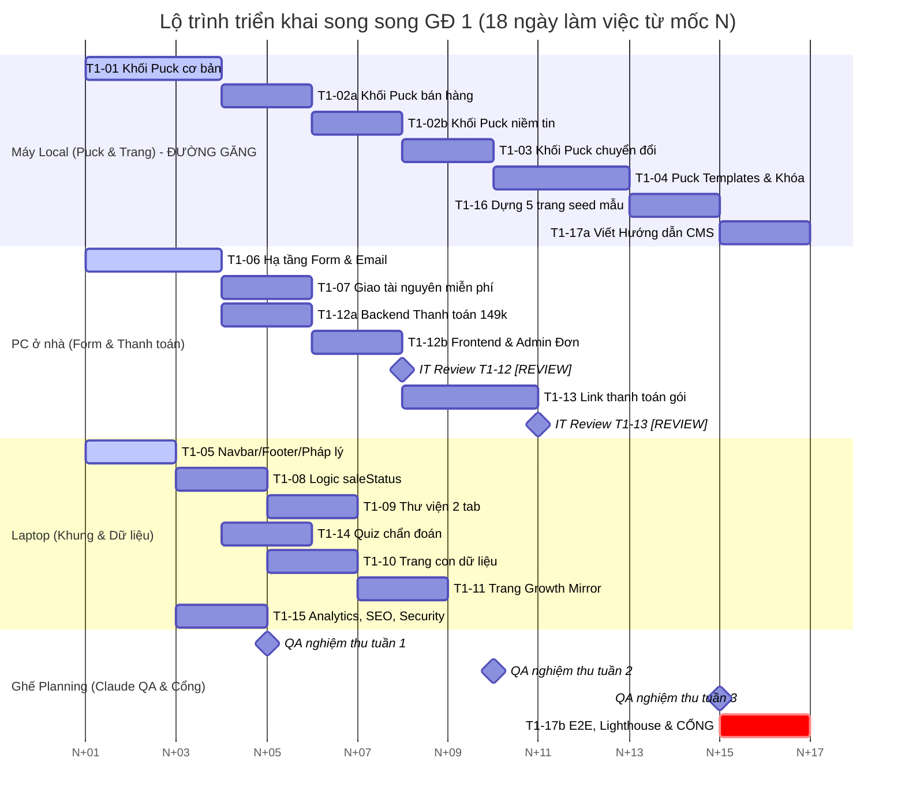

# Ước lượng Giai đoạn 1–4 (ESTIMATES)

> Báo cáo ước lượng kỹ thuật dự án **Trạm Dừng Cảm Xúc** (Task T0-11a / T0-11a-b).  
> Thực hiện: **Antigravity** · Cập nhật: 06/10/2026.  
> Căn cứ thực tế: Dữ liệu đo kiểm `git log`, lịch sử PR merged và biên bản nghiệm thu `docs/tasks/reviews/*.md` từ Giai đoạn 0; quy trình phân vai 3 máy tại `docs/tasks/WORKFLOW.md`; kế hoạch tổng thể `docs/plan/MASTER_PLAN.md` và bảng phân tích `docs/plan/GAPS_AND_QUESTIONS.md`.

---

## 1. Phân tích tốc độ thực tế Giai đoạn 0 (Nền móng)

Dữ liệu được trích xuất trực tiếp từ lịch sử commit, thời gian mở/merge PR và các biên bản nghiệm thu QA của GĐ 0, hoàn toàn không dựa trên con số phỏng đoán.

### 1.1 Bảng đo kiểm thời gian và vòng sửa từng task GĐ 0

| Mã Task | Nội dung | Bắt đầu / Giao việc | Merge PR chính thức | Vòng sửa | Thời gian chu kỳ | Đánh giá vòng đầu |
| --- | --- | --- | --- | :---: | :---: | --- |
| **T0-01** | Khởi tạo repo Next.js + Payload 3 + Postgres | 04/10 09:51 | 04/10 11:24 (`a349a08`) | 2 (T0-01, T0-01b) | 1h 33m | ĐẠT CÓ ĐIỀU KIỆN (sửa `.gitignore`, `.prettierignore`) |
| **T0-02** | CI GitHub Actions, Vitest, Playwright smoke | 04/10 11:24 | 04/10 12:19 (PR #3) | 2 (T0-02, T0-02b) | 55m | CHƯA ĐẠT (CI không chạy trên main, smoke test xanh giả do thiếu migration) |
| **T0-03** | Design tokens, fonts, SVG assets, `/styleguide` | 04/10 12:25 | 04/10 18:19 (PR #3) | 2 (T0-03, T0-03b) | 5h 54m | CHƯA ĐẠT (styleguide lộ trên prod, test bẩn repo, lệch CRLF/LF Windows) |
| **T0-04** | 8 UI primitives, WCAG AA, styleguide demo | 04/10 17:21 | 05/10 10:06 (PR #5) | 2 (T0-04, T0-04b) | ~16h 45m (làm qua đêm, thực làm ~3h) | CHƯA ĐẠT (Modal cướp focus / giật focus, PriceTag tương phản 2.92:1 < 4.5:1) |
| **T0-05** | UI composites (Navbar, Footer, ProgressGrid...) | 05/10 08:47 | 05/10 14:02 (PR #6) | 3 (T0-05, 05b, 05c) | 5h 15m | CHƯA ĐẠT (thiếu `'use client'` gây crash 500, bịa thông tin Footer, font sai, tràn menu 375px) |
| **T0-06** | Collections nội dung, globals, media (Codex) | 05/10 08:47 | 05/10 14:21 (PR #8) | 3 (T0-06, 06b, 06c) | 5h 34m (+ T0-06c bổ sung hôm sau) | CHƯA ĐẠT (slug chưa chuẩn hóa, khóa ngày in QR so chuỗi, test lệch múi giờ UTC+7) |
| **T0-07** | Phân quyền owner/editor, giao dịch `[REVIEW]` | Planning làm trực tiếp | 05/10 19:54 (PR #13) | 1 | ~0,5 h | ĐẠT (Planning làm trực tiếp, chờ IT duyệt review code) |
| **T0-08** | Seed dữ liệu MẪU idempotent cho demo | Planning làm trực tiếp | 05/10 19:31 (PR #12) | 1 | ~0,5 h | ĐẠT (Planning làm trực tiếp) |
| **T0-09** | Tích hợp Puck editor vào admin + 5 khối đầu | 05/10 13:58 | 05/10 18:01 (PR #9, #10) | 4 (spike, 09b, 09c, 09d) | 4h 03m | CHƯA ĐẠT (kéo Payload vào client gây crash 500, gõ tay Media ID, e2e viết mà không chạy, lỗi mất feedback) |
| **T0-10** | Docker demo server riêng + GHCR image | 05/10 12:07 | 05/10 18:18 (PR #11) | 2 (T0-10, T0-10c) | 6h 11m (+ T0-10c CI) | CHƯA ĐẠT (Codex hết quota giữa chừng, lỗi prerender static trang chủ thiếu DB) |

### 1.2 Thống kê tổng hợp tốc độ GĐ 0

- **Thời gian trung bình hoàn thành một task**:
  - Task cấu hình hạ tầng / tài liệu nhỏ: **30 phút – 1.5 giờ**.
  - Task UI hoặc Data Collection trung bình: **3 – 6 giờ**.
  - Task tích hợp phức tạp (Puck editor, Docker production): **4 – 7 giờ** (thường phải tách spike và cần can thiệp phối hợp giữa các agent).
- **Số vòng sửa trung bình**: **2.2 vòng/task**.
  - Hầu như 100% các task lớn đều phải qua vòng sửa `b` để chỉnh sửa các lỗi phát hiện trong bước QA thực tế của Planning.
  - Các task chạm tới kiến trúc tương tác hoặc đa agent (T0-05, T0-06, T0-09) đều trải qua 3–4 vòng (`b`, `c`, `d`).

### 1.3 Năm loại lỗi hay gặp nhất trong GĐ 0 (Bài học xương máu)

1. **E2E viết nhưng không chạy được / Kiểm thử xanh giả**:
   - *Biểu hiện*: T0-02 smoke test xanh giả khi database chưa có bảng; T0-09b Antigravity viết E2E với tài khoản ảo `TdcxAdmin2026!` không tồn tại, id trang ảo, không click kéo thả thật; T0-06 E2E fail khi chạy trên môi trường dev đã có sẵn admin.
   - *Nguyên nhân*: Agent chạy Playwright foreground dễ bị treo terminal hoặc thiếu môi trường trình duyệt thật nên chỉ "viết chay" code test mà không tự kiểm chứng được kết quả.
   - *Giải pháp khắc phục cho GĐ 1*: Tuân thủ nghiêm ngặt `WORKFLOW.md`: Antigravity chỉ viết unit test và viết kịch bản e2e (không chạy Playwright); ghế Planning (Claude) chịu trách nhiệm chạy thực thi e2e trên CI/local để nghiệm thu.

2. **Quên `'use client'` / Lẫn lộn ranh giới Server Component và Client Component**:
   - *Biểu hiện*: T0-05 có 4 components (Navbar, LeadForm, EmotionPicker, ProgressGrid) dùng hook/event handlers nhưng thiếu chỉ thị `'use client'`, gây crash 500 khi import vào Server Component thật; T0-09 `src/puck/config.tsx` vô tình kéo Payload config và `revalidatePath` vào bundle client khiến Next.js crash 500 toàn bộ site; T0-10 prerender crash lúc build Docker vì trang chủ đọc CMS không có database.
   - *Giải pháp khắc phục cho GĐ 1*: Bắt buộc tạo module cô lập `*.server.ts` có `import 'server-only'` cho các logic đọc dữ liệu; **bổ sung (đề xuất)** bộ unit test kiểm tra ranh giới client (`tests/unit/client-boundaries.test.ts` – file chưa tồn tại, đề xuất bổ sung ở đầu GĐ 1 để quét tĩnh ranh giới client/server).

3. **Hardcode nội dung / Bịa dữ liệu mẫu vi phạm nguyên tắc brand & CMS**:
   - *Biểu hiện*: T0-03 gắn cứng giá "149.000đ" trong styleguide; T0-04 bịa trích dẫn của Hana Lương; T0-05 tự đặt thông tin người bán (email, địa chỉ, slogan tự chế) trong Footer và gắn cứng nhãn "Test 5p".
   - *Giải pháp khắc phục cho GĐ 1*: Tuyệt đối không tự bịa dữ liệu thật. Mọi text minh họa phải có tiền tố `[MẪU]`; nếu CMS thiếu dữ liệu thì component tự ẩn khối tương ứng, không được điền giá trị mặc định.

4. **Vi phạm chuẩn tương phản màu (WCAG AA) và quy tắc Layout/Font brand**:
   - *Biểu hiện*: T0-03 nhãn chữ nhỏ `accent-pink` trên `warm-ivory` (3.50:1 < 4.5:1); T0-04 giá gạch ngang `PriceTag` có độ mờ `/45` (2.92:1); T0-05 dùng nhầm `font-serif` thay vì `font-quote` (Playfair) và menu bị tràn ngang ở 375px (x = 462px); T0-09 cho phép chọn màu nền tối làm chìm chữ tiêu đề (1:1).
   - *Giải pháp khắc phục cho GĐ 1*: Mọi lựa chọn màu sắc trong component và Puck editor phải bị giới hạn nghiêm ngặt theo bảng token brand book 2026; nút CTA nền `accent-pink` chỉ dùng cho chữ lớn (≥ 18.66px đậm); nút nhỏ bắt buộc dùng nền `deep-navy`.

5. **Xung đột merge, lệch schema migration và lệch múi giờ (Timezone)**:
   - *Biểu hiện*: T0-05 và T0-06 xung đột merge file `docs/DECISIONS.md`; T0-06 slug không chuẩn hóa dẫn đến trùng URL; T0-06c test kiểm tra ngày in QR bị fail trên máy cài múi giờ UTC+7 do lệch chuyển đổi múi giờ; T0-08 vitest chạy song song đua lệnh `CREATE TABLE` trên DB mới.
   - *Giải pháp khắc phục cho GĐ 1*: Tách quyết định sang các file riêng lẻ `docs/decisions/<MÃ>.md`; áp dụng cơ chế khóa Migration (`🔒 Migration`) trên bảng trạng thái; cấu hình phiên kết nối Postgres và Vitest chạy chuẩn hóa UTC.

---

## 2. Bảng ước lượng 17 task Giai đoạn 1 (T1-01…T1-17)

*Quy ước:*
- **Độ phức tạp**: **S** (< 3h), **M** (3–4.5h), **L** (4.5–6h), **XL** (> 6h hoặc đa module phức tạp).
- **Giờ Antigravity**: Thời gian code và unit test thực tế của agent Antigravity.
- **Giờ QA Claude**: Thời gian ghế Planning (Claude) chạy e2e, kiểm thử màn hình, review và merge.
- **Vùng code & Máy đề xuất**: Phân bổ theo hồ sơ tại `docs/tasks/WORKFLOW.md` mục 3.

| Mã Task | Tên task & Phạm vi tóm tắt | Độ phức tạp | Giờ Antigravity | Vòng sửa dự kiến | Giờ QA Claude | Máy / Vùng code đề xuất | Cần Codex `[REVIEW]`? | Phụ thuộc | Việc chờ bên ngoài & Quyết định liên quan | Rủi ro kỹ thuật chính |
| --- | --- | :---: | :---: | :---: | :---: | --- | :---: | --- | --- | --- |
| **T1-01** | **Khối Puck: Mở đầu, Nội dung, Bố cục** 9 khối: HeroImage, QuoteBlock, StatsBar, JourneySteps, FAQ, VideoEmbed, Columns (nested dropzone), Spacer, Divider. Versioning & snapshot test. | **L** | 5.0h | 2 | 2.0h | **Máy Local** *(Puck & trang)* | Không | T0-09 | Chờ duyệt line-height cho Hero Anton 2 dòng tránh chạm dấu tiếng Việt. | Khối `Columns` lồng nhau (nested zones) trong `@puckeditor/core` dễ lỗi layout; dropdown cỡ chữ/khoảng cách phải khóa chặt token. |
| **T1-02** | **Khối Puck: Bán hàng, Niềm tin** 9 khối: ProductGrid, ProductFeature, PackageComparison, PriceTag, TrialCTA, TestimonialSlider, TestimonialGrid, LogoStrip, HanaStory. Dùng `resolveData` chỉ lưu ID, hook revalidate. | **XL** *(Đề xuất tách)* | 6.5h | 3 | 2.5h | **Máy Local** *(Puck & trang)* | Không | T1-01, T1-08 | Q5 (Hiển thị tổng giá trị & % ưu đãi 3 gói Growth Mirror). | `resolveData` bất đồng bộ trong Puck; hook `afterChange` revalidate cache on-demand khi admin đổi giá; lọc testimonial `consent = true`. |
| **T1-03** | **Khối Puck: Chuyển đổi** 8 khối: CTAButton, LeadForm (chọn tài nguyên), BookingCTA, B2BBriefForm, QuizCTA, ShopeeButton (UTM), ZaloButton, LibraryPreview. Kết nối API forms. | **L** | 4.5h | 2 | 2.0h | **Máy Local** *(Puck & trang)* | Không | T1-02, T1-06 | Q12 (Link Zalo chat), UTM Shopee URL. | Form tương tác nhúng trong canvas Puck dễ gặp lỗi bắt sự kiện (focus trap, propagation) và hydration mismatch. |
| **T1-04** | **Puck: Mẫu trang, versions, khóa khối, autosave** 4 templates JSON trong `puck/templates/`, tích hợp Payload versions & rollback tiếng Việt, Permissions API khóa Hero/Footer trang chủ, undo/redo, clone page, autosave 30s. | **L** | 5.0h | 2 | 2.0h | **Máy Local** *(Puck & trang)* | Không | T1-03 | Đánh giá phản hồi thao tác thực tế từ Hana. | Permissions API của Puck v0.23 có thể hạn chế khi khóa khối con; autosave 30s dễ xảy ra xung đột khi người dùng thao tác nhanh. |
| **T1-05** | **Navbar, Footer, FloatingChat, 6 trang pháp lý** Menu động từ global `navigation`, FloatingChat (safe-area iOS, tự ẩn trên route học/tracker), 6 route pháp lý rich text từ `legalPages`, thông tin `sellerInfo`. | **M** | 3.5h | 2 | 1.5h | **Laptop** *(Khung site & dữ liệu)* | Không | T0-05, T0-06 | Q12 (Link Zalo); Hana cung cấp `sellerInfo` ban đầu. | FloatingChat đè che vùng an toàn hoặc vỡ layout trên iOS Safari; route ẩn chat phải cấu hình tập trung. |
| **T1-06** | **Hạ tầng form + email: lead, coaching, B2B** Server Zod validation, honeypot, rate limit IP/email, Turnstile dev bypass, API `submitLead`, `submitCoachingForm`, `submitB2BBrief`, Resend + React Email, CSV export UTF-8 BOM. | **L** | 5.5h | 2 | 2.5h | **PC ở nhà** *(Form, email, thanh toán)* | Không | T0-07 | D1 (Cấu hình tài khoản Resend & xác thực domain email). | Rate limit và Turnstile ở môi trường dev/CI; mã hóa UTF-8 BOM cho file CSV để Excel mở không lỗi font tiếng Việt. |
| **T1-07** | **Giao tài nguyên miễn phí qua email** Route `/tai-nguyen/[slug]`, form nhận tài nguyên, token ký tải PDF hết hạn 7 ngày (`/api/download/[token]`), redirect tới URL ký của R2/S3. Event analytics. | **M** | 3.5h | 2 | 1.5h | **PC ở nhà** *(Form, email, thanh toán)* | Không | T1-06 | Hana cung cấp ít nhất 1 file PDF ebook/toolkit mẫu. | Bảo mật URL ký: không để lộ link direct của storage R2; kiểm soát hết hạn token và thông báo lỗi thân thiện. |
| **T1-08** | **Logic hiển thị sản phẩm theo `saleStatus`** Hàm thuần `resolveProductCta(product)` trong `src/lib/products.ts`, 6 nhánh trạng thái, kiểm tra `saleEndsAt`, gắn vào `ProductCard`. Lead tag `trial_waitlist`. | **S** | 2.0h | 1 | 1.0h | **Laptop** *(Khung site & dữ liệu)* | Không | T0-06 | GAPS B3 (Quy tắc hiển thị sản phẩm có trial). | Lệch múi giờ khi so sánh thời điểm `saleEndsAt` (phải chuẩn hóa theo múi giờ `Asia/Ho_Chi_Minh`). |
| **T1-09** | **Thư viện `/thu-vien`** 2 tab (Khóa học & Nội dung), bộ lọc topic EQ/Habit/Career, tìm kiếm, đồng bộ trạng thái URL query params (`?tab=&topic=&q=`), vùng Puck intro đầu trang. | **M** | 3.5h | 2 | 1.5h | **Laptop** *(Khung site & dữ liệu)* | Không | T1-08 | Danh mục sản phẩm và bài viết seed đã sẵn sàng. | Tránh lỗi Suspense de-opt khi đọc `useSearchParams` trong Next.js App Router; trải nghiệm mượt mà trên mobile 375px. |
| **T1-10** | **Trang con dữ liệu** Dynamic routes `/coaching/[slug]`, `/doanh-nghiep/[slug]`, `/blog/[slug]`, metadata SEO động, Live Preview Payload CMS, trang 404 thương hiệu. | **M** | 4.0h | 2 | 1.5h | **Laptop** *(Khung site & dữ liệu)* | Không | T1-08 | Hana chuẩn bị dữ liệu mẫu các dịch vụ/chương trình. | Cấu hình Live Preview với iframe postMessage của Payload; tối ưu cache static vs dynamic render. |
| **T1-11** | **Trang Growth Mirror** Route `/coaching/growth-mirror` dùng Puck (`PackageComparison` + `BookingCTA`). CTA duy nhất: "Đặt phiên trải nghiệm 149.000đ". Khóa không có nút mua trực tiếp các gói. | **S** | 2.5h | 1 | 1.0h | **Laptop** *(Khung site & dữ liệu)* | Không | T1-10 | Q5 (Xác nhận hiển thị % ưu đãi và giá trị gạch ngang). | Công thức tính % ưu đãi tự động phía client/server đồng bộ; kiểm tra chặn nút mua trực tiếp. |
| **T1-12** | **Thanh toán thủ công phiên trải nghiệm 149k** `PaymentProvider` interface + `ManualPaymentProvider`. Form đặt phiên + consent terms, tạo order DB server-side, VietQR EMVCo server-side, admin owner xác nhận/hủy, auditLogs, cron 24h, sandbox. | **XL** *(Đề xuất tách)* | 6.5h | 3 | 3.0h | **PC ở nhà** *(Form, email, thanh toán)* | **CÓ [REVIEW]** *(Codex review diff + IT duyệt)* | T1-06 | Hana cung cấp tài khoản ngân hàng nhận VietQR; Q11 (Link đặt lịch booking). | Bảo mật giá: cấm tin giá client gửi lên; race condition khi xác nhận đơn trùng; phân quyền chặt chẽ nút xác nhận (chỉ owner). |
| **T1-13** | **Link thanh toán gói do Hana tạo** Admin owner tạo order chọn khách + gói, sinh `payToken`, trang `/thanh-toan/[payToken]`, khách xem tóm tắt + VietQR, owner xác nhận → `grantEntitlementsForOrder` idempotent. | **L** | 5.0h | 2 | 2.5h | **PC ở nhà** *(Form, email, thanh toán)* | **CÓ [REVIEW]** *(Codex review diff + IT duyệt)* | T1-12 | Q4 (Phí 149k có trừ vào gói?), Q6 (Mở khóa Habit + EQ ngay sau khi mua gói). | Đảm bảo tính idempotent khi cấp entitlement (gọi nhiều lần không trùng); bảo mật `payToken` không đoán mò được. |
| **T1-14** | **Quiz chẩn đoán `/habit/chan-doan`** Mobile-first quiz, đọc `diagnosticQuestions`, thang 1–4, thuật toán `scoreDiagnostic()` xử lý hòa điểm (GAPS B8), lead tag `diagnostic`, hiển thị gợi ý CMS, CTA phiên trải nghiệm. | **M** | 4.0h | 2 | 1.5h | **Laptop** *(Khung site & dữ liệu)* | Không | T1-06 | Hana cung cấp 16 câu hỏi chẩn đoán từ file Excel. | Xử lý hòa điểm theo đúng quy tắc ưu tiên Cue→Craving→Response→Reward; tốc độ làm quiz < 3 phút trên mobile. |
| **T1-15** | **Analytics, SEO, security headers, domain** Helper `track.ts` (union types an toàn), cấu hình GA4/Plausible, metadata, Open Graph, sitemap, robots, CSP/HSTS headers, kết nối domain apex/www trên Vercel. | **M** | 3.5h | 2 | 2.0h | **Laptop** *(Khung site & dữ liệu)* | Không | T1-05 | Q10 (Chọn Plausible hay GA4); D1 (DNS domain thật `tramdungcamxuc.com`). | CSP header quá chặt có thể chặn nhầm iframe editor Puck hoặc Turnstile widget; kiểm tra securityheaders.com đạt điểm A. |
| **T1-16** | **Dựng các trang seed từ mẫu [HANA]** Dựng 5 trang Puck hoàn chỉnh: `/` (4 khối 8.1), `/ve-hana`, `/coaching`, `/coaching/growth-mirror`, `/doanh-nghiep`. Đánh dấu `[MẪU]` nếu chưa có copy thật. | **M** | 3.5h | 1 | 1.5h | **Máy Local** *(Puck & trang)* | Không | T1-04, T1-10, T1-11 | Hana cung cấp copy chính thức cho 5 trang. | Đảm bảo đúng chuẩn responsive 375px và 1440px; Hana có thể vào trực tiếp editor kéo sửa mà không vỡ bố cục. |
| **T1-17** | **QA tổng, E2E, Lighthouse, hướng dẫn CMS bản 1** Toàn bộ test Playwright luồng GĐ 1, audit Lighthouse mobile ≥ 90, axe a11y, soạn thảo `docs/HUONG_DAN_CMS.md` có ảnh chụp thực tế, nghiệm thu cổng GĐ 1. | **XL** *(Đề xuất tách)* | 4.0h | 2 | 6.0h | **Ghế Planning** *(Claude QA chính)* | Không | Tất cả task GĐ 1 | Hana trực tiếp thực hiện bài test nghiệm thu cổng. | Playwright flakiness trên môi trường CI; tối ưu font và ảnh để đạt điểm Lighthouse mobile ≥ 90. |

### Tổng thời gian Giai đoạn 1 theo bảng 17 task gốc

- **Tổng giờ Antigravity code & unit test (17 task)**: **72,0 giờ**  
  *(Cộng chi tiết: 5.0 + 6.5 + 4.5 + 5.0 + 3.5 + 5.5 + 3.5 + 2.0 + 3.5 + 4.0 + 2.5 + 6.5 + 5.0 + 4.0 + 3.5 + 3.5 + 4.0 = 72,0 h)*
- **Tổng giờ QA Claude / Planning nghiệm thu & E2E (17 task)**: **35,5 giờ**  
  *(Cộng chi tiết: 2.0 + 2.5 + 2.0 + 2.0 + 1.5 + 2.5 + 1.5 + 1.0 + 1.5 + 1.5 + 1.0 + 3.0 + 2.5 + 1.5 + 2.0 + 1.5 + 6.0 = 35,5 h)*

---

## 3. Đề xuất tách và gộp task Giai đoạn 1

Từ bài học thực tế ở GĐ 0 (task kéo dài quá 6 giờ dẫn đến quá tải bộ nhớ context của agent, dễ bỏ sót quy tắc ranh giới Server/Client và tăng số vòng sửa lỗi), khuyến nghị **tách 3 task quá lớn** sau đây:

### 3.1 Tách T1-02 thành T1-02a và T1-02b
- **Lý do**: T1-02 gồm tới 9 khối UI vừa chứa logic lấy dữ liệu động (`ProductGrid`, `PackageComparison`) vừa chứa các khối visual thương hiệu (`TestimonialSlider`, `HanaStory`), đồng thời phải xây dựng hook revalidate cache.
- **Phương án tách**:
  - **T1-02a (Khối Puck Bán hàng)**: `ProductGrid`, `ProductFeature`, `PackageComparison`, `PriceTag`, `TrialCTA` + cơ chế `resolveData` chỉ lưu ID cho sản phẩm. *(Độ phức tạp: M – 3.5h Antigravity, 1.5h QA)*.
  - **T1-02b (Khối Puck Niềm tin & Revalidate)**: `TestimonialSlider`, `TestimonialGrid` (lọc `consent=true`), `LogoStrip`, `HanaStory` + hook `afterChange` tự động revalidate trang khi đổi dữ liệu trong Payload. *(Độ phức tạp: M – 3.0h Antigravity, 1.0h QA)*.
  - *Cộng nhóm T1-02*: **6.5h Antigravity, 2.5h QA Claude**.

### 3.2 Tách T1-12 thành T1-12a và T1-12b
- **Lý do**: T1-12 là task tài chính có nhãn **`[REVIEW]`**, bao gồm cả thiết kế kiến trúc thanh toán trừu tượng, tích hợp thuật toán sinh mã chuẩn EMVCo VietQR, form đặt phiên người dùng và giao diện quản trị duyệt đơn cho admin. Dồn vào một lượt làm sẽ khiến việc review an toàn tài chính bị loãng.
- **Phương án tách**:
  - **T1-12a (Backend Thanh toán & VietQR Server - `[REVIEW]`)**: Interface `PaymentProvider`, `ManualPaymentProvider`, server action tạo đơn với giá DB server, thư viện sinh VietQR chuẩn EMVCo phía server, cron kiểm tra đơn quá hạn 24h. *(Độ phức tạp: M – 4.0h Antigravity, 1.5h QA) ➔ Cần Codex review diff + IT duyệt*.
  - **T1-12b (Frontend Đặt phiên & Quản trị Duyệt đơn)**: Form UI đặt lịch kèm ô tick chấp thuận điều khoản pháp lý, trang thanh toán hiển thị VietQR `/thanh-toan/don/[id]`, nút duyệt đơn thủ công / hủy đơn chỉ dành cho `owner` trong admin Payload, ghi nhận `auditLogs`. *(Độ phức tạp: M – 3.0h Antigravity, 1.5h QA)*.
  - *Cộng nhóm T1-12*: **7.0h Antigravity, 3.0h QA Claude** *(tăng 0.5h AG do chi phí thiết lập và phân tách ngữ cảnh)*.

### 3.3 Tách T1-17 thành T1-17a và T1-17b
- **Lý do**: T1-17 vừa có phần viết tài liệu hướng dẫn người dùng (Hana), vừa có phần kỹ thuật nặng về chạy E2E Playwright và audit hiệu năng.
- **Phương án tách**:
  - **T1-17a (Tài liệu Hướng dẫn CMS bản 1 & Checklist Hana)**: Antigravity soạn thảo `docs/HUONG_DAN_CMS.md` có cấu trúc đầy đủ, chụp màn hình minh họa các bước (tạo sản phẩm, kéo thả trang, xuất bản, xuất CSV lead), chuẩn bị checklist nghiệm thu. *(Độ phức tạp: M – 3.5h Antigravity, 1.0h QA)*.
  - **T1-17b (Bộ kiểm thử E2E, Lighthouse & Cổng GĐ 1)**: Claude chạy toàn bộ bộ test Playwright trên CI, tối ưu điểm Lighthouse mobile ≥ 90, chạy kiểm tra accessibility (axe), chốt biên bản nghiệm thu cổng. Chỉ bắt đầu sau khi T1-16 và T1-17a đã hoàn thành. *(Độ phức tạp: L – 1.0h Antigravity hỗ trợ fix, 5.0h Claude QA)*.
  - *Cộng nhóm T1-17*: **4.5h Antigravity, 6.0h QA Claude** *(tăng 0.5h AG do tách tài liệu riêng)*.

### 3.4 Tổng thời gian Giai đoạn 1 sau khi tách task (20 task)

- **Tổng giờ Antigravity code & unit test**: **73,0 giờ**  
  *(14 task giữ nguyên: 55.0h + T1-02a/b: 6.5h + T1-12a/b: 7.0h + T1-17a/b: 4.5h = 73,0 h)*
- **Tổng giờ QA Claude / Planning nghiệm thu & E2E**: **35,5 giờ**  
  *(14 task giữ nguyên: 24.0h + T1-02a/b: 2.5h + T1-12a/b: 3.0h + T1-17a/b: 6.0h = 35,5 h)*

---

## 4. Kế hoạch và Lịch chạy song song 3 máy cho Giai đoạn 1

### 4.1 Các giả định cơ bản (giả định)
1. *(giả định)* **Mốc khởi đầu N**: Toàn bộ tiến độ Giai đoạn 1 bắt đầu từ ngày cổng GĐ 0 đạt (ký hiệu là mốc **N**). Mọi mốc thời gian bên dưới được tính theo **N + x ngày làm việc**.
2. *(giả định)* **Công suất làm việc**: Mỗi ngày làm việc, Antigravity trên mỗi máy hoạt động hiệu dụng **3.0 – 4.0 giờ** (đảm bảo chia nhỏ commit, không chạy quá dài gây treo context).
3. *(giả định)* **Thời gian IT review**: Anh IT hỗ trợ cam kết review các PR nhạy cảm `[REVIEW]` (T1-12a, T1-13) trong vòng **≤ 2 ngày làm việc** (theo D4).
4. *(giả định)* **Đầu vào từ Hana**: Hana cung cấp các nội dung (copy, tài khoản ngân hàng, thông tin pháp lý) theo đúng mốc thời gian quy định tại mục 6.
5. *(giả định)* **Ghế Planning**: Claude xử lý nghiệm thu PR và merge trong vòng 1–2 giờ sau khi PR chuyển trạng thái Ready for review.

### 4.2 Phân tích Đường găng (Critical Path)

Theo bảng phụ thuộc trong `docs/tasks/GD1.md`:
- Task `T1-03` phụ thuộc vào `T1-02` và `T1-06`, **hoàn toàn không phụ thuộc** vào luồng thanh toán `T1-12` hay `T1-13`.
- Do đó, **Đường găng thực tế của Giai đoạn 1 chính là chuỗi Puck trên Máy Local**:
  $$\mathbf{T1-01} \longrightarrow \mathbf{T1-02a} \longrightarrow \mathbf{T1-02b} \longrightarrow \mathbf{T1-03} \longrightarrow \mathbf{T1-04} \longrightarrow \mathbf{T1-16} \longrightarrow \mathbf{T1-17b \text{ (Cổng GĐ 1)}}$$
  Chuỗi này diễn ra liên tục, tuần tự trên Máy Local với tổng thời gian làm việc ~30h AG và yêu cầu khoảng **16–18 ngày làm việc**, quyết định ngày về đích của toàn bộ giai đoạn.
- **Nhánh song song thanh toán trên PC ở nhà** (`T1-06` ➔ `T1-12a` ➔ `T1-12b` ➔ `T1-13`) có tổng thời gian kỹ thuật ngắn hơn (~17.5h AG), nhưng là nhánh mang **rủi ro tiến độ lớn nhất do thời gian chờ IT review** code `[REVIEW]` (T1-12a và T1-13 cần Codex review diff và IT duyệt ≤ 2 ngày làm việc). Nếu IT chậm duyệt, nhánh thanh toán có thể biến thành đường găng phụ.

### 4.3 Sơ đồ điều phối song song 3 máy theo mốc ngày làm việc (N + x)

> **Quy ước**: **N** là ngày cổng GĐ 0 đạt. Tiến độ được tính theo **18 ngày làm việc** (~3.5 – 4 tuần).  
> Giả định tuần làm việc 5 ngày:  
> - **Tuần 1**: Ngày N+1 đến N+5  
> - **Tuần 2**: Ngày N+6 đến N+10  
> - **Tuần 3**: Ngày N+11 đến N+15  
> - **Tuần 4**: Ngày N+16 đến N+18 (Nghiệm thu cổng)

*(Ghi chú biểu đồ Gantt: Trục thời gian mô phỏng tương đối 18 ngày làm việc liên tục từ ngày N+1 đến N+18. T1-17b bắt đầu sau khi T1-16 hoàn thành).*

#### Chi tiết tiến độ theo mốc ngày làm việc

- **Tuần 1 (Ngày N+1 đến N+5): Khởi động 3 máy độc lập – Dựng khung nền móng GĐ 1**
  - **Máy Local**: Thực hiện `T1-01` (Khối Puck Mở đầu, Nội dung, Bố cục – N+1 đến N+3) ➔ `T1-02a` (Khối Puck Bán hàng – N+4 đến N+5).
  - **PC ở nhà**: Thực hiện `T1-06` (Hạ tầng forms, Zod, Turnstile, Resend, React Email, Export CSV – N+1 đến N+3) ➔ `T1-07` (Giao tài nguyên miễn phí – N+4 đến N+5).
  - **Laptop**: Thực hiện `T1-05` (Navbar, Footer, FloatingChat, 6 trang pháp lý – N+1 đến N+2) ➔ `T1-08` (Logic `saleStatus` – N+3 đến N+4) ➔ Bắt đầu `T1-09` (Thư viện 2 tab – N+5).
  - *Mục tiêu cuối tuần 1 (N+5)*: Merge T1-01, T1-05, T1-06, T1-07, T1-08; sẵn sàng API forms và các khối cơ bản.

- **Tuần 2 (Ngày N+6 đến N+10): Mở rộng khối Puck, Thư viện, Quiz & Thanh toán phiên trải nghiệm**
  - **Máy Local**: Thực hiện `T1-02b` (Khối Puck Niềm tin & Revalidate – N+6 đến N+7) ➔ `T1-03` (Khối Puck Chuyển đổi – N+8 đến N+9; cần T1-02b và T1-06) ➔ Bắt đầu `T1-04` (Puck Templates – N+10).
  - **PC ở nhà**: Bắt đầu `T1-12a` (Backend Thanh toán 149k `[REVIEW]` – N+6 đến N+7) ➔ `T1-12b` (Frontend Đặt phiên & Admin Đơn hàng – N+8 đến N+9) ➔ Mở PR để Codex review diff và IT duyệt (N+10).
  - **Laptop**: Hoàn tất `T1-09` (Thư viện 2 tab – N+6) ➔ `T1-14` (Quiz chẩn đoán `/habit/chan-doan` – N+7 đến N+8) ➔ `T1-10` (Trang con dữ liệu – N+9 đến N+10).
  - *Mục tiêu cuối tuần 2 (N+10)*: Merge T1-02b, T1-03, T1-09, T1-10, T1-14; hoàn thành code T1-12 chuyển IT review.

- **Tuần 3 (Ngày N+11 đến N+15): Hoàn thiện Puck, Dựng trang mẫu & Link thanh toán gói**
  - **PC ở nhà**: Sau khi IT duyệt T1-12 ➔ Thực hiện `T1-13` (Link thanh toán gói do Hana tạo `[REVIEW]` – N+11 đến N+13) ➔ Mở PR chuyển IT duyệt (N+14 đến N+15).
  - **Laptop**: Thực hiện `T1-11` (Trang Growth Mirror – N+11 đến N+12; cần T1-10) ➔ `T1-15` (Analytics, SEO, Security headers, kết nối domain – N+13 đến N+14).
  - **Máy Local**: Hoàn tất `T1-04` (Puck Templates, Permissions, Autosave – N+11 đến N+12) ➔ `T1-16` (Dựng 5 trang seed mẫu – N+13 đến N+14; cần T1-04, T1-10, T1-11) ➔ `T1-17a` (Soạn hướng dẫn CMS bản 1 – N+15 đến N+16).
  - *Mục tiêu cuối tuần 3 (N+15)*: Hoàn thành toàn bộ giao diện 5 trang, hoàn thành cấu hình hạ tầng và bảo mật, hoàn tất PR T1-13.

- **Tuần 4 (Ngày N+16 đến N+18): QA Tổng, E2E & Nghiệm thu Cổng GĐ 1**
  - **Máy Local**: Hoàn tất `T1-17a` (Hướng dẫn CMS bản 1 kèm ảnh chụp màn hình).
  - **Ghế Planning**: Thực hiện `T1-17b` (Chạy toàn bộ Playwright test trên CI, audit Lighthouse mobile ≥ 90, kiểm tra accessibility axe – N+16 đến N+18).
  - **Ngày N+18**: Tổ chức phiên nghiệm thu Cổng GĐ 1 cùng Hana (Hana tự tạo 1 landing chiến dịch, sửa nội dung, xuất CSV lead mà không cần hỗ trợ).
  - *Kết quả*: Hoàn thành toàn bộ tiêu chí cổng GĐ 1 sau **18 ngày làm việc** kể từ N.

---

## 5. Ước lượng thô các Epic Giai đoạn 2–4

Căn cứ vào danh mục epic tại `docs/plan/MASTER_PLAN.md` mục 5, dưới đây là ước lượng thời gian và các rào cản quyết định đối với từng epic:

### 5.1 Giai đoạn 2 – Web 2 Habit MVP (~10 Epic)

| Mã Epic | Tên Epic & Phạm vi | Ước lượng | Trạng thái rào cản & Quyết định chờ |
| --- | --- | :---: | --- |
| **E2-1** | **Customer OTP login** (`/tai-khoan`) Collection `otpCodes` ẩn, rate limit, gửi OTP 6 số qua email, session auth. `[REVIEW]` | ~12h | Sẵn sàng triển khai kỹ thuật sau GĐ 1. |
| **E2-2** | **Entitlement service** Trial 21 ngày, hết hạn, trial→active, chặn trial lần 2, kế thừa logic từ T1-13. `[REVIEW]` | ~8h | Sẵn sàng (tái sử dụng cấu trúc từ GĐ 1). |
| **E2-3** | **Cổng thanh toán tự động (payOS / SePay)** Đăng ký webhook provider, xác thực chữ ký số, xử lý idempotent. `[REVIEW]` | ~14h | ⚠️ **BỊ CHẶN BỞI QUYẾT ĐỊNH Q8**: Hana và IT phải chốt hình thức kinh doanh (cá nhân/hộ kinh doanh) và tài khoản nhận tiền. |
| **E2-4** | **Checkout công cụ số tự động** Checkout tự động mở khóa Habit Tracker, webhook khớp tiền, đổi CTA quiz sang dùng thử. `[REVIEW]` | ~10h | Phụ thuộc E2-3. |
| **E2-5** | **Habit Loop 5 phút** Wizard 4 bước theo file Excel + trang offer `/habit/1-percent-better`. | ~12h | Cần nội dung 11 kỹ thuật và 16 tình huống thật từ file Excel của Hana. |
| **E2-6** | **Hệ thống Video bảo vệ & Dashboard học** Player video dùng link ký (signed URL), dashboard `/habit/hoc`, ghi nhận tiến độ ≥ 80%. | ~14h | ⚠️ **BỊ CHẶN BỞI QUYẾT ĐỊNH Q9**: Phải chốt nhà cung cấp video (Bunny Stream hay Cloudflare Stream). |
| **E2-7** | **Tracker 21 ngày & Cron nhắc nhở** Lưới tracker 21 ngày, logic lỡ nhịp, Vercel Cron nhắc lịch ngày 18, 21 và khi lỡ 2 ngày. | ~14h | Q14 (Chốt bộ icon và tên cảm xúc chuẩn). |
| **E2-8** | **Chứng nhận 21 ngày** Sinh ảnh `next/og` (4:5, 9:16), trang công khai `/chung-nhan/[code]`, bảo mật thông tin nhạy cảm. | ~10h | Kiểm tra font Anton có dấu tiếng Việt trong `next/og`. |
| **E2-9** | **Lịch Workshop** Collection `workshops`, lọc theo người mua gói, email nhắc lịch tự động trước 24h. | ~6h | Sẵn sàng (GAPS A1). |
| **E2-10** | **Kiểm thử E2E Playwright luồng Habit** Luồng đăng ký → trial → mua → học video → check-in tracker → nhận chứng nhận. | ~8h | Do Claude QA thực hiện. |

*Tổng thời gian dự kiến Giai đoạn 2*: **~108 giờ làm việc agent (~3.5 – 4.5 tuần thực tế)**.

---

### 5.2 Giai đoạn 3 – Web 3 EQ Buddy (~7 Epic)

| Mã Epic | Tên Epic & Phạm vi | Ước lượng | Trạng thái rào cản & Ghi chú |
| --- | --- | :---: | --- |
| **E3-1** | **Luồng rút thẻ EQ 5 bước** Lọc theo cảm xúc / chủ đề / ngẫu nhiên, hiệu ứng lật thẻ 3D nhẹ, hỗ trợ `prefers-reduced-motion`. | ~10h | Cần bộ 26 thẻ EQ nội dung thật. |
| **E3-2** | **Trang thẻ QR công khai** Route `/eq-buddy/the/[qrSlug]`, logic khóa cứng `qrSlug` khi thẻ đã đánh dấu in (`printedAt`). | ~6h | Kế thừa logic bảo vệ từ T0-06. |
| **E3-3** | **Cơ chế Gating truy cập** Thẻ đầu miễn phí; rút tiếp yêu cầu dùng thử 21 ngày (tái dùng entitlement service của GĐ 2). | ~6h | Phụ thuộc E2-2. |
| **E3-4** | **Lưu thẻ & Nhật ký Reflection** Lưu thẻ yêu thích, ghi chép suy nghĩ cá nhân (bảo mật nghiêm ngặt dữ liệu nhạy cảm). | ~6h | Tuân thủ quy định bảo vệ dữ liệu NĐ 13. |
| **E3-5** | **Ảnh chia sẻ mạng xã hội & Khối Upsell** Sinh ảnh `next/og` tỷ lệ 4:5 và 9:16 cho thông điệp thẻ; khối gợi ý offer liên quan. | ~8h | Template đồ họa theo brand book. |
| **E3-6** | **Nút mua thẻ Shopee & UTM tracking** Nút mở gian hàng Shopee ở tab mới kèm UTM, ghi nhận analytics `external_clicked`. | ~3h | Đã có primitive sẵn từ T1-08. |
| **E3-7** | **Công cụ xuất mã QR in ấn** Action xuất danh sách QR phục vụ in bộ thẻ vật lý (file CSV + file ảnh PNG chuẩn nét). | ~6h | Sẵn sàng. |

*Tổng thời gian dự kiến Giai đoạn 3*: **~45 giờ làm việc agent (~1.5 – 2 tuần thực tế)**.

---

### 5.3 Giai đoạn 4 – Mở rộng (~5 Epic)

| Mã Epic | Tên Epic & Phạm vi | Ước lượng | Ghi chú |
| --- | --- | :---: | --- |
| **E4-1** | **Tự động hóa thanh toán gói Growth Mirror** Thanh toán gói tự động qua webhook, tự động cấp quyền cộng đồng private và lịch workshop. | ~10h | Phụ thuộc hệ thống webhook GĐ 2. |
| **E4-2** | **Chuỗi email nuôi dưỡng tự động (Lead Nurturing)** Automation gửi chuỗi email giá trị sau khi khách tải tài nguyên miễn phí. | ~8h | Thiết kế kịch bản email cùng Hana. |
| **E4-3** | **Hệ thống mã giảm giá (Discount Codes)** Collection `discountCodes` (% hoặc số tiền cố định, giới hạn lượt dùng, áp dụng tại checkout). | ~8h | Sẵn sàng. |
| **E4-4** | **Đề xuất kỹ thuật giải pháp B2B Tracker** Soạn thảo tài liệu kiến trúc kỹ thuật B2B (không code) cho đội ngũ doanh nghiệp. | ~4h | Phối hợp cùng BA/Planning. |
| **E4-5** | **Hardening hệ thống & Tối ưu chuyển đổi** Tối ưu hiệu năng, bảo mật, vá lỗi dựa trên số liệu analytics và phản hồi sau 4 tuần chạy thật. | ~10h | Dựa trên dữ liệu thực tế. |

*Tổng thời gian dự kiến Giai đoạn 4*: **~40 giờ làm việc agent (~1.5 tuần thực tế)**.

---

## 6. Danh sách đầu vào Hana & IT xếp theo hạn chót (Mốc N + x)

Để đảm bảo đường găng Giai đoạn 1 không bị gián đoạn, danh sách đầu vào từ Hana và IT được sắp xếp theo trình tự ngày làm việc cụ thể kể từ ngày N (ngày cổng GĐ 0 đạt):

| Hạn chót | Đầu vào cần cung cấp | Người phụ trách | Chặn task nào | Chi tiết yêu cầu |
| --- | --- | :---: | :---: | --- |
| **Ngày N+1** | **Tài khoản Resend & Cấu hình Domain Email** | **IT (D1)** | **T1-06** | API key Resend, cấu hình DNS (SPF/DKIM) cho domain gửi mail `tramdungcamxuc.com`. |
| **Ngày N+1** | **Thông tin người bán `sellerInfo`** | **Hana** | **T1-05** | Tên hộ kinh doanh/cá nhân, MST (nếu có), địa chỉ, SĐT, email để hiển thị ở Footer và trang pháp lý. |
| **Ngày N+1** | **Đường dẫn chat Zalo chính thức (Q12)** | **Hana** | **T1-05** | Link Zalo OA hoặc Zalo cá nhân dùng cho nút FloatingChat. |
| **Ngày N+3** | **File PDF Ebook / Toolkit mẫu** | **Hana** | **T1-07** | Ít nhất 1 file tài liệu hoàn chỉnh để kiểm tra luồng tạo link tải có thời hạn qua email. |
| **Ngày N+5** | **16 câu hỏi quiz chẩn đoán** | **Hana** | **T1-14** | Nội dung các câu hỏi và gợi ý rich text từ sheet "Khảo sát trì hoãn" trong file Excel. |
| **Ngày N+6** | **Thông tin tài khoản ngân hàng VietQR** | **Hana** | **T1-12a** | Ngân hàng (mã BIN), số tài khoản, tên chủ tài khoản nhận thanh toán phiên 149k. |
| **Ngày N+6** | **Đường dẫn đặt lịch coaching (Q11)** | **Hana** | **T1-12b** | Link Cal.com hoặc Google Calendar booking gửi trong email xác nhận sau khi duyệt đơn. |
| **Ngày N+7** | **Quyết định hiển thị ưu đãi 3 gói (Q5)** | **Hana** | **T1-02a, T1-11** | Xác nhận giữ mặc định: hiển thị "Tổng giá trị" và "% ưu đãi", dùng `unitValue` 1.000.000đ cho coaching. |
| **Ngày N+10** | **Review kỹ thuật code thanh toán `[REVIEW]` (D4)** | **IT** | **T1-12** | Duyệt diff PR của T1-12 trong vòng ≤ 2 ngày làm việc để kịp mở nhánh T1-13. |
| **Ngày N+11** | **Quyết định trừ phí trial (Q4) & Cấp quyền (Q6)** | **Hana** | **T1-13** | Xác nhận mặc định: `trialCreditApplies = false`; mua gói tự động cấp quyền 2 công cụ số. |
| **Ngày N+12** | **Lựa chọn dịch vụ Analytics (Q10)** | **Hana + IT** | **T1-15** | Chốt lựa chọn: GA4 hay Plausible (Planning khuyến nghị Plausible để tránh cookie theo NĐ 13). |
| **Ngày N+13** | **Copy thật cho 5 trang Puck chính** | **Hana** | **T1-16** | Nội dung thông điệp trang chủ 2 lối vào, giới thiệu Về Hana, dịch vụ Coaching, Doanh nghiệp. |
| **Ngày N+16** | **Nội dung 6 trang pháp lý hoàn chỉnh** | **Hana** | **T1-17, Cổng GĐ 1** | Soạn thảo chính thức: điều khoản dịch vụ, chính sách bảo mật, thanh toán không hoàn tiền... |
| **Trước Giai đoạn 2** | **Chốt Cổng thanh toán (Q8) & Dịch vụ Video (Q9)** | **Hana + IT** | **E2-3, E2-6** | Quyết định pháp nhân đăng ký payOS/SePay và mở tài khoản Bunny Stream/Cloudflare Stream. |

---

## 7. Rủi ro lớn nhất và Giải pháp giảm thiểu

### Rủi ro 1: Lỗi bảo mật và sai lệch tài chính trong các module `[REVIEW]` (T1-12, T1-13)
- **Nguy cơ**: Form đặt phiên và tạo đơn gói có thể bị giả mạo giá gửi từ client; xử lý duyệt đơn bị duplicate; phân quyền lỏng lẻo cho phép editor duyệt đơn hoặc đọc log thanh toán; lộ token thanh toán `payToken`.
- **Giải pháp giảm thiểu**:
  - *Kiểm soát kiến trúc*: Giá bán bắt buộc được truy vấn trực tiếp từ database phía server (`orders.subtotal`), tuyệt đối không tin cậy dữ liệu giá gửi từ trình duyệt.
  - *Quy trình Review kép*: Áp dụng nghiêm ngặt quy trình: Antigravity lập trình và bổ sung unit test ➔ Codex thực hiện review chuyên sâu diff `[REVIEW]` ➔ Anh IT hỗ trợ xem xét và chấp thuận bằng văn bản trước khi Planning bấm merge.
  - *Kiểm tra tính Idempotent*: Viết unit test chứng minh hàm `grantEntitlementsForOrder` khi gọi lặp lại 2 lần liên tiếp không cấp trùng entitlement.

### Rủi ro 2: Lỗi hydration, crash Server Component và lộ dữ liệu nhạy cảm
- **Nguy cơ**: Agent lập trình vô tình import thư viện server (`payload`, `next/cache`, `revalidatePath`) vào các file client component hoặc quên `'use client'` khi sử dụng hooks; dữ liệu cảm xúc hoặc nhật ký reflection bị vô tình gửi vào analytics bên thứ ba.
- **Giải pháp giảm thiểu**:
  - **Bổ sung (đề xuất)** bộ unit test kiểm tra ranh giới client (`tests/unit/client-boundaries.test.ts` – file chưa tồn tại, đề xuất bổ sung ở đầu GĐ 1): quét toàn bộ `src/components/**` phát hiện các hàm có hooks mà thiếu `'use client'`; chặn tuyệt đối việc import module server trong `src/puck/config.tsx`.
  - Bộ định nghĩa sự kiện analytics `track.ts` sử dụng strict TypeScript union types, chặn hoàn toàn việc truyền các trường dữ liệu nhạy cảm vào payload analytics.

### Rủi ro 3: Trễ tiến độ do phụ thuộc vào đầu vào của Hana và thời gian IT review
- **Nguy cơ**: Hana bận rộn chưa kịp soạn thảo copy hoặc nội dung pháp lý; IT hỗ trợ chưa sắp xếp được thời gian review các PR `[REVIEW]`, gây tắc nghẽn toàn bộ nhánh thanh toán tại T1-12 và T1-13.
- **Giải pháp giảm thiểu**:
  - *Nguyên tắc "Mock/Sample First"*: Mọi trang và component đều được code hoàn chỉnh với dữ liệu mẫu có cờ `isSample = true` và nhãn `[MẪU]`. Việc thiếu copy thật không làm dừng tiến độ kỹ thuật.
  - *Tách nhỏ task*: Tách T1-12 thành phần logic backend (T1-12a) và phần giao diện (T1-12b) để việc review code backend có thể tiến hành độc lập trong khi giao diện vẫn tiếp tục được hoàn thiện.
  - *Theo dõi deadline chặt chẽ*: Sử dụng danh sách hạn chót tại mục 6 để nhắc nhở và cập nhật trạng thái đầu vào định kỳ.
